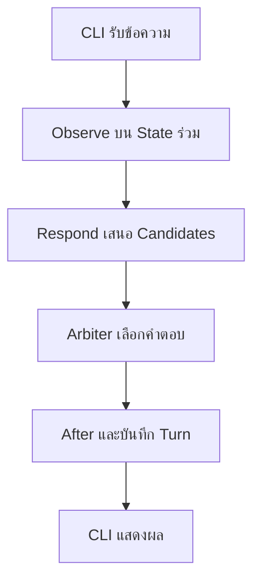
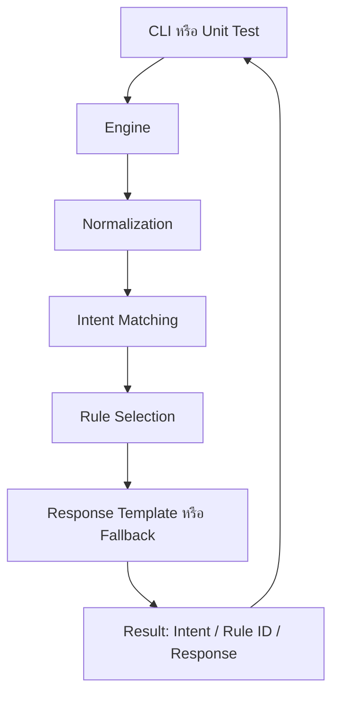
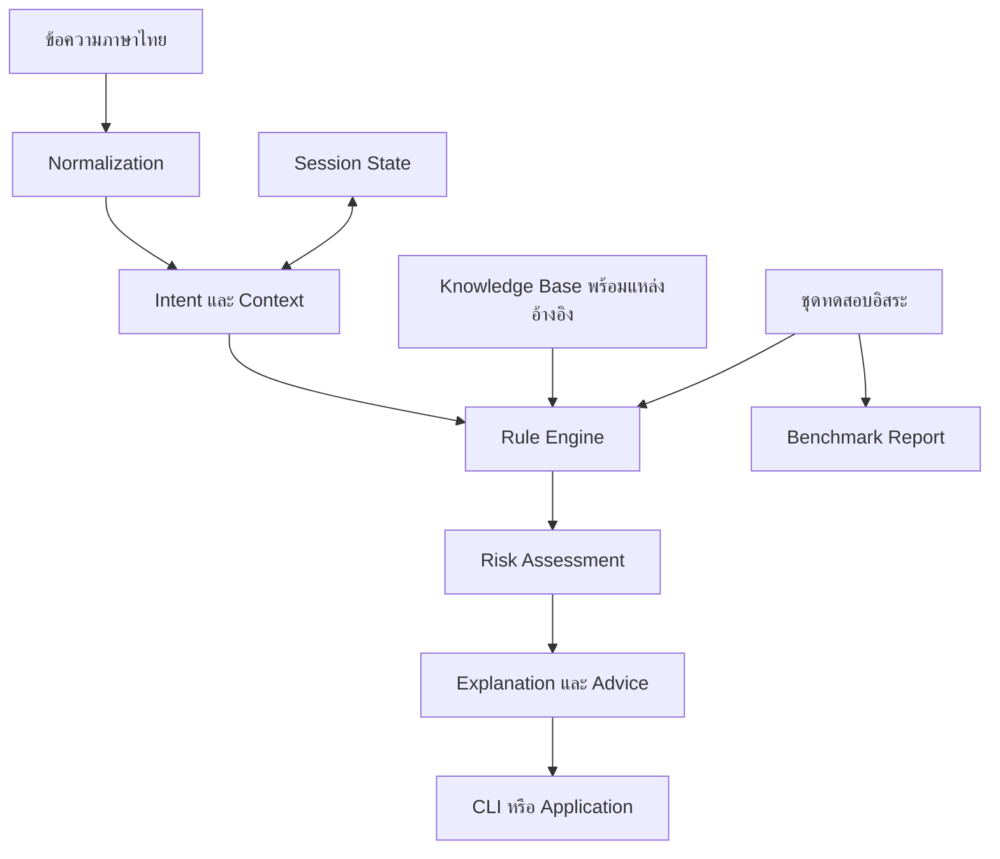
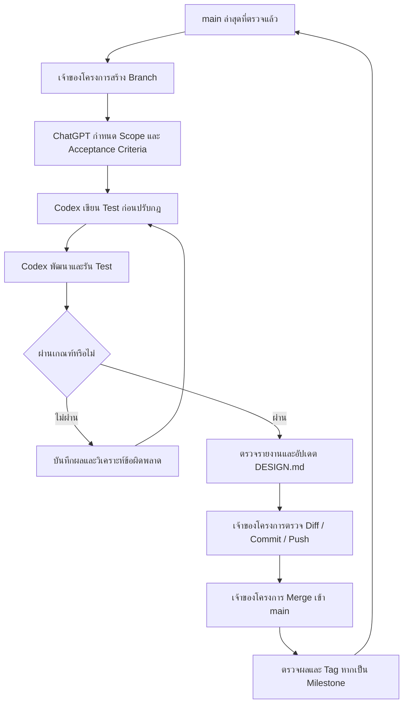

# DESIGN — Thai Rule-based Anti-Scam AI

> เอกสารกลางสำหรับการออกแบบ แผนพัฒนา และประวัติการทดลองของโครงการจบ  
> ฉบับเอกสาร: 0.2 (ปรับสถานะ Repository และ Adaptive Roadmap) | วันที่: 27 พฤศจิกายน 2569 (2026-11-27)  
> สถานะ AI: ยังไม่มี Implementation หรือ Benchmark; มี Local Repository ตามภาพที่เจ้าของโครงการส่ง  
> Repository: `thai-anti-scam-ai` (ชื่อที่เจ้าของโครงการเลือก); ชื่อทางการของงานวิจัยยังไม่สรุป

## 1. วัตถุประสงค์และขอบเขต

พัฒนา Rule-based AI ภาษาไทยด้วย Python ขึ้นเอง เพื่อจำแนกเจตนา ทำความเข้าใจบริบท ตรวจจับสัญญาณความเสี่ยงจากการหลอกลวง อธิบายเหตุผล และแนะนำวิธีป้องกัน โดยไม่ใช้ LLM เป็นแกนประมวลผลขณะทำงาน ใช้ Codex เป็นเครื่องมือช่วยพัฒนาเท่านั้น

โครงการมีสองส่วน: (1) AI Engine เป็นผลงานหลัก (2) Application ที่นำ AI ไปใช้งานจริงเมื่อผ่านเกณฑ์ที่ตกลงกับอาจารย์แล้ว รูปแบบผลิตภัณฑ์ยังไม่กำหนด

คำถามวิจัยเบื้องต้น: การปรับปรุงกฎและการประมวลผลภาษาไทยแบบวนซ้ำเพิ่มความถูกต้องในการจำแนกเจตนาและความเสี่ยงได้เพียงใด ภายใต้ข้อจำกัดด้านทรัพยากรและความสามารถในการอธิบายผล

| ประเด็น | สถานะ |
| --- | --- |
| แนวคิดพัฒนา AI เองเพื่อป้องกันการหลอกลวง | ได้รับความเห็นชอบจากอาจารย์ 27 พ.ย. 2569 |
| Python, Rule-based, Terminal, Automated Test, Codex, ศึกษา PyBot | แนวทางโครงการตาม PROJECT_CONTEXT.md |
| Git โดยเจ้าของโครงการเท่านั้น และพัฒนาทีละ Branch | ข้อตกลงการทำงานกับเจ้าของโครงการ |
| DESIGN.md ภาษาไทย ยกเว้นศัพท์เทคนิค และบันทึก History ตาม Branch | ข้อตกลงการทำงานกับเจ้าของโครงการ |
| โครงสร้าง Branch, สถาปัตยกรรมย่อย, Acceptance Criteria ในเอกสารนี้ | ข้อเสนอเพื่อทบทวน ไม่ใช่สิ่งที่อาจารย์อนุมัติทั้งหมด |
| ชื่อทางการของงานวิจัย ประเภทภัย เกณฑ์เชิงตัวเลข ผลิตภัณฑ์ NLP/OCR/Speech-to-Text | ยังไม่ตัดสินใจ |

ไม่เริ่ม Frontend, Backend API, Database, Docker, Cloud LLM, Deployment หรือ ML Framework ในต้นแบบแรก เริ่มจาก Python Standard Library และเพิ่ม Dependency เฉพาะเมื่อมีหลักฐานว่าจำเป็นและได้รับอนุมัติ ไม่สร้างฟังก์ชันหลอกลวงคนจริง

## 2. หลักฐานและเอกสารต้นทาง

- `PROJECT_CONTEXT.md` ฉบับ 27 พ.ย. 2569: บริบทโครงการหลัก ขอบเขตและ Roadmap เดิม (ควรเก็บสำเนาใน Repository เมื่อเริ่มงาน หากเจ้าของโครงการอนุญาต)
- ผล Terminal ที่เจ้าของโครงการส่งในบทสนทนา: Environment Inspection สองชุด วันที่ 27 พ.ย. 2569
- `TASK 001 — รายงานสถาปัตยกรรม Hugging Face PyBot`: รายงานที่ Codex ส่งกลับในไฟล์ข้อความแนบ วันที่ 27 พ.ย. 2569; เสนอให้เก็บรายงานฉบับเต็มไว้ใน `docs/research/pybot-study.md` พร้อมแหล่งอ้างอิงเมื่อสร้าง Repository โดยไม่เก็บข้อมูลส่วนตัว
- ข้อตกลงการทำงานล่าสุดในบทสนทนา: ผู้ใช้จัดการ Git เอง ChatGPT เขียน Prompt และ Codex ดำเนินงานตามขอบเขต

ข้อมูลเกี่ยวกับ PyBot ในเอกสารนี้สรุปจากรายงาน Codex ไม่ใช่การตรวจสอบซอร์สทุกบรรทัดซ้ำโดย ChatGPT ไม่ได้รัน PyBot ในการศึกษา TASK-001 และไม่มีการรับรองตัวเลข Benchmark ของ PyBot หรือของ AI เรา

## 3. ผลการตรวจสอบสภาพแวดล้อม (Phase 1)

| รายการ | ผลที่รายงานจาก Terminal |
| --- | --- |
| macOS | 27.2.1 (26B131) |
| สถาปัตยกรรม / CPU | arm64 / Apple M4 |
| RAM | 16 GiB |
| Python | 3.14.8 (`/opt/homebrew/bin/python3`) |
| Pip | 26.2.1 |
| Git | 2.54.0 (Apple Git-157) |
| Codex CLI | 0.172.0 |
| Authentication | Logged in using ChatGPT |
| Workspace | `~/Project` มีอยู่แล้ว |
| Standard Library | Import `sys`, `re`, `json`, `unittest`, `venv`, `unicodedata` สำเร็จ |
| Pseudo Terminal | ผ่านการทดสอบด้วย `zsh -f` |
| พื้นที่จัดเก็บ | ว่าง 7.7 GiB, Capacity 97% ตาม `df -h` ณ เวลาตรวจ |

ข้อจำกัด: พื้นที่เหลือน้อย แต่ต้นแบบ Standard Library ขนาดเล็กเริ่มได้ ควรตรวจพื้นที่ก่อนสร้างไฟล์จำนวนมาก คำเตือนเดิมของ Zsh/Spaceship มีแนวโน้มเกี่ยวข้องกับการตั้งค่า Shell แต่ยังไม่ทราบสาเหตุแน่ชัด ไม่ต้องลบไฟล์หรือแก้ Shell ตอนนี้ ผล Import ไม่ใช่การยืนยันว่าโปรแกรมทุกส่วนทำงานแล้ว

## 4. กรณีศึกษา PyBot (Phase 2 / TASK-001)

Repository: https://github.com/huggingface/pybot  
Revision ที่ Codex รายงานว่าตรวจ: `7d63c7fbebb44c7e466e5c8b5c1f341ab767929e`  
Source revision ที่ CLI ระบุ: `24cbc0439e07fd015c0747ab3be6e782a42b5c5b` (Codex รายงานว่าไม่พบใน API ของ Repository สาธารณะ)

### 4.1 ข้อค้นพบจากรายงาน

- Runtime ใช้ Python Standard Library; `pyproject.toml` ประกาศ Python >= 3.8 และไม่มี Runtime Dependencies; build dependency เป็นอีกเรื่องหนึ่ง
- รายงานนับไฟล์ทั้งหมด 537 ไฟล์ โดยมี Python 528 ไฟล์ใต้ `bot/` และ 636,551 บรรทัดรวมบรรทัดว่างและ Comment
- Runtime ค้นและจัดลำดับโมดูลด้วย Priority เรียก `observe` เพื่ออัปเดต State, เรียก `respond` เพื่อเสนอ Candidate, ใช้ Arbiter เลือกคำตอบและ State ของผู้ชนะ แล้วเรียก `after` และบันทึก Turn; การทำสำเนา State มีข้อยกเว้นตามรายงาน
- Understanding ใช้ Normalization, Keyword, Regex, Intent และ Context; Memory สกัด Fact และบันทึกการเปลี่ยนค่า; Knowledge ใช้ Entry, Guard, Index และการจัดอันดับ; Response ใช้ Template, Pool, ฟังก์ชันและ Fallback
- ไม่พบ LLM inference ในเส้นทางตอบที่รายงานตรวจ; ขั้นพัฒนาใช้ Coding Agent และผลประเมินที่ผู้เผยแพร่รายงานใช้ LLM Judge ซึ่งต่างจาก Runtime
- ชุดทดสอบสาธารณะที่ตรวจพบมี `tests/test_cli.py` จำนวน 12 Test Methods ไม่พบ Benchmark Harness และชุดข้อมูลพัฒนาภายในใน Snapshot ที่ตรวจ
- SmolTalkBench มี 1,000 English Single-turn Prompts; README รายงาน Win Rate จาก 0% เป็น 26% แต่ไม่สามารถยืนยันซ้ำหรือใช้แทน Intent Accuracy ภาษาไทย, Context Accuracy หรือ Scam Detection Accuracy ได้
- License ที่รายงานพบคือ Apache 2.0 หากนำโค้ดมาแจกจ่ายต้องปฏิบัติตามเงื่อนไข License และ Attribution ที่เกี่ยวข้อง โครงการเราตั้งใจเขียน Implementation ใหม่ ไม่คัดลอกกฎหรือคลังคำตอบของ PyBot และจะพิจารณา License ของโครงการเองแยกต่างหาก

### 4.2 เส้นทางการทำงานโดยสรุป



### 4.3 กรณีศึกษาเรื่องรูปประโยค

| ข้อความสมมติ | ผลจาก Static Analysis ของ Codex |
| --- | --- |
| `My name is Poopa` | กฎแนะนำตัวมีส่วน `is` ที่ตรง Pattern สกัดชื่อและบันทึก Fact ได้ตามเส้นทางที่ศึกษา |
| `my name poopa` | ขาดส่วนที่ Regex ต้องการ จึงไม่สร้าง Fact ชื่อใหม่ผ่านเส้นทางแนะนำตัวที่ตรวจใน Session ใหม่ |

Regex หลักใช้ `re.I` จึงไม่ใช่เพราะตัวพิมพ์ใหญ่/เล็กเพียงอย่างเดียว หากใช้ Session เดียวกัน อาจมีชื่อเดิมค้างอยู่ ผลข้างต้นไม่ใช่ผลรันใหม่ ไม่ทราบข้อความตอบสุดท้ายหรือโมดูลผู้ชนะจริง

บทเรียน: ต้องทดสอบประโยคที่มีเจตนาเดียวกันแต่รูปต่างกัน ภาษาไทยไม่เว้นช่องว่างทุกคำ มีการละประธาน คำลงท้าย ภาษาพูด คำย่อและคำปฏิเสธ จึงไม่ควรแปลกฎอังกฤษตรง ๆ

### 4.4 แนวทางถ่ายทอดความรู้

| นำมาประยุกต์ | ยังไม่ใช้ในต้นแบบแรก |
| --- | --- |
| แยก Normalization, Matching, State Update, Response | ระบบค้นหาโมดูลแบบ Dynamic จำนวนมาก |
| กฎมี Rule ID และลำดับที่ตรวจสอบได้ | Deepcopy State ให้ทุก Candidate |
| เก็บข้อความต้นฉบับและรูปที่ปรับแล้วแยกกัน | คลังความรู้ทั่วไปและกฎภาษาอังกฤษของ PyBot |
| ทดสอบ Intent, Fallback และ Context ตามเวอร์ชัน | ใช้ LLM Judge เป็น Metric หลัก |
| เพิ่ม Knowledge Entry และ Index เมื่อจำเป็น | สร้างระบบขนาดใหญ่ก่อนพิสูจน์ Baseline |

Codex เสนอ Memory ใน V0.1; เอกสารนี้เสนอคง Roadmap เดิม โดยเพิ่ม Memory ใน V0.5 เพื่อแยกผลของแต่ละความสามารถชัดเจน ต้องทบทวนก่อนเริ่ม Implementation

### 4.5 แหล่งอ้างอิงสำหรับตรวจซ้ำ

ลิงก์ต่อไปนี้มาจากรายงาน Codex ที่แนบ ไม่ได้ยืนยันใหม่ทุกลิงก์ในขั้นจัดทำเอกสารนี้:

- [README](https://github.com/huggingface/pybot/blob/7d63c7fbebb44c7e466e5c8b5c1f341ab767929e/README.md) และ [LICENSE](https://github.com/huggingface/pybot/blob/7d63c7fbebb44c7e466e5c8b5c1f341ab767929e/LICENSE)
- [Commit](https://github.com/huggingface/pybot/commit/7d63c7fbebb44c7e466e5c8b5c1f341ab767929e), [Tree](https://api.github.com/repos/huggingface/pybot/git/trees/7d63c7fbebb44c7e466e5c8b5c1f341ab767929e?recursive=1), [pyproject.toml](https://github.com/huggingface/pybot/blob/7d63c7fbebb44c7e466e5c8b5c1f341ab767929e/pyproject.toml)
- [Runtime — Turn](https://github.com/huggingface/pybot/blob/7d63c7fbebb44c7e466e5c8b5c1f341ab767929e/bot/runtime.py#L82-L120)
- [Name Patterns](https://github.com/huggingface/pybot/blob/7d63c7fbebb44c7e466e5c8b5c1f341ab767929e/bot/memory/facts.py#L275-L309), [Memory Store](https://github.com/huggingface/pybot/blob/7d63c7fbebb44c7e466e5c8b5c1f341ab767929e/bot/modules/memory_store.py#L875-L891)
- [Arbiter](https://github.com/huggingface/pybot/blob/7d63c7fbebb44c7e466e5c8b5c1f341ab767929e/bot/modules/arbiter.py#L1014-L1072), [Knowledge Lookup](https://github.com/huggingface/pybot/blob/7d63c7fbebb44c7e466e5c8b5c1f341ab767929e/bot/knowledge/lookup.py#L4649-L4694)
- [CLI Tests](https://github.com/huggingface/pybot/blob/7d63c7fbebb44c7e466e5c8b5c1f341ab767929e/tests/test_cli.py), [SmolTalkBench](https://huggingface.co/datasets/HuggingFaceSwarms/SmolTalkBench/raw/e4bc258ec8b9380f5fa79725285a13ffa2c07670/README.md), [Unicode UAX #29](https://www.unicode.org/reports/tr29/tr29-49.html#Conformance)

ยังไม่ยืนยันเวลาในการตอบ RAM ความเข้ากันได้ขณะรันบนเครื่องโครงการ หรือ Benchmark ซ้ำของ PyBot ตามรายงาน TASK-001 ไม่มีการติดตั้ง แก้ไฟล์ Clone รันโค้ดที่ดาวน์โหลด หรือใช้ Git; เป็นการรายงานของ Codex ไม่ใช่ Audit ระบบไฟล์อิสระ

## 5. สถาปัตยกรรม AI ของเรา (ข้อเสนอ)

### 5.1 Prototype V0.1



Engine แยกจาก CLI เพื่อให้ทดสอบและนำกลับไปใช้ได้ กฎมีลำดับที่ชัดเจนและผลซ้ำได้เมื่อ Input เท่ากัน ไม่ทำให้ข้อผิดพลาดภายในกลายเป็นคำตอบที่เหมือนประมวลผลสำเร็จ; แยก Unknown จาก Error เก็บ Original Text ไว้ระหว่างประมวลผลและสร้าง Normalized Text แบบระมัดระวัง (เสนอ NFC และจัดช่องว่างรอบข้อความ) ไม่ลบช่องว่างหรืออักขระภาษาไทยโดยพลการ ไม่บันทึกข้อความผู้ใช้จริงลง Log โดยอัตโนมัติ

Intent เริ่มต้นที่เสนอ: `greeting`, `farewell`, `capabilities`, `unknown` (Fallback) ยังไม่ต้องจำชื่อ ตอบความรู้ทั่วไป หรือประเมินความเสี่ยง ให้กำหนดพฤติกรรมและ Expected Results ก่อนเขียนกฎ

| Input ตัวอย่างสมมติ | Expected Intent | พฤติกรรมที่คาดหวัง (ยังไม่รัน) |
| --- | --- | --- |
| สวัสดีครับ | `greeting` | ทักทายภาษาไทย |
| ลาก่อน | `farewell` | ตอบลา |
| คุณทำอะไรได้บ้าง | `capabilities` | อธิบายขอบเขตจริง ไม่อ้างว่าตรวจ Scam ได้แล้ว |
| วันนี้ฝนจะตกไหม | `unknown` | แจ้งขอบเขตหรือขอรายละเอียด ไม่แต่งข้อมูล |
| ข้อความว่าง / ช่องว่าง | `unknown` | ขอให้กรอกข้อความ ไม่ Crash |

ตัวอย่างข้างต้นเป็นข้อเสนอ Test Cases ไม่ใช่ชุดประเมินลับหรือผลทดลอง เกณฑ์ผ่าน V0.1 เชิงหน้าที่: Test ที่กำหนดไว้ล่วงหน้าผ่านครบ CLI ใช้งานได้และหยุดได้อย่างเหมาะสม Engine ไม่ผูกกับ CLI ไม่ใช้ LLM/Dependency ภายนอก และมีรายงาน Baseline จริงก่อน Merge; ไม่ใช้เปอร์เซ็นต์ผ่านชุดเล็กอ้างความแม่นยำทั่วไป

### 5.2 เป้าหมายสถาปัตยกรรมระยะยาว



Risk Result ควรมีระดับความเสี่ยง ประเภทที่เกี่ยวข้อง Rule ID หลักฐาน และคำแนะนำ ไม่แสดงคะแนนเป็นความน่าจะเป็นว่าบุคคลเป็นมิจฉาชีพเมื่อยังไม่ผ่าน Calibration; การไม่พบสัญญาณไม่ได้แปลว่าปลอดภัย ไม่พบข้อมูลเพียงพอให้ Abstain หรือถามเพิ่ม

### 5.3 โครงสร้าง Repository ระยะแรก (ข้อเสนอ; มี README เริ่มต้นแล้ว)

```text
thai-anti-scam-ai/            # ชื่อ Repository ที่เลือกแล้ว
├── README.md
├── DESIGN.md
├── AGENTS.md
├── .gitignore
├── thai_ai/
│   ├── __init__.py
│   ├── __main__.py
│   ├── engine.py
│   ├── normalization.py
│   ├── intents.py
│   └── responses.py
├── tests/
│   ├── __init__.py
│   └── test_intents.py
├── datasets/
│   └── development/
├── docs/
│   └── research/
│       └── pybot-study.md
└── reports/
```

สร้างเท่าที่ใช้จริงในแต่ละ Branch ไม่ต้องสร้างไฟล์เปล่าทั้งหมดพร้อมกัน เพิ่ม `context.py`, Knowledge Base และ Risk Modules เมื่อถึง Milestone ที่เกี่ยวข้อง เก็บ Held-out Evaluation แยกจาก Workspace ที่ Codex อ่านได้ ไม่ Commit ข้อมูลส่วนตัวหรือชุดประเมินที่ต้องปิดบังลง GitHub; `.gitignore` ไม่ใช่เครื่องมือป้องกันการเข้าถึงของ Agent

## 6. หน้าที่และ Workflow

| ผู้รับผิดชอบ | หน้าที่ |
| --- | --- |
| เจ้าของโครงการ | อนุมัติขอบเขต เปิด Branch เอง ส่ง Prompt รัน Git ตรวจ Diff Commit Push Merge Tag และส่งผลกลับ |
| ChatGPT | วางแผน ออกแบบเกณฑ์ทดสอบ เขียน Prompt และสคริปต์ Git ให้ผู้ใช้รัน ตรวจรายงาน เสนอการแก้ไขและจัดทำ DESIGN.md |
| Codex | สร้าง/แก้โค้ดและเอกสารตาม Prompt รัน Test/Benchmark รายงานคำสั่ง ผลจริง ไฟล์ที่เปลี่ยน ข้อผิดพลาด และข้อจำกัด |

ข้อบังคับสำหรับ `AGENTS.md` และทุก Prompt: Codex ห้ามรันคำสั่ง Git ทั้งหมด (รวมคำสั่งอ่านสถานะ) ห้ามแก้ `.git` หรือจัดการ Remote/Branch/Commit/Push/Merge ห้ามแตะโครงการอื่น ไม่เพิ่ม Dependency หรือเปลี่ยน Scope โดยพลการ ไม่อ่าน Held-out Evaluation ขณะพัฒนา ไม่รายงานผลผ่านหากไม่ได้รัน เจ้าของโครงการแจ้งชื่อ Branch ให้ Codex ผ่าน Prompt แทนการให้ Agent ตรวจด้วย Git

### 6.1 Git Branch Strategy ที่เสนอ

- ใช้ `main` เป็นเส้นหลักที่ผ่านการตรวจสอบแล้ว ไม่ต้องมี `develop` เพิ่มในช่วงแรก
- เริ่มด้วย Commit เอกสารตั้งต้นบน `main` ที่เจ้าของโครงการสร้างเอง (เอกสารยังไม่ยืนยันว่า AI ใช้งานได้) จากนั้นทำทีละ Branch โดยแยกจาก `main` ล่าสุดที่ผ่านการ Merge
- ใช้ชื่อ `chore/…`, `test/…`, `feat/…`, `research/…`, `eval/…`, `fix/…` ตามงาน; ชื่อใน Roadmap เป็นข้อเสนอ ไม่ใช่ Branch ที่มีอยู่จริง
- ใช้ Adaptive Roadmap ตามข้อตกลงล่าสุด: ชื่อ จำนวน ลำดับ Branch และ Milestone ไม่ตายตัว สามารถเพิ่ม แทรก แยก รวม หรือปรับเปลี่ยนได้ตามหลักฐานและความจำเป็น บันทึกเหตุผล ผลกระทบ และแผนใหม่ใน Decision Log/Development History โดยไม่เขียนทับประวัติที่เกิดขึ้นจริง
- Push Branch เพื่อสำรองและตรวจสอบความคืบหน้าได้ระหว่างทำงาน แต่ Merge เมื่อผ่านเกณฑ์และบันทึก History แล้วเท่านั้น; เจ้าของโครงการเลือกใช้ Pull Request หรือ Merge ในเครื่องตามความเหมาะสม
- เสนอ Tag แบบ `v0.1.0` เป็นต้น เมื่อ Milestone ผ่านจริง ห้าม Tag เวอร์ชันที่ยังไม่พร้อม ห้าม Force Push, Reset แบบทำลายข้อมูล หรือแก้ประวัติเดิมโดยไม่อนุมัติ



หมายเหตุ: ควร Push/Commit งานระหว่าง Branch เมื่อเหมาะสม ไม่ต้องรอจนเสร็จทั้งหมดเพื่อสำรองงาน และควรเก็บผลทดสอบที่ไม่ผ่านด้วย เมื่อ Merge แล้วให้บันทึก Commit/Tag/PR จริงเพิ่มเติมใน DESIGN.md ใน Commit ถัดไปหากจำเป็น (ไม่ใส่ SHA ของ Commit ที่กำลังสร้างเอง เพราะไม่สามารถทราบล่วงหน้า)

### 6.2 Definition of Done ของทุก Branch

1. มี Scope, งานที่ไม่ทำ และ Acceptance Criteria ก่อนเริ่ม
2. มี Test Cases และ Expected Result ก่อนแก้กฎ (Branch เอกสารใช้เกณฑ์ตรวจเอกสารแทน)
3. Codex รายงานผลรันจริง พร้อมคำสั่ง Exit Status/จำนวน Pass/Fail/Skip และข้อจำกัด; ไม่เปลี่ยน Expected Result เพียงเพื่อให้ผ่าน
4. รัน Regression Tests ทั้งหมดที่เกี่ยวข้อง เก็บ Baseline และผลเปรียบเทียบเมื่อมีความหมาย
5. ChatGPT และเจ้าของโครงการตรวจ Diff รายงาน และการเปลี่ยน Scope
6. ทุก Branch ต้องอัปเดต DESIGN.md ก่อนเจ้าของโครงการ Commit และ Push ตาม D-012 โดยบันทึกงาน เหตุผล การเปลี่ยนแผน ผลทดสอบจริง และข้อจำกัด เก็บรายงานขนาดใหญ่ไว้ใน `reports/` แล้วลิงก์จาก DESIGN.md
7. เจ้าของโครงการ Commit, Push, Merge และ Tag ตามความเหมาะสม ตรวจผลบน `main` หลัง Merge; หากยังไม่ผ่านให้คงสถานะ Blocked/Failed ไม่เริ่ม Milestone ถัดไปโดยพลการ

### 6.3 Continuous Integration (เพิ่มใน TASK-003)

`.github/workflows/ci.yml` กำหนด Workflow `CI` ให้รันเมื่อ Push ทุก Branch หรือเปิดและอัปเดต Pull Request ที่มีเป้าหมายเป็น `main` และรองรับ `workflow_dispatch` เมื่อไฟล์ Workflow อยู่บน Default Branch งาน `Python Tests` ใช้ GitHub-hosted Runner `ubuntu-latest` โดยจำกัดเวลา 10 นาที [GitHub Actions Workflow Syntax](https://docs.github.com/en/actions/reference/workflows-and-actions/workflow-syntax)

ลำดับงานคือ Checkout Source → ตั้งค่า Python 3.14.8 → แสดงเวอร์ชัน → Compile ไฟล์ `.py` ใน `thai_ai/`, `tests/` และ `scripts/` ในหน่วยความจำ → รัน Local Test Runner ด้วย `python3 -B -m scripts.run_tests` หากขั้นใดล้มเหลว งาน CI จะล้มเหลว ใช้ Official Actions ที่ล็อก Full-length Commit SHA ได้แก่ `actions/checkout` v7.0.1 (`3d3c42e5aac5ba805825da76410c181273ba90b1`) และ `actions/setup-python` v7.1.0 (`6d4fd22b20465ccc0f7354476588e8df7c9ca0e0`) [Checkout Release](https://github.com/actions/checkout/releases/tag/v7.0.1) [Setup Python Release](https://github.com/actions/setup-python/releases/tag/v7.1.0)

กำหนด `GITHUB_TOKEN` เป็น `contents: read` และ `persist-credentials: false` สำหรับ Checkout ขั้นตอนนี้เป็นข้อยกเว้นที่เจ้าของโครงการอนุญาตเฉพาะการโหลด Source Code ภายใน GitHub-hosted Runner Workflow ไม่มีการติดตั้ง Python Package เพิ่มเติม ไม่ส่ง Secrets ให้ขั้นตอนทดสอบ และไม่ใช้ Held-out Dataset [GitHub Actions Secure Use](https://docs.github.com/en/actions/reference/security/secure-use)

Test Runner ใช้ `unittest` ค้นหา `test_*.py` ใน `tests/` แล้วแสดงผลราย Test คืน Exit Code `1` เมื่อพบ Failure, Error, Unexpected Success, 0 Tests หรือไม่มี Test ที่จบโดยไม่ถูก Skip เพื่อป้องกันสถานะผ่านที่เกิดจากการไม่ได้ทดสอบอะไร คืน `0` เมื่อ Suite สำเร็จตาม `unittest` และมีอย่างน้อยหนึ่ง Test จบโดยไม่ถูก Skip รวมถึง Expected Failure ที่ถูกเรียกจริง Foundation Smoke Tests ตรวจ Package Import และเอกสาร ผล CI จึงใช้ตรวจความพร้อมของโค้ดตามชุดทดสอบที่รัน ส่วน AI Benchmark ต้องมี Engine, Dataset และเกณฑ์ประเมินที่กำหนดไว้

Test Runner Regression Tests ตรวจการคืน Exit Code ในกรณีผ่าน ล้มเหลว เกิด Error ชุดว่าง Skip ทั้งหมด และมีทั้งผ่านกับ Skip จึงครอบคลุมกรณีที่ Smoke Tests เพียงชุดเดียวไม่สามารถยืนยันได้

Local Verification ยืนยันว่าโค้ดและชุดทดสอบทำงานในเครื่อง และตรวจไวยากรณ์กับค่ากำหนดของ Workflow ได้ก่อน Commit ส่วน Remote Verification ต้องใช้หลักฐานจาก GitHub Actions เพื่อยืนยันการเรียก Workflow ตามเหตุการณ์ การตั้งค่า Runner และ Python ตลอดจนผลของ Job จริง

#### 6.3.1 ผลตรวจ Local แยกตามรอบ

| รายการ | TASK-003 (H-008 และรายงาน TASK-003) | TASK-003-R1 (H-009) |
| --- | --- | --- |
| Local Test Suite | 9 Tests · Pass 9 · Failure 0 · Error 0 · Skip 0 · Exit 0 | 9 Tests · Pass 9 · Failure 0 · Error 0 · Skip 0 · Exit 0 |
| Foundation Smoke Tests | ผ่าน 3/3 | ผ่าน 3/3 |
| Test Runner Regression Tests | ผ่าน 6/6 | ผ่าน 6/6 |
| Python Syntax | ผ่าน 6 ไฟล์ · Exit 0 | ผ่าน 6 ไฟล์ · Exit 0 |
| Workflow YAML Syntax | ผ่าน · Exit 0 | ผ่าน · Exit 0 |
| Workflow Configuration | ผ่าน · Exit 0 | ผ่าน · Exit 0 |

จำนวน Smoke Tests และ Regression Tests ยืนยันจาก Test Methods ใน `tests/test_foundation.py` และ `tests/test_run_tests.py` ตามลำดับ การตรวจเอกสารสามไฟล์ใช้ Subtests ภายใน Smoke Test หนึ่งรายการ

| Suite จำลอง | Exit Code ใน TASK-003 | Exit Code ที่รันซ้ำใน TASK-003-R1 |
| --- | ---: | ---: |
| All Passed | 0 | 0 |
| Failure | 1 | 1 |
| Error | 1 | 1 |
| Empty Suite | 1 | 1 |
| All-skipped Suite | 1 | 1 |
| Passed and Skipped | 0 | 0 |

#### 6.3.2 ข้อพิจารณาสำหรับ CI ในอนาคต

- เมื่อมี AI Behavior Tests ให้กำหนดวิธีตรวจว่าชุดทดสอบที่จำเป็นได้รันจริง เพราะ Runner ปัจจุบันอนุญาตให้บาง Test ถูก Skip หาก Suite ที่เหลือผ่าน
- พิจารณา Branch Protection หลังมีหลักฐานว่า Remote CI ทำงานสำเร็จจริง
- ใช้ CI Passing Rate ติดตามงาน CI และวัด AI Accuracy ด้วย Benchmark และชุดข้อมูลที่กำหนด
- เก็บ Held-out Evaluation Dataset แยกจาก CI ปกติ
- พิจารณาลด Workflow ที่รันซ้ำจาก Push และ Pull Request หากเกิดความซ้ำซ้อนที่มีผลต่อโครงการ

รายการข้างต้นเป็นข้อพิจารณาสำหรับงานในอนาคต การตรวจรอบนี้แก้เฉพาะเอกสาร

## 7. Roadmap ตาม Branch (Adaptive Roadmap)

แผนด้านล่างเป็นทิศทางเบื้องต้น ไม่ใช่รายการงานที่ล็อกไว้; ทบทวนก่อนเริ่มแต่ละ Branch ตามผลการศึกษาและการทดสอบ

เดิมหลัง Project Foundation มีแผนเข้าสู่ `test/v0.1-baseline` ตาม H-006 ต่อมาเจ้าของโครงการเสนอเพิ่ม GitHub Actions CI เพื่อลดความผิดพลาดจากการตรวจด้วยมือ จึงแทรก `ci/github-actions` ก่อน Baseline ตาม D-011 ชื่อและลำดับของ Branch และ Task ในอนาคตยังปรับได้เมื่อเจ้าของโครงการอนุมัติและบันทึกเหตุผลไว้

สถานะที่ใช้: `PLANNED`, `IN_PROGRESS`, `BLOCKED`, `FAILED`, `VERIFIED` (ผ่านเกณฑ์แต่ยังไม่ Merge), `READY_FOR_COMMIT` (ผ่านเกณฑ์สำหรับขั้นก่อน Commit และเอกสารพร้อมให้เจ้าของโครงการดำเนินการ), `MERGED` (ยืนยัน Merge จริง) ส่วนงานก่อนมี Git ใช้ `PRE-REPO` ไม่สร้างประวัติย้อนหลังว่าเป็น Commit ที่เกิดขึ้นจริง

| ลำดับ | Branch | Milestone | สถานะ |
| --- | --- | --- | --- |
| 00 | `main` — เอกสารตั้งต้น | เริ่ม Repository | เจ้าของโครงการยืนยันแล้ว |
| 01 | `chore/project-foundation` | โครงสร้างและข้อกำหนด (TASK-002) | MERGED |
| 02 | `ci/github-actions` | GitHub Actions CI (TASK-003) | READY_FOR_COMMIT · Remote CI: PENDING_REMOTE_VERIFICATION |
| 03 | `test/v0.1-baseline` | Test Design & Baseline (เสนอเป็น TASK-004) | PLANNED |
| 04 | `feat/v0.1-basic-chatbot` | AI Prototype V0.1 (เสนอเป็น TASK-005) | PLANNED |
| 05 | `feat/v0.2-intent-variants` | V0.2 | PLANNED |
| 06 | `feat/v0.3-informal-thai` | V0.3 | PLANNED |
| 07 | `feat/v0.4-negation-ambiguity` | V0.4 | PLANNED |
| 08 | `feat/v0.5-session-memory` | V0.5 | PLANNED |
| 09 | `feat/v0.6-multi-intent` | V0.6 | PLANNED |
| 10 | `feat/v0.7-knowledge-base` | V0.7 | PLANNED |
| 11 | `feat/v0.8-scam-risk-detection` | V0.8 | PLANNED |
| 12 | `feat/v0.9-explanation-advice` | V0.9 | PLANNED |
| 13 | `eval/v1.0-release-readiness` | V1.0 | PLANNED |
| 14 | ยังไม่กำหนด | Application | รอเลือกขอบเขต |

### 00 — `main` / เอกสารตั้งต้น

**เป้าหมาย:** เริ่ม Repository อย่างโปร่งใสก่อนให้ Codex สร้างโค้ด

- เจ้าของโครงการเลือกชื่อ `thai-anti-scam-ai` แล้ว; ทบทวนขอบเขต V0.1 และยืนยันสถานะ Remote/สิทธิ์การเข้าถึง GitHub ตามจริง
- สร้าง Repository ด้วยตนเอง เก็บ README เริ่มต้นและ DESIGN.md ฉบับที่ตกลงแล้ว ไม่ Commit ความลับหรือ Held-out Data
- ตรวจสถานะ Git, Initial Commit และ Remote ก่อนบันทึก DESIGN.md และ Push; ไม่สร้าง Repository หรือ Remote ซ้ำหากมีอยู่แล้ว

**เกณฑ์ผ่าน:** เจ้าของโครงการยืนยัน Repository, Branch `main`, Commit เริ่มต้น และผล Push จริง; ไม่อ้างว่า AI สร้างเสร็จ

### 01 — `chore/project-foundation`

**เป้าหมาย:** เตรียมสภาพโครงการที่เล็กและตรวจสอบได้

- สร้าง `AGENTS.md` ระบุข้อห้าม Git, ขอบเขต, การรายงานผล และข้อกำหนด Dataset
- ปรับ README, `.gitignore`, เก็บกรณีศึกษา PyBot และจัดโครงสร้าง Package เท่าที่จำเป็น
- ตรวจ Python และแนวทาง Virtual Environment; สร้างเมื่อจำเป็นเท่านั้น ไม่ติดตั้ง Dependency ภายนอก

**เกณฑ์ผ่าน:** เอกสารตรงข้อตกลง ไม่มีโค้ด Scam Detection หรือ Dependency เกิน Scope ไม่มีไฟล์ส่วนตัว และผู้ใช้ตรวจรายการไฟล์ก่อน Commit

### 02 — `ci/github-actions` / TASK-003 GitHub Actions CI

**เป้าหมาย:** เพิ่มการตรวจ Syntax และชุดทดสอบอัตโนมัติก่อนเริ่มพัฒนา AI Engine ตามข้อเสนอของเจ้าของโครงการ

**เกณฑ์ผ่าน:** Workflow ใช้ Official Actions แบบ Pin Full SHA และสิทธิ์อ่านเท่านั้น ชุดทดสอบ Local ผ่าน และเจ้าของโครงการยืนยันการรันบน GitHub Actions หลัง Push รายละเอียดอยู่ในข้อ 6.3 และ H-008

### 03 — `test/v0.1-baseline` / เสนอเป็น TASK-004 Test Design & Baseline

**เป้าหมาย:** กำหนดสัญญาพฤติกรรมก่อนเขียนกฎเพื่อป้องกันการปรับข้อสอบตามคำตอบ

- ตกลง Intent และ Expected Behavior สำหรับ Greeting, Farewell, Capabilities, Unknown รวมข้อความว่างและ Negative Cases
- ออกแบบ Development Cases และ Regression Cases พร้อม Case ID; แยก Held-out ภายนอก Workspace
- สร้าง Test Harness และ Engine Interface ขั้นต่ำที่ยังไม่อ้างว่ามีความสามารถ; บันทึก Baseline ก่อนปรับกฎโดยระบุว่าเป็น Stub หากใช้ Stub
- หากยังไม่มี Engine ที่รันได้ ให้รายงาน Baseline ว่า N/A พร้อมเหตุผล ไม่ใส่ 0% สมมติ; หาก Test ยัง Fail โดยตั้งใจ ให้ใช้สถานะเฉพาะสำหรับ Test-first Baseline

**เกณฑ์ผ่าน:** Test Harness รันได้และผลตรงสถานะเริ่มต้นที่กำหนด มี Expected Result ชัดเจน ไม่ซ่อน Fail; อนุญาต Merge Branch นี้เฉพาะเมื่อเจ้าของโครงการยอมรับสภาพ Test-first ที่บันทึกไว้ โดยระบุชัดว่า `main` ยังไม่ใช่ Release; หากไม่ต้องการ Test Fail บน `main` ให้รวมงานนี้กับ `feat/v0.1-basic-chatbot` ก่อน Merge

### 04 — `feat/v0.1-basic-chatbot` / เสนอเป็น TASK-005 AI Prototype V0.1

**เป้าหมาย:** สร้าง Rule-based Chatbot ภาษาไทยตัวแรกที่รันจริง

- Implement Normalization, Intent Matching, ลำดับกฎ, Response Template, Unknown Fallback และ CLI
- ทดสอบ Intent/Response, ข้อความว่าง, การเรียกซ้ำ และการปิด CLI
- รัน Automated Test และบันทึก Benchmark แรกบนเครื่องจริง

**เกณฑ์ผ่าน:** ผ่านชุด Functional Tests ที่ตกลงไว้ทั้งหมด มีผล Test/Benchmark จริง CLI และ Engine แยกกัน ไม่มี Runtime LLM หรือ Dependency ภายนอก; เสนอ Tag `v0.1.0` หลัง Merge และยืนยันผล

### 05 — `feat/v0.2-intent-variants`

**เป้าหมาย:** รองรับประโยคที่มีเจตนาเดิมแต่ใช้รูปคำต่างกัน

- สร้างชุดประโยคหลายรูปสำหรับ Intent เดิม พร้อมข้อความคล้ายกันแต่คนละเจตนา
- เพิ่ม Pattern และกฎที่สื่อความหมายทั่วไป แทนการจำข้อสอบทีละประโยค
- ตรวจ Priority และ False Matches

**เกณฑ์ผ่าน:** ผ่าน Acceptance Cases ใหม่และ Regression V0.1; รายงาน Intent Accuracy และ Error Analysis บนชุดที่ระบุชัดเจน; เสนอ Tag `v0.2.0`

### 06 — `feat/v0.3-informal-thai`

**เป้าหมาย:** รองรับภาษาไทยไม่เป็นทางการในขอบเขตที่กำหนด

- ทดสอบคำย่อ คำลงท้าย ภาษาพูด คำสะกดผิดที่เลือก การเว้นวรรคและ Unicode
- รักษาข้อความต้นฉบับและหลีกเลี่ยงการ Normalize จนเปลี่ยนความหมาย

**เกณฑ์ผ่าน:** ผ่านชุดกรณีภาษาไม่เป็นทางการที่ตกลงไว้และ Regression เดิม รายงานกรณีที่ยังไม่รองรับ; เสนอ Tag `v0.3.0`

### 07 — `feat/v0.4-negation-ambiguity`

**เป้าหมาย:** แยกการยืนยัน การปฏิเสธ และข้อความกำกวม

- ทดสอบคู่ประโยคที่ต่างกันด้วยคำปฏิเสธและบริบท รวมข้อความยกตัวอย่างคำพูด
- ออกแบบลำดับกฎขัดแย้งและ Fallback ที่ถามเพิ่มเมื่อข้อมูลไม่พอ

**เกณฑ์ผ่าน:** ผ่านชุด Negation/Ambiguity ที่กำหนดและ Regression เดิม ไม่ตัดสินเกินข้อมูล; เสนอ Tag `v0.4.0`

### 08 — `feat/v0.5-session-memory`

**เป้าหมาย:** ทำให้ AI ใช้ข้อมูลบทสนทนาต่อเนื่องได้ภายใน Session

- เพิ่ม Session State, Slot Extraction (เช่น ชื่อสมมติ), การเรียกคืนข้อมูล การแก้ไข และ Reset
- ทดสอบแนะนำตัว ถามชื่อ เปลี่ยนชื่อ ปฏิเสธชื่อ ข้อความไม่ชัดเจน และแยก Session
- ไม่เก็บข้อมูลข้าม Session หรือเขียนข้อมูลส่วนตัวลง Disk โดยอัตโนมัติ

**เกณฑ์ผ่าน:** ผ่าน Multi-turn Tests ทั้ง Intent, Slot, State และ Reset; Regression เดิมผ่าน; เสนอ Tag `v0.5.0`

### 09 — `feat/v0.6-multi-intent`

**เป้าหมาย:** รองรับหลายเจตนาในข้อความเดียวภายในขอบเขตที่ระบุ

- แยกส่วนข้อความเมื่อมีหลักฐานเพียงพอ รักษาคำปฏิเสธและบริบท
- กำหนดลำดับคำตอบและการจัดการ Conflict ไม่เดาความหมายเกินหลักฐาน

**เกณฑ์ผ่าน:** ผ่านชุดหลายเจตนาและกรณีที่ไม่ควรแยกข้อความพร้อม Regression; เสนอ Tag `v0.6.0`

### 10 — `feat/v0.7-knowledge-base`

**เป้าหมาย:** เพิ่มฐานความรู้ด้านการป้องกันภัยที่ตรวจสอบที่มาได้

- กำหนด Taxonomy ของภัยร่วมกับอาจารย์ก่อนสร้างกฎตรวจจับ; รองรับหมวดซ้อนกันตามความจำเป็น
- ศึกษาแหล่งทางการและบันทึก Source URL, วันที่ตรวจสอบ, Rule/Knowledge ID, สัญญาณที่สังเกตได้, ข้อจำกัดและคำแนะนำ
- พัฒนาการค้นคืน Entry แบบเรียบง่ายและ Unknown Fallback; เพิ่ม Index เมื่อมีผลวัดว่าจำเป็น

**เกณฑ์ผ่าน:** ทุก Entry ที่ใช้มีแหล่งอ้างอิงและตรวจสอบได้ ผ่าน Knowledge Retrieval Tests และ Regression; เสนอ Tag `v0.7.0`

แหล่งตั้งต้นที่ต้องตรวจใหม่ก่อนอ้างเป็นข้อเท็จจริง: [ธปท.](https://www.bot.or.th/), [ETDA](https://www.etda.or.th/), [ศูนย์ต่อต้านข่าวปลอม](https://www.antifakenewscenter.com/), [NIST Phish Scale](https://csrc.nist.gov/pubs/tn/2276/final)

### 11 — `feat/v0.8-scam-risk-detection`

**เป้าหมาย:** ตรวจจับสัญญาณเสี่ยงจากข้อความโดยไม่กล่าวหาบุคคล

- กำหนดประเภทภัยที่รองรับและ Expected Labels ก่อนทำกฎ
- แยก Risk Signal Extraction จาก Risk Assessment; เก็บ Rule ID และหลักฐานข้อความอย่างเหมาะสม
- รองรับข้อความปกติ เสี่ยง กำกวม ปฏิเสธ และข้อมูลไม่พอ ใช้ข้อมูลสมมติหรือได้รับอนุญาตเท่านั้น

**เกณฑ์ผ่าน:** ผ่าน Functional/Safety Tests ที่กำหนดและ Regression; รายงาน Precision, Recall, F1, False Positive/Negative และ Abstention ตามชุดที่ระบุ ไม่อ้างคะแนนเป็นความน่าจะเป็น; เสนอ Tag `v0.8.0`

### 12 — `feat/v0.9-explanation-advice`

**เป้าหมาย:** อธิบายผลและแนะนำวิธีป้องกันที่ปลอดภัย

- สร้าง Explanation จากกฎที่ทำงานจริง พร้อมหลักฐานที่จำเป็นและข้อจำกัด
- เชื่อมคำแนะนำกับแหล่งทางการและแยกช่องทางตรวจสอบจากข้อมูลติดต่อที่น่าสงสัย
- ทดสอบความสอดคล้องระหว่าง Risk, Reason, Advice และกรณีหลักฐานไม่พอ

**เกณฑ์ผ่าน:** คำอธิบายตรวจย้อนกลับได้ทุกกรณีที่ทดสอบ ไม่มีการยืนยันความผิดโดยไม่มีหลักฐาน และผ่าน Regression/Safety Tests; เสนอ Tag `v0.9.0`

### 13 — `eval/v1.0-release-readiness`

**เป้าหมาย:** ประเมิน AI อย่างเป็นอิสระก่อนพิจารณานำไปใช้งานจริง

- กำหนดเกณฑ์เชิงตัวเลข จำนวนตัวอย่าง และวิธีประเมินร่วมกับอาจารย์ก่อนเปิด Held-out Set
- Freeze เวอร์ชัน Engine และ Dataset; เจ้าของโครงการรัน Held-out Evaluation ในพื้นที่ที่ Codex ไม่สามารถอ่านได้
- รายงาน Accuracy, Precision, Recall, F1, FPR, FNR, Abstention, Context/Negation Accuracy, เวลา และ RAM ตามขอบเขต พร้อมความผิดพลาดและข้อจำกัด
- หากไม่ผ่าน ห้ามปรับกฎจากคำตอบใน Held-out เดิมแล้วอ้างผลเดิมเป็นการประเมินอิสระ ให้กลับไปปรับด้วย Development Data และกำหนดชุดประเมินอิสระใหม่ตามแผน

**เกณฑ์ผ่าน:** ผ่านเกณฑ์ที่ตกลงไว้จริง มีหลักฐานทำซ้ำได้และตรวจ Safety/Privacy แล้ว จึงเสนอ Tag `v1.0.0`; หากไม่ผ่านคงสถานะยังไม่พร้อม

### 14 — Application (ยังไม่เลือก Branch)

หลังผ่านเกณฑ์ AI Engine จึงหารืออาจารย์ว่าจะเลือก Text Detection, OCR จากภาพ, Speech-to-Text จากเสียงที่ได้รับอนุญาต, AI Assistant หรือรูปแบบอื่น การตรวจเสียงระหว่างโทรจริงมีข้อจำกัดสิทธิ์ของระบบปฏิบัติการ ไม่ถือว่าเป็น Requirement ที่อนุมัติแล้ว ต้องพิจารณาเครื่องมือแปลงข้อมูล ความเป็นส่วนตัว และการทดลองกับมนุษย์ก่อนเลือกแพลตฟอร์มและ Branch เพิ่มเติม

## 8. Dataset, Benchmark และการทดลอง

- Development Set ใช้พัฒนากฎ; Regression Set ตรวจความสามารถเดิม; Held-out Evaluation Set ห้าม Codex อ่านขณะพัฒนาและห้ามใช้ปรับกฎ เก็บแยกจาก Repository/Workspace ที่ Agent เข้าถึงได้
- ลดข้อมูลรั่วระหว่างชุดด้วยการจัดกลุ่มประโยคที่มาจากต้นฉบับเดียวกัน ตรวจข้อความซ้ำ และบันทึก Dataset Version, Label Schema และจำนวนตัวอย่าง
- กำหนด Test ID, Input สมมติ, Expected Intent/Slot/State/Label, Expected Behavior, Actual Result, Pass/Fail และ Rule ID ตามความเหมาะสม
- ใช้ `unittest`, JSON/JSONL และรายงาน Markdown/JSON/CSV ตามความจำเป็น ใช้ `time.perf_counter()` สำหรับเวลา (ข้อเสนอ) และกำหนดวิธีวัด RAM ก่อนอ้างผล
- ควบคุม Environment, เวอร์ชัน Python/กฎ/Dataset, Warm-up, จำนวนรอบ และวิธีจับเวลาให้เทียบกันได้ รายงานทั้งเวลาเริ่มต้นและเวลาต่อข้อความเมื่อเหมาะสม
- Metric และเกณฑ์ต้องแยกตามขอบเขตเวอร์ชัน: Intent Accuracy = จำนวน Intent ถูก / จำนวนตัวอย่างทั้งหมด; Context/Negation Accuracy วัดในชุดเฉพาะ; Precision = TP/(TP+FP), Recall = TP/(TP+FN), F1 = 2PR/(P+R), FPR = FP/(FP+TN), FNR = FN/(FN+TP); รายงานกรณีตัวหารเป็นศูนย์ตามวิธีที่ระบุและนับ Abstention แยกอย่างโปร่งใส
- ไม่กำหนดเป้าหมาย 90% หรือจำนวน Dataset โดยพลการ; ตัวเลขของ PyBot ไม่ใช่ Baseline ของเรา; ไม่มีผล Benchmark จริงในเอกสารฉบับนี้

คำสั่งที่คาดว่าจะใช้หลังสร้างโมดูลและ Test Harness แล้ว (ยังไม่ได้รันในโครงการใหม่):

```bash
python3 -m thai_ai
python3 -m unittest discover -s tests -v
# เพิ่มเมื่อสร้าง Benchmark Runner และกำหนด Interface แล้ว
python3 -m tests.evaluate
```

## 9. ความปลอดภัยและความเป็นส่วนตัว

เน้นป้องกันภัย ไม่สร้างบทพูดหรือระบบสำหรับหลอกคนจริง ไม่ใช้ข้อมูล OTP, Password หรือข้อมูลการเงินจริง ใช้ข้อมูลสมมติหรือได้รับอนุญาตและตัดข้อมูลระบุตัวตน ไม่แชร์ผลวิเคราะห์กับบุคคลอื่นโดยอัตโนมัติ ไม่ระบุว่าบุคคลเป็นมิจฉาชีพจากสัญญาณเพียงอย่างเดียว เก็บข้อมูลเท่าที่จำเป็นและกำหนดวิธีลบ ตรวจข้อกำหนดของมหาวิทยาลัยและการขอความยินยอมก่อนวิจัยกับมนุษย์ การอนุมัติแนวคิดไม่ใช่การอนุมัติจริยธรรมการวิจัยหรือการรับรองความปลอดภัย

## 10. Decision Log

| ID | วันที่ | การตัดสินใจ / ข้อเสนอ | สถานะและเหตุผล |
| --- | --- | --- | --- |
| D-001 | 2026-11-27 | AI Engine เป็นผลงานหลัก | แนวคิดได้รับความเห็นชอบจากอาจารย์; Application เลือกภายหลัง |
| D-002 | 2026-11-27 | Python Rule-based, Standard Library ก่อน | แนวทางเดิม; ลดความซับซ้อนและทดสอบได้ |
| D-003 | 2026-11-27 | เจ้าของโครงการควบคุม Git ทั้งหมด | ตกลงแล้ว; Codex ห้ามรัน Git |
| D-004 | 2026-11-27 | ศึกษา PyBot แบบ Read-only | Codex ส่งรายงานแล้ว; ไม่ใช้ซอร์สทั้งโปรเจกต์เป็นผลงาน |
| D-005 | 2026-11-27 | DESIGN.md ภาษาไทยและ History ต่อ Branch | ตกลงแล้วตามคำขอล่าสุด |
| D-006 | 2026-11-27 | `main` + Branch ทีละงาน, ชื่อและ Tag ตาม Milestone | ข้อเสนอ; ทบทวนก่อนเริ่ม Git |
| D-007 | 2026-11-27 | คง Session Memory ไว้ V0.5 | ข้อเสนอของ ChatGPT; แตกต่างจากคำแนะนำ V0.1 ของ Codex เพื่อวัดผลแยกทีละความสามารถ |
| D-008 | 2026-11-27 | Test-first และแยก Held-out นอก Workspace | หลักแยกชุดข้อมูลตามแผนเดิม; วิธีจัดเก็บเป็นข้อเสนอเชิงปฏิบัติ |
| D-009 | 2026-11-27 | Adaptive Roadmap | เจ้าของโครงการยืนยันว่าเพิ่ม แทรก แยก รวม เปลี่ยนชื่อ หรือปรับลำดับ Branch และ Milestone ได้ตามผลการทดลอง โดยบันทึกเหตุผลและรักษาประวัติเดิม |
| D-010 | 2026-11-27 | Repository `thai-anti-scam-ai` | เจ้าของโครงการเลือกชื่อและส่งภาพ VS Code/Terminal ที่แสดง `main` และ README.md |
| D-011 | 2026-11-27 | เพิ่ม GitHub Actions CI ก่อน Baseline V0.1 | เจ้าของโครงการเสนอใน TASK-003 ให้แทรก `ci/github-actions` ตาม Adaptive Roadmap เพื่อให้ตรวจ Syntax และรันชุดทดสอบซ้ำได้บน Push และ PR ก่อนเริ่ม AI Engine โดยใช้ Test Runner เดียวกับ Local |
| D-012 | 2026-11-27 | บังคับอัปเดต DESIGN.md ก่อน Commit และ Push ในทุก Branch | เจ้าของโครงการกำหนดใน TASK-003-R1 เพื่อบันทึกเหตุผล แผน และผลทดสอบก่อนส่งงาน พร้อมแยกความพร้อมในเครื่องออกจากผล Remote CI และหลักฐานการ Merge |

## 11. Development History (บันทึกเพิ่มตามงานจริง)

ไม่เขียนประวัติให้เหมือนงานสำเร็จล่วงหน้า ไม่ลบผลที่เคยล้มเหลว ให้เพิ่มรายการแก้ไขพร้อมเหตุผล และแยกผลจากรายงาน Codex ออกจากผลที่เจ้าของโครงการยืนยันใน Terminal/Git

### H-001 — PRE-REPO / Environment Inspection

- วันที่: 2026-11-27 | สถานะ: เสร็จสำหรับขอบเขตตรวจเบื้องต้น
- งาน: ตรวจ System, Python, Pip, Git, Codex, Workspace, Storage, Authentication, Standard Library และ PTY
- เหตุผล: ยืนยันความพร้อมก่อนสร้างโครงการ ไม่แก้เครื่องโดยไม่จำเป็น
- ผลจริง: ตามข้อ 3; Python และ Git เรียกใช้ได้, Authentication/Import/PTY ผ่าน
- ข้อจำกัด: Storage 7.7 GiB; สาเหตุของ Shell Warning ยังไม่ยืนยัน; ไม่มี AI Test
- หลักฐาน: ผล Terminal สองชุดจากเจ้าของโครงการ
- Branch / Commit / Push: N/A (ก่อนสร้าง Repository)
- งานถัดไป: ศึกษา PyBot (ดำเนินการแล้วใน H-002)

### H-002 — PRE-REPO / TASK-001 PyBot Study

- วันที่: 2026-11-27 | สถานะ: ได้รับรายงานและสรุปแล้ว; การตรวจ Source ซ้ำอิสระยังไม่ครบ
- งาน: Codex ศึกษา README, License, Source, Runtime, Memory, Arbiter, Tests และ Benchmark แบบ Read-only
- เหตุผล: เรียนรู้หลักการออกแบบโดยไม่ Clone หรือใช้โค้ดทั้งโครงการ
- ผล: พบแนวคิดแยกโมดูล กฎและ Priority; Static Trace กรณีรูปประโยคแนะนำตัว; ข้อค้นพบและแหล่งอ้างอิงตามข้อ 4
- ข้อจำกัด: ไม่มี Runtime Test ใหม่ ไม่มีการวัด Benchmark ซ้ำ; Source Revision ภายในที่ระบุใน CLI ไม่พบตามรายงาน
- หลักฐาน: รายงาน TASK-001 ฉบับเต็มที่เจ้าของโครงการส่ง
- Branch / Commit / Push: N/A (ก่อนสร้าง Repository)
- งานถัดไป: ออกแบบ V0.1, Branch Strategy และ DESIGN.md

### H-003 — PRE-REPO / Design and Branch Planning

- วันที่: 2026-11-27 | สถานะ: จัดทำร่าง DESIGN.md แล้ว รอเจ้าของโครงการทบทวน
- งาน: รวมบริบทเดิม ผล Environment และรายงาน PyBot; เสนอ Scope V0.1, Branch Roadmap, Acceptance Criteria, Git Workflow และ History
- เหตุผล: ควบคุมขอบเขตและวัดพัฒนาการทีละ Branch พร้อมหลักฐานสำหรับรายงานจบ
- ผล: เอกสาร DESIGN.md ฉบับ 0.1; ยังไม่มีโค้ดหรือ Repository ใหม่
- ข้อจำกัด: ชื่อ Repository, รายละเอียด Acceptance Criteria, เกณฑ์เชิงตัวเลขและ Branch Strategy ยังต้องยืนยัน; ไม่มี Test หรือ Benchmark ใหม่
- Branch / Commit / Push: N/A (ก่อนสร้าง Repository)
- งานถัดไป: ทบทวนแผน จากนั้นเจ้าของโครงการเริ่ม Git บน `main` ด้วยคำสั่งเฉพาะสถานะจริง แล้วเริ่ม `chore/project-foundation`

### H-004 — `main` / Repository Initialization

- วันที่: 2026-11-27 | สถานะ: IN_PROGRESS
- งาน: เจ้าของโครงการสร้าง Repository ชื่อ `thai-anti-scam-ai` และเปิดใน VS Code; ภาพ Terminal แสดง `~/Project/thai-anti-scam-ai` บน `main`
- ผลที่เห็น: README.md มีหัวข้อ `# thai-anti-scam-ai`; ยังไม่เห็น DESIGN.md ใน Explorer ขณะถ่ายภาพ
- เหตุผล: ตั้งต้นประวัติโครงการก่อนเริ่มพัฒนา
- ข้อตกลง: Roadmap ยืดหยุ่นตาม D-009; ปรับ DESIGN.md ฉบับ 0.2 ให้ตรงชื่อและสถานะจริง
- หลักฐาน: ภาพ VS Code และ Terminal ที่เจ้าของโครงการส่ง
- ข้อจำกัด: ยังไม่ได้ตรวจ `git status`, Initial Commit SHA, Remote, Upstream, Visibility หรือผล Push; ไม่มี AI Test
- Git: `main` ตามภาพ; Commit/Push/Merge/Tag ยังไม่ยืนยัน
- งานถัดไป: เจ้าของโครงการนำ DESIGN.md เข้า Repository ตรวจสถานะ Git และบันทึกเอกสารตั้งต้น จากนั้นสร้าง `chore/project-foundation` เพื่อให้ Codex ทำ TASK-002

### H-005 — `chore/project-foundation` / TASK-002

- วันที่: 2026-11-27 | สถานะ: IN_PROGRESS (รอเจ้าของโครงการตรวจทาน)
- Branch มาจากข้อมูลที่เจ้าของโครงการแจ้ง ส่วนสถานะ `main` ใน H-004 และข้อ 13 เป็นข้อมูล ณ ช่วง Repository Initialization
- งาน: วางโครงสร้างเอกสารและ Package ขั้นต่ำสำหรับการพัฒนา Rule-based AI ภาษาไทยตามเกณฑ์ของ TASK-002
- ไฟล์ที่สร้าง: `AGENTS.md`, `.gitignore`, `thai_ai/__init__.py`, `tests/__init__.py`
- ไฟล์ที่แก้ไข: `README.md`, `DESIGN.md`
- ผลตรวจสภาพแวดล้อม: `python3 -B --version` ได้ `Python 3.14.8` และ `uname -sm` ได้ `Darwin arm64` ทั้งสองคำสั่งมี Exit Status 0
- ผลตรวจ Import: `python3 -B -S -c 'from pathlib import Path; import thai_ai; import tests; assert Path(thai_ai.__file__).resolve() == Path("thai_ai/__init__.py").resolve(); assert Path(tests.__file__).resolve() == Path("tests/__init__.py").resolve(); print("Package import: OK")'` มี Exit Status 0 และแสดง `Package import: OK`
- ผลตรวจโครงสร้างก่อนเพิ่มรายการนี้: สคริปต์ Python Standard Library ผ่านด้วย Exit Status 0 ตรวจว่าเอกสารอ่านได้เป็น UTF-8 ลิงก์จาก README ชี้ไปที่ DESIGN.md ไฟล์ Package ทั้งสองมีเฉพาะ Docstring ไม่มี Runtime Import และ SHA-256 ของ DESIGN.md ตรงกับต้นฉบับ ณ เวลาที่ตรวจ
- ผลตรวจหลังเพิ่มรายการ: สคริปต์ Python Standard Library มี Exit Status 0 และแสดง `TASK-002 history entry: OK` กับ `Original DESIGN.md bytes: preserved` โดยคำนวณ SHA-256 หลังตัดรายการ H-005 ออกจากข้อมูลในหน่วยความจำ
- กรณีศึกษา PyBot: ใช้สรุปในข้อ 4 ไฟล์ต้นทางของรายงาน TASK-001 ฉบับเต็มยังไม่ได้ถูกนำเข้า Repository และไม่มีการตรวจ Source Code ของ PyBot เพิ่มเติมในงานนี้
- ข้อจำกัด: ยังไม่มี AI Engine, CLI, Scam Detection, Intent Rules, Response Rules, Session Memory, Evaluation Dataset หรือ Functional Tests จึงไม่มีผลทดสอบพฤติกรรม AI หรือ Benchmark ไม่ได้เข้าถึง Held-out Dataset ไม่ได้ติดตั้ง Dependency หรือสร้าง Virtual Environment และไม่ได้ดำเนินการ Git
- งานถัดไป: ให้เจ้าของโครงการตรวจทานรายการไฟล์และผลตรวจ TASK-002 ก่อนพิจารณางานถัดไปตาม Roadmap

### H-006 — `chore/project-foundation` / TASK-002-R1

- วันที่: 2026-11-27 | สถานะ: `READY_FOR_COMMIT`
- ผลการ Review: เจ้าของโครงการยืนยันว่าได้ตรวจทานไฟล์ก่อน Commit แล้ว และ Project Foundation ผ่าน Acceptance Criteria ด้านโครงสร้างและเอกสารของ TASK-002
- ผลตรวจ Package ตามรายงาน TASK-002: Import `thai_ai` และ `tests` จากไฟล์ใน Repository สำเร็จบน Python 3.14.8 / Darwin arm64 ด้วย Exit Status `0` และ Output `Package import: OK` คำสั่งที่รันจริงอยู่ใน H-005
- ผลตรวจโครงสร้างตามรายงาน TASK-002: สคริปต์ Python Standard Library จบด้วย Exit Status `0` ตรวจว่ารายการไฟล์ตรงตามขอบเขต เอกสารอ่านได้เป็น UTF-8 ลิงก์ใน README ชี้ไปที่ DESIGN.md และไฟล์ Package ทั้งสองมีเฉพาะ Docstring โดยไม่มี Runtime Import การตรวจ SHA-256 ยืนยันว่าเนื้อหาเดิมของ DESIGN.md ตรงกับต้นฉบับของ TASK-002 หลังแยก H-005 ออกในหน่วยความจำ
- ข้อจำกัด: Functional Tests, AI Algorithm และ Benchmark ยังไม่ได้สร้าง ผล Import ครอบคลุมเฉพาะการโหลด Package
- ไฟล์ที่แก้ไขใน TASK-002-R1: `DESIGN.md`
- สถานะ Git: เจ้าของโครงการยังไม่ได้ Commit, Push หรือ Merge สำหรับ Project Foundation
- งานถัดไปที่เสนอ: `test/v0.1-baseline` เพื่อกำหนดพฤติกรรมที่คาดหวังและชุดทดสอบ AI V0.1 ก่อนเขียนกฎ
- Adaptive Roadmap: ชื่อ ลำดับ และขอบเขตของ Branch และ Milestone ในอนาคตยังปรับได้ตามผลการทดลอง เมื่อเจ้าของโครงการอนุมัติและบันทึกเหตุผลไว้

### H-007 — `chore/project-foundation` / ปิด TASK-002

- วันที่บันทึก: 2026-11-27 | สถานะ: `MERGED`
- หลักฐานจากเจ้าของโครงการใน TASK-003: Initial Commit `36281b8`, Initial Design Commit `7139bbc`, Project Foundation Commit `8022db1` และ Merge Commit `8bda4e8` โดย Pull Request #1 ถูก Merge เข้า `main` แล้ว
- เจ้าของโครงการยืนยันว่า `main` ตรงกับ `origin/main` และ Working Tree ไม่มีการเปลี่ยนแปลงค้างก่อนสร้าง Branch ใหม่ ใช้หลักฐานจากเจ้าของโครงการโดยตรง

### H-008 — `ci/github-actions` / TASK-003 CI Setup

- วันที่: 2026-11-27 | Local Verification: ผ่าน | Remote CI: `PENDING_REMOTE_VERIFICATION`
- งาน: เพิ่ม CI ตามข้อเสนอของเจ้าของโครงการก่อน Baseline V0.1 ตาม D-011 และข้อ 6.3
- ไฟล์ที่สร้าง: `.github/workflows/ci.yml`, `scripts/__init__.py`, `scripts/run_tests.py`, `tests/test_foundation.py`, `tests/test_run_tests.py`
- ไฟล์ที่แก้ไข: `AGENTS.md`, `README.md`, `DESIGN.md`
- Local Tests: `python3 -B -m scripts.run_tests` บน Python 3.14.8 / Darwin arm64 ได้ Exit Status `0` และ `OK` รวม 9 Tests (Pass 9, Fail 0, Error 0, Skip 0) แบ่งเป็น Foundation Smoke Tests 3 และ Test Runner Regression Tests 6
- Syntax: รันขั้นตอน `Check Python syntax` ด้วย Python Standard Library ในเครื่อง Compile สำเร็จ 6 ไฟล์ (Exit Status `0`) ตรวจไวยากรณ์ YAML ของ Workflow ด้วย Ruby Psych ได้ `Workflow YAML syntax: OK` (Exit Status `0`) ไม่เกิด Bytecode Cache ในสามไดเรกทอรีที่ตรวจ
- การตรวจ Exit Code ด้วย Suite จำลองและ `unittest.mock`: ผ่านทั้งหมดและชุดที่มีทั้งผ่านกับ Skip คืน `0` กรณี Failure, Error, 0 Tests และ Skip ทั้งหมดคืน `1` ตามที่กำหนด
- ข้อจำกัด: ยังไม่มีหลักฐานการรันบน GitHub-hosted Runner และยังไม่ได้สร้าง AI Algorithm, AI Behavior Tests หรือ Benchmark ไม่ได้ติดตั้ง Dependency และไม่ได้เข้าถึง Held-out Evaluation
- งานถัดไปที่เสนอ: หลังเจ้าของโครงการยืนยันผล Remote CI ให้พิจารณา TASK-004 บน `test/v0.1-baseline` เพื่อกำหนดพฤติกรรมที่คาดหวังและชุดทดสอบ AI V0.1 ก่อนเขียนกฎ

### H-009 — `ci/github-actions` / TASK-003-R1

- วันที่: 2026-11-27 | สถานะก่อน Commit: `READY_FOR_COMMIT` | Remote CI: `PENDING_REMOTE_VERIFICATION`
- เป้าหมายและเหตุผล: ตรวจ Local Verification ครั้งสุดท้ายก่อนเจ้าของโครงการดำเนินการ Git และบันทึกข้อกำหนดการอัปเดต DESIGN.md สำหรับทุก Branch ตาม D-012
- ผล Review จาก ChatGPT ที่เจ้าของโครงการแจ้ง: รายงาน TASK-003 และ Configuration ของ `ci.yml` ผ่านตามขอบเขตที่กำหนด การ Review ดังกล่าวยังไม่ครอบคลุมการตรวจ Source Code ทุกไฟล์โดยอิสระ
- ผลตรวจ Local ของ Codex: รัน `python3 -B -m scripts.run_tests` จาก Repository Root บน Python 3.14.8 / Darwin arm64 ได้ `Ran 9 tests`, `OK` และ Exit Status `0` (Pass 9, Failure 0, Error 0, Skip 0) ตรวจ Python Syntax ผ่าน 6 ไฟล์ และตรวจ Workflow YAML Syntax กับ Configuration ด้วย Ruby Psych ผ่าน ทั้งสามการตรวจได้ Exit Status `0` ผล Suite จำลองทั้งหกกรณีตรงกับ TASK-003 ตามตารางข้อ 6.3.1
- ไฟล์ที่แก้ไข: `DESIGN.md` และ `AGENTS.md`
- หลักฐาน Git สำหรับ Branch นี้: Commit, Push, PR และ Merge ยังไม่ได้รับการยืนยันจากเจ้าของโครงการ
- งานถัดไป: เจ้าของโครงการ Commit และ Push แล้วตรวจผล GitHub Actions เพื่อยืนยันการทำงานบน Runner จริง จากนั้นพิจารณา TASK-004 Test Design & Baseline บน `test/v0.1-baseline` เพื่อกำหนดพฤติกรรมและชุดทดสอบก่อนเขียนกฎ

### แบบบันทึกผล Branch (คัดลอกเมื่อเริ่มงาน ไม่ใช่ผลจริง)

```markdown
### H-XXX — `<branch>` / `<task-id>`
- วันที่เริ่ม / วันที่ตรวจล่าสุด:
- สถานะ: PLANNED / IN_PROGRESS / BLOCKED / FAILED / VERIFIED / MERGED
- เป้าหมายและเหตุผล:
- ขอบเขตงาน / งานที่ไม่ทำ:
- Acceptance Criteria ที่ตกลงไว้:
- Prompt Version / Task ID:
- ไฟล์ที่เปลี่ยน:
- กฎหรือ Algorithm ที่เปลี่ยน / เหตุผล:
- คำสั่งทดสอบจริง / Exit Status:
- Dataset Version / จำนวนกรณี:
- ผลจริงก่อนและหลัง / Pass / Fail / Skip:
- ข้อผิดพลาด / สาเหตุ / สิ่งที่แก้:
- ข้อจำกัด / งานที่ยังไม่ผ่าน:
- หลักฐาน: ลิงก์รายงานหรือผล Terminal ที่ไม่มีข้อมูลส่วนตัว
- ผู้ตรวจสอบ / ผลการตรวจ:
- Git: Branch / Commit SHA / Push / PR / Merge / Tag (เจ้าของโครงการยืนยันเท่านั้น)
- งานถัดไป / เหตุผล:
```

## 12. รูปแบบสรุปท้ายคำตอบทุกครั้ง

| หัวข้อ | รายการที่ต้องระบุ |
| --- | --- |
| Current Branch | ชื่อจริงที่ผู้ใช้ยืนยัน หรือ PRE-REPO หากยังไม่มี |
| Current Task | งานที่กำลังทำ |
| Objective | ทำเพื่ออะไร |
| Result | ผลจริงที่มีหลักฐาน หรือยังไม่ทดสอบ |
| Next Step | งานถัดไปเพียงขั้นที่เกี่ยวข้อง |
| Reason | เหตุผลของงานถัดไป |
| DESIGN.md | บันทึกอะไรแล้ว / ต้องอัปเดตอะไรต่อ |
| Git Status | งาน Git ที่เจ้าของโครงการต้องทำ หรือยังไม่ต้องทำ |

## 13. สถานะปัจจุบันและงานถัดไป

- [x] อาจารย์เห็นชอบแนวคิดโครงการ
- [x] ตรวจ Environment เบื้องต้น
- [x] ได้รับรายงาน TASK-001 และสรุปผลการศึกษา PyBot
- [x] จัดทำร่าง DESIGN.md และเสนอ Branch Roadmap
- [x] เลือกชื่อ Repository `thai-anti-scam-ai` และยืนยัน Adaptive Roadmap
- [x] เห็น Local Repository และ `main` จากภาพที่เจ้าของโครงการส่ง
- [x] บันทึก Initial Commit, Initial Design Commit และสถานะ `main` กับ `origin/main` ตามหลักฐานจากเจ้าของโครงการ
- [ ] ยืนยันขอบเขต V0.1 และเกณฑ์ทดสอบก่อนเริ่ม Branch ชุดทดสอบ
- [x] ดำเนินงาน Project Foundation บน `chore/project-foundation` ตามชื่อ Branch ที่เจ้าของโครงการแจ้ง
- [x] เจ้าของโครงการตรวจทานไฟล์และยืนยันผล Acceptance Criteria ด้านโครงสร้างและเอกสาร
- [x] เจ้าของโครงการยืนยัน Commit และ Merge งาน Project Foundation ผ่าน Pull Request #1
- [x] ตั้งค่า CI และตรวจ Local Tests สำหรับ TASK-003
- [x] ตรวจ Local Verification ซ้ำและอัปเดตเอกสารก่อน Commit และ Push ใน TASK-003-R1
- [ ] ยืนยันผล Remote CI ด้วยหลักฐาน GitHub Actions หลังเจ้าของโครงการ Push
- [ ] กำหนด Dataset และ Baseline ก่อนเขียนกฎ
- [ ] พัฒนาและวัดผล AI ทีละ Milestone

**Current Branch:** `ci/github-actions` ตามที่เจ้าของโครงการแจ้ง  
**Current Task:** TASK-003-R1 — CI Review and Documentation Finalization  
**Status:** `READY_FOR_COMMIT` หลัง Local Verification ผ่าน ส่วน Remote CI อยู่ในสถานะ `PENDING_REMOTE_VERIFICATION`  
**Next Step:** เจ้าของโครงการ Commit และ Push เพื่อตรวจผล GitHub Actions แล้วพิจารณา TASK-004 Test Design & Baseline บน `test/v0.1-baseline`  
**Reason:** ยืนยันว่า Workflow ทำงานบน GitHub Actions ก่อนกำหนดพฤติกรรมและชุดทดสอบ AI V0.1  
**Git Status:** เจ้าของโครงการยืนยันว่า TASK-002 Merge แล้ว ส่วน Commit, Push, PR และ Merge ของ `ci/github-actions` ยังไม่ได้รับการยืนยัน
