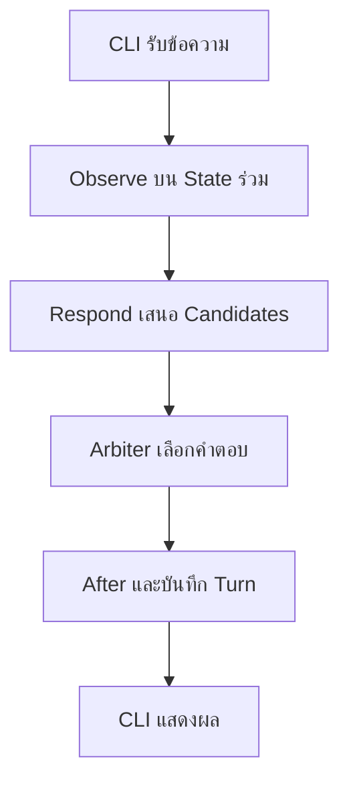
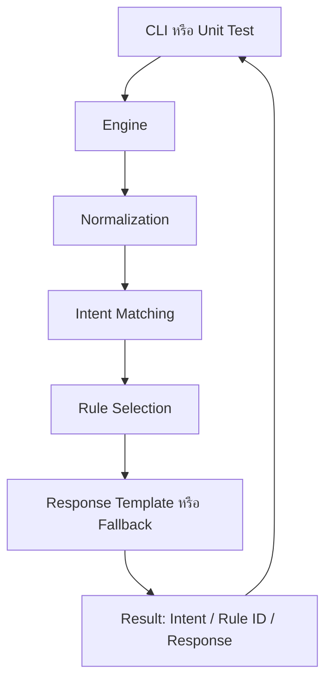
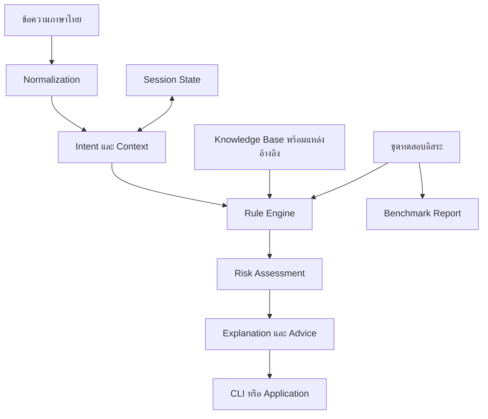
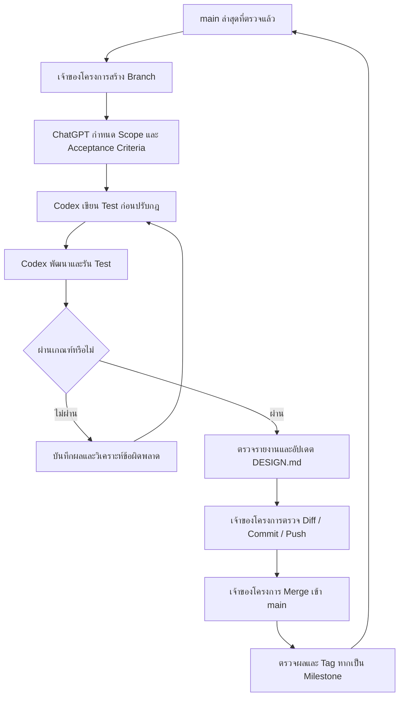

# DESIGN — Thai Rule-based Anti-Scam AI

> เอกสารกลางสำหรับการออกแบบ แผนพัฒนา และประวัติการทดลองของโครงการจบ  
> ฉบับเอกสาร: 0.2 (ปรับสถานะ Repository และ Adaptive Roadmap) | วันที่: 27 พฤศจิกายน 2569 (2026-11-27)  
> สถานะ AI: มีข้อกำหนด V0.1 และรายงาน Reference Baseline บน Development Dataset แล้ว ยังไม่มี AI Engine หรือผลประเมิน AI แบบอิสระ  
> Repository: `thai-anti-scam-ai` (ชื่อที่เจ้าของโครงการเลือก); ชื่อทางการของงานวิจัยยังไม่สรุป

## 1. วัตถุประสงค์และขอบเขต

พัฒนา Rule-based AI ภาษาไทยด้วย Python ขึ้นเอง เพื่อจำแนกเจตนา ทำความเข้าใจบริบท ตรวจจับสัญญาณความเสี่ยงจากการหลอกลวง อธิบายเหตุผล และแนะนำวิธีป้องกัน โดยไม่ใช้ LLM เป็นแกนประมวลผลขณะทำงาน ใช้ Codex เป็นเครื่องมือช่วยพัฒนาเท่านั้น

โครงการมีสองส่วน: (1) AI Engine เป็นผลงานหลัก (2) Application ที่นำ AI ไปใช้งานจริงเมื่อผ่านเกณฑ์ที่ตกลงกับอาจารย์แล้ว รูปแบบผลิตภัณฑ์ยังไม่กำหนด

คำถามวิจัยเบื้องต้น: การปรับปรุงกฎและการประมวลผลภาษาไทยแบบวนซ้ำเพิ่มความถูกต้องในการจำแนกเจตนาและความเสี่ยงได้เพียงใด ภายใต้ข้อจำกัดด้านทรัพยากรและความสามารถในการอธิบายผล

| ประเด็น | สถานะ |
| --- | --- |
| แนวคิดพัฒนา AI เองเพื่อป้องกันการหลอกลวง | ได้รับความเห็นชอบจากอาจารย์ 27 พ.ย. 2569 |
| Python, Rule-based, Terminal, Automated Test, Codex, ศึกษา PyBot | แนวทางโครงการตาม PROJECT_CONTEXT.md |
| Git โดยเจ้าของโครงการเท่านั้น และพัฒนาทีละ Branch | ข้อตกลงการทำงานกับเจ้าของโครงการ |
| DESIGN.md ภาษาไทย ยกเว้นศัพท์เทคนิค และบันทึก History ตาม Branch | ข้อตกลงการทำงานกับเจ้าของโครงการ |
| โครงสร้าง Branch, สถาปัตยกรรมย่อย, Acceptance Criteria ในเอกสารนี้ | ข้อเสนอเพื่อทบทวน ไม่ใช่สิ่งที่อาจารย์อนุมัติทั้งหมด |
| ชื่อทางการของงานวิจัย ประเภทภัย เกณฑ์เชิงตัวเลข ผลิตภัณฑ์ NLP/OCR/Speech-to-Text | ยังไม่ตัดสินใจ |

ไม่เริ่ม Frontend, Backend API, Database, Docker, Cloud LLM, Deployment หรือ ML Framework ในต้นแบบแรก เริ่มจาก Python Standard Library และเพิ่ม Dependency เฉพาะเมื่อมีหลักฐานว่าจำเป็นและได้รับอนุมัติ ไม่สร้างฟังก์ชันหลอกลวงคนจริง

## 2. หลักฐานและเอกสารต้นทาง

- `PROJECT_CONTEXT.md` ฉบับ 27 พ.ย. 2569: บริบทโครงการหลัก ขอบเขตและ Roadmap เดิม (ควรเก็บสำเนาใน Repository เมื่อเริ่มงาน หากเจ้าของโครงการอนุญาต)
- ผล Terminal ที่เจ้าของโครงการส่งในบทสนทนา: Environment Inspection สองชุด วันที่ 27 พ.ย. 2569
- `TASK 001 — รายงานสถาปัตยกรรม Hugging Face PyBot`: รายงานที่ Codex ส่งกลับในไฟล์ข้อความแนบ วันที่ 27 พ.ย. 2569; เสนอให้เก็บรายงานฉบับเต็มไว้ใน `docs/research/pybot-study.md` พร้อมแหล่งอ้างอิงเมื่อสร้าง Repository โดยไม่เก็บข้อมูลส่วนตัว
- ข้อตกลงการทำงานล่าสุดในบทสนทนา: ผู้ใช้จัดการ Git เอง ChatGPT เขียน Prompt และ Codex ดำเนินงานตามขอบเขต

ข้อมูลเกี่ยวกับ PyBot ในเอกสารนี้สรุปจากรายงาน Codex ไม่ใช่การตรวจสอบซอร์สทุกบรรทัดซ้ำโดย ChatGPT ไม่ได้รัน PyBot ในการศึกษา TASK-001 และไม่มีการรับรองตัวเลข Benchmark ของ PyBot หรือของ AI เรา

## 3. ผลการตรวจสอบสภาพแวดล้อม (Phase 1)

| รายการ | ผลที่รายงานจาก Terminal |
| --- | --- |
| macOS | 27.2.1 (26B131) |
| สถาปัตยกรรม / CPU | arm64 / Apple M4 |
| RAM | 16 GiB |
| Python | 3.14.8 (`/opt/homebrew/bin/python3`) |
| Pip | 26.2.1 |
| Git | 2.54.0 (Apple Git-157) |
| Codex CLI | 0.172.0 |
| Authentication | Logged in using ChatGPT |
| Workspace | `~/Project` มีอยู่แล้ว |
| Standard Library | Import `sys`, `re`, `json`, `unittest`, `venv`, `unicodedata` สำเร็จ |
| Pseudo Terminal | ผ่านการทดสอบด้วย `zsh -f` |
| พื้นที่จัดเก็บ | ว่าง 7.7 GiB, Capacity 97% ตาม `df -h` ณ เวลาตรวจ |

ข้อจำกัด: พื้นที่เหลือน้อย แต่ต้นแบบ Standard Library ขนาดเล็กเริ่มได้ ควรตรวจพื้นที่ก่อนสร้างไฟล์จำนวนมาก คำเตือนเดิมของ Zsh/Spaceship มีแนวโน้มเกี่ยวข้องกับการตั้งค่า Shell แต่ยังไม่ทราบสาเหตุแน่ชัด ไม่ต้องลบไฟล์หรือแก้ Shell ตอนนี้ ผล Import ไม่ใช่การยืนยันว่าโปรแกรมทุกส่วนทำงานแล้ว

## 4. กรณีศึกษา PyBot (Phase 2 / TASK-001)

Repository: https://github.com/huggingface/pybot  
Revision ที่ Codex รายงานว่าตรวจ: `7d63c7fbebb44c7e466e5c8b5c1f341ab767929e`  
Source revision ที่ CLI ระบุ: `24cbc0439e07fd015c0747ab3be6e782a42b5c5b` (Codex รายงานว่าไม่พบใน API ของ Repository สาธารณะ)

### 4.1 ข้อค้นพบจากรายงาน

- Runtime ใช้ Python Standard Library; `pyproject.toml` ประกาศ Python >= 3.8 และไม่มี Runtime Dependencies; build dependency เป็นอีกเรื่องหนึ่ง
- รายงานนับไฟล์ทั้งหมด 537 ไฟล์ โดยมี Python 528 ไฟล์ใต้ `bot/` และ 636,551 บรรทัดรวมบรรทัดว่างและ Comment
- Runtime ค้นและจัดลำดับโมดูลด้วย Priority เรียก `observe` เพื่ออัปเดต State, เรียก `respond` เพื่อเสนอ Candidate, ใช้ Arbiter เลือกคำตอบและ State ของผู้ชนะ แล้วเรียก `after` และบันทึก Turn; การทำสำเนา State มีข้อยกเว้นตามรายงาน
- Understanding ใช้ Normalization, Keyword, Regex, Intent และ Context; Memory สกัด Fact และบันทึกการเปลี่ยนค่า; Knowledge ใช้ Entry, Guard, Index และการจัดอันดับ; Response ใช้ Template, Pool, ฟังก์ชันและ Fallback
- ไม่พบ LLM inference ในเส้นทางตอบที่รายงานตรวจ; ขั้นพัฒนาใช้ Coding Agent และผลประเมินที่ผู้เผยแพร่รายงานใช้ LLM Judge ซึ่งต่างจาก Runtime
- ชุดทดสอบสาธารณะที่ตรวจพบมี `tests/test_cli.py` จำนวน 12 Test Methods ไม่พบ Benchmark Harness และชุดข้อมูลพัฒนาภายในใน Snapshot ที่ตรวจ
- SmolTalkBench มี 1,000 English Single-turn Prompts; README รายงาน Win Rate จาก 0% เป็น 26% แต่ไม่สามารถยืนยันซ้ำหรือใช้แทน Intent Accuracy ภาษาไทย, Context Accuracy หรือ Scam Detection Accuracy ได้
- License ที่รายงานพบคือ Apache 2.0 หากนำโค้ดมาแจกจ่ายต้องปฏิบัติตามเงื่อนไข License และ Attribution ที่เกี่ยวข้อง โครงการเราตั้งใจเขียน Implementation ใหม่ ไม่คัดลอกกฎหรือคลังคำตอบของ PyBot และจะพิจารณา License ของโครงการเองแยกต่างหาก

### 4.2 เส้นทางการทำงานโดยสรุป



### 4.3 กรณีศึกษาเรื่องรูปประโยค

| ข้อความสมมติ | ผลจาก Static Analysis ของ Codex |
| --- | --- |
| `My name is Poopa` | กฎแนะนำตัวมีส่วน `is` ที่ตรง Pattern สกัดชื่อและบันทึก Fact ได้ตามเส้นทางที่ศึกษา |
| `my name poopa` | ขาดส่วนที่ Regex ต้องการ จึงไม่สร้าง Fact ชื่อใหม่ผ่านเส้นทางแนะนำตัวที่ตรวจใน Session ใหม่ |

Regex หลักใช้ `re.I` จึงไม่ใช่เพราะตัวพิมพ์ใหญ่/เล็กเพียงอย่างเดียว หากใช้ Session เดียวกัน อาจมีชื่อเดิมค้างอยู่ ผลข้างต้นไม่ใช่ผลรันใหม่ ไม่ทราบข้อความตอบสุดท้ายหรือโมดูลผู้ชนะจริง

บทเรียน: ต้องทดสอบประโยคที่มีเจตนาเดียวกันแต่รูปต่างกัน ภาษาไทยไม่เว้นช่องว่างทุกคำ มีการละประธาน คำลงท้าย ภาษาพูด คำย่อและคำปฏิเสธ จึงไม่ควรแปลกฎอังกฤษตรง ๆ

### 4.4 แนวทางถ่ายทอดความรู้

| นำมาประยุกต์ | ยังไม่ใช้ในต้นแบบแรก |
| --- | --- |
| แยก Normalization, Matching, State Update, Response | ระบบค้นหาโมดูลแบบ Dynamic จำนวนมาก |
| กฎมี Rule ID และลำดับที่ตรวจสอบได้ | Deepcopy State ให้ทุก Candidate |
| เก็บข้อความต้นฉบับและรูปที่ปรับแล้วแยกกัน | คลังความรู้ทั่วไปและกฎภาษาอังกฤษของ PyBot |
| ทดสอบ Intent, Fallback และ Context ตามเวอร์ชัน | ใช้ LLM Judge เป็น Metric หลัก |
| เพิ่ม Knowledge Entry และ Index เมื่อจำเป็น | สร้างระบบขนาดใหญ่ก่อนพิสูจน์ Baseline |

Codex เสนอ Memory ใน V0.1; เอกสารนี้เสนอคง Roadmap เดิม โดยเพิ่ม Memory ใน V0.5 เพื่อแยกผลของแต่ละความสามารถชัดเจน ต้องทบทวนก่อนเริ่ม Implementation

### 4.5 แหล่งอ้างอิงสำหรับตรวจซ้ำ

ลิงก์ต่อไปนี้มาจากรายงาน Codex ที่แนบ ไม่ได้ยืนยันใหม่ทุกลิงก์ในขั้นจัดทำเอกสารนี้:

- [README](https://github.com/huggingface/pybot/blob/7d63c7fbebb44c7e466e5c8b5c1f341ab767929e/README.md) และ [LICENSE](https://github.com/huggingface/pybot/blob/7d63c7fbebb44c7e466e5c8b5c1f341ab767929e/LICENSE)
- [Commit](https://github.com/huggingface/pybot/commit/7d63c7fbebb44c7e466e5c8b5c1f341ab767929e), [Tree](https://api.github.com/repos/huggingface/pybot/git/trees/7d63c7fbebb44c7e466e5c8b5c1f341ab767929e?recursive=1), [pyproject.toml](https://github.com/huggingface/pybot/blob/7d63c7fbebb44c7e466e5c8b5c1f341ab767929e/pyproject.toml)
- [Runtime — Turn](https://github.com/huggingface/pybot/blob/7d63c7fbebb44c7e466e5c8b5c1f341ab767929e/bot/runtime.py#L82-L120)
- [Name Patterns](https://github.com/huggingface/pybot/blob/7d63c7fbebb44c7e466e5c8b5c1f341ab767929e/bot/memory/facts.py#L275-L309), [Memory Store](https://github.com/huggingface/pybot/blob/7d63c7fbebb44c7e466e5c8b5c1f341ab767929e/bot/modules/memory_store.py#L875-L891)
- [Arbiter](https://github.com/huggingface/pybot/blob/7d63c7fbebb44c7e466e5c8b5c1f341ab767929e/bot/modules/arbiter.py#L1014-L1072), [Knowledge Lookup](https://github.com/huggingface/pybot/blob/7d63c7fbebb44c7e466e5c8b5c1f341ab767929e/bot/knowledge/lookup.py#L4649-L4694)
- [CLI Tests](https://github.com/huggingface/pybot/blob/7d63c7fbebb44c7e466e5c8b5c1f341ab767929e/tests/test_cli.py), [SmolTalkBench](https://huggingface.co/datasets/HuggingFaceSwarms/SmolTalkBench/raw/e4bc258ec8b9380f5fa79725285a13ffa2c07670/README.md), [Unicode UAX #29](https://www.unicode.org/reports/tr29/tr29-49.html#Conformance)

ยังไม่ยืนยันเวลาในการตอบ RAM ความเข้ากันได้ขณะรันบนเครื่องโครงการ หรือ Benchmark ซ้ำของ PyBot ตามรายงาน TASK-001 ไม่มีการติดตั้ง แก้ไฟล์ Clone รันโค้ดที่ดาวน์โหลด หรือใช้ Git; เป็นการรายงานของ Codex ไม่ใช่ Audit ระบบไฟล์อิสระ

เอกสารต่อยอดจาก TASK-004-R4 รวบรวม Static Source Trace ที่ตรวจซ้ำจาก Public Snapshot ตาราง Mapping เหตุผลที่เลือกและไม่เลือกแนวทาง รวมถึงคำถามสำหรับนำเสนอ [PyBot Reference Mapping และเหตุผลด้านสถาปัตยกรรม](docs/pybot-reference-and-design-rationale.md)

## 5. สถาปัตยกรรม AI ของเรา (ข้อเสนอ)

### 5.1 Prototype V0.1



Engine แยกจาก CLI เพื่อให้ทดสอบและนำกลับไปใช้ได้ กฎมีลำดับที่ชัดเจนและผลซ้ำได้เมื่อ Input เท่ากัน ไม่ทำให้ข้อผิดพลาดภายในกลายเป็นคำตอบที่เหมือนประมวลผลสำเร็จ; แยก Unknown จาก Error เก็บ Original Text ไว้ระหว่างประมวลผลและสร้าง Normalized Text แบบระมัดระวัง (เสนอ NFC และจัดช่องว่างรอบข้อความ) ไม่ลบช่องว่างหรืออักขระภาษาไทยโดยพลการ ไม่บันทึกข้อความผู้ใช้จริงลง Log โดยอัตโนมัติ

TASK-004 กำหนด Intent V0.1 แปดประเภท ได้แก่ `GREETING`, `BOT_IDENTITY`, `BOT_CAPABILITIES`, `THANKS`, `FAREWELL`, `HELP`, `UNKNOWN` และ `EMPTY_INPUT` ตาม D-013 ข้อกำหนดฉบับปัจจุบันแยกคำถามความสามารถออกจากการขอความช่วยเหลือทั่วไป และแยกข้อความว่างออกจากข้อความนอกขอบเขต [ข้อกำหนดพฤติกรรม AI V0.1](docs/v0.1-behavior.md)

Proposed Contract รับ Python `str` และคืน `intent`, `response` ภาษาไทย และ `rule_id` ตาม D-014 เกณฑ์เชิงหน้าที่สำหรับต้นแบบคือผ่าน Behavioral Regression Tests ที่กำหนดจาก Test Specification ใช้ CLI แยกจาก Engine และใช้ Python Standard Library โดยไม่มี LLM ขณะทำงาน

### 5.2 เป้าหมายสถาปัตยกรรมระยะยาว



Risk Result ควรมีระดับความเสี่ยง ประเภทที่เกี่ยวข้อง Rule ID หลักฐาน และคำแนะนำ ไม่แสดงคะแนนเป็นความน่าจะเป็นว่าบุคคลเป็นมิจฉาชีพเมื่อยังไม่ผ่าน Calibration; การไม่พบสัญญาณไม่ได้แปลว่าปลอดภัย ไม่พบข้อมูลเพียงพอให้ Abstain หรือถามเพิ่ม

### 5.3 โครงสร้าง Repository ระยะแรก (ข้อเสนอ; มี README เริ่มต้นแล้ว)

```text
thai-anti-scam-ai/            # ชื่อ Repository ที่เลือกแล้ว
├── README.md
├── DESIGN.md
├── AGENTS.md
├── .gitignore
├── thai_ai/
│   ├── __init__.py
│   ├── __main__.py
│   ├── engine.py
│   ├── normalization.py
│   ├── intents.py
│   └── responses.py
├── tests/
│   ├── __init__.py
│   └── test_intents.py
├── datasets/
│   └── development/
├── docs/
│   └── research/
│       └── pybot-study.md
└── reports/
```

สร้างเท่าที่ใช้จริงในแต่ละ Branch ไม่ต้องสร้างไฟล์เปล่าทั้งหมดพร้อมกัน เพิ่ม `context.py`, Knowledge Base และ Risk Modules เมื่อถึง Milestone ที่เกี่ยวข้อง เก็บ Held-out Evaluation แยกจาก Workspace ที่ Codex อ่านได้ ไม่ Commit ข้อมูลส่วนตัวหรือชุดประเมินที่ต้องปิดบังลง GitHub; `.gitignore` ไม่ใช่เครื่องมือป้องกันการเข้าถึงของ Agent

## 6. หน้าที่และ Workflow

| ผู้รับผิดชอบ | หน้าที่ |
| --- | --- |
| เจ้าของโครงการ | อนุมัติขอบเขต เปิด Branch เอง ส่ง Prompt รัน Git ตรวจ Diff Commit Push Merge Tag และส่งผลกลับ |
| ChatGPT | วางแผน ออกแบบเกณฑ์ทดสอบ เขียน Prompt และสคริปต์ Git ให้ผู้ใช้รัน ตรวจรายงาน เสนอการแก้ไขและจัดทำ DESIGN.md |
| Codex | สร้าง/แก้โค้ดและเอกสารตาม Prompt รัน Test/Benchmark รายงานคำสั่ง ผลจริง ไฟล์ที่เปลี่ยน ข้อผิดพลาด และข้อจำกัด |

ข้อบังคับสำหรับ `AGENTS.md` และทุก Prompt: Codex ห้ามรันคำสั่ง Git ทั้งหมด (รวมคำสั่งอ่านสถานะ) ห้ามแก้ `.git` หรือจัดการ Remote/Branch/Commit/Push/Merge ห้ามแตะโครงการอื่น ไม่เพิ่ม Dependency หรือเปลี่ยน Scope โดยพลการ ไม่อ่าน Held-out Evaluation ขณะพัฒนา ไม่รายงานผลผ่านหากไม่ได้รัน เจ้าของโครงการแจ้งชื่อ Branch ให้ Codex ผ่าน Prompt แทนการให้ Agent ตรวจด้วย Git

### 6.1 Git Branch Strategy ที่เสนอ

- ใช้ `main` เป็นเส้นหลักที่ผ่านการตรวจสอบแล้ว ไม่ต้องมี `develop` เพิ่มในช่วงแรก
- เริ่มด้วย Commit เอกสารตั้งต้นบน `main` ที่เจ้าของโครงการสร้างเอง (เอกสารยังไม่ยืนยันว่า AI ใช้งานได้) จากนั้นทำทีละ Branch โดยแยกจาก `main` ล่าสุดที่ผ่านการ Merge
- ใช้ชื่อ `chore/…`, `test/…`, `feat/…`, `research/…`, `eval/…`, `fix/…` ตามงาน; ชื่อใน Roadmap เป็นข้อเสนอ ไม่ใช่ Branch ที่มีอยู่จริง
- ใช้ Adaptive Roadmap ตามข้อตกลงล่าสุด: ชื่อ จำนวน ลำดับ Branch และ Milestone ไม่ตายตัว สามารถเพิ่ม แทรก แยก รวม หรือปรับเปลี่ยนได้ตามหลักฐานและความจำเป็น บันทึกเหตุผล ผลกระทบ และแผนใหม่ใน Decision Log/Development History โดยไม่เขียนทับประวัติที่เกิดขึ้นจริง
- Push Branch เพื่อสำรองและตรวจสอบความคืบหน้าได้ระหว่างทำงาน แต่ Merge เมื่อผ่านเกณฑ์และบันทึก History แล้วเท่านั้น; เจ้าของโครงการเลือกใช้ Pull Request หรือ Merge ในเครื่องตามความเหมาะสม
- เสนอ Tag แบบ `v0.1.0` เป็นต้น เมื่อ Milestone ผ่านจริง ห้าม Tag เวอร์ชันที่ยังไม่พร้อม ห้าม Force Push, Reset แบบทำลายข้อมูล หรือแก้ประวัติเดิมโดยไม่อนุมัติ



หมายเหตุ: ควร Push/Commit งานระหว่าง Branch เมื่อเหมาะสม ไม่ต้องรอจนเสร็จทั้งหมดเพื่อสำรองงาน และควรเก็บผลทดสอบที่ไม่ผ่านด้วย เมื่อ Merge แล้วให้บันทึก Commit/Tag/PR จริงเพิ่มเติมใน DESIGN.md ใน Commit ถัดไปหากจำเป็น (ไม่ใส่ SHA ของ Commit ที่กำลังสร้างเอง เพราะไม่สามารถทราบล่วงหน้า)

### 6.2 Definition of Done ของทุก Branch

1. มี Scope, งานที่ไม่ทำ และ Acceptance Criteria ก่อนเริ่ม
2. มี Test Cases และ Expected Result ก่อนแก้กฎ (Branch เอกสารใช้เกณฑ์ตรวจเอกสารแทน)
3. Codex รายงานผลรันจริง พร้อมคำสั่ง Exit Status/จำนวน Pass/Fail/Skip และข้อจำกัด; ไม่เปลี่ยน Expected Result เพียงเพื่อให้ผ่าน
4. รัน Regression Tests ทั้งหมดที่เกี่ยวข้อง เก็บ Baseline และผลเปรียบเทียบเมื่อมีความหมาย
5. ChatGPT และเจ้าของโครงการตรวจ Diff รายงาน และการเปลี่ยน Scope
6. ทุก Branch ต้องอัปเดต DESIGN.md ก่อนเจ้าของโครงการ Commit และ Push ตาม D-012 โดยบันทึกงาน เหตุผล การเปลี่ยนแผน ผลทดสอบจริง และข้อจำกัด เก็บรายงานขนาดใหญ่ไว้ใน `reports/` แล้วลิงก์จาก DESIGN.md
7. เจ้าของโครงการ Commit, Push, Merge และ Tag ตามความเหมาะสม ตรวจผลบน `main` หลัง Merge; หากยังไม่ผ่านให้คงสถานะ Blocked/Failed ไม่เริ่ม Milestone ถัดไปโดยพลการ

### 6.3 Continuous Integration (เพิ่มใน TASK-003)

`.github/workflows/ci.yml` กำหนด Workflow `CI` ให้รันเมื่อ Push ทุก Branch หรือเปิดและอัปเดต Pull Request ที่มีเป้าหมายเป็น `main` และรองรับ `workflow_dispatch` เมื่อไฟล์ Workflow อยู่บน Default Branch งาน `Python Tests` ใช้ GitHub-hosted Runner `ubuntu-latest` โดยจำกัดเวลา 10 นาที [GitHub Actions Workflow Syntax](https://docs.github.com/en/actions/reference/workflows-and-actions/workflow-syntax)

ลำดับงานคือ Checkout Source → ตั้งค่า Python 3.14.8 → แสดงเวอร์ชัน → Compile ไฟล์ `.py` ใน `thai_ai/`, `tests/` และ `scripts/` ในหน่วยความจำ → รัน Local Test Runner ด้วย `python3 -B -m scripts.run_tests` หากขั้นใดล้มเหลว งาน CI จะล้มเหลว ใช้ Official Actions ที่ล็อก Full-length Commit SHA ได้แก่ `actions/checkout` v7.0.1 (`3d3c42e5aac5ba805825da76410c181273ba90b1`) และ `actions/setup-python` v7.1.0 (`6d4fd22b20465ccc0f7354476588e8df7c9ca0e0`) [Checkout Release](https://github.com/actions/checkout/releases/tag/v7.0.1) [Setup Python Release](https://github.com/actions/setup-python/releases/tag/v7.1.0)

กำหนด `GITHUB_TOKEN` เป็น `contents: read` และ `persist-credentials: false` สำหรับ Checkout ขั้นตอนนี้เป็นข้อยกเว้นที่เจ้าของโครงการอนุญาตเฉพาะการโหลด Source Code ภายใน GitHub-hosted Runner Workflow ไม่มีการติดตั้ง Python Package เพิ่มเติม ไม่ส่ง Secrets ให้ขั้นตอนทดสอบ และไม่ใช้ Held-out Dataset [GitHub Actions Secure Use](https://docs.github.com/en/actions/reference/security/secure-use)

Test Runner ใช้ `unittest` ค้นหา `test_*.py` ใน `tests/` แล้วแสดงผลราย Test คืน Exit Code `1` เมื่อพบ Failure, Error, Unexpected Success, 0 Tests หรือไม่มี Test ที่จบโดยไม่ถูก Skip เพื่อป้องกันสถานะผ่านที่เกิดจากการไม่ได้ทดสอบอะไร คืน `0` เมื่อ Suite สำเร็จตาม `unittest` และมีอย่างน้อยหนึ่ง Test จบโดยไม่ถูก Skip รวมถึง Expected Failure ที่ถูกเรียกจริง Foundation Smoke Tests ตรวจ Package Import และเอกสาร ผล CI จึงใช้ตรวจความพร้อมของโค้ดตามชุดทดสอบที่รัน ส่วน AI Benchmark ต้องมี Engine, Dataset และเกณฑ์ประเมินที่กำหนดไว้

Test Runner Regression Tests ตรวจการคืน Exit Code ในกรณีผ่าน ล้มเหลว เกิด Error ชุดว่าง Skip ทั้งหมด และมีทั้งผ่านกับ Skip จึงครอบคลุมกรณีที่ Smoke Tests เพียงชุดเดียวไม่สามารถยืนยันได้

Local Verification ยืนยันว่าโค้ดและชุดทดสอบทำงานในเครื่อง และตรวจไวยากรณ์กับค่ากำหนดของ Workflow ได้ก่อน Commit ส่วน Remote Verification ต้องใช้หลักฐานจาก GitHub Actions เพื่อยืนยันการเรียก Workflow ตามเหตุการณ์ การตั้งค่า Runner และ Python ตลอดจนผลของ Job จริง

#### 6.3.1 ผลตรวจ Local แยกตามรอบ

| รายการ | TASK-003 (H-008 และรายงาน TASK-003) | TASK-003-R1 (H-009) |
| --- | --- | --- |
| Local Test Suite | 9 Tests · Pass 9 · Failure 0 · Error 0 · Skip 0 · Exit 0 | 9 Tests · Pass 9 · Failure 0 · Error 0 · Skip 0 · Exit 0 |
| Foundation Smoke Tests | ผ่าน 3/3 | ผ่าน 3/3 |
| Test Runner Regression Tests | ผ่าน 6/6 | ผ่าน 6/6 |
| Python Syntax | ผ่าน 6 ไฟล์ · Exit 0 | ผ่าน 6 ไฟล์ · Exit 0 |
| Workflow YAML Syntax | ผ่าน · Exit 0 | ผ่าน · Exit 0 |
| Workflow Configuration | ผ่าน · Exit 0 | ผ่าน · Exit 0 |

จำนวน Smoke Tests และ Regression Tests ยืนยันจาก Test Methods ใน `tests/test_foundation.py` และ `tests/test_run_tests.py` ตามลำดับ การตรวจเอกสารสามไฟล์ใช้ Subtests ภายใน Smoke Test หนึ่งรายการ

| Suite จำลอง | Exit Code ใน TASK-003 | Exit Code ที่รันซ้ำใน TASK-003-R1 |
| --- | ---: | ---: |
| All Passed | 0 | 0 |
| Failure | 1 | 1 |
| Error | 1 | 1 |
| Empty Suite | 1 | 1 |
| All-skipped Suite | 1 | 1 |
| Passed and Skipped | 0 | 0 |

#### 6.3.2 ข้อพิจารณาสำหรับ CI ในอนาคต

- เมื่อมี AI Behavior Tests ให้กำหนดวิธีตรวจว่าชุดทดสอบที่จำเป็นได้รันจริง เพราะ Runner ปัจจุบันอนุญาตให้บาง Test ถูก Skip หาก Suite ที่เหลือผ่าน
- พิจารณา Branch Protection หลังมีหลักฐานว่า Remote CI ทำงานสำเร็จจริง
- ใช้ CI Passing Rate ติดตามงาน CI และวัด AI Accuracy ด้วย Benchmark และชุดข้อมูลที่กำหนด
- เก็บ Held-out Evaluation Dataset แยกจาก CI ปกติ
- พิจารณาลด Workflow ที่รันซ้ำจาก Push และ Pull Request หากเกิดความซ้ำซ้อนที่มีผลต่อโครงการ

รายการข้างต้นเป็นข้อพิจารณาสำหรับงานในอนาคต การตรวจรอบนี้แก้เฉพาะเอกสาร

### 6.4 Engineering Principles และ Quality Gate

ให้ความถูกต้อง ความน่าเชื่อถือ ความเสถียร และการดูแลต่อได้มาก่อนความเร็ว เลือกเทคโนโลยีและ Algorithm จากหลักฐาน ความเหมาะสม ข้อจำกัด และมาตรฐานทางวิศวกรรม Python Standard Library เป็นจุดเริ่มต้น การใช้ Dependency ภายนอกต้องมีเหตุผล ผลการศึกษา ความเหมาะสม License และการอนุมัติก่อนใช้ [Engineering Principles สำหรับ Agent](AGENTS.md#engineering-principles)

ให้พัฒนา ทดสอบ วิเคราะห์ข้อผิดพลาด และปรับกฎหลายรอบได้ใน Version เดิม เก็บหลักฐานที่ทำซ้ำได้ อธิบายผลจากกฎที่ทำงานจริง ตรวจผล Regression และปกป้องข้อมูลส่วนตัว การเพิ่ม Version ต้องมีความสามารถและผลทดสอบรองรับ และการปรับ Roadmap ต้องบันทึกเหตุผลและขออนุมัติ

**ก่อน Commit และ Push** ตรวจงานตาม Acceptance Criteria ทบทวนผลจริงและข้อจำกัด อัปเดต DESIGN.md แล้วจัดระดับข้อค้นพบเป็น BLOCKER, HIGH, MEDIUM หรือ LOW หากพบ BLOCKER หรือ HIGH ที่กระทบเกณฑ์ ให้ใช้ `NEEDS_REVISION` และระบุงานแก้ไข ให้ใช้ `READY_FOR_COMMIT` เมื่อผลตรวจผ่านและไม่มีประเด็นที่ขัดขวางการส่งงาน

**ก่อน Merge** ตรวจหลักฐาน Remote CI แยกจาก Local Verification และบันทึก Git ตามข้อมูลที่เจ้าของโครงการยืนยัน

## 7. Roadmap ตาม Branch (Adaptive Roadmap)

แผนด้านล่างเป็นทิศทางเบื้องต้น ไม่ใช่รายการงานที่ล็อกไว้; ทบทวนก่อนเริ่มแต่ละ Branch ตามผลการศึกษาและการทดสอบ

เดิมหลัง Project Foundation มีแผนเข้าสู่ `test/v0.1-baseline` ตาม H-006 ต่อมาเจ้าของโครงการเสนอเพิ่ม GitHub Actions CI เพื่อลดความผิดพลาดจากการตรวจด้วยมือ จึงแทรก `ci/github-actions` ก่อน Baseline ตาม D-011 ชื่อและลำดับของ Branch และ Task ในอนาคตยังปรับได้เมื่อเจ้าของโครงการอนุมัติและบันทึกเหตุผลไว้

สถานะที่ใช้: `PLANNED`, `IN_PROGRESS`, `BLOCKED`, `FAILED`, `VERIFIED` (ผ่านเกณฑ์แต่ยังไม่ Merge), `READY_FOR_COMMIT` (ผ่านเกณฑ์สำหรับขั้นก่อน Commit และเอกสารพร้อมให้เจ้าของโครงการดำเนินการ), `NEEDS_REVISION` (พบประเด็นที่ต้องแก้ก่อนปิด Branch), `MERGED` (ยืนยัน Merge จริง) ส่วนงานก่อนมี Git ใช้ `PRE-REPO` ไม่สร้างประวัติย้อนหลังว่าเป็น Commit ที่เกิดขึ้นจริง

| ลำดับ | Branch | Milestone | สถานะ |
| --- | --- | --- | --- |
| 00 | `main` — เอกสารตั้งต้น | เริ่ม Repository | เจ้าของโครงการยืนยันแล้ว |
| 01 | `chore/project-foundation` | โครงสร้างและข้อกำหนด (TASK-002) | MERGED |
| 02 | `ci/github-actions` | GitHub Actions CI (TASK-003) | MERGED · Remote CI ผ่านตามที่เจ้าของโครงการยืนยัน |
| 03 | `test/v0.1-baseline` | AI Behavior Specification & Baseline Evaluation (TASK-004) | MERGED · PR #4 · Remote CI ผ่านตามหลักฐานจากเจ้าของโครงการ |
| 03a | `design/v0.1-behavioral-contract` | Behavioral Contract & Regression Engineering (TASK-005 Analysis Phase) | ANALYSIS_COMPLETE_PENDING_REVIEW |
| 03b | `design/v0.1-behavioral-contract` | Thai Text Processing Research & Experiments (TASK-005-R1) | RESEARCH_COMPLETE_PENDING_REVIEW |
| 03c | `design/v0.1-behavioral-contract` | Rule Architecture, Conflict Resolution & Response Contract (TASK-005-R2) | DESIGN_COMPLETE_PENDING_REVIEW |
| 03d | `design/v0.1-behavioral-contract` | Regression Engineering & Behavioral Contract Validation (TASK-005-R3) | REGRESSION_SPEC_COMPLETE_PENDING_REVIEW |
| 03e | `design/v0.1-behavioral-contract` | Final Contract & Quality Review (TASK-005-R4) | NEEDS_REVISION |
| 03f | `design/v0.1-behavioral-contract` | Regression Validator Reliability & Contract Finalization (TASK-005-R5) | REVIEW_COMPLETE_PENDING_OWNER_APPROVAL |
| 03g | `design/v0.1-behavioral-contract` | Contract Approval & Finalization (TASK-005-R6) | READY_FOR_COMMIT |
| 04 | `feat/v0.1-basic-chatbot` | AI Prototype V0.1 (แผน TASK-006) | PLANNED · รอคำสั่งเริ่มงาน |
| 05 | `feat/v0.2-intent-variants` | V0.2 | PLANNED |
| 06 | `feat/v0.3-informal-thai` | V0.3 | PLANNED |
| 07 | `feat/v0.4-negation-ambiguity` | V0.4 | PLANNED |
| 08 | `feat/v0.5-session-memory` | V0.5 | PLANNED |
| 09 | `feat/v0.6-multi-intent` | V0.6 | PLANNED |
| 10 | `feat/v0.7-knowledge-base` | V0.7 | PLANNED |
| 11 | `feat/v0.8-scam-risk-detection` | V0.8 | PLANNED |
| 12 | `feat/v0.9-explanation-advice` | V0.9 | PLANNED |
| 13 | `eval/v1.0-release-readiness` | V1.0 | PLANNED |
| 14 | ยังไม่กำหนด | Application | รอเลือกขอบเขต |

### 00 — `main` / เอกสารตั้งต้น

**เป้าหมาย:** เริ่ม Repository อย่างโปร่งใสก่อนให้ Codex สร้างโค้ด

- เจ้าของโครงการเลือกชื่อ `thai-anti-scam-ai` แล้ว; ทบทวนขอบเขต V0.1 และยืนยันสถานะ Remote/สิทธิ์การเข้าถึง GitHub ตามจริง
- สร้าง Repository ด้วยตนเอง เก็บ README เริ่มต้นและ DESIGN.md ฉบับที่ตกลงแล้ว ไม่ Commit ความลับหรือ Held-out Data
- ตรวจสถานะ Git, Initial Commit และ Remote ก่อนบันทึก DESIGN.md และ Push; ไม่สร้าง Repository หรือ Remote ซ้ำหากมีอยู่แล้ว

**เกณฑ์ผ่าน:** เจ้าของโครงการยืนยัน Repository, Branch `main`, Commit เริ่มต้น และผล Push จริง; ไม่อ้างว่า AI สร้างเสร็จ

### 01 — `chore/project-foundation`

**เป้าหมาย:** เตรียมสภาพโครงการที่เล็กและตรวจสอบได้

- สร้าง `AGENTS.md` ระบุข้อห้าม Git, ขอบเขต, การรายงานผล และข้อกำหนด Dataset
- ปรับ README, `.gitignore`, เก็บกรณีศึกษา PyBot และจัดโครงสร้าง Package เท่าที่จำเป็น
- ตรวจ Python และแนวทาง Virtual Environment; สร้างเมื่อจำเป็นเท่านั้น ไม่ติดตั้ง Dependency ภายนอก

**เกณฑ์ผ่าน:** เอกสารตรงข้อตกลง ไม่มีโค้ด Scam Detection หรือ Dependency เกิน Scope ไม่มีไฟล์ส่วนตัว และผู้ใช้ตรวจรายการไฟล์ก่อน Commit

### 02 — `ci/github-actions` / TASK-003 GitHub Actions CI

**เป้าหมาย:** เพิ่มการตรวจ Syntax และชุดทดสอบอัตโนมัติก่อนเริ่มพัฒนา AI Engine ตามข้อเสนอของเจ้าของโครงการ

**เกณฑ์ผ่าน:** Workflow ใช้ Official Actions แบบ Pin Full SHA และสิทธิ์อ่านเท่านั้น ชุดทดสอบ Local ผ่าน และเจ้าของโครงการยืนยันการรันบน GitHub Actions หลัง Push รายละเอียดอยู่ในข้อ 6.3 และ H-008 ถึง H-010

### 03 — `test/v0.1-baseline` / TASK-004 AI Behavior Specification & Baseline Evaluation

**เป้าหมาย:** กำหนดสัญญาพฤติกรรมก่อนเขียนกฎเพื่อป้องกันการปรับข้อสอบตามคำตอบ

- ระบุ Taxonomy แปดประเภทและ Proposed Input/Output Contract พร้อม Expected Behavior ใน Test Specification
- สร้าง Development Dataset สมมติพร้อม Case ID และประเมิน Always-UNKNOWN ใน Evaluation Script แยกจาก AI Runtime
- ทดสอบ Dataset และสูตรคำนวณด้วย `unittest` เก็บ Behavior Specification ไว้สร้าง Behavioral Regression Tests เมื่อมี Engine ใน TASK-005

**เกณฑ์ผ่าน:** Dataset ผ่าน Validation ผล Reference Baseline รันซ้ำได้ สูตรคำนวณผ่าน Test ที่ทราบคำตอบ และ Local Suite ผ่านโดยไม่ Skip เพื่อปกปิดข้อผิดพลาด

#### TASK-004-R3 — README Project Homepage & Visual Documentation

ปรับ Project Homepage และ Project Overview ให้เห็น Current Capabilities และ Planned Capabilities ชัดเจน เพิ่ม AI System Architecture Diagram, Development and CI Workflow, Iterative Rule Refinement Workflow, Getting Started, Testing and Evaluation Guide, Repository Structure, Documentation Index และ Development Roadmap

ใช้ Mermaid ที่แก้ไขต่อได้ แยก Current Implementation จาก Planned Architecture และจัดทำแผนภาพของโครงการเองโดยไม่คัดลอกจาก PyBot งานเอกสารผ่านการตรวจในเครื่องและอยู่ในสถานะ `READY_FOR_COMMIT` ตาม H-014 ส่วน Remote CI ยังรอหลักฐานของ Branch นี้

### 03a — `design/v0.1-behavioral-contract` / TASK-005 Analysis Phase

เจ้าของโครงการกำหนดให้แทรกการวิเคราะห์สัญญาพฤติกรรมก่อน Prototype เพื่อระบุขอบเขต Intent, ตรวจตัวอย่างพัฒนา, แยกนโยบาย Input/Output และออกแบบ Regression ที่ตรวจย้อนกลับได้ ขอบเขตนี้ใช้การตรวจเอกสารและการสังเกต Python String Operations ในหน่วยความจำ ผลทดลอง TASK-005-R1 บันทึกใน H-024 ข้อเสนอทางเทคนิคและเกณฑ์ Implementation รอทบทวน [Behavioral Contract Analysis V0.1](docs/v0.1-behavioral-contract-analysis.md)

### 04 — `feat/v0.1-basic-chatbot` / AI Prototype V0.1 ตามแผนเดิม

เดิมเสนอให้ใช้ TASK-005 สำหรับ Prototype ต่อมาแยกงานออกแบบและตรวจ Contract ไว้ใน TASK-005 ถึง R6 ก่อนวางแผน Prototype ใน TASK-006

แผน TASK-006 ใช้ Regression Specification ที่ตรึงใน R6 เขียน Behavioral Tests และบันทึก RED ก่อนพัฒนา Input Validation, Normalization และ Result Contract จากนั้นเพิ่ม Matching, Guards, Resolver และ Response ตาม Dependency ทดสอบ Mandatory IDs ที่รันจริงและวัดผล Engine แยกจากผล Specification งานยังอยู่ในแผน [Test Integration Plan](docs/v0.1-regression-spec.md#test-integration-plan)

**เป้าหมาย:** สร้าง Rule-based Chatbot ภาษาไทยตัวแรกที่รันจริง

- Implement Normalization, Intent Matching, ลำดับกฎ, Response Template, Unknown Fallback และ CLI
- ทดสอบ Intent/Response, ข้อความว่าง, การเรียกซ้ำ และการปิด CLI
- รัน Automated Test และบันทึก Benchmark แรกบนเครื่องจริง

**เกณฑ์ผ่าน:** ผ่านชุด Functional Tests ที่ตกลงไว้ทั้งหมด มีผล Test/Benchmark จริง CLI และ Engine แยกกัน ไม่มี Runtime LLM หรือ Dependency ภายนอก; เสนอ Tag `v0.1.0` หลัง Merge และยืนยันผล

### 05 — `feat/v0.2-intent-variants`

**เป้าหมาย:** รองรับประโยคที่มีเจตนาเดิมแต่ใช้รูปคำต่างกัน

- สร้างชุดประโยคหลายรูปสำหรับ Intent เดิม พร้อมข้อความคล้ายกันแต่คนละเจตนา
- เพิ่ม Pattern และกฎที่สื่อความหมายทั่วไป แทนการจำข้อสอบทีละประโยค
- ตรวจ Priority และ False Matches

**เกณฑ์ผ่าน:** ผ่าน Acceptance Cases ใหม่และ Regression V0.1; รายงาน Intent Accuracy และ Error Analysis บนชุดที่ระบุชัดเจน; เสนอ Tag `v0.2.0`

### 06 — `feat/v0.3-informal-thai`

**เป้าหมาย:** รองรับภาษาไทยไม่เป็นทางการในขอบเขตที่กำหนด

- ทดสอบคำย่อ คำลงท้าย ภาษาพูด คำสะกดผิดที่เลือก การเว้นวรรคและ Unicode
- รักษาข้อความต้นฉบับและหลีกเลี่ยงการ Normalize จนเปลี่ยนความหมาย

**เกณฑ์ผ่าน:** ผ่านชุดกรณีภาษาไม่เป็นทางการที่ตกลงไว้และ Regression เดิม รายงานกรณีที่ยังไม่รองรับ; เสนอ Tag `v0.3.0`

### 07 — `feat/v0.4-negation-ambiguity`

**เป้าหมาย:** แยกการยืนยัน การปฏิเสธ และข้อความกำกวม

- ทดสอบคู่ประโยคที่ต่างกันด้วยคำปฏิเสธและบริบท รวมข้อความยกตัวอย่างคำพูด
- ออกแบบลำดับกฎขัดแย้งและ Fallback ที่ถามเพิ่มเมื่อข้อมูลไม่พอ

**เกณฑ์ผ่าน:** ผ่านชุด Negation/Ambiguity ที่กำหนดและ Regression เดิม ไม่ตัดสินเกินข้อมูล; เสนอ Tag `v0.4.0`

### 08 — `feat/v0.5-session-memory`

**เป้าหมาย:** ทำให้ AI ใช้ข้อมูลบทสนทนาต่อเนื่องได้ภายใน Session

- เพิ่ม Session State, Slot Extraction (เช่น ชื่อสมมติ), การเรียกคืนข้อมูล การแก้ไข และ Reset
- ทดสอบแนะนำตัว ถามชื่อ เปลี่ยนชื่อ ปฏิเสธชื่อ ข้อความไม่ชัดเจน และแยก Session
- ไม่เก็บข้อมูลข้าม Session หรือเขียนข้อมูลส่วนตัวลง Disk โดยอัตโนมัติ

**เกณฑ์ผ่าน:** ผ่าน Multi-turn Tests ทั้ง Intent, Slot, State และ Reset; Regression เดิมผ่าน; เสนอ Tag `v0.5.0`

### 09 — `feat/v0.6-multi-intent`

**เป้าหมาย:** รองรับหลายเจตนาในข้อความเดียวภายในขอบเขตที่ระบุ

- แยกส่วนข้อความเมื่อมีหลักฐานเพียงพอ รักษาคำปฏิเสธและบริบท
- กำหนดลำดับคำตอบและการจัดการ Conflict ไม่เดาความหมายเกินหลักฐาน

**เกณฑ์ผ่าน:** ผ่านชุดหลายเจตนาและกรณีที่ไม่ควรแยกข้อความพร้อม Regression; เสนอ Tag `v0.6.0`

### 10 — `feat/v0.7-knowledge-base`

**เป้าหมาย:** เพิ่มฐานความรู้ด้านการป้องกันภัยที่ตรวจสอบที่มาได้

- กำหนด Taxonomy ของภัยร่วมกับอาจารย์ก่อนสร้างกฎตรวจจับ; รองรับหมวดซ้อนกันตามความจำเป็น
- ศึกษาแหล่งทางการและบันทึก Source URL, วันที่ตรวจสอบ, Rule/Knowledge ID, สัญญาณที่สังเกตได้, ข้อจำกัดและคำแนะนำ
- พัฒนาการค้นคืน Entry แบบเรียบง่ายและ Unknown Fallback; เพิ่ม Index เมื่อมีผลวัดว่าจำเป็น

**เกณฑ์ผ่าน:** ทุก Entry ที่ใช้มีแหล่งอ้างอิงและตรวจสอบได้ ผ่าน Knowledge Retrieval Tests และ Regression; เสนอ Tag `v0.7.0`

แหล่งตั้งต้นที่ต้องตรวจใหม่ก่อนอ้างเป็นข้อเท็จจริง: [ธปท.](https://www.bot.or.th/), [ETDA](https://www.etda.or.th/), [ศูนย์ต่อต้านข่าวปลอม](https://www.antifakenewscenter.com/), [NIST Phish Scale](https://csrc.nist.gov/pubs/tn/2276/final)

### 11 — `feat/v0.8-scam-risk-detection`

**เป้าหมาย:** ตรวจจับสัญญาณเสี่ยงจากข้อความโดยไม่กล่าวหาบุคคล

- กำหนดประเภทภัยที่รองรับและ Expected Labels ก่อนทำกฎ
- แยก Risk Signal Extraction จาก Risk Assessment; เก็บ Rule ID และหลักฐานข้อความอย่างเหมาะสม
- รองรับข้อความปกติ เสี่ยง กำกวม ปฏิเสธ และข้อมูลไม่พอ ใช้ข้อมูลสมมติหรือได้รับอนุญาตเท่านั้น

**เกณฑ์ผ่าน:** ผ่าน Functional/Safety Tests ที่กำหนดและ Regression; รายงาน Precision, Recall, F1, False Positive/Negative และ Abstention ตามชุดที่ระบุ ไม่อ้างคะแนนเป็นความน่าจะเป็น; เสนอ Tag `v0.8.0`

### 12 — `feat/v0.9-explanation-advice`

**เป้าหมาย:** อธิบายผลและแนะนำวิธีป้องกันที่ปลอดภัย

- สร้าง Explanation จากกฎที่ทำงานจริง พร้อมหลักฐานที่จำเป็นและข้อจำกัด
- เชื่อมคำแนะนำกับแหล่งทางการและแยกช่องทางตรวจสอบจากข้อมูลติดต่อที่น่าสงสัย
- ทดสอบความสอดคล้องระหว่าง Risk, Reason, Advice และกรณีหลักฐานไม่พอ

**เกณฑ์ผ่าน:** คำอธิบายตรวจย้อนกลับได้ทุกกรณีที่ทดสอบ ไม่มีการยืนยันความผิดโดยไม่มีหลักฐาน และผ่าน Regression/Safety Tests; เสนอ Tag `v0.9.0`

### 13 — `eval/v1.0-release-readiness`

**เป้าหมาย:** ประเมิน AI อย่างเป็นอิสระก่อนพิจารณานำไปใช้งานจริง

- กำหนดเกณฑ์เชิงตัวเลข จำนวนตัวอย่าง และวิธีประเมินร่วมกับอาจารย์ก่อนเปิด Held-out Set
- Freeze เวอร์ชัน Engine และ Dataset; เจ้าของโครงการรัน Held-out Evaluation ในพื้นที่ที่ Codex ไม่สามารถอ่านได้
- รายงาน Accuracy, Precision, Recall, F1, FPR, FNR, Abstention, Context/Negation Accuracy, เวลา และ RAM ตามขอบเขต พร้อมความผิดพลาดและข้อจำกัด
- หากไม่ผ่าน ห้ามปรับกฎจากคำตอบใน Held-out เดิมแล้วอ้างผลเดิมเป็นการประเมินอิสระ ให้กลับไปปรับด้วย Development Data และกำหนดชุดประเมินอิสระใหม่ตามแผน

**เกณฑ์ผ่าน:** ผ่านเกณฑ์ที่ตกลงไว้จริง มีหลักฐานทำซ้ำได้และตรวจ Safety/Privacy แล้ว จึงเสนอ Tag `v1.0.0`; หากไม่ผ่านคงสถานะยังไม่พร้อม

### 14 — Application (ยังไม่เลือก Branch)

หลังผ่านเกณฑ์ AI Engine จึงหารืออาจารย์ว่าจะเลือก Text Detection, OCR จากภาพ, Speech-to-Text จากเสียงที่ได้รับอนุญาต, AI Assistant หรือรูปแบบอื่น การตรวจเสียงระหว่างโทรจริงมีข้อจำกัดสิทธิ์ของระบบปฏิบัติการ ไม่ถือว่าเป็น Requirement ที่อนุมัติแล้ว ต้องพิจารณาเครื่องมือแปลงข้อมูล ความเป็นส่วนตัว และการทดลองกับมนุษย์ก่อนเลือกแพลตฟอร์มและ Branch เพิ่มเติม

## 8. Dataset, Benchmark และการทดลอง

- Development Set ใช้พัฒนากฎ; Regression Set ตรวจความสามารถเดิม; Held-out Evaluation Set ห้าม Codex อ่านขณะพัฒนาและห้ามใช้ปรับกฎ เก็บแยกจาก Repository/Workspace ที่ Agent เข้าถึงได้
- ลดข้อมูลรั่วระหว่างชุดด้วยการจัดกลุ่มประโยคที่มาจากต้นฉบับเดียวกัน ตรวจข้อความซ้ำ และบันทึก Dataset Version, Label Schema และจำนวนตัวอย่าง
- กำหนด Test ID, Input สมมติ, Expected Intent/Slot/State/Label, Expected Behavior, Actual Result, Pass/Fail และ Rule ID ตามความเหมาะสม
- ใช้ `unittest`, JSON/JSONL และรายงาน Markdown/JSON/CSV ตามความจำเป็น ใช้ `time.perf_counter()` สำหรับเวลา (ข้อเสนอ) และกำหนดวิธีวัด RAM ก่อนอ้างผล
- ควบคุม Environment, เวอร์ชัน Python/กฎ/Dataset, Warm-up, จำนวนรอบ และวิธีจับเวลาให้เทียบกันได้ รายงานทั้งเวลาเริ่มต้นและเวลาต่อข้อความเมื่อเหมาะสม
- Metric และเกณฑ์ต้องแยกตามขอบเขตเวอร์ชัน: Intent Accuracy = จำนวน Intent ถูก / จำนวนตัวอย่างทั้งหมด; Context/Negation Accuracy วัดในชุดเฉพาะ; Precision = TP/(TP+FP), Recall = TP/(TP+FN), F1 = 2PR/(P+R), FPR = FP/(FP+TN), FNR = FN/(FN+TP); รายงานกรณีตัวหารเป็นศูนย์ตามวิธีที่ระบุและนับ Abstention แยกอย่างโปร่งใส
- เกณฑ์เชิงตัวเลขสำหรับงานวิจัยต้องตกลงตามขอบเขตการประเมิน ตัวเลขของ PyBot ใช้ประกอบกรณีศึกษา ส่วน Baseline ของโครงการมาจากการทดลองในข้อ 8.1
- คะแนนจาก Development Set ใช้ปรับและเปรียบเทียบกฎระหว่างพัฒนา การรายงานความแม่นยำสุดท้ายต้องใช้ Independent Evaluation ด้วยชุดที่ไม่ถูกใช้ปรับกฎและเก็บนอก Public Repository กับ CI ปกติ

### 8.1 Reference Baseline V0.1

[Development Dataset v0.1](datasets/development/v0.1.json) มีข้อความสมมติ 32 ตัวอย่าง แบ่งแปด Intent ประเภทละสี่ตัวอย่าง ตัวจำแนกอ้างอิง Always-UNKNOWN คืน `UNKNOWN` เสมอ รวมถึงข้อความว่าง เก็บ Predictor ใน `scripts/evaluate_baseline.py` แยกจาก `thai_ai/` ตัว Evaluator รับ Predictor ที่รับข้อความแล้วคืน Intent จึงใช้สูตรเดิมกับ Predictor อื่นได้

รัน `python3 -B -m scripts.evaluate_baseline` เพื่อดูผล หรือใช้ `--output reports/baseline-v0.1.json` เพื่อบันทึก JSON ที่ตรงกับผลใน Terminal รายงานระบุ Dataset Version, SHA-256, Python, Platform และ Confusion Matrix โดยแถวคือ Expected Intent และคอลัมน์คือ Predicted Intent ผลที่รันจริงอยู่ใน H-011 และ [รายงาน Baseline](reports/baseline-v0.1.json)

### 8.2 Quality Review ของ Baseline (TASK-004-R1)

- **Dataset** ตรวจความหมาย Label และ Expected Behavior ครบ 32 ตัวอย่าง มี 8 Intent ประเภทละ 4 รายการ ไม่มี ID หรือ Input ซ้ำตรงตัว `DEV-V01-029` ถึง `032` เป็นสตริงว่าง ช่องว่าง แท็บ และ whitespace ผสมที่ตั้งใจเก็บแยกกัน `DEV-V01-004` เป็นคำทักทายที่มีลักษณะเป็นคำบอกการกระทำได้ `DEV-V01-007` อาจสื่อถึงชนิดหรือหน้าที่ของบอต และ `DEV-V01-021` อาจฟังเหมือนขอความช่วยเหลือเร่งด่วน Label เดิมสมเหตุสมผลในบทสนทนาที่ไม่มีบริบทเพิ่มเติม สำหรับ `DEV-V01-006` ควรระบุว่าคำตอบต้องระบุชื่อบอตหรือชื่อโครงการหรือไม่ กลุ่ม `009` กับ `012`, `013` กับ `015` และ `019` กับ `020` มีความหมายใกล้กัน จึงมีข้อจำกัดเมื่อต้องวัดความหลากหลาย
- **Evaluator** `validate_dataset()` ตรวจข้อมูลก่อนเริ่มทำนาย `evaluate()` รับ Predictor แยกจากการอ่านไฟล์ และคำนวณจาก Confusion Matrix แถว Expected และคอลัมน์ Predicted ไม่มีการฝังคะแนน 12.5% Class ที่ไม่มีตัวอย่างได้ Support 0, Correct 0 และ Accuracy `null` ส่วน `build_report()` คำนวณ Hash จากไบต์เดียวกับที่นำไปอ่าน
- **Test Quality** สูตรและ Matrix ใน `tests/test_baseline.py` เทียบกับจำนวนและเซลล์ที่ระบุไว้ล่วงหน้า `tests/test_dataset.py` ตรวจ Schema ขั้นพื้นฐานและคำบ่งชี้ใน Expected Behavior ส่วน Foundation Tests และ Runner Tests ตรวจการโหลดไฟล์และสถานะของ Suite ตามลำดับ การตรวจคำบ่งชี้ไม่ได้ยืนยันความถูกต้องเชิงความหมาย การตรวจในหน่วยความจำรอบนี้เพิ่ม Invalid JSON, Predictor Exception, All Correct, All Incorrect และการเทียบรายงานเต็มโดยไม่เพิ่มไฟล์ทดสอบ

| Severity | ประเภทและหลักฐาน | ผลกระทบและแนวทางที่เสนอ |
| --- | --- | --- |
| HIGH | ยืนยันแล้วใน `build_report()` และ `main()` ของ `scripts/evaluate_baseline.py` ที่บรรทัด 97–101 และ 125–138 การจำลอง Input จากหน่วยความจำที่มี `NaN` ในฟิลด์เพิ่มเติมยังคืน Exit 0 และออกรายงาน อีกกรณีที่มี `expected_intent` ซ้ำ โดยค่าแรกผิดและค่าท้ายถูก ก็คืน Exit 0 และออกรายงาน [RFC 8259 ข้อ 4 และ 6](https://www.rfc-editor.org/rfc/rfc8259) | กระทบเกณฑ์ Validation เพราะคำสั่งอาจรายงานผลสำเร็จจาก JSON ที่ผิดมาตรฐานหรือ Label ที่ถูกทับก่อนตรวจ เสนอให้ TASK-004-R2 ปฏิเสธค่าตัวเลขนอกมาตรฐานและชื่อสมาชิกซ้ำก่อน Schema Validation พร้อมเพิ่ม Regression Tests ยืนยัน Exit 1 และไม่มีรายงานสำหรับข้อมูลผิด |
| MEDIUM | ช่องว่างด้านการทดสอบใน `tests/test_baseline.py` มี Mixed และ Zero Support อยู่แล้ว แต่กรณี JSON ผิด, Predictor Exception, All Correct, All Incorrect และการเทียบรายงานเต็มยังไม่อยู่ใน Suite ถาวร | ผลตรวจเพิ่มในรอบนี้ทำซ้ำได้ในหน่วยความจำ แต่ CI ยังไม่คุ้มครองกรณีเหล่านี้ เสนอให้เพิ่ม Regression ตามความเสี่ยง โดยให้ความสำคัญกับ Validation |
| MEDIUM | ข้อเสนอเชิงออกแบบใน `docs/v0.1-behavior.md` ส่วน Proposed Contract ยังต้องระบุวิธีตรวจความหมายคำตอบ ขอบเขต whitespace และเงื่อนไข `rule_id` ใน Fallback ให้ชัด | เสนอให้ยืนยันก่อน TASK-005 ว่า Input เดิมใน Engine และ Rule Version เดียวกันให้ผลเดิม ระบุเงื่อนไขที่ต้องมี `rule_id` และกรณีที่ใช้ `null` ตรวจผลตอบจากองค์ประกอบที่ต้องมีและสิ่งที่ห้ามอ้าง ตัวอย่างเช่น `EMPTY_INPUT` ต้องขอให้ป้อนข้อความ และ `UNKNOWN` ต้องแจ้งขอบเขตหรือชวนระบุคำขอใหม่โดยไม่ตอบข้อเท็จจริงนอกขอบเขต |
| LOW | ข้อจำกัดด้านความหลากหลายและความกำกวมของตัวอย่างตามรายการ Dataset ข้างต้น | เก็บชุดและ Hash ปัจจุบันเป็นหลักฐานเดิม พิจารณาเพิ่มคู่ตัวอย่างข้าม Intent และรูปประโยคที่ต่างกันในรอบที่เจ้าของโครงการอนุมัติ |

ข้อเสนอ `TypeError` สำหรับ Non-string เหมาะกับ Python Contract เพราะทำให้ผู้เรียกแยกข้อผิดพลาดชนิดข้อมูลจาก `EMPTY_INPUT` และ `UNKNOWN` ได้ ให้ยืนยันก่อน Implementation เมื่อกำหนด Behavioral Regression Tests ให้ตรวจชนิดและค่าของ `intent` ตรวจข้อความตอบที่ไม่ว่างและองค์ประกอบตาม Intent ตรวจ `rule_id` ตามเงื่อนไขของกฎ และตรวจ Input ซ้ำภายใต้การตั้งค่าเดียวกัน โดยยอมรับถ้อยคำภาษาไทยได้หลายแบบ

### 8.3 Strict JSON Parsing สำหรับ Evaluator (TASK-004-R2)

`parse_dataset_json()` ใช้ `parse_constant` ปฏิเสธ `NaN`, `Infinity` และ `-Infinity` และใช้ `object_pairs_hook` ตรวจชื่อสมาชิกซ้ำในทุก Object ก่อนแปลงเป็น Dictionary รวมถึงชื่อที่ตรงกันหลังถอด JSON escape เช่น `id` กับ `\u0069d` การปฏิเสธชื่อซ้ำเป็นนโยบายของโครงการเพื่อป้องกันค่าที่ถูกทับก่อนตรวจ Schema

นโยบายของ Evaluator ใช้ `parse_float` ตรวจว่าค่าที่อ่านได้เป็น `float` แบบ finite ตัวเลขเช่น `1e400` มีรูปแบบ JSON Number ที่ถูกต้อง แต่เกินช่วง finite ของ `float` จึงถูกปฏิเสธพร้อมข้อความระบุสาเหตุ ตัวเลข finite ที่อยู่ในช่วง เช่น `1e308` ยังอ่านได้

หากอ่าน JSON ไม่สำเร็จ CLI ใช้ Error Handler เดิมเพื่อแจ้งสาเหตุใน stderr และคืน Exit `1` ก่อนคำนวณ Metrics หรือเปิดไฟล์รายงาน Regression Tests ครอบคลุมตัวอ่าน JSON และการรัน CLI จริงทั้งกรณีที่ไฟล์รายงานยังไม่มีและมีอยู่แล้ว

## 9. ความปลอดภัยและความเป็นส่วนตัว

เน้นป้องกันภัย ไม่สร้างบทพูดหรือระบบสำหรับหลอกคนจริง ไม่ใช้ข้อมูล OTP, Password หรือข้อมูลการเงินจริง ใช้ข้อมูลสมมติหรือได้รับอนุญาตและตัดข้อมูลระบุตัวตน ไม่แชร์ผลวิเคราะห์กับบุคคลอื่นโดยอัตโนมัติ ไม่ระบุว่าบุคคลเป็นมิจฉาชีพจากสัญญาณเพียงอย่างเดียว เก็บข้อมูลเท่าที่จำเป็นและกำหนดวิธีลบ ตรวจข้อกำหนดของมหาวิทยาลัยและการขอความยินยอมก่อนวิจัยกับมนุษย์ การอนุมัติแนวคิดไม่ใช่การอนุมัติจริยธรรมการวิจัยหรือการรับรองความปลอดภัย

## 10. Decision Log

| ID | วันที่ | การตัดสินใจ / ข้อเสนอ | สถานะและเหตุผล |
| --- | --- | --- | --- |
| D-001 | 2026-11-27 | AI Engine เป็นผลงานหลัก | แนวคิดได้รับความเห็นชอบจากอาจารย์; Application เลือกภายหลัง |
| D-002 | 2026-11-27 | Python Rule-based, Standard Library ก่อน | แนวทางเดิม; ลดความซับซ้อนและทดสอบได้ |
| D-003 | 2026-11-27 | เจ้าของโครงการควบคุม Git ทั้งหมด | ตกลงแล้ว; Codex ห้ามรัน Git |
| D-004 | 2026-11-27 | ศึกษา PyBot แบบ Read-only | Codex ส่งรายงานแล้ว; ไม่ใช้ซอร์สทั้งโปรเจกต์เป็นผลงาน |
| D-005 | 2026-11-27 | DESIGN.md ภาษาไทยและ History ต่อ Branch | ตกลงแล้วตามคำขอล่าสุด |
| D-006 | 2026-11-27 | `main` + Branch ทีละงาน, ชื่อและ Tag ตาม Milestone | ข้อเสนอ; ทบทวนก่อนเริ่ม Git |
| D-007 | 2026-11-27 | คง Session Memory ไว้ V0.5 | ข้อเสนอของ ChatGPT; แตกต่างจากคำแนะนำ V0.1 ของ Codex เพื่อวัดผลแยกทีละความสามารถ |
| D-008 | 2026-11-27 | Test-first และแยก Held-out นอก Workspace | หลักแยกชุดข้อมูลตามแผนเดิม; วิธีจัดเก็บเป็นข้อเสนอเชิงปฏิบัติ |
| D-009 | 2026-11-27 | Adaptive Roadmap | เจ้าของโครงการยืนยันว่าเพิ่ม แทรก แยก รวม เปลี่ยนชื่อ หรือปรับลำดับ Branch และ Milestone ได้ตามผลการทดลอง โดยบันทึกเหตุผลและรักษาประวัติเดิม |
| D-010 | 2026-11-27 | Repository `thai-anti-scam-ai` | เจ้าของโครงการเลือกชื่อและส่งภาพ VS Code/Terminal ที่แสดง `main` และ README.md |
| D-011 | 2026-11-27 | เพิ่ม GitHub Actions CI ก่อน Baseline V0.1 | เจ้าของโครงการเสนอใน TASK-003 ให้แทรก `ci/github-actions` ตาม Adaptive Roadmap เพื่อให้ตรวจ Syntax และรันชุดทดสอบซ้ำได้บน Push และ PR ก่อนเริ่ม AI Engine โดยใช้ Test Runner เดียวกับ Local |
| D-012 | 2026-11-27 | บังคับอัปเดต DESIGN.md ก่อน Commit และ Push ในทุก Branch | เจ้าของโครงการกำหนดใน TASK-003-R1 เพื่อบันทึกเหตุผล แผน และผลทดสอบก่อนส่งงาน พร้อมแยกความพร้อมในเครื่องออกจากผล Remote CI และหลักฐานการ Merge |
| D-013 | 2026-11-27 | กำหนด Intent Taxonomy V0.1 แปดประเภท | ใช้ชุด Intent ที่เจ้าของโครงการกำหนดใน TASK-004 แทนข้อเสนอเบื้องต้นในข้อ 5.1 โดยแยก HELP ออกจาก BOT_CAPABILITIES และแยก EMPTY_INPUT ออกจาก UNKNOWN เพื่อกำหนดพฤติกรรมที่ทดสอบได้ก่อนเขียนกฎ |
| D-014 | 2026-11-27 | เสนอ Input/Output Contract สำหรับ V0.1 | รับ Python `str` และคืน `intent`, `response` ภาษาไทย และ `rule_id` หรือ `null` ตามกรณี วิธีจัดการ Non-string ที่เสนอคือ `TypeError` รอยืนยันก่อน Implementation |
| D-015 | 2026-11-27 | เริ่มด้วย Development Dataset ขนาดเล็ก | ใช้ข้อความสมมติภาษาไทย 32 ตัวอย่าง แบ่งแต่ละ Intent เท่ากันเพื่อทบทวน Label, Expected Behavior และกรณีขอบเขตได้ง่าย |
| D-016 | 2026-11-27 | ใช้ Always-UNKNOWN และแยก Predictor ออกจาก AI Runtime | ใช้ตัวจำแนกค่าคงที่ใน Evaluation Script เป็นจุดเทียบก่อนเขียนกฎ และเปิดให้ใช้สูตร Evaluator เดิมกับ Predictor อื่นได้ |
| D-017 | 2026-11-27 | ใช้ Development Accuracy สำหรับเทียบระหว่างพัฒนา | รายงานความแม่นยำสุดท้ายของงานวิจัยด้วย Independent Evaluation ที่ไม่ถูกใช้ปรับกฎ |
| D-018 | 2026-11-27 | เก็บ Held-out Dataset นอก Public Repository | เก็บแยกจาก Workspace ที่ Agent เข้าถึงได้และ CI ปกติ เจ้าของโครงการเป็นผู้ควบคุมการประเมินอิสระ |
| D-019 | 2026-11-27 | ให้คุณภาพและความเสถียรมาก่อนความเร็ว | เจ้าของโครงการกำหนดให้ยึดความถูกต้อง ความน่าเชื่อถือ และมาตรฐานการใช้งานจริงเป็นเกณฑ์พัฒนา |
| D-020 | 2026-11-27 | เลือกเทคโนโลยีตามหลักฐานและความเหมาะสม | ประเมินข้อจำกัด คุณภาพ และความเหมาะสมก่อนเลือก เครื่องมือภายนอกต้องมีผลการศึกษา เหตุผล License และการอนุมัติ |
| D-021 | 2026-11-27 | ใช้ Quality Gate ก่อนปิด Branch | จัดระดับข้อค้นพบ ตรวจหลักฐานและ Acceptance Criteria ก่อน Commit/Push และแยกการยืนยัน Remote CI กับ Merge |
| D-022 | 2026-11-27 | ปรับกฎหลายรอบใน Version เดิมได้ | ทำซ้ำตามผลทดสอบและการวิเคราะห์ข้อผิดพลาด แทรกงานหรือ Branch ตาม Adaptive Roadmap เมื่อได้รับอนุมัติ เพิ่ม Version เมื่อความสามารถและผลทดสอบรองรับ |
| D-023 | 2026-11-27 | ใช้ Strict JSON Parsing สำหรับ Dataset ของ Evaluator | ปฏิเสธค่าพิเศษนอกมาตรฐาน ตัวเลขที่แปลงเป็น float อนันต์ และชื่อสมาชิกซ้ำทุกระดับก่อน Schema Validation ใช้ Regression Tests ตรวจการ Parse และสถานะ CLI โดยรักษา Metrics, Hash และรายงาน Baseline เดิมสำหรับ Dataset ที่ถูกต้อง |
| D-024 | 2026-11-27 | ใช้ README.md เป็น Project Homepage พร้อมแผนภาพ Mermaid | อ้างความสามารถและผลตรวจจากโค้ด การตั้งค่า รายงาน หรือหลักฐานที่ยืนยันแล้ว แยก Current Implementation ออกจาก Planned Capabilities และใช้ Mermaid แบบ inline ที่แก้ไขได้เพื่อให้ GitHub อ่านแผนภาพจาก Markdown ได้ Badge ระบุสถานะของ `main` เท่านั้น |
| D-025 | 2026-11-27 | ใช้ PyBot เป็น Architecture Reference และปรับใช้เฉพาะหลักการที่เหมาะสม | อ้าง Public Snapshot แบบเจาะจง แยกสิ่งที่อ่านพบออกจากการตัดสินใจของโครงการ เลือก Separation of Responsibilities และการทดสอบย้อนกลับตามขอบเขต งานนี้ไม่นำ Source Code, Rules หรือ Response Pools ของ PyBot มาใช้ |
| D-026 | 2026-11-27 | แยก Current Implementation ออกจาก Proposed Architecture และออกแบบโดยคำนึงถึงภาษาไทย | ระบุสิ่งที่ยังไม่มี Runtime อย่างชัดเจน และทดลอง Normalization กับภาษาไทยโดยรักษา Raw Text, คำปฏิเสธ และขอบเขตของหลักฐานก่อนเลือกวิธี |
| D-027 | 2026-11-27 | แยกการประเมิน Anti-Scam ออกจากการประเมินบทสนทนา | วัด Risk ตาม Label ภาษาไทยด้วย Precision, Recall และ Error Rates เมื่อมีระบบให้ประเมิน SmolTalkBench Win Rate และ Always-UNKNOWN Development Baseline วัดคนละขอบเขตกับผล Anti-Scam |
| D-028 | 2026-11-27 | ใช้ README เป็น Product-focused Project Homepage | หลังเจ้าของโครงการตรวจหน้า GitHub จริง ให้เน้นความสามารถ สถาปัตยกรรม วิธีใช้งาน และผลประเมินสำหรับผู้อ่านภายนอก รายละเอียดการทำงานภายในและประวัติอยู่ใน DESIGN.md และ AGENTS.md |
| D-029 | 2026-11-27 | ใช้ Project Banner แบบ SVG ต้นฉบับสำหรับ Visual Identity | ให้หน้าหลักสื่อถึงงานวิจัยภาษาไทยแบบใช้กฎด้วยตัวอักษรไทยและโล่เชิงสัญลักษณ์ บนพื้น Navy–Teal ใช้ SVG เพื่อรักษาความคมชัดและแก้ไข Source ได้ แยกภาพประจำโครงการจากแผนภาพ Runtime ใช้สถานะ Research in Progress โดยไม่กล่าวอ้างผลหรือความพร้อมใช้งาน และไม่ใช้ Assets ของ PyBot |
| D-030 | 2026-11-27 | ใช้ ban.png เป็น Banner บน README | เจ้าของโครงการเลือกภาพนี้สำหรับหน้าหลัก เก็บ SVG ต้นฉบับไว้ตามเดิม และกำกับภาพว่าแสดงแนวคิดงานวิจัยที่ยังไม่ได้ Implement |
| D-031 | 2026-11-27 | ยืนยัน ban.png เป็น Banner ที่ใช้งานจริงก่อนส่งงาน | ทำตามการเลือกของเจ้าของโครงการใน D-030 และแก้ Directory Tree ให้ตรงกับไฟล์จริงที่พบในรอบ R6-FINAL ประวัติการสร้าง SVG ยังคงอยู่ใน D-029 และ H-017 |
| D-032 | 2026-11-27 | แทรก TASK-005 Analysis Phase ก่อน AI Prototype V0.1 | เจ้าของโครงการกำหนด Branch และขอบเขตเพื่อทบทวน Contract กับ Regression ก่อนเริ่ม Runtime ผลกระทบคือ Prototype ยังอยู่ในแผนและรอการอนุมัติหลังทบทวน |
| D-033 | 2026-11-27 | เสนอนโยบาย Input, Selection, Output และ Regression ที่ตรวจย้อนกลับได้ | Proposed · คง Taxonomy ตาม D-013 และบันทึก Q-00 ถึง Q-14 หลักฐาน String Operations ยังไม่พอเลือก Normalization หรือเพดานความยาว รายละเอียดรอทดลองและทบทวน |
| D-034 | 2026-11-27 | ใช้มาตรฐาน Concise Documentation | เจ้าของโครงการกำหนดให้ลดเนื้อหาซ้ำและเก็บหลักฐานที่ใช้ตรวจซ้ำได้ ความละเอียดของการศึกษาและทดสอบขึ้นกับงาน [AGENTS.md](AGENTS.md#concise-documentation) |
| D-035 | 2026-11-27 | เสนอ Raw เป็นตัวควบคุมและ strip + NFC สำหรับทดสอบ Matching View หลังตรวจ Input | Proposed · รักษาความต่าง 8/8 และรวมคู่เทียบเท่า 3/8 ในชุดสมมติ ส่วน compatibility folding และเพดานความยาวต้องศึกษาต่อ |
| D-036 | 2026-11-27 | เสนอ Input Policy, ลำดับเลือกกฎ และ Response Contract V0.1 | Proposed · ตรวจอักขระก่อน blank ใช้ allowlist TAB/LF/CR จัดกฎภายใน Intent ตาม Priority → Specificity → rule_id และแยก ambiguity จาก Internal Error |
| D-037 | 2026-11-27 | ใช้ Contract ที่เจ้าของโครงการเลือกเป็นฐาน Regression Specification ของ R3 | ใช้ในชุดอ้างอิงรอบนี้ · Pending ไม่มีผลคาดหวังบังคับ ส่วนการอนุมัติ Runtime และ Template รอการตรวจทาน |
| D-038 | 2026-11-28 | เสนอแก้การตรวจ oracle ขัดกันข้ามหมวดก่อนตรึง Regression | Proposed · กำหนดความเท่ากันตามจุดเรียกและ Configuration เดียวกัน รอเจ้าของทบทวนโดยคง Expected Outcome เดิม |
| D-039 | 2026-11-28 | ใช้จุดเรียกและ Raw Typed Fixture ตรวจความขัดแย้ง และตรวจผลคาดหวังเทียบ Contract | Implemented เฉพาะ validator · ตรวจผู้ชนะและ path จาก Fixture โดยคงผลคาดหวังเดิม ส่วน Pending, S15, Template และ Result Contract รอ Owner Approval |
| D-040 | 2026-11-28 | เจ้าของอนุมัติผล Intent สี่กรณี, ZWSP เดี่ยว S15, Template และ Result Contract V0.1 | อนุมัติใน R6 · คง Raw ตาม Input Policy เดิม ใช้ frozen dataclass พร้อม Runtime Validation และอนุมัติขอบเขตการทดลองชั่วคราว 32,768 raw code points กับ 2 วินาทีต่อ child process |

## 11. Development History (บันทึกเพิ่มตามงานจริง)

ไม่เขียนประวัติให้เหมือนงานสำเร็จล่วงหน้า ไม่ลบผลที่เคยล้มเหลว ให้เพิ่มรายการแก้ไขพร้อมเหตุผล และแยกผลจากรายงาน Codex ออกจากผลที่เจ้าของโครงการยืนยันใน Terminal/Git

### H-001 — PRE-REPO / Environment Inspection

- วันที่: 2026-11-27 | สถานะ: เสร็จสำหรับขอบเขตตรวจเบื้องต้น
- งาน: ตรวจ System, Python, Pip, Git, Codex, Workspace, Storage, Authentication, Standard Library และ PTY
- เหตุผล: ยืนยันความพร้อมก่อนสร้างโครงการ ไม่แก้เครื่องโดยไม่จำเป็น
- ผลจริง: ตามข้อ 3; Python และ Git เรียกใช้ได้, Authentication/Import/PTY ผ่าน
- ข้อจำกัด: Storage 7.7 GiB; สาเหตุของ Shell Warning ยังไม่ยืนยัน; ไม่มี AI Test
- หลักฐาน: ผล Terminal สองชุดจากเจ้าของโครงการ
- Branch / Commit / Push: N/A (ก่อนสร้าง Repository)
- งานถัดไป: ศึกษา PyBot (ดำเนินการแล้วใน H-002)

### H-002 — PRE-REPO / TASK-001 PyBot Study

- วันที่: 2026-11-27 | สถานะ: ได้รับรายงานและสรุปแล้ว; การตรวจ Source ซ้ำอิสระยังไม่ครบ
- งาน: Codex ศึกษา README, License, Source, Runtime, Memory, Arbiter, Tests และ Benchmark แบบ Read-only
- เหตุผล: เรียนรู้หลักการออกแบบโดยไม่ Clone หรือใช้โค้ดทั้งโครงการ
- ผล: พบแนวคิดแยกโมดูล กฎและ Priority; Static Trace กรณีรูปประโยคแนะนำตัว; ข้อค้นพบและแหล่งอ้างอิงตามข้อ 4
- ข้อจำกัด: ไม่มี Runtime Test ใหม่ ไม่มีการวัด Benchmark ซ้ำ; Source Revision ภายในที่ระบุใน CLI ไม่พบตามรายงาน
- หลักฐาน: รายงาน TASK-001 ฉบับเต็มที่เจ้าของโครงการส่ง
- Branch / Commit / Push: N/A (ก่อนสร้าง Repository)
- งานถัดไป: ออกแบบ V0.1, Branch Strategy และ DESIGN.md

### H-003 — PRE-REPO / Design and Branch Planning

- วันที่: 2026-11-27 | สถานะ: จัดทำร่าง DESIGN.md แล้ว รอเจ้าของโครงการทบทวน
- งาน: รวมบริบทเดิม ผล Environment และรายงาน PyBot; เสนอ Scope V0.1, Branch Roadmap, Acceptance Criteria, Git Workflow และ History
- เหตุผล: ควบคุมขอบเขตและวัดพัฒนาการทีละ Branch พร้อมหลักฐานสำหรับรายงานจบ
- ผล: เอกสาร DESIGN.md ฉบับ 0.1; ยังไม่มีโค้ดหรือ Repository ใหม่
- ข้อจำกัด: ชื่อ Repository, รายละเอียด Acceptance Criteria, เกณฑ์เชิงตัวเลขและ Branch Strategy ยังต้องยืนยัน; ไม่มี Test หรือ Benchmark ใหม่
- Branch / Commit / Push: N/A (ก่อนสร้าง Repository)
- งานถัดไป: ทบทวนแผน จากนั้นเจ้าของโครงการเริ่ม Git บน `main` ด้วยคำสั่งเฉพาะสถานะจริง แล้วเริ่ม `chore/project-foundation`

### H-004 — `main` / Repository Initialization

- วันที่: 2026-11-27 | สถานะ: IN_PROGRESS
- งาน: เจ้าของโครงการสร้าง Repository ชื่อ `thai-anti-scam-ai` และเปิดใน VS Code; ภาพ Terminal แสดง `~/Project/thai-anti-scam-ai` บน `main`
- ผลที่เห็น: README.md มีหัวข้อ `# thai-anti-scam-ai`; ยังไม่เห็น DESIGN.md ใน Explorer ขณะถ่ายภาพ
- เหตุผล: ตั้งต้นประวัติโครงการก่อนเริ่มพัฒนา
- ข้อตกลง: Roadmap ยืดหยุ่นตาม D-009; ปรับ DESIGN.md ฉบับ 0.2 ให้ตรงชื่อและสถานะจริง
- หลักฐาน: ภาพ VS Code และ Terminal ที่เจ้าของโครงการส่ง
- ข้อจำกัด: ยังไม่ได้ตรวจ `git status`, Initial Commit SHA, Remote, Upstream, Visibility หรือผล Push; ไม่มี AI Test
- Git: `main` ตามภาพ; Commit/Push/Merge/Tag ยังไม่ยืนยัน
- งานถัดไป: เจ้าของโครงการนำ DESIGN.md เข้า Repository ตรวจสถานะ Git และบันทึกเอกสารตั้งต้น จากนั้นสร้าง `chore/project-foundation` เพื่อให้ Codex ทำ TASK-002

### H-005 — `chore/project-foundation` / TASK-002

- วันที่: 2026-11-27 | สถานะ: IN_PROGRESS (รอเจ้าของโครงการตรวจทาน)
- Branch มาจากข้อมูลที่เจ้าของโครงการแจ้ง ส่วนสถานะ `main` ใน H-004 และข้อ 13 เป็นข้อมูล ณ ช่วง Repository Initialization
- งาน: วางโครงสร้างเอกสารและ Package ขั้นต่ำสำหรับการพัฒนา Rule-based AI ภาษาไทยตามเกณฑ์ของ TASK-002
- ไฟล์ที่สร้าง: `AGENTS.md`, `.gitignore`, `thai_ai/__init__.py`, `tests/__init__.py`
- ไฟล์ที่แก้ไข: `README.md`, `DESIGN.md`
- ผลตรวจสภาพแวดล้อม: `python3 -B --version` ได้ `Python 3.14.8` และ `uname -sm` ได้ `Darwin arm64` ทั้งสองคำสั่งมี Exit Status 0
- ผลตรวจ Import: `python3 -B -S -c 'from pathlib import Path; import thai_ai; import tests; assert Path(thai_ai.__file__).resolve() == Path("thai_ai/__init__.py").resolve(); assert Path(tests.__file__).resolve() == Path("tests/__init__.py").resolve(); print("Package import: OK")'` มี Exit Status 0 และแสดง `Package import: OK`
- ผลตรวจโครงสร้างก่อนเพิ่มรายการนี้: สคริปต์ Python Standard Library ผ่านด้วย Exit Status 0 ตรวจว่าเอกสารอ่านได้เป็น UTF-8 ลิงก์จาก README ชี้ไปที่ DESIGN.md ไฟล์ Package ทั้งสองมีเฉพาะ Docstring ไม่มี Runtime Import และ SHA-256 ของ DESIGN.md ตรงกับต้นฉบับ ณ เวลาที่ตรวจ
- ผลตรวจหลังเพิ่มรายการ: สคริปต์ Python Standard Library มี Exit Status 0 และแสดง `TASK-002 history entry: OK` กับ `Original DESIGN.md bytes: preserved` โดยคำนวณ SHA-256 หลังตัดรายการ H-005 ออกจากข้อมูลในหน่วยความจำ
- กรณีศึกษา PyBot: ใช้สรุปในข้อ 4 ไฟล์ต้นทางของรายงาน TASK-001 ฉบับเต็มยังไม่ได้ถูกนำเข้า Repository และไม่มีการตรวจ Source Code ของ PyBot เพิ่มเติมในงานนี้
- ข้อจำกัด: ยังไม่มี AI Engine, CLI, Scam Detection, Intent Rules, Response Rules, Session Memory, Evaluation Dataset หรือ Functional Tests จึงไม่มีผลทดสอบพฤติกรรม AI หรือ Benchmark ไม่ได้เข้าถึง Held-out Dataset ไม่ได้ติดตั้ง Dependency หรือสร้าง Virtual Environment และไม่ได้ดำเนินการ Git
- งานถัดไป: ให้เจ้าของโครงการตรวจทานรายการไฟล์และผลตรวจ TASK-002 ก่อนพิจารณางานถัดไปตาม Roadmap

### H-006 — `chore/project-foundation` / TASK-002-R1

- วันที่: 2026-11-27 | สถานะ: `READY_FOR_COMMIT`
- ผลการ Review: เจ้าของโครงการยืนยันว่าได้ตรวจทานไฟล์ก่อน Commit แล้ว และ Project Foundation ผ่าน Acceptance Criteria ด้านโครงสร้างและเอกสารของ TASK-002
- ผลตรวจ Package ตามรายงาน TASK-002: Import `thai_ai` และ `tests` จากไฟล์ใน Repository สำเร็จบน Python 3.14.8 / Darwin arm64 ด้วย Exit Status `0` และ Output `Package import: OK` คำสั่งที่รันจริงอยู่ใน H-005
- ผลตรวจโครงสร้างตามรายงาน TASK-002: สคริปต์ Python Standard Library จบด้วย Exit Status `0` ตรวจว่ารายการไฟล์ตรงตามขอบเขต เอกสารอ่านได้เป็น UTF-8 ลิงก์ใน README ชี้ไปที่ DESIGN.md และไฟล์ Package ทั้งสองมีเฉพาะ Docstring โดยไม่มี Runtime Import การตรวจ SHA-256 ยืนยันว่าเนื้อหาเดิมของ DESIGN.md ตรงกับต้นฉบับของ TASK-002 หลังแยก H-005 ออกในหน่วยความจำ
- ข้อจำกัด: Functional Tests, AI Algorithm และ Benchmark ยังไม่ได้สร้าง ผล Import ครอบคลุมเฉพาะการโหลด Package
- ไฟล์ที่แก้ไขใน TASK-002-R1: `DESIGN.md`
- สถานะ Git: เจ้าของโครงการยังไม่ได้ Commit, Push หรือ Merge สำหรับ Project Foundation
- งานถัดไปที่เสนอ: `test/v0.1-baseline` เพื่อกำหนดพฤติกรรมที่คาดหวังและชุดทดสอบ AI V0.1 ก่อนเขียนกฎ
- Adaptive Roadmap: ชื่อ ลำดับ และขอบเขตของ Branch และ Milestone ในอนาคตยังปรับได้ตามผลการทดลอง เมื่อเจ้าของโครงการอนุมัติและบันทึกเหตุผลไว้

### H-007 — `chore/project-foundation` / ปิด TASK-002

- วันที่บันทึก: 2026-11-27 | สถานะ: `MERGED`
- หลักฐานจากเจ้าของโครงการใน TASK-003: Initial Commit `36281b8`, Initial Design Commit `7139bbc`, Project Foundation Commit `8022db1` และ Merge Commit `8bda4e8` โดย Pull Request #1 ถูก Merge เข้า `main` แล้ว
- เจ้าของโครงการยืนยันว่า `main` ตรงกับ `origin/main` และ Working Tree ไม่มีการเปลี่ยนแปลงค้างก่อนสร้าง Branch ใหม่ ใช้หลักฐานจากเจ้าของโครงการโดยตรง

### H-008 — `ci/github-actions` / TASK-003 CI Setup

- วันที่: 2026-11-27 | Local Verification: ผ่าน | Remote CI: `PENDING_REMOTE_VERIFICATION`
- งาน: เพิ่ม CI ตามข้อเสนอของเจ้าของโครงการก่อน Baseline V0.1 ตาม D-011 และข้อ 6.3
- ไฟล์ที่สร้าง: `.github/workflows/ci.yml`, `scripts/__init__.py`, `scripts/run_tests.py`, `tests/test_foundation.py`, `tests/test_run_tests.py`
- ไฟล์ที่แก้ไข: `AGENTS.md`, `README.md`, `DESIGN.md`
- Local Tests: `python3 -B -m scripts.run_tests` บน Python 3.14.8 / Darwin arm64 ได้ Exit Status `0` และ `OK` รวม 9 Tests (Pass 9, Fail 0, Error 0, Skip 0) แบ่งเป็น Foundation Smoke Tests 3 และ Test Runner Regression Tests 6
- Syntax: รันขั้นตอน `Check Python syntax` ด้วย Python Standard Library ในเครื่อง Compile สำเร็จ 6 ไฟล์ (Exit Status `0`) ตรวจไวยากรณ์ YAML ของ Workflow ด้วย Ruby Psych ได้ `Workflow YAML syntax: OK` (Exit Status `0`) ไม่เกิด Bytecode Cache ในสามไดเรกทอรีที่ตรวจ
- การตรวจ Exit Code ด้วย Suite จำลองและ `unittest.mock`: ผ่านทั้งหมดและชุดที่มีทั้งผ่านกับ Skip คืน `0` กรณี Failure, Error, 0 Tests และ Skip ทั้งหมดคืน `1` ตามที่กำหนด
- ข้อจำกัด: ยังไม่มีหลักฐานการรันบน GitHub-hosted Runner และยังไม่ได้สร้าง AI Algorithm, AI Behavior Tests หรือ Benchmark ไม่ได้ติดตั้ง Dependency และไม่ได้เข้าถึง Held-out Evaluation
- งานถัดไปที่เสนอ: หลังเจ้าของโครงการยืนยันผล Remote CI ให้พิจารณา TASK-004 บน `test/v0.1-baseline` เพื่อกำหนดพฤติกรรมที่คาดหวังและชุดทดสอบ AI V0.1 ก่อนเขียนกฎ

### H-009 — `ci/github-actions` / TASK-003-R1

- วันที่: 2026-11-27 | สถานะก่อน Commit: `READY_FOR_COMMIT` | Remote CI: `PENDING_REMOTE_VERIFICATION`
- เป้าหมายและเหตุผล: ตรวจ Local Verification ครั้งสุดท้ายก่อนเจ้าของโครงการดำเนินการ Git และบันทึกข้อกำหนดการอัปเดต DESIGN.md สำหรับทุก Branch ตาม D-012
- ผล Review จาก ChatGPT ที่เจ้าของโครงการแจ้ง: รายงาน TASK-003 และ Configuration ของ `ci.yml` ผ่านตามขอบเขตที่กำหนด การ Review ดังกล่าวยังไม่ครอบคลุมการตรวจ Source Code ทุกไฟล์โดยอิสระ
- ผลตรวจ Local ของ Codex: รัน `python3 -B -m scripts.run_tests` จาก Repository Root บน Python 3.14.8 / Darwin arm64 ได้ `Ran 9 tests`, `OK` และ Exit Status `0` (Pass 9, Failure 0, Error 0, Skip 0) ตรวจ Python Syntax ผ่าน 6 ไฟล์ และตรวจ Workflow YAML Syntax กับ Configuration ด้วย Ruby Psych ผ่าน ทั้งสามการตรวจได้ Exit Status `0` ผล Suite จำลองทั้งหกกรณีตรงกับ TASK-003 ตามตารางข้อ 6.3.1
- ไฟล์ที่แก้ไข: `DESIGN.md` และ `AGENTS.md`
- หลักฐาน Git สำหรับ Branch นี้: Commit, Push, PR และ Merge ยังไม่ได้รับการยืนยันจากเจ้าของโครงการ
- งานถัดไป: เจ้าของโครงการ Commit และ Push แล้วตรวจผล GitHub Actions เพื่อยืนยันการทำงานบน Runner จริง จากนั้นพิจารณา TASK-004 Test Design & Baseline บน `test/v0.1-baseline` เพื่อกำหนดพฤติกรรมและชุดทดสอบก่อนเขียนกฎ

### H-010 — `ci/github-actions` / ปิด TASK-003 และ TASK-003-R1

- วันที่บันทึก: 2026-11-27 | สถานะ: `MERGED`
- เจ้าของโครงการยืนยันว่า PR #2 ของ `ci/github-actions` Merge เข้า `main` ด้วย Merge Commit `30e52b1`
- Remote CI ผ่านตามคำยืนยันของเจ้าของโครงการและภาพหน้า GitHub ที่แสดง Merge Commit พร้อมเครื่องหมายตรวจสอบสีเขียว รายละเอียด Workflow Run ID, Remote Test Log, Remote Test Count, ระยะเวลารัน และ Full Commit SHA ยังไม่มีหลักฐานยืนยัน
- ผล Local รอบสุดท้ายก่อนปิด Branch อยู่ใน H-009 และข้อ 6.3.1

### H-011 — `test/v0.1-baseline` / TASK-004

- วันที่: 2026-11-27 | สถานะ: `IN_PROGRESS` · รอเจ้าของโครงการ Review
- เป้าหมายและเหตุผล: กำหนดพฤติกรรม V0.1 ล่วงหน้าและวัด Reference Baseline บน Dataset ที่มี Version และ SHA-256 เพื่อให้ตรวจและเปรียบเทียบผลการพัฒนาในภายหลัง
- ไฟล์ที่สร้าง: `docs/v0.1-behavior.md`, `datasets/development/v0.1.json`, `scripts/evaluate_baseline.py`, `tests/test_dataset.py`, `tests/test_baseline.py` และ `reports/baseline-v0.1.json`
- ไฟล์ที่แก้ไข: `README.md` และ `DESIGN.md`
- สภาพแวดล้อม: Python 3.14.8 / Darwin arm64
- ผลก่อนและหลัง: `python3 -B -m scripts.run_tests` ก่อนแก้ไขได้ 9 Tests (Pass 9, Failure 0, Error 0, Skip 0) และหลังแก้ไขได้ 22 Tests (Pass 22, Failure 0, Error 0, Skip 0) ทั้งสองรอบ Exit Status `0` ตรวจ Syntax ตาม CI ด้วย `compile()` ผ่าน 9 ไฟล์ (Exit Status `0`)
- ผล Baseline: `python3 -B -m scripts.evaluate_baseline` และ `python3 -B -m scripts.evaluate_baseline --output reports/baseline-v0.1.json` ได้ Exit Status `0` ทำนายถูก 4 ผิด 28 จาก 32 ตัวอย่าง (Intent Accuracy 12.5%) แถว `UNKNOWN` ถูก 4/4 ส่วนอีกเจ็ด Intent ถูก 0/4 ทุกรายการถูกทำนายว่า `UNKNOWN`
- Dataset Version `v0.1` · SHA-256 `dde615e2e63116f0f410027833f4f76dcc7928e44814f6e33fc5864078cbcaed`
- การทำซ้ำ: รันคำสั่งประเมินซ้ำแล้ว Output ตรงกับไฟล์รายงานทุกไบต์ รวมถึง Metrics และ Confusion Matrix
- ปัญหาและข้อจำกัด: ไม่พบข้อผิดพลาดในชุดทดสอบและคำสั่งประเมินที่รัน ผลมาจากข้อความสมมติที่ใช้พัฒนาและวัดเฉพาะ Intent ของตัวจำแนกอ้างอิง ยังไม่มี AI Engine, Behavioral Regression Tests, ผลประเมินแบบอิสระ หรือหลักฐาน Remote CI สำหรับ TASK-004
- งานถัดไปที่เสนอ: หลัง Review ให้พิจารณา TASK-005 AI Prototype V0.1 เพื่อยืนยันวิธีจัดการ Non-string และนำ Test Specification ไปสร้าง Behavioral Regression Tests ก่อนเขียนกฎ

### H-012 — `test/v0.1-baseline` / TASK-004-R1

- วันที่: 2026-11-27 | Final Quality Gate: `NEEDS_REVISION` | Remote CI: `PENDING_REMOTE_VERIFICATION`
- เป้าหมาย: ตรวจคุณภาพข้อกำหนด Dataset เครื่องมือประเมิน และ Assertions ก่อนเจ้าของโครงการ Commit หรือ Push พร้อมบันทึก Engineering Principles ตาม D-019 ถึง D-022
- Dataset Audit: ตรวจครบ 32/32 รายการ เจตนาและพฤติกรรมที่คาดหวังสอดคล้องกับ V0.1 ในบริบทที่กำหนด ไม่มี ID หรือ Input ซ้ำตรงตัว ระบุกรณีกำกวมและความหลากหลายที่จำกัดไว้ในข้อ 8.2 พร้อมเหตุผลที่คง EMPTY_INPUT ทั้งสี่รูปแบบ
- Source และ Test Review: ตรวจการแยก Predictor จาก Evaluator สูตรและแนวแกน Confusion Matrix การคำนวณ Hash และ Assertions ที่กำหนดค่าคาดหวังล่วงหน้า กรณีในหน่วยความจำยืนยันการปฏิเสธ Schema ผิด การส่งต่อ Predictor Exception และผล All Correct, All Incorrect, Mixed และ Zero Support พบ HIGH ด้านการอ่าน JSON ตามข้อ 8.2
- ผลจริงรอบ R1: `python3 -B -m scripts.run_tests` บน Python 3.14.8 / Darwin arm64 จบด้วย Exit Status `0` พบและรัน 22 Tests (Pass 22, Failure 0, Error 0, Skip 0) ตรวจ Syntax ด้วยวิธี CI ผ่าน 9 ไฟล์ (Exit Status `0`) การตรวจจำลองผ่าน stdin จบด้วย Exit Status `0` และยืนยันว่า CLI คืน Exit `1` เมื่อ JSON ผิดไวยากรณ์ทั่วไป แต่คืน `0` สำหรับสองกรณี HIGH
- Baseline รอบ R1: `python3 -B -m scripts.evaluate_baseline` จบด้วย Exit Status `0` ได้ 32 ตัวอย่าง ถูก 4 ผิด 28 และ Intent Accuracy 12.5% ตรวจแยกจากโค้ด Evaluator แล้วว่าทุกแถวมี 4 รายการที่คอลัมน์ `UNKNOWN` เซลล์อื่นเป็น 0 รันซ้ำและเทียบผลตรงกับรายงานเดิมทุกไบต์ โดยใช้รายงานแบบอ่านอย่างเดียว
- Dataset Version `v0.1` · SHA-256 `dde615e2e63116f0f410027833f4f76dcc7928e44814f6e33fc5864078cbcaed` ตรงกับรายงานเดิมและผล TASK-004 ใน H-011
- ข้อจำกัด: ผลยืนยันเฉพาะชุดพัฒนาและ Predictor อ้างอิง ยังไม่มีผลพฤติกรรม AI หรือการประเมินอิสระ Commit, Push, PR และ Merge ของ Branch นี้ยังไม่มีหลักฐานยืนยัน
- ไฟล์ที่แก้ไข: `DESIGN.md` และ `AGENTS.md`
- งานถัดไปที่เสนอ: TASK-004-R2 เพื่อแก้ JSON ingestion และเพิ่ม Regression Tests ตามข้อ 8.2 ก่อนผ่าน Quality Gate แล้วจึงพิจารณา TASK-005 ตามการอนุมัติของเจ้าของโครงการ

### H-013 — `test/v0.1-baseline` / TASK-004-R2

- วันที่: 2026-11-27 | Local Quality Gate: `READY_FOR_COMMIT` | Remote CI: `PENDING_REMOTE_VERIFICATION`
- ข้อค้นพบจาก R1 และ Root Cause: `json.loads()` ใช้ค่าปริยายที่ยอมรับ non-standard constants และเก็บเฉพาะค่าท้ายสุดของชื่อสมาชิกซ้ำ ข้อมูลจึงผ่านถึง Schema Validation ได้ ก่อนแก้ไขยืนยันผ่าน CLI จริงด้วย Dataset จำลองว่า `NaN` และ `expected_intent` ซ้ำต่างคืน Exit `0` และสร้างรายงาน
- วิธีแก้: ใช้นโยบาย D-023 และ Decoder Hooks ตามข้อ 8.3 ก่อนเรียก Evaluator เมื่อข้อมูลผิด CLI แจ้งสาเหตุและจบก่อนเขียนรายงาน
- ไฟล์ที่เปลี่ยน: แก้ `scripts/evaluate_baseline.py` และ `DESIGN.md` เพิ่ม `tests/test_baseline_json.py` จำนวน 8 Tests แบ่งเป็น Parsing 5 และ CLI Integration 3
- ผล Test-first: `python3 -B -m unittest -v tests.test_baseline_json.BaselineCliTests` ก่อนแก้โค้ดรัน 3 Tests และมี 4 subtest failures (Exit `1`) เพราะกรณี `NaN` และคีย์ซ้ำยังคืน Exit `0` ทั้งเมื่อมีและยังไม่มีรายงาน
- ผล Local: `python3 -B -m scripts.run_tests` ก่อนเพิ่ม Tests ผ่าน 22/22 หลังแก้ผ่าน 30/30 (Pass 30, Failure 0, Error 0, Skip 0, Exit `0`) ตรวจ Syntax ตาม CI ผ่าน 10 ไฟล์ (Exit `0`) บน Python 3.14.8 / Darwin arm64
- Baseline ก่อนและหลัง: Always-UNKNOWN คงที่ 32 ตัวอย่าง ถูก 4 ผิด 28 และ Accuracy 12.5% โดย `UNKNOWN` ถูก 4/4 และอีกเจ็ด Intent ถูก 0/4 Confusion Matrix เหมือนเดิม
- การทำซ้ำ: `python3 -B -m scripts.evaluate_baseline` ได้ Exit `0` การเปรียบเทียบสองรอบด้วยและไม่มี `--output` ไปยังไดเรกทอรีชั่วคราวใน Repository ได้ Exit `0` ทั้งสองรอบ stdout และไฟล์ชั่วคราวตรงกับรายงานที่เก็บไว้ทุกไบต์
- Dataset `v0.1` · SHA-256 `dde615e2e63116f0f410027833f4f76dcc7928e44814f6e33fc5864078cbcaed`
- ข้อจำกัด: ขอบเขตตัวเลขตามข้อ 8.3 ใช้เฉพาะตัวอ่าน JSON ของ Evaluator ผล Baseline เป็นผลบน Development Dataset และยังไม่มีหลักฐาน Remote CI, Commit, Push, PR หรือ Merge สำหรับ Branch นี้
- งานถัดไปที่เสนอ: TASK-004-R3 README & Visual Documentation เพื่ออธิบายสถานะปัจจุบันและแผน AI ด้วยเอกสารและภาพที่แก้ไขได้ ก่อนพิจารณางาน Prototype ตาม Adaptive Roadmap

### H-014 — `test/v0.1-baseline` / TASK-004-R3

- วันที่: 2026-11-27 | Final Review: `READY_FOR_COMMIT` | Remote CI: `PENDING_REMOTE_VERIFICATION`
- เป้าหมาย: ทำให้ README เป็นหน้าหลักสำหรับผู้เยี่ยมชม Repository และใช้หลักฐานแยกสิ่งที่ทำงานอยู่จากแผน AI ตาม D-024
- ส่วนที่จัดทำ: Project Header และสารบัญ, Project Overview, Current Capabilities, Architecture, Development Workflow, Getting Started, Testing and Evaluation, Repository Structure, Documentation Index และ Adaptive Roadmap
- แผนภาพ Mermaid inline 4 รายการ: Current Evaluation Architecture, Planned AI Architecture, Development and CI Workflow และ Iterative Rule Refinement ใช้เส้นประกับแผนภาพ AI ที่ยังไม่ได้ Implement และแสดงป้ายผู้รับผิดชอบเพื่อแยก GitHub Actions ออกจาก Code Review และ Merge ของทีม
- หลักฐาน GitHub แบบอ่านอย่างเดียว: ตรวจชื่อ Public Repository, Clone URL, Default Branch `main` และ Workflow `CI` ที่ `.github/workflows/ci.yml` ยืนยันว่า Badge ที่ระบุ `branch=main` และลิงก์ไปหน้า Workflow ตอบ HTTP 200 ใช้ URL จริงใน Getting Started และระบุว่า Evaluator ใช้ได้ใน Checkout ที่มีไฟล์ดังกล่าว สถานะของ Badge ใช้เฉพาะ `main`
- ผลตรวจเอกสาร: ใช้ Python Standard Library ตรวจลิงก์ภายใน 31 จุด รวม Relative Links และ Anchors ตรวจ Directory Tree ตรงกับไฟล์โครงการจริง 18 ไฟล์ ตรวจ Markdown fences 7 คู่ และตรวจ Mermaid ทั้ง 4 แผนภาพแบบ Static โดยเทียบ Flowchart Syntax และเส้นทางกับ Source Code และข้อกำหนด
- ผลตรวจคำสั่ง: `python3 -B --version` ได้ Python 3.14.8, Local Test Runner ผ่าน 30/30 (Pass 30, Failure 0, Error 0, Skip 0, Exit `0`) และ Python Syntax ผ่าน 10 ไฟล์ตามวิธี CI (Exit `0`)
- Baseline: ยืนยันผลจาก H-013 โดยรัน `python3 -B -m scripts.evaluate_baseline` และรันแบบระบุ `--output` ไปยังไฟล์ชั่วคราว ทั้งสองได้ Exit `0` และตรงกับรายงานเดิมทุกไบต์ (Always-UNKNOWN ถูก 4/32, Accuracy 12.5% บน Development Dataset) Dataset และรายงานที่บันทึกไว้มี SHA-256 ตรงกับก่อนเริ่มงาน
- ไฟล์ที่แก้ไข: `README.md` และ `DESIGN.md` ใช้แผนภาพ inline จึงไม่ต้องสร้าง Assets
- ข้อจำกัด: เครื่องนี้ไม่มี Mermaid Renderer หรือ Markdown Linter การตรวจแผนภาพรอบนี้เป็น Static Verification ส่วนการแสดงผลจริงบน GitHub และ Remote CI ของ Branch นี้ยังรอตรวจหลังเจ้าของโครงการ Push คำสั่ง Clone ใน README ตรวจสอบจาก URL และข้อมูล GitHub โดยไม่ได้รันคำสั่ง Git
- งานถัดไปที่เสนอ: เจ้าของโครงการตรวจทาน README ก่อน Commit และ Push จากนั้นตรวจการแสดงผลแผนภาพกับ Remote CI ก่อนพิจารณา TASK-005 เมื่ออนุมัติ

### H-015 — `test/v0.1-baseline` / TASK-004-R4

- วันที่: 2026-11-27 | Local Quality Gate: `READY_FOR_COMMIT` | Remote CI: `PENDING_REMOTE_VERIFICATION`
- เป้าหมาย: อธิบาย PyBot เป็นกรณีศึกษาทางสถาปัตยกรรม เก็บเหตุผลที่เลือกหรือไม่เลือกแนวทาง และเตรียมเอกสารสำหรับการนำเสนอโครงการ
- ฐานวิจัย: ใช้สรุป TASK-001 ในข้อ 4 ร่วมกับ Static Source Analysis ผ่าน HTTPS จาก Public Snapshot `7d63c7fbebb44c7e466e5c8b5c1f341ab767929e` ไฟล์รายงาน TASK-001 ฉบับเต็มยังไม่พบใน Repository นี้ และ `SOURCE_COMMIT` ที่ CLI ระบุยังยืนยันไม่ได้จาก Public API
- ผลศึกษา: บันทึกโครงสร้างและ Runtime Lifecycle, Priority และ Arbiter, Understanding, Session Memory, Knowledge, Composition และ Fallback แยก 12 Methods ใน `tests/test_cli.py` ที่นับจาก Snapshot ออกจากรายงาน Agent Swarm และ SmolTalkBench ของผู้เผยแพร่
- ผล Mapping: ครอบคลุม 18 แนวคิด ระบุสถานะการส่งมอบและ Test ที่ใช้ยืนยัน เลือกหลักการแยกความรับผิดชอบและปรับแนวคิดเรื่องการตีความ ลำดับกฎ และ Fallback ให้เหมาะกับภาษาไทย ตัดการคัดลอก Source Code, Dynamic Discovery จำนวนมาก และ Silent Exception Skipping ออกจากขอบเขตต้นแบบ
- ผลส่งมอบ: แยก Evaluation Tooling ที่รันได้จริงจากข้อเสนอ Conversational และ Anti-Scam Architecture ระบุกรณีตัวอย่างภาษาไทย แผนประเมินแยกโดเมน และ Academic Q&A ภาษาไทย 16 ข้อ
- ไฟล์ที่เปลี่ยน: เพิ่ม `docs/pybot-reference-and-design-rationale.md` และแก้ `README.md` กับ `DESIGN.md`
- Verification: ตรวจ UTF-8, โครงสร้าง Markdown, Relative Links, ชื่อสถานะ และเลข Revision ผ่าน ตรวจเส้นทาง Reference ใน Source Tree และอ่านไฟล์อ้างอิง 21 ไฟล์ตาม Snapshot รวม Line Anchors 5 ช่วง Local Tests ผ่าน 30/30 และตรวจ Python Syntax ผ่าน 10 ไฟล์ Dataset, Report, Source Code, Tests และ CI Workflow ตรงกับก่อนเริ่มงาน
- ข้อจำกัด: ไม่ได้รัน PyBot หรือทำซ้ำ Benchmark ของผู้เผยแพร่ ข้อเสนอ AI Architecture ยังต้องตกลงและทดสอบในงานต่อไป และยังไม่มีหลักฐาน Remote CI ของ Branch นี้
- งานถัดไปที่เสนอ: ให้เจ้าของโครงการตรวจทานเอกสารและยืนยัน Remote CI ตามขั้นตอน ก่อนพิจารณา TASK-005 เพื่อกำหนดขอบเขต Prototype V0.1 จาก Behavior Contract และกรณี Regression ที่ตกลงกัน

### H-016 — `test/v0.1-baseline` / TASK-004-R5

- วันที่: 2026-11-27 | สถานะก่อน Commit และ Push: `READY_FOR_COMMIT` | Remote CI: `PENDING_REMOTE_VERIFICATION`
- ปัญหาและเหตุผล: เจ้าของโครงการตรวจหน้า GitHub แล้วพบว่ารายละเอียดหน้าที่ทีมและลำดับงาน Git เบียดเนื้อหาเกี่ยวกับผลงาน จึงปรับ README ให้ผู้อ่านภายนอกเข้าใจสิ่งที่รันได้ วิธีลองใช้ และข้อจำกัดได้เร็วขึ้นตาม D-028
- เนื้อหาที่นำออกจาก README: แผนภาพและคำอธิบาย Development Workflow การแบ่งหน้าที่ทีม ขั้นตอน Commit, Push, Pull Request และ Merge รวมถึงหมายเลข TASK และสถานะชั่วคราว ลดแผนภาพ Iterative Rule Refinement ออกจากหน้าหลัก ส่วนหลักการและประวัติเดิมยังอยู่ใน DESIGN.md และ AGENTS.md
- เนื้อหาที่รักษา: ภาพรวม แนวทางใช้งานและทดสอบ ผล Always-UNKNOWN 12.5% บน Development Dataset, Badge ที่ระบุ `main`, ลิงก์ PyBot Reference Study และแผนเพิ่มความสามารถ เพิ่มข้อจำกัดและจริยธรรมให้เห็นชัดขึ้น
- แผนภาพ: คง Current Evaluation Architecture และ Planned AI Architecture เป็น Mermaid แนวนอนสองภาพ ลดข้อความและจำนวน Node โดยใช้เส้นทึบกับการประเมินที่รันได้ และเส้นประพร้อมป้ายสถานะกับสถาปัตยกรรม AI ในแผน
- ผลตรวจ: ตรวจ README แบบ Static ผ่าน 10 หัวข้อ ลิงก์ภายใน 18 จุด รายการใน Directory Tree 11 จุด และ Mermaid 2 ภาพ ยืนยัน Clone URL, ไฟล์ Test Runner และ Evaluator บน Default Branch รวมถึง URL ของ Badge `main` ผ่าน HTTPS แบบอ่านอย่างเดียว
- ผล Local: `python3 -B -m scripts.run_tests` ได้ 30 Tests (Pass 30, Failure 0, Error 0, Skip 0, Exit `0`) `python3 -B -m scripts.evaluate_baseline` ได้ Exit `0` และตรงกับรายงานเดิมทุกไบต์ Dataset v0.1 และรายงาน Baseline ที่เก็บไว้มี SHA-256 ตรงกับก่อนเริ่มงาน
- ไฟล์ที่แก้ไข: `README.md` และ `DESIGN.md` เท่านั้น ไม่เพิ่ม Asset
- ข้อจำกัดและงานถัดไป: ตรวจ Mermaid แบบ Static เนื่องจากไม่มี Renderer ในเครื่อง รอเจ้าของโครงการตรวจการแสดงผลหน้า README และ Remote CI บน GitHub ก่อนพิจารณาต้นแบบ V0.1

### H-017 — `test/v0.1-baseline` / TASK-004-R6

- วันที่: 2026-11-27 | Local Quality Gate: `READY_FOR_COMMIT` | Remote CI: `PENDING_REMOTE_VERIFICATION`
- เป้าหมาย: สร้างเอกลักษณ์ภาพสำหรับ README ให้สื่อถึงการวิจัยเกี่ยวกับภาษาไทย กฎ และหลักฐาน ตาม D-029
- งานที่ทำ: เพิ่ม `docs/assets/project-banner.svg` ขนาด ViewBox 1600 × 500 เป็น Static SVG ที่แก้ไข Source ได้ ใช้ตัวอักษร “ก” และโล่เป็นเครื่องหมายประจำภาพ เพิ่มภาพและ Alternative Text ก่อน H1 ใน README ตลอดจนเพิ่มไฟล์ Banner ใน Directory Tree โดยรักษาเนื้อหา Product-focused จาก R5
- ผลตรวจภาพ: Render ด้วย `sips` ที่ 1600 × 500 พิกเซล และตรวจฉบับย่อกว้าง 420 พิกเซลบนพื้นสว่างและมืด ข้อความทั้งสามและกราฟิกปรากฏครบในกรอบ ลบไฟล์ Preview ชั่วคราวหลังตรวจ
- ผลตรวจเอกสาร: ตรวจ XML, ViewBox, ข้อความ, Static Elements และการอ้างอิงใน SVG ยืนยันว่าไม่มี Script, Animation หรือทรัพยากรภายนอก ตรวจตำแหน่ง Banner, Alternative Text, H1, CI Badge และลิงก์ภายใน README ครบ 19 จุด
- ผล Local: `python3 -B -m scripts.run_tests` ได้ 30 Tests (Pass 30, Failure 0, Error 0, Skip 0, Exit `0`) ตรวจ SHA-256 ยืนยันว่า Dataset และ Baseline Report ตรงกับก่อนเริ่มงาน ผล `python3 -B -m scripts.evaluate_baseline` ตรงกับรายงานเดิมทุกไบต์ (Exit `0`)
- ไฟล์ที่เปลี่ยน: เพิ่ม `docs/assets/project-banner.svg` และแก้ `README.md` กับ `DESIGN.md`
- ข้อจำกัดและงานถัดไป: การตรวจภาพเป็นผล Render ในเครื่อง เจ้าของโครงการยังต้องตรวจการแสดง Banner และ Remote CI บน GitHub หลัง Push ก่อนพิจารณา TASK-005

### H-018 — `test/v0.1-baseline` / TASK-004-R6 ติดตามการเลือก Banner

- วันที่: 2026-11-27 | Local Quality Gate: `READY_FOR_COMMIT` | Remote CI: `PENDING_REMOTE_VERIFICATION`
- เปลี่ยน Banner ใน README ให้ใช้ `docs/assets/ban.png` ที่เจ้าของโครงการเลือกตาม D-030 เพิ่มคำกำกับสถานะ AI และอัปเดตรายการไฟล์ใน Directory Tree เก็บรูป PNG และ SVG เดิมไว้
- ตรวจไฟล์ PNG ขนาด 2244 × 701 พิกเซลและ Relative Link ใน README รัน `python3 -B -m scripts.run_tests` ผ่าน 30/30 (Exit `0`) การแสดงผลบน GitHub รอตรวจหลัง Push

### H-019 — `test/v0.1-baseline` / TASK-004-R6-FINAL

- วันที่: 2026-11-27 | Local Quality Gate: `READY_FOR_COMMIT` | Remote CI: `PENDING_REMOTE_VERIFICATION`
- Banner ปัจจุบันคือ `docs/assets/ban.png` ขนาด 2244 × 701 พิกเซล และ 1,730,078 ไบต์ ตรวจ PNG signature, CRC ครบ 4 chunks และถอดข้อมูลภาพได้ครบ 701 แถว
- README อ้าง PNG ในบรรทัดแรก มี Alternative Text และคำกำกับว่าเป็นแนวคิดงานวิจัย โดย AI Engine และ Scam Detection ยังไม่ได้ Implement ตรวจ Relative Links ครบ 19 จุดและ Directory Tree ตรงกับไฟล์ที่แสดง
- `docs/assets/project-banner.svg` ไม่พบตั้งแต่เริ่มตรวจรอบนี้ จึงนำเฉพาะรายการ SVG ที่ค้างใน Directory Tree ของ README ออก งานนี้ไม่ได้ลบหรือกู้คืนไฟล์ SVG และคงบันทึก D-029, H-017 และ H-018 ไว้ตามเดิม
- `python3 -B -m scripts.run_tests` ได้ Pass 30/30, Failure 0, Error 0, Skip 0 (Exit `0`) และ `python3 -B -m scripts.evaluate_baseline` ได้ 4/32 หรือ 12.5% (Exit `0`) โดย Output ตรงกับรายงานเดิมทุกไบต์ ตรวจ SHA-256 ยืนยันว่า Dataset และ Baseline Report ตรงกับค่าที่บันทึกไว้ก่อนเริ่มงาน
- แก้เฉพาะ `README.md` และ `DESIGN.md` การแสดง Banner บน GitHub และ Remote CI ยังรอตรวจหลังเจ้าของโครงการ Push

### H-020 — `test/v0.1-baseline` / ปิด TASK-004 และ README Refinement

- วันที่บันทึก: 2026-11-27 · สถานะ Merge: `MERGED` ตามหลักฐานที่เจ้าของโครงการระบุใน TASK-005 ทาง PR #4 เข้า `main` ด้วย Merge Commit แบบย่อ `164e9a3`
- Remote CI ผ่านตามคำยืนยันของเจ้าของโครงการ ผู้ใช้ระบุว่าภาพหน้า GitHub แสดงเครื่องหมายตรวจสอบสีเขียวบน Merge Commit ยังไม่มี Full SHA, SHA ของ Merge อื่นสำหรับ Baseline, Run ID, จำนวน Remote Tests หรือ Duration
- เจ้าของโครงการยืนยันว่า Banner แสดงบนหน้า README จริงและเป็นผู้นำ SVG เดิมออก ในเครื่องตรวจ `docs/assets/ban.png` ได้ 2244 × 701 พิกเซล และ 1,730,078 ไบต์ ประวัติการใช้ SVG อยู่ใน D-029, H-017 ถึง H-019 โดยผลการแสดง Mermaid บน GitHub ยังไม่มีหลักฐานเฉพาะ
- Local Results ก่อนปิด Branch ตาม H-019 แยกจากผล Remote ข้อความสถานะเก่าในประวัติสะท้อนข้อมูล ณ เวลาที่บันทึก

### H-021 — `design/v0.1-behavioral-contract` / TASK-005 Analysis Phase

- วันที่: 2026-11-27 · สถานะงาน Local: `ANALYSIS_COMPLETE_PENDING_REVIEW` ก่อนเจ้าของโครงการพิจารณา Commit/Push · Remote CI และ Merge ของ TASK-005 ยังรอหลักฐานจากเจ้าของโครงการ
- งาน: สรุป Current Implementation กับ Contract เดิม วิเคราะห์ 8 Intent และ Traceability 32 กรณี ยืนยันจากเอกสารได้ 28 กรณี คง Label เดิมและส่งเรื่อง 004, 006, 007, 021 ให้ทบทวน ออกแบบ Regression/Test-first, Decision Matrix และแผนทดลอง TASK-005-R1
- ผลทดลองจริง: `python3 -B -` ผ่าน stdin (คำสั่งเต็มในเอกสารวิเคราะห์) Exit `0` บน Python 3.14.8 / Darwin arm64 / UCD 16.0.0 พบ whitespace ของ Python 29 code points, BOM และ zero-width ที่ตรวจยังอยู่หลัง strip, surrogate ทดลอง encode แบบ UTF-8 ไม่ได้ และ NFKC เปลี่ยนรูปสระอำในตัวอย่างที่ NFC คงไว้
- ก่อนและหลังแก้เอกสาร: `python3 -B -m scripts.run_tests` ได้ 30 Tests, Pass 30, Failure 0, Error 0, Skip 0, Exit `0` และ `python3 -B -m scripts.evaluate_baseline` ได้ 32 ตัวอย่าง ถูก 4 ผิด 28 (12.5%), Exit `0` โดย stdout ตรงรายงานเดิมทุกไบต์
- Dataset SHA-256 `dde615e2e63116f0f410027833f4f76dcc7928e44814f6e33fc5864078cbcaed` และ Baseline Report SHA-256 `c1219b9eab5e806e181e0d02c6525349e8da9f9aee9fdad77636246d7a79e38e`
- ตรวจ Syntax ตามวิธี CI ด้วย `python3 -B -` และ `compile()` ในหน่วยความจำครบ 10 ไฟล์ (Exit `0`) ตรวจ UTF-8 และโครงสร้าง Markdown แบบ Static 6 ไฟล์ ตรวจ Traceability จาก JSON 32/32, coverage map 15 Requirements, Decision Matrix 15 คำถาม และ Directory Tree ใน README 14 เส้นทาง (Exit `0`) ประวัติเดิม D-001 ถึง D-031 และ H-001 ถึง H-019 ตรงตาม SHA-256 ของช่วงข้อความก่อนแก้ และไฟล์อื่นนอกชุดส่งมอบ 17 ไฟล์มี SHA-256 เดิม
- ตรวจ Relative Links 55 รายการ พบ Anchor เดิมใน PyBot Reference ชี้ `../README.md#architecture` ซึ่งไม่มีแล้วหลังเปลี่ยนชื่อหัวข้อใน README คงรายการเดิมตามขอบเขตที่ให้เพิ่มเฉพาะ Mapping ของ TASK-005 ลิงก์ Relative ที่เพิ่มในรอบนี้ชี้ไปยังปลายทางจริง
- ไฟล์ที่เปลี่ยน: เพิ่ม `docs/v0.1-behavioral-contract-analysis.md` และแก้ `DESIGN.md`, `README.md`, `docs/pybot-reference-and-design-rationale.md`
- ข้อจำกัด: Local Tests ครอบคลุม Tooling ยังไม่มี Behavioral Test หรือ Benchmark ของ Engine ผลเปรียบเทียบ Normalization, การเลือก Intent, เพดานความยาว และ Result Object ยังรอหลักฐานหรือการตัดสินใจ
- งานถัดไปที่เสนอ: เจ้าของโครงการทบทวน Contract และแผน TASK-005-R1 เพื่อกำหนด oracle กับกรณีเสี่ยงก่อนทดลองเปรียบเทียบวิธี

### H-022 — `design/v0.1-behavioral-contract` / TASK-005 Documentation Refinement

- เพิ่มมาตรฐาน Concise Documentation ใน `AGENTS.md` และแก้ลิงก์ Evaluation Architecture ใน PyBot Reference ตามข้อค้นพบ H-021
- ตรวจ Relative Links 56 จุดใน Markdown 6 ไฟล์ผ่าน และ `python3 -B -m scripts.run_tests` ได้ 30/30, Failure 0, Error 0, Skip 0 ทั้งคู่ Exit `0`
- การปรับเนื้อหา PyBot Reference รอไฟล์ฉบับปรับปรุงจากเจ้าของโครงการ เพื่อนำมาเทียบกับข้อค้นพบ TASK-005 และหลักฐานอ้างอิง

### H-023 — `design/v0.1-behavioral-contract` / TASK-005 Documentation Refinement ส่งตรวจ

- ใช้ PyBot Reference ฉบับย่อของเจ้าของโครงการเป็นฐาน แทรกข้อค้นพบ TASK-005 ในตารางเดิมและลิงก์รายละเอียดการทดลอง คง Source References, License, ข้อจำกัด และสถานะ Implemented/Proposed
- ตรวจ Relative Links ผ่าน 44/44 ใน Markdown 6 ไฟล์ ป้าย Source References ของ PyBot ครบ 33 รายการ และ `python3 -B -m scripts.run_tests` ผ่าน 30/30, Failure 0, Error 0, Skip 0 ทั้งหมด Exit `0`
- สถานะส่งตรวจในเครื่อง เจ้าของโครงการทบทวนเอกสารและข้อเสนอ TASK-005 ก่อนพิจารณาแผนทดลอง

### H-024 — `design/v0.1-behavioral-contract` / TASK-005-R1

- สถานะในเครื่อง `RESEARCH_COMPLETE_PENDING_REVIEW` ตรวจ Unicode และ Matching View บนข้อความสมมติ ใช้ข้อมูลเพื่อทบทวน Input Contract คง Dataset และ Label เดิมทั้งสี่รายการที่ส่งให้ทบทวน
- `python3 -B -m scripts.experiments.text_processing` รันเต็มสองชุด Exit `0` ทั้งคู่ EXP-001 ตรง 64/64 และ EXP-002 ตรง 24/24 พบ Python whitespace 29 เทียบกับ White_Space 25 ตัว ผล EXP-001–003 ตรงกันทั้งสองชุด และตรวจซ้ำด้วย `--behavior-only` Exit `0` ตรงกับรายงาน
- EXP-003 ให้ strip + NFC รวมได้ 3/8 คู่และ collision 0/8 ส่วน strip + NFKC รวมได้ 5/8 และ collision 1/8 EXP-004 วัด 340 จุดต่อชุด เวลา median ต่างกันมัธยฐาน 2.73% และมากสุด 35.94% ค่า peak traced allocations ตรงกัน 340/340 จุด ผลเป็นต้นทุนของ Text Processing ยังไม่กำหนดเพดาน Engine
- ก่อนและหลังงาน `python3 -B -m scripts.run_tests` ผ่าน 30/30, Failure 0, Error 0, Skip 0 และ `python3 -B -m scripts.evaluate_baseline` ได้ 4/32 (12.5%) ตรง Baseline Report ทุกไบต์ ทั้งคู่ Exit `0` Hash Dataset และ Baseline Report ตรง H-021 ตรวจ Syntax ตาม CI ผ่าน 11 ไฟล์ Exit `0`
- ส่งมอบสคริปต์ รายงาน JSON และบทสรุป อัปเดต Decision Matrix และ Documentation Index เจ้าของโครงการทบทวน whitespace/controls, format characters และตัวเลือก Normalization ก่อนอนุมัติงานถัดไป Remote CI และ Merge ยังรอหลักฐาน [สคริปต์](scripts/experiments/text_processing.py) · [รายงาน JSON](reports/text-processing-v0.1.json) · [บทสรุป](docs/v0.1-thai-text-processing.md)

### H-025 — `design/v0.1-behavioral-contract` / TASK-005-R2

- สถานะในเครื่อง `DESIGN_COMPLETE_PENDING_REVIEW` จัดทำ Input Policy, Rule Contract, Decision Table, Response Rubric และ 26 Scenario ที่อ้าง Requirement เดิม เพื่อเตรียม Regression ใน R3 คง Raw และ Label ของ 004, 006, 007, 021 [Rule Architecture V0.1](docs/v0.1-rule-architecture.md)
- ก่อนและหลัง `python3 -B -m scripts.run_tests` ผ่าน 30/30, Failure 0, Error 0, Skip 0 และ `python3 -B -m scripts.evaluate_baseline` ได้ 4/32 (12.5%) ตรงรายงานเดิมทุกไบต์ ทั้งคู่ Exit `0` SHA-256 ของ Dataset, Baseline Report และผล R1 ตรงกับก่อนเริ่มงาน
- `python3 -B -m scripts.experiments.text_processing --behavior-only` Exit `0` และ EXP-001–003 ตรงรายงาน R1 ตรวจ allowlist กับหลักฐาน EXP-002 ได้ whitespace ที่รับ 22 code points และครอบคลุม EMPTY_INPUT เดิม 4/4 ตรวจ Syntax 11 ไฟล์และ Relative Links ผ่าน การตรวจเอกสารรอบแรก Exit `1` เพราะตัวกรองนับหัวตารางในจำนวน Scenario หลังระบุรูป S01–S26 ตรวจซ้ำได้ Exit `0`
- งานรอบนี้ใช้ Decision Table และการตรวจเอกสาร ยังไม่มีผลจาก Intent Resolver จริง เจ้าของโครงการทบทวน allowlist, Bidi_Control, การเลือกข้าม Intent และ Rubric ก่อนตรึง expected outcomes ใน R3 เพดานความยาวและต้นทุน Regex รอการวัดเมื่อมีกฎจริง Remote CI และ Merge รอหลักฐาน

### H-026 — `design/v0.1-behavioral-contract` / TASK-005-R3

- สถานะในเครื่อง `REGRESSION_SPEC_COMPLETE_PENDING_REVIEW` สร้าง 147 Cases แบ่งเป็น Mandatory 141 และ Pending 6 เชื่อมครบ 15 Requirements และ 26 Scenario ของ R2 คง Raw Input กับ Label เดิมครบ 32 ตัวอย่าง วางชุดอ้างอิงก่อนเริ่ม Runtime [Regression Specification V0.1](docs/v0.1-regression-spec.md)
- เพิ่ม Test Methods ตรวจ Specification 15 วิธี และ helper ใต้ `tests/` ที่ใช้ Strict JSON Parser เดิม ตรวจ Schema, Fixtures, Coverage และผลขัดแย้ง การทดสอบ negative case ของตำแหน่งอักขระคืน Exit `1` ครั้งแรกเพราะ validator ยอมรับตำแหน่งตัวที่สอง หลังแก้ validator ชุด Specification ผ่าน 15/15 Exit `0` โดยคงผลคาดหวังเดิม
- `python3 -B -m scripts.run_tests` ก่อนงานผ่าน 30/30 และหลังงาน 45/45, Failure 0, Error 0, Skip 0, Exit `0` `python3 -B -m scripts.evaluate_baseline` ก่อนและหลังได้ 4/32 (12.5%) ตรงรายงานเดิมทุกไบต์ Exit `0` Dataset, Baseline Report และรายงาน R1 มี SHA-256 เดิม ตรวจ Syntax ตาม CI ผ่าน 13 ไฟล์
- Behavioral Tests และการตรวจความหมายของ Template โดยผู้ทบทวนยังรอดำเนินการ เจ้าของโครงการทบทวน Pending Cases, Template และเกณฑ์ทรัพยากรก่อนอนุมัติ Implementation และการเก็บ Behavioral RED แยกจาก Specification Validation Remote CI และ Merge ยังรอหลักฐาน

### H-027 — `design/v0.1-behavioral-contract` / TASK-005-R4

- วันที่ 2026-11-28 · ตรวจครบ 147 กรณี (141 Mandatory, 6 Pending), 15/15 Requirements, 26/26 Scenario IDs และถ้อยคำจริง 11 Template records สำหรับ 8 Intent S15 ยังขาด ZWSP เดี่ยว แม้มีกรณีผสม อ้างอิง Development Dataset เดิมครบ 32 ตัวอย่าง
- สถานะ `NEEDS_REVISION` เพราะ synthetic probe ระดับ HIGH ยืนยันว่า validator ยอมรับ Result กับ ValueError สำหรับ Input เดียวกันเมื่อแยกหมวด จาก 12 probes ปฏิเสธ 9 และยอมรับ 3 รวมผู้ชนะ Priority ต่ำกว่าและ path format-only ที่ระบุผิดด้วย คง Source Code และ Expected Outcome เดิม [ผลตรวจและแนวทางแก้](docs/v0.1-regression-spec.md#final-quality-review)
- `python3 -B -m scripts.run_tests` ผ่าน 45/45, Failure 0, Error 0, Skip 0, Exit `0` `python3 -B -m scripts.evaluate_baseline` ได้ 4/32 (12.5%) และ stdout ตรงรายงานเดิมทุกไบต์ Exit `0` Syntax ตาม CI ผ่าน 13 ไฟล์ และ Dataset ทั้งสองชุด, Baseline Report, รายงาน R1 มี SHA-256 เดิม
- เพิ่มแผน Test-first ตาม Dependency และข้อเสนอแยก process สำหรับทดลอง Regex เจ้าของโครงการทบทวนการแก้ HIGH, Pending และ Template ก่อนพิจารณา Implementation เพดานและงบใช้งานจริงรอผล Engine ส่วน Remote CI และ Merge ยังรอหลักฐาน

### H-028 — `design/v0.1-behavioral-contract` / TASK-005-R5

- สถานะ `REVIEW_COMPLETE_PENDING_OWNER_APPROVAL` แก้ HIGH เรื่อง category แยกคีย์ของจุดเรียกเดียวกัน และ MEDIUM เรื่องผลผู้ชนะกับ format-only ที่ขัด Contract ตรวจ ZWSP เดี่ยวด้วย synthetic fixture ในหน่วยความจำ การเพิ่ม S15 ลง Dataset ยังรออนุมัติ [Regression Specification](docs/v0.1-regression-spec.md)
- ก่อนแก้ 12 probes จาก R4 ปฏิเสธ 9 และยอมรับ 3 หลังแก้ปฏิเสธ 12/12 `python3 -B -m unittest -v tests.test_regression_spec` ได้ RED 23 methods, 10 failures รวม subtests, 1 error, Exit `1` หลังแก้ผ่าน 23/23 Exit `0` ครอบคลุม fixture ที่ถูกต้อง การสลับ Candidate, tie, guard และกรณีผลเดียวกันแต่ตรวจ follow-up เพิ่ม
- `python3 -B -m scripts.run_tests` ก่อนแก้ผ่าน 45/45 หลังแก้ผ่าน 53/53, Failure 0, Error 0, Skip 0 ทั้งคู่ Exit `0` `python3 -B -m scripts.evaluate_baseline` ได้ 4/32 (12.5%) และ stdout ตรงรายงานเดิมทุกไบต์ Exit `0` SHA-256 ของ Dataset ทั้งสองชุด, Baseline Report และรายงาน R1 คงเดิม มี 147 Cases (141 Mandatory, 6 Pending), Requirements 15/15 และ Scenario IDs 26/26
- ทบทวนถ้อยคำจริง 11 records ของ 8 Intent คง Template และ Expected Outcome เดิม เสนอขอบเขตทดลอง 32,768 raw code points กับ 2 วินาทีต่อ child process ตรวจกลไกหยุดด้วย dummy worker ได้ timeout ที่ตั้ง 0.25 วินาทีและ reap สำเร็จ (child `-9`, parent Exit `0`, เวลา 0.253 วินาที) ส่วนเพดานและงบใช้งานจริงรอผล Engine
- แก้ `tests/regression_spec_validation.py`, `tests/test_regression_spec.py`, Regression Specification, Decision Matrix และ DESIGN.md งานถัดไปคือ Owner Review สำหรับ Pending Cases, S15, Template และ Result Contract ก่อนตรึงผลคาดหวังสำหรับ Behavioral Tests · Remote CI `PENDING_REMOTE_VERIFICATION`

### H-029 — `design/v0.1-behavioral-contract` / TASK-005-R6

- สถานะในเครื่อง `READY_FOR_COMMIT` ตามผลอนุมัติ D-040 ตรึงสามกรณีเป็น UNKNOWN/no_match/None, คำขอเริ่มต้นร่วมกับคำขอบคุณเป็น HELP พร้อมอ้างกฎผู้ชนะ และเพิ่ม `INT-ZWSP-ONLY` สำหรับ S15 เป็น UNKNOWN/format_only/None รักษา ID เดิมและเปลี่ยนถ้อยคำเฉพาะ BOT_CAPABILITIES กับ UNKNOWN แบบ ambiguity
- Regression Specification `v0.1` มี 148 Cases (146 Mandatory, 2 Pending), Requirements 15/15, Scenarios 26/26 และ SHA-256 `5d300acdadcb48d3bce4ea98bf9564a6e5346b81b45864a3c6b843199cc9b948` คง Pending สำหรับ Production Input Limit และ Regex Budget [Regression Specification](docs/v0.1-regression-spec.md)
- ก่อนปรับ Local Tests ผ่าน 53/53 หลังอัปเดต Dataset รอบแรก Specification Tests 23 methods ได้ 1 failure และ 1 error (Exit `1`) จาก fixture ZWSP สังเคราะห์ที่กลายเป็นกรณีซ้ำ และตัวตรวจ Pending ที่อ้าง BOM ซึ่งอนุมัติแล้ว หลังปรับให้ตรวจ S15 จริงและใช้กรณีที่ยัง Pending ชุด Specification ผ่าน 24/24 และ Local Tests ผ่าน 54/54, Failure 0, Error 0, Skip 0, Exit `0`
- Negative probes จาก R4 ถูกปฏิเสธ 12/12 และ R5 เพิ่มเติม 8/8 Syntax ตาม CI ผ่าน 13 ไฟล์ และตรวจ UTF-8 กับ Relative Links 85 รายการผ่าน Baseline 4/32 (12.5%) ตรงรายงานเดิมทุกไบต์ Exit `0` SHA-256 ของ Development Dataset, Baseline Report และ R1 Report คงเดิม Validator ตรวจ Specification ส่วน Behavioral Tests รอ TASK-006
- Remote CI `PENDING_REMOTE_VERIFICATION` งานถัดไปคือเจ้าของโครงการตรวจทานการปิด Design Branch และสั่งเริ่ม TASK-006 เพื่อบันทึก Behavioral RED จากชุดที่อนุมัติก่อนเขียน Engine

### แบบบันทึกผล Branch (คัดลอกเมื่อเริ่มงาน ไม่ใช่ผลจริง)

```markdown
### H-XXX — `<branch>` / `<task-id>`
- วันที่เริ่ม / วันที่ตรวจล่าสุด:
- สถานะ: PLANNED / IN_PROGRESS / BLOCKED / FAILED / VERIFIED / MERGED
- เป้าหมายและเหตุผล:
- ขอบเขตงาน / งานที่ไม่ทำ:
- Acceptance Criteria ที่ตกลงไว้:
- Prompt Version / Task ID:
- ไฟล์ที่เปลี่ยน:
- กฎหรือ Algorithm ที่เปลี่ยน / เหตุผล:
- คำสั่งทดสอบจริง / Exit Status:
- Dataset Version / จำนวนกรณี:
- ผลจริงก่อนและหลัง / Pass / Fail / Skip:
- ข้อผิดพลาด / สาเหตุ / สิ่งที่แก้:
- ข้อจำกัด / งานที่ยังไม่ผ่าน:
- หลักฐาน: ลิงก์รายงานหรือผล Terminal ที่ไม่มีข้อมูลส่วนตัว
- ผู้ตรวจสอบ / ผลการตรวจ:
- Git: Branch / Commit SHA / Push / PR / Merge / Tag (เจ้าของโครงการยืนยันเท่านั้น)
- งานถัดไป / เหตุผล:
```

## 12. รูปแบบสรุปท้ายคำตอบทุกครั้ง

| หัวข้อ | รายการที่ต้องระบุ |
| --- | --- |
| Current Branch | ชื่อจริงที่ผู้ใช้ยืนยัน หรือ PRE-REPO หากยังไม่มี |
| Current Task | งานที่กำลังทำ |
| Objective | ทำเพื่ออะไร |
| Result | ผลจริงที่มีหลักฐาน หรือยังไม่ทดสอบ |
| Next Step | งานถัดไปเพียงขั้นที่เกี่ยวข้อง |
| Reason | เหตุผลของงานถัดไป |
| DESIGN.md | บันทึกอะไรแล้ว / ต้องอัปเดตอะไรต่อ |
| Git Status | งาน Git ที่เจ้าของโครงการต้องทำ หรือยังไม่ต้องทำ |

## 13. สถานะปัจจุบันและงานถัดไป

- [x] อาจารย์เห็นชอบแนวคิดโครงการ
- [x] ตรวจ Environment เบื้องต้น
- [x] ได้รับรายงาน TASK-001 และสรุปผลการศึกษา PyBot
- [x] จัดทำร่าง DESIGN.md และเสนอ Branch Roadmap
- [x] เลือกชื่อ Repository `thai-anti-scam-ai` และยืนยัน Adaptive Roadmap
- [x] เห็น Local Repository และ `main` จากภาพที่เจ้าของโครงการส่ง
- [x] บันทึก Initial Commit, Initial Design Commit และสถานะ `main` กับ `origin/main` ตามหลักฐานจากเจ้าของโครงการ
- [x] จัดทำข้อกำหนดพฤติกรรม V0.1 และเกณฑ์ทดสอบใน TASK-004
- [x] ดำเนินงาน Project Foundation บน `chore/project-foundation` ตามชื่อ Branch ที่เจ้าของโครงการแจ้ง
- [x] เจ้าของโครงการตรวจทานไฟล์และยืนยันผล Acceptance Criteria ด้านโครงสร้างและเอกสาร
- [x] เจ้าของโครงการยืนยัน Commit และ Merge งาน Project Foundation ผ่าน Pull Request #1
- [x] ตั้งค่า CI และตรวจ Local Tests สำหรับ TASK-003
- [x] ตรวจ Local Verification ซ้ำและอัปเดตเอกสารก่อน Commit และ Push ใน TASK-003-R1
- [x] เจ้าของโครงการยืนยันผล Remote CI และ Merge ของ CI Branch ผ่าน PR #2
- [x] จัดทำ Development Dataset และบันทึก Reference Baseline ที่รันซ้ำได้
- [x] ทบทวนคุณภาพ Baseline และรันซ้ำใน TASK-004-R1
- [x] แก้ข้อค้นพบ HIGH ด้าน Validation ใน TASK-004-R2 และตรวจ Local Quality Gate ซ้ำ
- [x] จัดทำ README Project Homepage และตรวจเอกสารใน TASK-004-R3
- [x] จัดทำ PyBot Reference Mapping และเหตุผลด้านสถาปัตยกรรมใน TASK-004-R4
- [x] ปรับ README ให้เน้นผลงาน วิธีใช้งาน และผลประเมินใน TASK-004-R5
- [x] เพิ่ม Project Banner แบบ SVG และตรวจการแสดงผลในเครื่องใน TASK-004-R6
- [x] เจ้าของโครงการยืนยัน Remote CI, Merge ของ `test/v0.1-baseline` และการแสดง Banner บน GitHub
- [ ] หลักฐานเฉพาะการแสดงผล Mermaid บน GitHub
- [x] จัดทำการวิเคราะห์ Behavioral Contract และ Regression Engineering ของ TASK-005
- [x] ดำเนิน TASK-005-R1 Thai Text Processing Research & Experiments
- [x] จัดทำ Rule Architecture, Conflict Resolution และ Response Contract ใน TASK-005-R2
- [x] สร้างและตรวจ Regression Specification ใน TASK-005-R3
- [x] ตรวจ Final Contract และบันทึกข้อค้นพบใน TASK-005-R4
- [x] แก้ validator และตรวจหลักฐานตามขอบเขต TASK-005-R5
- [x] บันทึก Contract และผลตรวจหลังเจ้าของโครงการอนุมัติใน TASK-005-R6
- [ ] พัฒนาและวัดผล AI ทีละ Milestone

**Current Branch** `design/v0.1-behavioral-contract` ตามที่เจ้าของโครงการแจ้ง  
**Current Task** TASK-005-R6 — Contract Approval & Finalization  
**Status** `READY_FOR_COMMIT` · Local Tests ผ่าน 54/54 · Remote CI `PENDING_REMOTE_VERIFICATION`  
**Next Step** เจ้าของโครงการตรวจทานการปิด Design Branch ก่อนสั่งเริ่ม TASK-006  
**Reason** ใช้ Contract ที่ตรึงแล้วเก็บ Behavioral RED ก่อนพัฒนา Engine  
**Git Status** เจ้าของโครงการยืนยัน PR #4 Merge เข้า `main` ด้วย `164e9a3` ส่วน Commit, Push, PR และ Merge ของ TASK-005 ยังไม่มีข้อมูลยืนยัน
