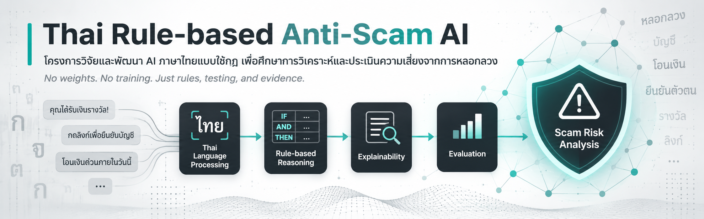
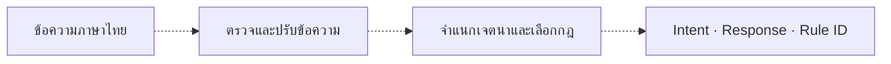
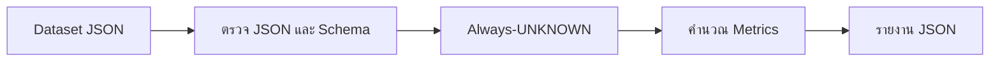

*ภาพแสดงแนวคิดงานวิจัย ปัจจุบัน AI Engine และ Scam Detection ยังไม่ได้ Implement*

# Thai Rule-based Anti-Scam AI

โครงการจบที่ศึกษาการพัฒนา AI ภาษาไทยแบบใช้กฎ เพื่อจำแนกเจตนาอย่างอธิบายได้ และวางพื้นฐานสำหรับการประเมินความเสี่ยงจากการหลอกลวง

[](https://github.com/siwakon8285/thai-anti-scam-ai/actions/workflows/ci.yml?query=branch%3Amain)

**สถานะ** เตรียมต้นแบบ V0.1 · **Python อ้างอิง** 3.14.8 · **Runtime** Python Standard Library

[ความสามารถปัจจุบัน](#current-capabilities) · [สถาปัตยกรรม](#system-architecture) · [เริ่มต้นใช้งาน](#getting-started) · [ผลประเมิน](#testing-and-evaluation) · [เอกสาร](#documentation) · [แผนพัฒนา](#capability-roadmap)

## Project Overview

โครงการศึกษาว่ากฎที่อธิบายและทดสอบได้ช่วยตีความข้อความภาษาไทยได้อย่างไร ขอบเขตต้นแบบ V0.1 คือการจำแนกเจตนาเบื้องต้นและตอบข้อความตาม [Behavior Specification](docs/v0.1-behavior.md) ปัจจุบันรันชุดทดสอบและประเมินตัวจำแนกอ้างอิงได้ ส่วน AI สนทนาและ Scam Detection ยังไม่ได้ Implement

## Current Capabilities

| ส่วนที่ใช้งานได้ | สิ่งที่ตรวจสอบได้ |
| --- | --- |
| [Development Dataset v0.1](datasets/development/v0.1.json) | ข้อความสมมติภาษาไทยและกรณีข้อความว่าง รวม 32 ตัวอย่าง ครบ 8 Intent |
| [Baseline Evaluator](scripts/evaluate_baseline.py) | ตรวจ JSON และ Schema แล้ววัด Intent Accuracy และ Confusion Matrix ของตัวจำแนก Always-UNKNOWN |
| [Automated Tests](tests/) | ตรวจชุดข้อมูล สูตรคำนวณ Strict JSON Parsing และพฤติกรรม CLI ของ Evaluator |

## System Architecture

**Planned AI Architecture — ยังไม่ได้ Implement** แผนของต้นแบบ V0.1 คืออ่านข้อความภาษาไทยและคืน Intent, คำตอบภาษาไทย และ Rule ID เมื่อมีกฎที่ทำงานจริง ตาม [Behavior Specification](docs/v0.1-behavior.md)



## Evaluation Architecture

**Current Implementation** Evaluator อ่าน Dataset แบบ UTF-8 ปฏิเสธคีย์ JSON ซ้ำและค่าตัวเลขที่แปลงเป็นอนันต์ แล้วตรวจ Schema ก่อนส่งแต่ละข้อความให้ตัวจำแนกอ้างอิง [โค้ด Evaluator](scripts/evaluate_baseline.py)



## Getting Started

ใช้ Python 3.14.8 เป็นเวอร์ชันอ้างอิงและรันจาก Repository Root

```bash
git clone https://github.com/siwakon8285/thai-anti-scam-ai.git
cd thai-anti-scam-ai
python3 -B --version
python3 -B -m scripts.run_tests
python3 -B -m scripts.evaluate_baseline
```

Evaluator แสดง JSON ทาง Terminal หากต้องการเก็บผลแยก ให้ใช้ `python3 -B -m scripts.evaluate_baseline --output reports/baseline-local.json`

## Testing and Evaluation

Test Runner ใช้ `unittest` ส่วน [GitHub Actions](.github/workflows/ci.yml) ตรวจ Python Syntax และรันชุดทดสอบเดียวกัน Badge ด้านบนแสดงสถานะ CI ของ `main`

| ผล Reference Baseline v0.1 | ค่า |
| --- | --- |
| Development Dataset | 32 ตัวอย่าง · 8 Intent |
| ตัวจำแนกอ้างอิง | Always-UNKNOWN |
| ผลทำนาย | ถูก 4 · ผิด 28 |
| Development Intent Accuracy | **12.5%** |

**12.5% เป็นผลของตัวจำแนกอ้างอิงบน Development Dataset** ใช้เป็นจุดเทียบในการพัฒนากฎ ความแม่นยำของ AI Engine และ Independent Evaluation ยังไม่มีผลให้รายงาน [รายงาน Baseline และ Confusion Matrix](reports/baseline-v0.1.json)

## Repository Structure

```text
thai-anti-scam-ai/
├── datasets/
│   ├── development/v0.1.json
│   └── regression/v0.1.json
├── docs/
│   ├── assets/
│   │   └── ban.png
│   ├── v0.1-behavior.md
│   ├── v0.1-behavioral-contract-analysis.md
│   ├── v0.1-thai-text-processing.md
│   ├── v0.1-rule-architecture.md
│   ├── v0.1-regression-spec.md
│   └── pybot-reference-and-design-rationale.md
├── reports/
│   ├── baseline-v0.1.json
│   └── text-processing-v0.1.json
├── scripts/
│   ├── experiments/text_processing.py
│   ├── evaluate_baseline.py
│   └── run_tests.py
├── tests/
├── thai_ai/
└── DESIGN.md
```

## Documentation

- [Behavior Specification V0.1](docs/v0.1-behavior.md) — Intent ที่รองรับตามแผน พฤติกรรมที่คาดหวัง และ Proposed Contract
- [Behavioral Contract Analysis V0.1](docs/v0.1-behavioral-contract-analysis.md) — ขอบเขต Intent การตรวจย้อนกลับ 32 ตัวอย่าง และข้อเสนอด้าน Regression
- [Thai Text Processing Experiments V0.1](docs/v0.1-thai-text-processing.md) — การทดลอง Unicode และการเทียบรูปข้อความภาษาไทย
- [Rule Architecture V0.1](docs/v0.1-rule-architecture.md) — ข้อเสนอการเลือก Intent และสัญญาคำตอบ
- [Regression Specification V0.1](docs/v0.1-regression-spec.md) — กรณีอ้างอิงและผลคาดหวังสำหรับทดสอบก่อนพัฒนา Engine
- [PyBot Reference Study](docs/pybot-reference-and-design-rationale.md) — กรณีศึกษา PyBot และเหตุผลที่เลือกปรับแนวคิดให้เหมาะกับภาษาไทย
- [DESIGN.md](DESIGN.md) — สถาปัตยกรรม แนวทางประเมิน และเหตุผลด้านการออกแบบ

## Capability Roadmap

| ขอบเขต | ความสามารถ |
| --- | --- |
| ปัจจุบัน | ชุดทดสอบและการประเมิน Reference Baseline |
| แผนต้นแบบ V0.1 | จำแนกเจตนาและตอบข้อความภาษาไทยตามข้อกำหนด |
| ระยะถัดไปตามผลทดลอง | เพิ่มความครอบคลุมของภาษาไทย ศึกษาบริบทและ Session Memory แล้วพัฒนาการประเมินความเสี่ยงและการทดสอบอิสระ |

ลำดับการเพิ่มความสามารถปรับได้ตามผลการทดลองใน [Adaptive Roadmap](DESIGN.md)

## Limitations and Ethical Considerations

- AI สนทนาและ Scam Detection ยังไม่ได้ Implement ผล Baseline จึงใช้ตัดสินความปลอดภัยของข้อความจริงไม่ได้
- ใช้ข้อมูลสมมติหรือข้อมูลที่ได้รับอนุญาตและตัดข้อมูลระบุตัวตน ชุด Held-out สำหรับการประเมินอิสระในอนาคตต้องแยกจากข้อมูลที่ใช้ปรับกฎ
- หากพัฒนาการประเมินความเสี่ยงในอนาคต ผลต้องอธิบายหลักฐานและข้อจำกัด หลีกเลี่ยงการกล่าวหาบุคคลหรือรับรองความปลอดภัยจากการไม่พบสัญญาณ
