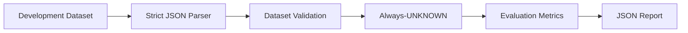
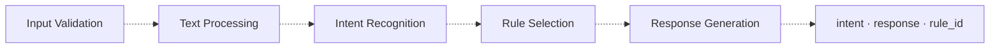
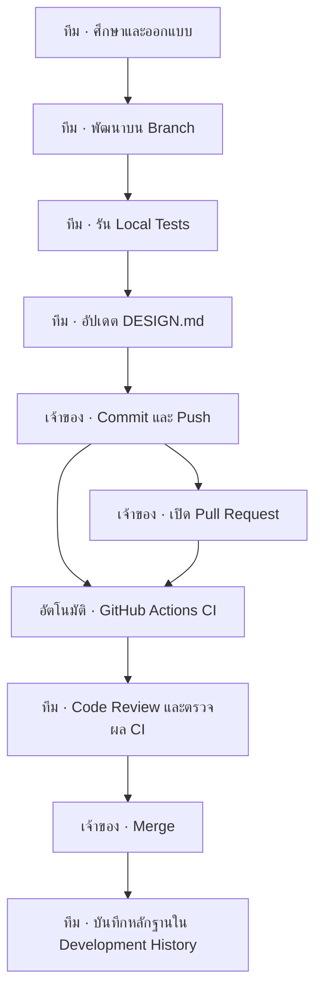
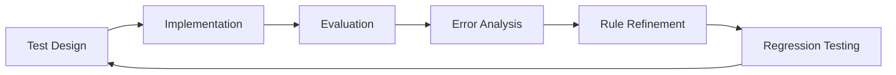

# Thai Rule-based Anti-Scam AI

โครงการจบที่ศึกษาการพัฒนา AI ภาษาไทยแบบใช้กฎ เพื่อให้ตรวจสอบได้ว่าระบบจำแนกเจตนาอย่างไร และวางพื้นฐานสำหรับการประเมินสัญญาณการหลอกลวงในอนาคต

[](https://github.com/siwakon8285/thai-anti-scam-ai/actions/workflows/ci.yml?query=branch%3Amain)

**Python อ้างอิง** 3.14.8 · **Runtime** Python Standard Library · **สถานะโครงการ** เตรียมต้นแบบ V0.1

Badge แสดงผลของ `main` เท่านั้น ส่วน Remote CI ของ TASK-004-R3 อยู่ในสถานะ `PENDING_REMOTE_VERIFICATION`

[ภาพรวม](#project-overview) · [ความสามารถ](#current-capabilities) · [สถาปัตยกรรม](#architecture) · [กระบวนการพัฒนา](#development-workflow) · [เริ่มต้นใช้งาน](#getting-started) · [การทดสอบ](#testing-and-evaluation) · [โครงสร้าง](#repository-structure) · [เอกสาร](#documentation-index) · [แผนพัฒนา](#adaptive-roadmap)

## Project Overview

แนวทางของโครงการคือกำหนดพฤติกรรมและเขียนกรณีทดสอบก่อนพัฒนากฎ จากนั้นวัดผล วิเคราะห์ข้อผิดพลาด และปรับกฎเป็นรอบ เพื่อให้ตรวจย้อนกลับได้ว่าผลลัพธ์เกิดจากกฎใด ขอบเขต V0.1 ที่วางแผนไว้คือการจำแนกเจตนาเบื้องต้นและการตอบข้อความภาษาไทยตาม [ข้อกำหนดพฤติกรรม V0.1](docs/v0.1-behavior.md)

สิ่งที่ใช้งานได้ใน Repository ปัจจุบันคือชุดทดสอบและตัวประเมิน Reference Baseline ส่วน AI Engine และ Scam Detection ยังไม่ได้ Implement จึงยังไม่มี Application หรือคำสั่งสำหรับเริ่มสนทนากับ AI

## Current Capabilities

### ใช้งานได้ใน Repository

| ส่วนประกอบ | สิ่งที่ทำได้ |
| --- | --- |
| Project Foundation | มีโครงสร้าง Package และข้อกำหนดโครงการ [Package](thai_ai/__init__.py) · [AGENTS.md](AGENTS.md) |
| Test Runner | ค้นหาและรัน `unittest` พร้อมคืนสถานะให้ CI และปฏิเสธกรณีพบ 0 Tests หรือ Skip ทั้งหมด [Test Runner](scripts/run_tests.py) |
| Automated Tests | ตรวจ Foundation, Test Runner, Dataset, Metrics, Strict JSON และ CLI [ชุดทดสอบ](tests/) |
| Development Dataset | ข้อความภาษาไทยสมมติและข้อความว่างรวม 32 ตัวอย่าง จาก 8 Intent [Dataset v0.1](datasets/development/v0.1.json) |
| Baseline Evaluator | คำนวณ Intent Accuracy, Per-intent Metrics และ Confusion Matrix [Evaluator](scripts/evaluate_baseline.py) |
| Strict JSON Parsing | ปฏิเสธคีย์ซ้ำทุกระดับ ค่าพิเศษ JSON และค่าที่แปลงเป็น `float` อนันต์ [Regression Tests](tests/test_baseline_json.py) |
| GitHub Actions CI | มี Workflow `CI` และ Job `Python Tests` สำหรับตรวจ Python Syntax และรัน Test Runner [Workflow](.github/workflows/ci.yml) |

### ยังไม่ได้ Implement หรือประเมิน

| ส่วนประกอบ | ขอบเขตที่วางแผนไว้ |
| --- | --- |
| Conversational AI Engine | ต้นแบบ V0.1 ตาม Behavior Specification |
| Intent Recognition Runtime | จำแนกข้อความตาม Intent Taxonomy ของ V0.1 |
| Response Generation Engine | เลือกคำตอบภาษาไทยตามกฎและพฤติกรรมที่คาดหวัง |
| Session Memory | หัวข้อสำหรับระยะถัดไปนอกขอบเขต V0.1 |
| Scam Detection Engine | หัวข้อสำหรับ Milestone ด้านความเสี่ยงในอนาคต |
| Independent Evaluation | ยังไม่มีผลจากชุดประเมินอิสระ |

## Architecture

### Current Evaluation Architecture

Evaluator อ่าน Dataset JSON แบบ UTF-8 ตรวจ JSON และ Schema ก่อนเรียกตัวจำแนกอ้างอิง แล้วคำนวณ Metrics เพื่อพิมพ์รายงาน JSON หรือบันทึกด้วย `--output` [โค้ด Evaluator](scripts/evaluate_baseline.py)



### Planned Architecture — Not Yet Implemented

แผนภาพนี้สรุปเส้นทางของ AI V0.1 ตามข้อกำหนด เส้นประแสดงองค์ประกอบที่ยังอยู่ในแผน [Behavior Specification](docs/v0.1-behavior.md) · [Design](DESIGN.md)



## Development Workflow

เจ้าของโครงการดูแล Git ส่วน GitHub Actions ทำงานอัตโนมัติเฉพาะการตรวจที่กำหนด Workflow รันเมื่อ Push ไปยังทุก Branch หรือเมื่อมี Pull Request ที่มีเป้าหมายเป็น `main` และรองรับ `workflow_dispatch` เมื่อไฟล์อยู่บน Default Branch งาน `Python Tests` ใช้ `ubuntu-latest` และ Python 3.14.8 [Workflow](.github/workflows/ci.yml)



### Iterative Rule Refinement

กระบวนการด้านล่างเป็นวิธีทำงานของทีมเมื่อเริ่มพัฒนากฎ แต่ละรอบใช้ผลทดสอบและการวิเคราะห์ข้อผิดพลาดประกอบการปรับกฎ ระบบ Auto-training ยังไม่ได้ Implement [Engineering Principles](AGENTS.md#engineering-principles)



## Getting Started

ใช้ Python 3.14.8 เป็นเวอร์ชันอ้างอิง คำสั่งด้านล่างไม่ต้องติดตั้ง Python Package เพิ่มเติม

```bash
git clone https://github.com/siwakon8285/thai-anti-scam-ai.git
cd thai-anti-scam-ai
python3 -B --version
python3 -B -m scripts.run_tests
```

สำหรับ Checkout ที่มี [Evaluator](scripts/evaluate_baseline.py) ให้รันจาก Repository Root ใช้คำสั่งแรกเพื่อดูผลใน Terminal หรือคำสั่งที่สองเพื่อบันทึกผลรอบใหม่เป็นไฟล์แยก

```bash
python3 -B -m scripts.evaluate_baseline
python3 -B -m scripts.evaluate_baseline --output reports/baseline-local.json
```

ใน `main` ขณะตรวจเอกสารมี Test Runner แล้ว ส่วน Evaluator ยังอยู่ใน Checkout ของ Baseline Branch

## Testing and Evaluation

- **Automated tests** ใช้ `python3 -B -m scripts.run_tests` ผล Local ของ TASK-004-R2 คือ **30/30 Tests** ไม่มี Failure, Error หรือ Skip [Development History](DESIGN.md)
- **Dataset validation** ตรวจ Schema, ID และ Input ซ้ำ, Intent Taxonomy และความสัมพันธ์ระหว่างข้อความว่างกับ `EMPTY_INPUT` [Dataset Tests](tests/test_dataset.py)
- **Evaluation** รายงาน Intent Accuracy, Support และผลถูกแยกตาม Intent พร้อม Confusion Matrix ที่ใช้แถวเป็น Expected Intent และคอลัมน์เป็น Predicted Intent [รายงาน Baseline](reports/baseline-v0.1.json)

| Baseline v0.1 | ผลที่บันทึกไว้ |
| --- | --- |
| Dataset | 32 ตัวอย่าง · 8 Intent · ประเภทละ 4 ตัวอย่าง |
| Predictor | Always-UNKNOWN สำหรับทุกข้อความ |
| ผลทำนาย | ถูก 4 · ผิด 28 |
| Development Intent Accuracy | **12.5%** |

**Dataset SHA-256** `dde615e2e63116f0f410027833f4f76dcc7928e44814f6e33fc5864078cbcaed`

12.5% เป็นคะแนนตัวจำแนกอ้างอิงบน Development Dataset ใช้เป็นจุดเทียบระหว่างพัฒนา ความแม่นยำของ AI Engine ต้องวัดจาก Engine ที่ Implement แล้ว ตามนโยบาย ชุด Held-out สำหรับการประเมินอิสระในอนาคตต้องแยกจากการปรับกฎ และเก็บนอก Public Repository กับ CI ปกติ

## Repository Structure

แสดงไฟล์โครงการใน Checkout นี้

```text
thai-anti-scam-ai/
├── .github/
│   └── workflows/
│       └── ci.yml
├── .gitignore
├── AGENTS.md
├── DESIGN.md
├── README.md
├── datasets/
│   └── development/
│       └── v0.1.json
├── docs/
│   ├── pybot-reference-and-design-rationale.md
│   └── v0.1-behavior.md
├── reports/
│   └── baseline-v0.1.json
├── scripts/
│   ├── __init__.py
│   ├── evaluate_baseline.py
│   └── run_tests.py
├── tests/
│   ├── __init__.py
│   ├── test_baseline.py
│   ├── test_baseline_json.py
│   ├── test_dataset.py
│   ├── test_foundation.py
│   └── test_run_tests.py
└── thai_ai/
    └── __init__.py
```

`scripts/` เป็นจุดเรียก Test Runner และ Evaluator, `tests/` เก็บ Automated Tests, `datasets/development/` เก็บข้อมูลสมมติ, `reports/` เก็บผลที่ตรวจซ้ำได้ และ `thai_ai/` มี Package ขั้นต้นสำหรับ AI Engine ที่ยังไม่ได้ Implement

## Documentation Index

| เอกสาร | ใช้ดู |
| --- | --- |
| [DESIGN.md](DESIGN.md) | สถาปัตยกรรม การตัดสินใจ และ Development History |
| [AGENTS.md](AGENTS.md) | ข้อกำหนดการทำงานและ Engineering Principles |
| [Behavior Specification V0.1](docs/v0.1-behavior.md) | Intent Taxonomy, Proposed Contract และพฤติกรรมที่คาดหวัง |
| [PyBot Reference Mapping](docs/pybot-reference-and-design-rationale.md) | สถาปัตยกรรม PyBot ที่ตรวจจาก Snapshot เหตุผลการออกแบบภาษาไทย แผนประเมิน และคำถามสำหรับนำเสนอ |

## Adaptive Roadmap

| สถานะ | งาน |
| --- | --- |
| Completed | Project Foundation และ GitHub Actions CI Merge แล้วตามหลักฐานที่เจ้าของโครงการยืนยัน |
| Current | `test/v0.1-baseline` มีข้อกำหนด V0.1, Dataset, Baseline, Strict JSON Validation และ Project Homepage ผล Remote CI ยังรอการยืนยัน |
| Proposed | TASK-005 AI Prototype V0.1 รออนุมัติให้เริ่ม |
| Planned | ปรับความครอบคลุมของภาษาไทย พิจารณา Session Memory, Scam Detection และ Independent Evaluation ตาม Milestone ใน DESIGN.md |

เจ้าของโครงการปรับลำดับหรือแทรกงานได้ตามผลทดลองและหลักฐานด้านคุณภาพ [Adaptive Roadmap ใน DESIGN.md](DESIGN.md)
