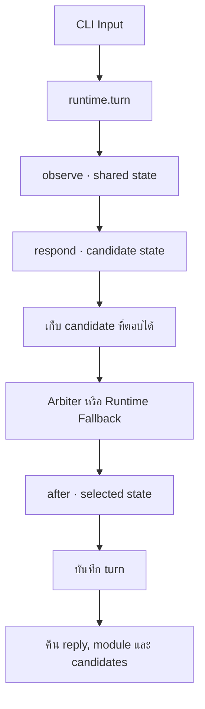
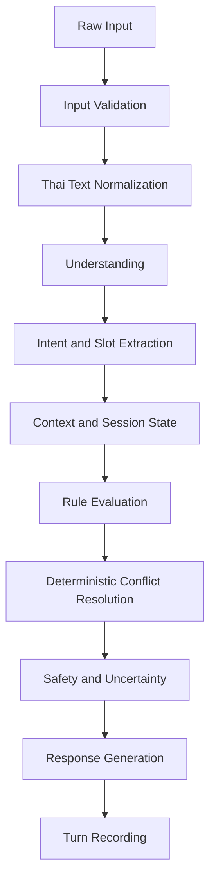
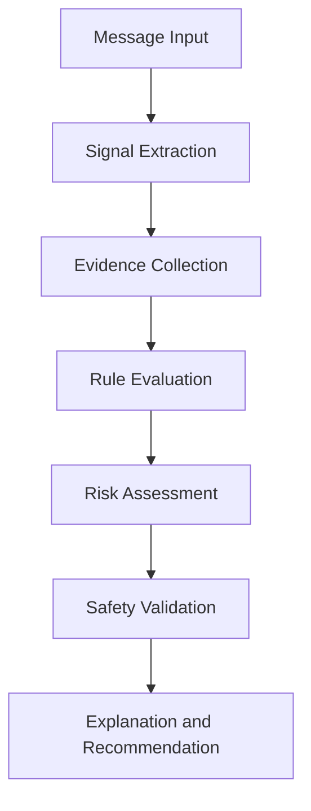

# PyBot Reference Mapping และเหตุผลด้านสถาปัตยกรรม

เอกสารประกอบการออกแบบและการนำเสนอของ `thai-anti-scam-ai` ใน TASK-004-R4 โครงการพัฒนาเครื่องมือและต้นแบบภาษาไทยของตนเอง โดยใช้ Hugging Face PyBot เป็นกรณีศึกษาเชิงสถาปัตยกรรม เอกสารนี้อ้างอิงแนวคิดและพฤติกรรมที่อ่านจากซอร์ส ส่วน Code, Rule Tables, Response Pools และ Dataset ของ PyBot ไม่ได้ถูกนำมาใช้ในงานนี้

## 1. ฐานหลักฐานและวิธีอ่านสถานะ

- **ฐานอ้างอิง** ใช้ข้อค้นพบ TASK-001 ที่บันทึกใน [DESIGN.md ข้อ 4](../DESIGN.md) ร่วมกับการอ่านไฟล์และตรวจรายการ Source Tree ผ่าน HTTPS แบบอ่านอย่างเดียวใน TASK-004-R4 ไฟล์รายงาน TASK-001 ฉบับเต็มยังไม่พบใน Repository นี้
- **Revision ที่ใช้จริง** `7d63c7fbebb44c7e466e5c8b5c1f341ab767929e` เป็น Public Snapshot สำหรับข้อค้นพบทั้งหมดของ PyBot ในเอกสารนี้ ค่า `SOURCE_COMMIT` ใน `pybot.py` คือ `24cbc0439e07fd015c0747ab3be6e782a42b5c5b` รายงานเดิมระบุว่าค้นไม่พบใน Public Repository API รอบนี้คำขอ Commit Lookup ได้ HTTP 422 จึงยังยืนยัน Revision นั้นจาก Repository สาธารณะไม่ได้และคงใช้ Snapshot ที่ระบุ [S01] · [S03]
- **วิธีศึกษา** เป็น Static Source Analysis ทั้งข้อค้นพบเดิมและการตรวจส่วนที่เลือกซ้ำ ไม่มีการรัน PyBot หรือชุดทดสอบ PyBot ตัวเลขการทดลองของผู้เผยแพร่ระบุแยกจากสิ่งที่อ่านยืนยันได้ใน Source Tree

| สถานะ | ความหมายในเอกสารนี้ |
| --- | --- |
| **Observed in PyBot** | พฤติกรรมหรือโครงสร้างที่พบในซอร์สของ Snapshot ที่ระบุ |
| **Adopted** | หลักการที่โครงการเลือกใช้แล้ว เช่น แยกความรับผิดชอบและพัฒนาแบบ Test-first |
| **Adapted** | หลักการที่เลือกมาใช้โดยปรับขอบเขตหรือวิธีให้เหมาะกับภาษาไทยและการประเมินความเสี่ยง |
| **Implemented** | มีโค้ด การตั้งค่า หรือสิ่งส่งมอบรูปธรรมที่ตรวจได้ใน Repository ปัจจุบัน |
| **Proposed** | ข้อเสนอเชิงออกแบบที่ยังต้องตกลง Contract หรือทดลองก่อนนำไปพัฒนา |
| **Future Work** | งานที่ยังไม่มี Implementation ใน Repository ปัจจุบัน |
| **Rejected** | แนวทางที่พิจารณาและตัดออกสำหรับขอบเขตที่ระบุ |

**Adopted** หรือ **Adapted** เป็นสถานะการเลือกแนวทาง สถานะการส่งมอบต้องพิจารณาแยกจากหลักฐานของ **Implemented** คำว่า “แนวทางสอดคล้องกับ” ใช้เมื่อพบความคล้ายกันแต่ไม่มีหลักฐานว่าโครงการรับแนวทางนั้นจาก PyBot โดยตรง

## 2. สถาปัตยกรรม PyBot ที่สังเกตได้

### 2.1 โครงสร้าง Repository

| ส่วน | หน้าที่ที่พบใน Snapshot |
| --- | --- |
| `pybot.py` | จุดเข้า CLI รองรับ Interactive, One-shot และ Pipe จัดการคำสั่งของ CLI เช่น Reset และแสดงผลจาก Runtime [S03] |
| `bot/runtime.py` | ค้นและเรียงโมดูล เรียก Hooks จัด Candidate เลือกผล และบันทึก Turn [S04] |
| `bot/understanding/` | สร้างตัวแทนของข้อความ วิเคราะห์ชนิดข้อความ คำสำคัญ Topic, Entity และ Reference [S05] |
| `bot/modules/` | โมดูลจัดการเหตุการณ์ใน Turn เช่น Understanding, Intent, Memory, Answers, Safety และ Arbiter [S06] |
| `bot/memory/` | โครงสร้างช่วยจัดการ User Facts, Fact History และการอ่าน Turn ก่อนหน้า [S07] |
| `bot/knowledge/` | Registry ของ Knowledge Entries ตาม Domain พร้อม Lookup, Index, Scoring และ Guards [S08] |
| `bot/compose/` | ตัวประกอบคำตอบและตัวช่วยเลือกข้อความจาก Response Pools รวมถึง Fallback Chain [S09] |
| `tests/` | มี `test_cli.py` ซึ่งทดสอบพฤติกรรม CLI ผ่าน subprocess [S10] |

`pyproject.toml` ระบุ Python ขั้นต่ำ 3.8 และไม่มี Runtime Dependencies ส่วน `setuptools` เป็น Build Dependency หลักฐานนี้ประกอบกับเส้นทางตอบที่อ่านยืนยันว่าไม่พบการเรียก LLM inference ในเส้นทาง Runtime ที่ศึกษา การใช้ Agent และ LLM Judge ที่รายงานโดยผู้เผยแพร่เกิดในงานพัฒนาและการประเมิน [S02] · [S11]

### 2.2 Runtime Lifecycle, Priority และ State

1. **Module Discovery** Runtime ค้นใต้ `bot/modules/` ผ่าน `pkgutil` และ Import แบบ Dynamic ขณะตั้งค่า Hooks ถ้า Import โยน `Exception` โมดูลนั้นถูกข้าม ค่า Priority ที่ไม่ได้กำหนดหรือชนิดที่ Runtime ไม่รับใช้ค่า 0 เรียง Priority จากมากไปน้อยและเรียงชื่อโมดูลเมื่อเท่ากัน
2. **Observe** เรียก Observer ตามลำดับบน Session Dictionary ร่วมกัน ข้อมูลที่ Observer ต้นลำดับบันทึก เช่น Understanding Record จึงเป็นข้อมูลให้ Observer หรือ Handler ถัดไปเข้าถึงได้
3. **Respond และ Candidate Collection** แต่ละ Handler เสนอข้อความหรือผ่าน Runtime รับเฉพาะคำตอบที่เป็นสตริงและไม่ว่างเมื่อ Trim แล้ว Candidate เก็บชื่อโมดูล, Priority และคำตอบ พร้อม State ที่สัมพันธ์กับข้อเสนอแยกไว้
4. **State Copying** โดยปกติ Runtime ทำ Deep Copy ค่าแต่ละรายการก่อนเรียก `respond()` แต่ให้ `turns` ใช้ List ร่วมกัน หาก Copy ล้มเหลวจะคืน State ต้นฉบับให้ Handler นั้น การแยกผลข้างเคียงของข้อเสนอจึงขึ้นกับการ Copy และวินัยในการเขียน Hooks
5. **Selection และ Fallback** Runtime เรียก Arbiter เมื่อมี Candidate ตั้งแต่สองรายการ ถ้า Arbiter ขาดหาย โยน Exception หรือคืนค่าไม่ตรงเงื่อนไข Runtime ใช้ Candidate แรกตามลำดับเดิม ถ้าไม่มี Candidate เลยจึงคืนข้อความสำรองคงที่และค่าโมดูลว่าง สองกรณีนี้มีสาเหตุแตกต่างกัน
6. **After และ Turn** เมื่อ State ที่ชนะเป็น Copy Runtime อัปเดต Dictionary ร่วมด้วยข้อมูลชุดนั้น แล้วเรียก `after()` ของโมดูลที่มี Hook โดยใช้คำตอบที่เลือก จากนั้นเพิ่ม user text, bot reply และ module ลงใน `turns` และคืนผลให้ CLI ตัว CLI เองมีชั้นจัดรูปแบบคำตอบและคำตอบสำรองเมื่อการเรียก Runtime โยน Exception อีกชั้น

การข้าม Exception ช่วยให้ CLI ตอบต่อได้เมื่อโมดูลหนึ่งเสีย แต่ผู้ใช้และผู้ทดสอบอาจมองไม่เห็นว่าขั้นใดผิดพลาด การข้าม Observer หรือ Handler ที่ทำงานไปบางส่วนก็ไม่มีการย้อน State โดยอัตโนมัติในจุดที่ใช้ Dictionary ร่วมกัน [S03] · [S04] · [S06]

### 2.3 Understanding Engine

- **Normalization** เก็บ `text` ต้นฉบับ และสร้างหลายมุมมอง `clean` เป็นข้อความที่ปรับรูปอักขระและช่องว่างบางส่วนสำหรับการอ่าน, `plain` ซ่อมรูปคำในแนวเดิมโดยยังรักษาลำดับและเครื่องหมายตามเจตนาของโค้ด และ `norm` / `norm_text` ใช้การตีความที่ละเอียดขึ้น เช่น ขยายคำย่อและ Contractions แยก Clause และระบุ Focus นอกจากนี้ยังมี `words`, `fixes` และข้อมูลประกอบอื่น
- **Keyword Extraction และ Pattern Matching** ใช้ Lexicon, Regex, Token Forms และวลีเพื่อดึงคำสำคัญ ความหมายของสัญญาณขึ้นกับรูปข้อความที่แต่ละ Reader เลือกอ่าน รูปประโยคและคำปฏิเสธจึงทำให้คำเดียวกันส่งผลต่างกันได้
- **Intent และ Topic** `kinds.classify()` ช่วยอ่านชนิดของข้อความ ขณะที่ `bot/modules/intent.py` เพิ่มลักษณะคำตอบที่คำถามต้องการลงใน Understanding Record การตรวจ Topic และ Entity อยู่ใน `topics.py` สิ่งเหล่านี้เป็นหลายสัญญาณใน Understanding Record ไม่ควรเทียบตรงตัวกับ Output Intent เดียวของ V0.1 ในโครงการเรา
- **Reference Resolution และ Context** Reader ใช้ข้อความก่อนหน้า Entity และ Topic เพื่ออ่านคำชี้อ้างและ Follow-up โดยมีเงื่อนไขตรวจการเปลี่ยนหัวข้อหรือผู้ถูกกล่าวถึง โมดูล Understanding เรียกขั้นอ่านก่อนและบันทึกผลใน `memory["understood"]` เพื่อให้ขั้นอื่นใช้ร่วมกัน

ตัวอย่างใน TASK-001 คือโครงประโยคแนะนำตัวที่มี `is` ตรงกับ Name Pattern ที่อ่าน ส่วนรูปที่ตัดคำดังกล่าวออกไม่ตรง Pattern เดียวกันใน Session ใหม่ ตัวอย่างนี้อธิบายความไวต่อโครงประโยคจาก Static Trace เท่านั้น ยังไม่มีผลการรันจริงหรือหลักฐานว่าคำตอบสุดท้ายมาจาก Candidate ใด [S05] · [S06] · [S12]

### 2.4 Memory และ State Update

| ส่วน | สิ่งที่พบและขอบเขต |
| --- | --- |
| User Facts | Dictionary `user` เก็บข้อเท็จจริงที่ตัวอ่านสกัดได้ โมดูล Memory Store มีเส้นทางสกัดและอัปเดต Fact รวมถึงกรณีแก้ข้อความจาก Turn ก่อน |
| Fact History | `facts_log` ใช้บันทึกการเปลี่ยนค่าบางประเภท โดยมี Key, Value, ตำแหน่ง Turn และข้อความที่สัมพันธ์ตามเส้นทางที่ตรวจ |
| Session Turns | Runtime เก็บข้อความผู้ใช้ ข้อความบอต และชื่อโมดูลต่อ Turn ใน `turns` ซึ่งไม่ใช่รายการเดียวกับ Fact History |
| Recall และ Context | Reader ใช้ Facts หรือ Turn ก่อนหน้าเพื่อเรียกคืนสิ่งที่เคยกล่าว กันการอ้างถึงบทสนทนาที่ไม่มีจริง หรืออ่านคำอ้างอิงตามหัวข้อ |
| State Update | Observer ได้ State ร่วม ส่วน State ของ Handler ที่ตอบถูกเลือกจะถูกนำมาใช้ตามเงื่อนไขการ Copy แล้ว After Hook จึงทำงาน |

เส้นทาง `pybot.py` ที่ตรวจสร้าง Dictionary ในหน่วยความจำ One-shot เริ่มใหม่ทุกการเรียก ส่วน Pipe และ Interactive แบ่งปัน State ภายใน Session ของการรันนั้น ใน Interactive คำสั่ง Reset สร้าง Dictionary ใหม่ ไม่พบการบันทึก Chat State ลง Persistent Storage ในเส้นทาง CLI นี้ และขอบเขตการตรวจไม่ครอบคลุมการเก็บข้อมูลของบริการที่โฮสต์ PyBot [S03] · [S04] · [S07] · [S12]

### 2.5 Knowledge และ Response

1. **Structured Knowledge Entries** Domain ส่งรายการ Entry เข้าสู่ Registry โดย Entry มี ID, Key, Reply และตัวเลือก เช่น คำที่ต้องเลี่ยง เงื่อนไขรูปคำถาม Bias และ Guard
2. **Lookup และ Word Index** สร้าง Index จากรูปคำไปยังตำแหน่งของ Entry เพื่อจำกัดขอบเขต Candidate Retrieval ในกรณีที่พบคำร่วม เส้นทาง `_reaching()` ที่ตรวจคืนรายการเดิมเมื่อ Index ไม่พบ Hit แล้วให้การให้คะแนนและเงื่อนไขภายหลังตัดสิน
3. **Scoring และ Guards** Matcher ให้คะแนนความสอดคล้องของคำและบริบทในเส้นทางที่รองรับ Guard ตรวจว่าข้อความมีความหมายตามขอบเขตของ Entry ก่อนตอบ การจัดอันดับภายใน Knowledge จึงเป็นคนละระดับกับ Arbiter ที่ตัดสินคำตอบข้ามโมดูล
4. **Templates, Pools และ Composition** โมดูลคำตอบมีเส้นทางใช้ Template จัดข้อความจากข้อมูลที่มี และ Composition มี Response Pools กับตัวช่วยเลือกข้อความโดยพิจารณา Turn ก่อนหน้า ตัวอย่าง `pick()` ใช้ Seed จาก Turn และข้อความหากผู้เรียกส่งมาเพื่อเลือกจากรายการที่ผ่านการกรอง
5. **Fallback Chain** ฝั่ง Composition มีลำดับ Pattern และ Pools สำหรับตอบเมื่อไม่พบคำตอบเฉพาะหรือเมื่อบริบทบ่งชี้ว่าควรตอบแบบทั่วไป ชั้นนี้ต่างจากคำตอบคงที่ของ Runtime เมื่อไม่เหลือ Candidate

Index และ Guards ช่วยให้ต่อยอดรายการความรู้โดยแยกการค้นจากการสร้างข้อความ แต่ต้องทดสอบทั้งกรณีคำเหมือนแต่ความหมายต่าง และกรณีที่การจำกัด Candidates ทำให้ตกหล่น ตัวเลขประสิทธิภาพที่ปรากฏในคอมเมนต์หรือรายงานไม่ถูกใช้เป็น Benchmark ของโครงการเรา [S04] · [S08] · [S09] · [S13]

### 2.6 Rule Arbitration และ Safety

Runtime ใช้ Priority และชื่อโมดูลสร้างลำดับ Candidate พื้นฐาน ส่วน Arbiter ประเมินกฎเพิ่มเติม เช่น ความสอดคล้องกับหัวข้อ การแก้รายละเอียดจาก Turn ก่อน และการกรองคำตอบที่อ้างถึงบทสนทนาที่ไม่เคยเกิดขึ้น จุดเปรียบเทียบคะแนนที่ตรวจจุดหนึ่งเก็บ Candidate ที่มาก่อนเมื่อคะแนนเท่ากัน พฤติกรรมนี้ไม่ควรถูกสรุปว่าทุกเส้นทางใช้คะแนนเดียวหรือ Tie-break แบบเดียว

Safety Module ใช้ Priority Band ที่สูง และเส้นทาง `_choose()` ที่ตรวจให้ Candidate ใน Band ดังกล่าวผ่านก่อนการกรองคำตอบซ้ำบางช่วง การมี Band ช่วยให้เห็นตำแหน่งของกฎ Safety แต่ Static Analysis ไม่ยืนยันความครอบคลุม ความแม่นยำ หรือการรับประกันผลในทุกเส้นทาง ข้อดีของ Arbiter คือรองรับกฎเฉพาะทางหลายชุดและรวมการตัดสินไว้ที่จุดเดียว ข้อจำกัดคือกฎหลายชั้นและการเปลี่ยน State ทำให้วิเคราะห์ Regression ยาก หากโมดูลถูกข้ามหรือ Arbiter ตกกลับไปยัง Candidate แรก คำตอบที่ได้อาจต่างจากเส้นทางปกติโดยไม่แสดง Error ต่อผู้ใช้ [S04] · [S06] · [S13]

### 2.7 Testing และ Evaluation ที่มีหลักฐาน

- **Observed in PyBot** นับได้ 12 Test Methods ใน `tests/test_cli.py` ที่ Snapshot นี้ ใช้ subprocess ทดสอบ Interactive, One-shot และ Pipe รวมถึงการสนทนาหลาย Turn และ Reset ตัวเลขนี้เป็นจำนวน Method จากซอร์ส และงานนี้ไม่ได้รัน Tests เหล่านั้น [S01] · [S10]
- **สิ่งที่ไม่พบใน Source Tree ที่ตรวจ** ไม่พบ Development Dataset, Rule-specific Test Suite แยก, Benchmark Harness หรือ CI Workflow สำหรับ Runtime พบ `.github/dependabot.yml` ซึ่งเป็นการตั้งค่าอัปเดต Dependency การไม่พบใน Snapshot ไม่ได้สรุปว่าเครื่องมือเหล่านั้นไม่เคยมีภายใน [S01]
- **Reported by publisher** README ระบุการพัฒนาโดย Agent Swarm มากกว่า 1,000 Agents การสร้างและประเมินมากกว่า 5,000 เวอร์ชัน และประมาณ 550,000 บรรทัดของ Tests พร้อมรายงาน SmolTalkBench Win Rate จาก 0% เป็น 26% โดยใช้ LLM Judge จำนวนบรรทัด Tests ดังกล่าวเป็นคำรายงานของผู้เผยแพร่ ส่วนที่ตรวจซ้ำได้จาก Public Snapshot คือ CLI Tests ข้างต้น SmolTalkBench เป็นงานประเมินภาษาอังกฤษแบบ Single-turn ที่มี 1,000 Prompts และไม่ได้ใช้เป็น Benchmark ของโครงการเรา [S11] · [S14]

## 3. Mapping ระหว่าง PyBot กับโครงการ

คอลัมน์ Status ระบุการเลือกแนวทางและสถานะการส่งมอบแยกกัน คอลัมน์ Test คือหลักฐานที่มีหรือกรณีที่ต้องใช้ยืนยันในอนาคต รายละเอียดโครงการอ้างจาก [DESIGN.md](../DESIGN.md), [Behavior v0.1](v0.1-behavior.md) และ [AGENTS.md](../AGENTS.md)

| PyBot Concept | PyBot Implementation | Our Project Adaptation | Status | Reason | Test หรือหลักฐานยืนยัน |
| --- | --- | --- | --- | --- | --- |
| 1. Standard Library Runtime | Runtime Dependencies ว่างใน `pyproject.toml` [S02] | ใช้ Python Standard Library กับเครื่องมือปัจจุบันตามข้อกำหนดโครงการ แนวทางสอดคล้องกับ PyBot | Adopted · Implemented ใน Evaluation Tooling | ลดภาระติดตั้งและคุมสภาพแวดล้อม งบความซับซ้อนให้กับคุณภาพกฎ | รัน Test Runner และ Evaluator ด้วย Python อ้างอิงโดยไม่ติดตั้ง Package |
| 2. Modular Architecture | แยก Runtime, Understanding, Memory, Knowledge และ Composition [S01] · [S04] | แยก CLI, Engine, การตีความ และการตอบตามหน้าที่ เครื่องมือประเมินแยกจาก Package AI แล้ว | Adopted · Implemented เฉพาะ Tooling · Engine เป็น Future Work | เปลี่ยนส่วนหนึ่งและทดสอบได้โดยควบคุมผลกระทบ | Smoke Test การ Import ปัจจุบัน ภายหลังทดสอบ Engine โดยไม่ผ่าน Terminal |
| 3. Text Normalization | เก็บหลายมุมมองรวม Clean, Plain และ Normalized [S05] | เก็บ Raw Text ควบคู่ข้อความที่ปรับอย่างระมัดระวัง ทดลองตัวเลือกกับภาษาไทย | Adapted · Future Work | ลดการเปลี่ยนความหมายและรักษาหลักฐาน | เปรียบเทียบ Raw กับ Candidate Normalization ในกรณี Unicode, คำปฏิเสธ, URL และจำนวน |
| 4. Intent Recognition | แยกชนิดข้อความและลักษณะคำตอบที่ผู้ใช้ต้องการ [S05] · [S06] | กำหนด Taxonomy 8 Intent และแยกคำถามขอบเขตจากการขอความช่วยเหลือโดยตรง | Adapted · Implemented เฉพาะ Specification และ Label · Runtime เป็น Future Work | กำหนด Contract ก่อนปรับกฎและตรวจข้อขัดแย้งได้ | Behavioral Regression ของ `HELP`, `BOT_IDENTITY`, `BOT_CAPABILITIES` และ `EMPTY_INPUT` |
| 5. Keyword and Pattern Matching | ใช้ Lexicon, Regex และรูปร่างคำร่วมกับเงื่อนไข [S05] · [S08] | เสนอพิจารณาคำและ Pattern ภาษาไทยพร้อม Counterexample และขอบเขตข้อความ | Proposed · Future Work | คำเดียวอาจอยู่ในคำปฏิเสธ คำยกมาเล่า หรือชื่อเฉพาะ | Minimal Pairs ที่คำเหมือนกันแต่ Expected Outcome ต่างกัน |
| 6. Information Extraction | สกัด Facts, ชื่อ, Entities และหน่วย [S05] · [S12] | เสนอ Slot Extraction เฉพาะเขตข้อมูลที่รุ่นนั้นใช้จริง | Proposed · Future Work นอก V0.1 | ลดการเก็บข้อมูลและจำกัดความผิดพลาดจากการยึดโยงข้อมูลผิดคน | Exact Value หรือ Span ของ Slot, ข้อมูลขาด, ค่าขัดแย้ง และกรณีไม่ควรสกัด |
| 7. Session Memory | Facts, Fact Log และ Turns ใน Session Dictionary [S03] · [S07] | พิจารณา Session State ขนาดเล็กต่อ Session พร้อมขอบเขต Reset และไม่เขียนข้อความจริงลง Log อัตโนมัติ | Adapted · Future Work นอก V0.1 | คุมวงจรข้อมูลและจำกัดการรั่วข้าม Session | สอง Session แยกกัน, Recall, Reset และปฏิเสธการคืนข้อมูลข้าม Session |
| 8. Context Resolution | อ่าน Reference จาก Entity, Topic และ Turn ก่อนหน้า [S05] | เสนอใช้บริบทเฉพาะเมื่อมีหลักฐานยึดโยง ใช้ผลไม่แน่ชัดเมื่ออ้างอิงหลายอย่างได้ | Proposed · Future Work | ลดการเติมประธานหรือเปลี่ยนผู้ถูกกล่าวถึงจากการเดา | คู่บทสนทนาที่ลำดับเหมือนกันแต่ Referent ต่างกัน และกรณีเปลี่ยนหัวข้อ |
| 9. Knowledge Entries | Registry ตาม Domain, Entry ID, Index และ Guard [S08] | เสนอ Entry แบบมีที่มา วันที่ตรวจ และขอบเขตสัญญาณ เพิ่ม Index เมื่อมีเหตุผลจากการวัด | Adapted · Future Work | ตรวจที่มาและแก้เนื้อหาได้โดยไม่เปลี่ยนการจำแนกเจตนา | Lookup, Source/Version Trace, Guard ปฏิเสธกรณีคล้ายกัน และความครบถ้วนเมื่อเพิ่ม Index |
| 10. Rule Priority | เรียงตาม Priority แล้วตามชื่อโมดูล [S04] | ใช้ลำดับที่อธิบายได้และ Rule ID ในการออกแบบของเรา โดยวิธีตั้ง Priority ต้องทบทวนตาม Scope | Adopted · Proposed Contract · Future Work | ผลควรตรวจซ้ำได้โดยไม่ขึ้นกับลำดับ Import | สลับลำดับลงทะเบียนแล้วตรวจกฎที่ชนะตาม Contract |
| 11. Conflict Resolution | Arbiter รวม Priority, Context Guards และการเปรียบเทียบ [S06] · [S13] | เสนอ Resolver ที่กำหนดลำดับและ Tie-break ชัดเจน ให้ทดสอบกฎขัดแย้งก่อนเพิ่มเงื่อนไข | Adapted · Future Work | ลดผลข้างเคียงและตรวจเหตุผลได้จากผลเลือก | Positive Match, Tie, ข้อยกเว้น และกรณีควร Abstain |
| 12. Response Templates | โมดูลมี Templates และ Response Pools พร้อมตัวประกอบข้อความ [S09] · [S13] | เสนอ Template ภาษาไทยที่รักษา Contract และตรวจจากความหมายของคำตอบ | Adapted · Future Work | คุมถ้อยคำและไม่กล่าวอ้างความสามารถเกินจริง | ตรวจองค์ประกอบจำเป็น Forbidden Claims และ Template ที่ไม่มีข้อมูลพอ |
| 13. Fallback | Composition มี Chain และ Runtime มีข้อความคงที่เมื่อ Candidate ว่าง [S04] · [S09] | แยก `UNKNOWN`, `EMPTY_INPUT`, ข้อมูลไม่พอ และข้อผิดพลาดภายใน | Adapted · Implemented เฉพาะ Specification · Runtime เป็น Future Work | รักษาพฤติกรรมและแยกข้อมูลไม่พอออกจากความผิดพลาดของระบบ | ข้อความนอกขอบเขต, whitespace, กฎไม่ตรง, Internal Error และ `rule_id` ตาม Contract |
| 14. Multi-turn Processing | ใช้ Turns และ Facts ให้โมดูลอ่านย้อนหลัง [S04] · [S07] | เมื่อตกลง Memory แล้ว ให้แยก State Update จากการเลือกคำตอบและกำหนด Reset | Proposed · Future Work นอก V0.1 | แยกผลของ Context จาก Single-turn Baseline ก่อนเพิ่มความซับซ้อน | ลำดับถาม–ตอบ, แก้ Fact, เปลี่ยนหัวข้อ และ Reset |
| 15. Regression Testing | Snapshot มี CLI Tests รวม Multi-turn และ Reset [S10] | แนวทางสอดคล้องกับ PyBot ในการตรวจเส้นทางใช้งานจริง โครงการใช้ `unittest` สำหรับ Tooling และจะเพิ่ม Behavior Regression เมื่อมี Engine | Adopted · Implemented สำหรับ Tooling · Behavior เป็น Future Work | รักษาผลเดิมขณะเพิ่มความสามารถและจับข้อผิดพลาดผ่าน CLI | Suite ปัจจุบันและ Test ตาม Case ID ที่กำหนดก่อนปรับกฎ |
| 16. Evaluation Strategy | ผู้เผยแพร่รายงาน English Single-turn Win Rate ด้วย LLM Judge [S11] · [S14] | ใช้ Known Labels, Always-UNKNOWN และ Metrics ตรวจซ้ำได้ใน Development เริ่มแยกมาตรวัดด้าน Scam ในแผน | Adapted · Implemented สำหรับ Reference Baseline · Independent Evaluation เป็น Future Work | เปรียบเทียบ Predictor ด้วยฐานเดียวกัน และวัดความเสี่ยงด้วยตัวชี้วัดที่ตรงโจทย์ | เทียบรายงานและ Hash, Known-answer Metric Tests, แผนประเมินอิสระก่อนเปิดผล |
| 17. Explainability | ผล Runtime มีชื่อโมดูลและ Candidates และ CLI มีโหมดแสดงข้อมูลโมดูล [S03] · [S04] | เสนอ `rule_id` สำหรับกฎที่ทำงานจริง ส่วนเหตุผลด้านความเสี่ยงต้องอ้างถึงหลักฐานและข้อจำกัด | Adapted · Proposed Contract · Future Work | ชื่อโมดูลอย่างเดียวไม่พอต่อการอธิบายผลความเสี่ยงของงานเรา | Trace จาก Expected Match ไปยัง Rule ID และหลักฐาน รวมถึงกรณีที่ต้องคืน `null` |
| 18. Safety Handling | Safety Module และ Priority Band แยกจากโมดูลตอบทั่วไป [S06] · [S13] | เสนอ Safety Validation แยกจาก Intent และ Risk Level ให้มีทางออกเมื่อหลักฐานไม่พอ | Adapted · Proposed · Future Work | ลดข้อกล่าวหาเกินหลักฐานและป้องกันคำแนะนำที่ไม่สอดคล้องกับผล | กรณีไม่เสี่ยงที่มีคำร่วม กรณีข้อมูลไม่พอ และความสอดคล้อง Risk, Evidence, Explanation |

## 4. สถาปัตยกรรมของโครงการ

### 4.1 Current Implementation

ตรวจจากเนื้อหาไฟล์จริงใน Checkout ของ TASK-004-R4 ดังนี้

| สิ่งที่ตรวจพบ | สถานะและหลักฐาน |
| --- | --- |
| Project Foundation | **Implemented** ในฐานะ Package ขั้นต้น `thai_ai/__init__.py` มี Docstring เท่านั้น ไม่มี Engine [Package](../thai_ai/__init__.py) |
| Test Runner และ Automated Tests | **Implemented** มี Test Discovery, Exit Code และการป้องกัน Suite ว่างหรือ Skip ทั้งหมด ชุดทดสอบตรวจ Foundation, Runner, Dataset, Evaluator, Strict JSON และ CLI [Runner](../scripts/run_tests.py) · [Tests](../tests/) |
| Intent Taxonomy และ Behavior Specification | **Implemented ในฐานะเอกสารและชุด Label** มี 8 Intent และ Proposed Contract ไม่มีตัวจำแนก Intent ขณะสนทนาที่เรียกใช้ได้ [Behavior v0.1](v0.1-behavior.md) · [Dataset](../datasets/development/v0.1.json) |
| Development Dataset | **Implemented** ในฐานะข้อมูลสมมติ v0.1 จำนวน 32 ตัวอย่าง ประเภทละ 4 ตัวอย่าง [Dataset](../datasets/development/v0.1.json) |
| Baseline Evaluator และ Strict JSON Parsing | **Implemented** ใช้ Always-UNKNOWN, ตรวจ Schema, ปฏิเสธค่าพิเศษและคีย์ซ้ำ แล้วสรุป Metrics และรายงาน JSON [Evaluator](../scripts/evaluate_baseline.py) · [Report](../reports/baseline-v0.1.json) |
| GitHub Actions CI | **Implemented ในฐานะ Workflow Configuration** ตั้งค่าให้ตรวจ Syntax และรัน Test Runner ด้วย Python 3.14.8 ผล Remote CI ของ TASK-004-R4 ยังรอหลักฐาน [Workflow](../.github/workflows/ci.yml) |
| Conversational Runtime, Intent Recognition Runtime และ Response Generation | **Future Work** มีเพียง Contract และแผนสำหรับต้นแบบ [Behavior v0.1](v0.1-behavior.md) |
| Session Memory และ Scam Detection | **Future Work** อยู่นอกขอบเขต V0.1 ไม่มีการประเมินอิสระของสองความสามารถนี้ [Roadmap](../DESIGN.md) |

เส้นทางที่รันได้จริงคือ **Development JSON → Strict Parser → Dataset Validation → Always-UNKNOWN → Metrics → JSON Report** ส่วน CI รัน Syntax Check และ Test Runner รายงาน Baseline ที่มีอยู่คือถูก 4 จาก 32 ตัวอย่างหรือ 12.5% บน Development Dataset [Current Evaluation Architecture](../README.md#architecture) · [รายงาน Baseline](../reports/baseline-v0.1.json)

### 4.2 Proposed Conversational Architecture

**Proposed — Not Yet Implemented** แผนภาพแสดงภาพรวมสำหรับการศึกษาในหลาย Milestone ส่วน V0.1 มีขอบเขตตาม Behavior Specification ปัจจุบัน โดย Slot Extraction, Session State ขั้นเต็ม และ Turn Recording อยู่นอกขอบเขตที่ตกลงไว้สำหรับ V0.1

| ขั้น | สัญญาและเหตุผลที่เสนอ |
| --- | --- |
| Raw Input และ Input Validation | รับ Python `str` เก็บข้อความต้นฉบับตลอดการประมวลผล และแยก Input ผิดชนิดออกจากข้อความว่าง ข้อเสนอ `TypeError` ยังต้องยืนยันตาม Contract |
| Thai Text Normalization | ให้ตัวตีความอ่านรูปข้อความที่ผ่านการปรับโดยรักษา Raw Text และตัวเลข URL หรือคำปฏิเสธที่มีผลต่อความหมาย |
| Understanding → Intent and Slot Extraction | สร้างสัญญาณจากภาษาไทยและคืน Intent ใน Taxonomy สำหรับข้อความหนึ่งรายการ ส่วน Slots ใช้ใน Milestone ที่กำหนด |
| Context and Session State | ระบุความเชื่อมโยงกับ Turn เดิมเมื่อมีหลักฐานและเก็บเฉพาะข้อมูลที่จำเป็น เมื่อไม่มี State ในต้นแบบให้ตัดสินจากข้อความปัจจุบัน |
| Rule Evaluation → Conflict Resolution | รวบรวมผล Match ตรวจ Guard และเลือกตามลำดับที่ตกลงกัน พร้อม Tie-break ที่ทดสอบได้ ตัวอย่างทางเลือกที่ต้องทบทวนคือ Priority ที่ประกาศชัดเจนและ Rule ID ที่เสถียร |
| Safety and Uncertainty | แยก Unknown, หลักฐานไม่พอ และ Error ออกจากผล Match ที่สมบูรณ์ พร้อมปฏิเสธข้อสรุปที่เกินขอบเขต |
| Response Generation → Turn Recording | คืนผลตาม Contract ที่มี `intent`, `response`, `rule_id` เมื่อเพิ่ม Session ให้บันทึก Turn ตามนโยบายข้อมูลและขอบเขต Reset ที่ได้รับอนุมัติ |

### 4.3 Proposed Anti-Scam Analysis Architecture

**Proposed — Not Yet Implemented** แยกงานประเมินข้อความเสี่ยงจากการจำแนกเจตนาสนทนา การถามเกี่ยวกับการหลอกลวงจึงเป็นข้อมูลเกี่ยวกับเจตนาของผู้ถาม ส่วน Risk Outcome ต้องพิจารณาหลักฐานของข้อความที่จะประเมินแยกต่างหาก

- **Message Input → Signal Extraction → Evidence Collection** ระบุข้อความที่ได้รับอนุญาตให้วิเคราะห์ รักษาบริบท คำปฏิเสธ และขอบเขตของข้อความอ้างอิง ให้แต่ละสัญญาณตรวจกลับไปยังหลักฐานได้ การพบ Keyword เดี่ยวไม่เพียงพอสำหรับสรุปว่าเป็นการหลอกลวง
- **Rule Evaluation → Risk Assessment** ตรวจเงื่อนไขและข้อยกเว้น บันทึก Rule ID และหลักฐานที่สัมพันธ์กับผลแยกจาก Conversational Intent กำหนดทางออก `UNKNOWN` หรือ `INSUFFICIENT_EVIDENCE` เมื่อข้อมูลไม่พอ ชื่อระดับความเสี่ยงและเกณฑ์เชิงตัวเลขยังต้องตกลงก่อนทดลอง
- **Safety Validation → Explanation and Recommendation** ตรวจว่าผลและถ้อยคำตอบสอดคล้องกับหลักฐาน เน้นแนวทางตรวจสอบที่ปลอดภัยและหลีกเลี่ยงการยืนยันว่าบุคคลเป็นผู้กระทำผิด ประเมินทั้ง False Positive และ False Negative รวมถึงกรณีระบบงดตัดสิน และรอผล Evaluation ก่อนกล่าวอ้างความแม่นยำ

แนวทางนี้กำหนดขอบเขตและข้อมูลที่ต้องตรวจสอบได้ ยังไม่ได้กำหนด Scam Rules, Scoring Model, Deployment หรือ Runtime API

## 5. เหตุผลที่เลือกและไม่เลือกแนวทาง

### Adopted และ Adapted

- **Adopted** แยกความรับผิดชอบของเครื่องมือประเมิน ตัวอ่านข้อมูล และ Test Runner ตามที่ทำแล้วใน Repository การออกแบบ Engine แยกจาก CLI เป็นหลักการที่เลือกใช้ ส่วน Engine ยังเป็น Future Work
- **Adopted** Test-first, Regression Testing และการอธิบายผลย้อนกลับได้ การระบุ Rule ID และลำดับเลือกกฎอยู่ในข้อกำหนดที่ต้องทดสอบเมื่อมี Runtime
- **Adapted** ใช้แนวคิด Understanding Pipeline โดยเก็บข้อความดิบและรูปที่ผ่านการปรับ ออกแบบการเลือกคำตอบให้ตรวจสอบผลเมื่อ Input และ Rule Version เท่ากัน เก็บ Fallback แยกจาก Error และแสดงขอบเขตที่ระบบทำได้
- **Adapted** พิจารณา Structured Knowledge ที่มีแหล่งอ้างอิง, Response Templates ภาษาไทย, State ต่อ Session และ Multi-turn Regression เมื่อถึง Milestone นั้น ทั้งสี่ส่วนยังเป็น Future Work

### Rejected สำหรับขอบเขตที่ระบุ

| แนวทางที่ไม่เลือกใช้โดยตรง | เหตุผลทางวิศวกรรม |
| --- | --- |
| กฎภาษาอังกฤษของ PyBot | Token Boundaries, Contractions, รูปชื่อ และรูปประโยคต่างจากภาษาไทย การแปลคำยังต้องผ่านการทดสอบความหมายและกรณีขอบเขต |
| คัดลอก Source Code หรือโครงสร้าง Repository ทั้งชุด | โจทย์และขนาดต่างกัน การสร้างองค์ประกอบเท่าที่จำเป็นช่วยให้ตรวจได้ว่าการเพิ่มแต่ละส่วนส่งผลอย่างไร |
| Dynamic Module Discovery จำนวนมากในต้นแบบ | เพิ่มความเสี่ยงจากการกำหนดลำดับและการ Import ที่ตรวจยากก่อนมีเหตุผลจากขนาดของระบบ |
| Deep Copy Shared State ให้ทุก Candidate ใน V0.1 | V0.1 ยังไม่มี Session Memory การส่งมอบ State แบบชัดเจนในระยะที่ต้องใช้จะทดสอบผลข้างเคียงได้ง่ายกว่า |
| Silent Exception Skipping | การข้ามข้อผิดพลาดอาจทำให้การประเมินดูสำเร็จทั้งที่กฎหรือข้อมูลไม่ครบ ให้แยกข้อผิดพลาดออกจาก Fallback ที่คาดไว้ |
| General-purpose Knowledge Scope | การบำรุงรักษาข้อเท็จจริงนอกโดเมนเพิ่มต้นทุนและทำให้วัดความพร้อมด้านป้องกันภัยได้ไม่ตรงจุด |
| PyBot-specific Response Pools | ถ้อยคำ พฤติกรรม และสมมติฐานเรื่อง Session เป็นของอีกระบบ คำตอบภาษาไทยควรตรวจตาม Contract และขอบเขตที่โครงการรองรับ |
| SmolTalkBench หรือ LLM Judge เป็นตัวชี้วัดหลัก | การชนะคำตอบอ้างอิงในการสนทนาภาษาอังกฤษแบบ Single-turn วัดคนละโจทย์กับการเตือนความเสี่ยงจากข้อความภาษาไทย [S11] · [S14] |

## 6. ข้อพิจารณาภาษาไทย

Tokenizer และ Name Patterns ที่ตรวจใน PyBot มี English Lexicon และช่วงอักษร Latin เป็นหลัก โดยส่วนจับชื่อที่รายงานใช้ช่วงตัวอักษรแบบ `a–z` กับรูปประโยคภาษาอังกฤษ ข้อค้นพบนี้จำกัดอยู่ที่เส้นทางที่ตรวจ และไม่เพียงพอที่จะใช้ตัดสินความครอบคลุมภาษาไทยทั้งระบบ [S05] · [S12]

| ประเด็น | ตัวอย่างสมมติสำหรับออกแบบ Test | สิ่งที่ควรตรวจ |
| --- | --- | --- |
| Thai Word Segmentation และข้อความไม่เว้นวรรคระหว่างคำ | “ขอความช่วยเหลือหน่อยค่ะ” กับ “ขอความช่วยเหลือ หน่อยค่ะ” | เจตนาไม่เปลี่ยนเพียงเพราะมีช่องว่างเพิ่ม และตกลงว่าจะรักษา Text Span อย่างไร |
| Thai Unicode | “คำถาม” ในรูปตัวอักษรปกติ กับรูปที่ใช้ U+0E4D ตามด้วย U+0E32 ในตำแหน่งสระอำ | เปรียบเทียบ Code Points, ผลการค้น และการเก็บ Raw Text ทดลอง NFC และการแปลงอื่นแยกกันโดยไม่สมมติว่าทุกรูปสมมูลแบบ Canonical |
| คำย่อและภาษาพูด | “สวัสดีครับ” กับ “หวัดดี” หรือ “ขอรายละเอียดหน่อยค้าบ” | แยกคำที่รองรับจากคำที่เป็นเพียง Candidate สำหรับเวอร์ชันถัดไป |
| การละประธาน | “ช่วยหน่อยได้ไหม” | รับเจตนาจากข้อความ โดยไม่เติมว่าใครทำอะไรเมื่อข้อมูลไม่พอ |
| คำลงท้าย | “คุณชื่ออะไรคะ” กับ “คุณชื่ออะไรครับ” | รักษาความหมายเดียวกันและไม่ตีความคำลงท้ายเป็นส่วนของชื่อ |
| การสะกดผิดและการพิมพ์ซ้ำ | “สวัสสดี” กับ “หวัดดีค้าบบบ” | ตรวจ False Match จากการยุบอักษรหรือแก้สะกด เริ่มจากกรณีที่มีผลคาดหวังชัดเจน |
| ชื่อไทยและชื่อผสม | “ผมชื่อมะลิ” กับ “เรียกผมว่า Mali-มะลิ” | สำหรับ Milestone ที่รองรับ Slots ตรวจขอบเขตชื่อและแก้กรณีดึงคำข้างเคียงผิด |
| Thai–English Mixed Text | “ช่วยอธิบายคำว่า baseline หน่อย” กับ “Hello คุณคือใคร” | รักษาคำภาษาอังกฤษและกำหนดเกณฑ์เมื่อหนึ่งข้อความมีหลายเจตนา |
| URL และตัวเลข | “ตัวอย่างเอกสารอยู่ที่ https://example.org ราคา ๑๒.๕ บาท” | ตรวจขอบเขต URL และจำนวนก่อนปรับรูป หลีกเลี่ยงการลบเครื่องหมายที่มีผลต่อค่าตัวเลข |
| หลายประโยคและคำปฏิเสธ | “ยังไม่ได้ส่งข้อความนะ อีกเรื่องหนึ่ง คุณคือใคร” | ไม่ลบคำปฏิเสธหรือรวมประโยคโดยพลการ และบันทึกว่าหลายเจตนายังอยู่นอก V0.1 |

รายการนี้เป็นแนวทางสร้าง Test ในอนาคตและไม่ได้เพิ่มเข้า Dataset ปัจจุบัน ควรเปรียบเทียบตัวเลือกการปรับข้อความด้วยชุดเดียวกัน วิเคราะห์ทั้งกรณีที่ดีขึ้นและกรณีที่ความหมายเสียหาย ก่อนเลือกวิธีตามหลักฐาน

## 7. Evaluation และ Stability Strategy

### 7.1 พฤติกรรมสนทนา

| มาตรวัด | วิธีประเมินที่เสนอ |
| --- | --- |
| Intent Accuracy | จำนวนตัวอย่างที่ Intent ตรงกับ Label หารด้วยจำนวนทั้งหมด รายงาน Per-intent Support และ Confusion Matrix คู่กัน |
| Slot Extraction Accuracy | กำหนดล่วงหน้าว่าต้องตรงค่า, Span หรือทั้งคู่ พร้อมกรณีไม่มี Slot และกรณีที่ไม่ควรสกัด ใช้เมื่อมี Slot Runtime |
| Response Behavior | ตรวจองค์ประกอบจำเป็นและสิ่งที่ห้ามกล่าวอ้างตาม Behavior Specification โดยยอมรับถ้อยคำได้หลายแบบ |
| Multi-turn Correctness | ตรวจผลราย Turn และความถูกต้องของ State ต่อ Session รวม Reset เมื่อ Milestone นั้นรองรับ |
| Context Resolution | ใช้คู่กรณีที่เปลี่ยน Referent หรือหัวข้อ แล้วตรวจว่าอ้างถึงรายการที่ถูกต้องหรือยอมงดตัดสิน |
| Unknown Handling | ตรวจข้อความว่าง ข้อความนอกขอบเขต และกรณีคลุมเครือ โดยแยก Fallback จาก Internal Error |

### 7.2 การประเมิน Scam Detection ในอนาคต

ออกแบบการประเมินแยกสำหรับข้อความภาษาไทยที่เกี่ยวข้องกับความเสี่ยง กำหนด Category, Label, หน่วยวิเคราะห์ และเกณฑ์ตัดสินร่วมกับผู้รับผิดชอบก่อนการทดลอง ตัวอย่างต้องมีทั้งข้อความเสี่ยง ข้อความทั่วไป และข้อความที่คล้ายกันแต่เจตนาหรือบริบทต่างกัน

| มาตรวัด | ความหมาย |
| --- | --- |
| Precision | `TP / (TP + FP)` สัดส่วนผลเตือนที่ตรงกับ Label เสี่ยง |
| Recall | `TP / (TP + FN)` สัดส่วนตัวอย่างเสี่ยงที่ระบบตรวจพบ |
| F1-score | `2 × Precision × Recall / (Precision + Recall)` สรุปสมดุลของ Precision และ Recall |
| False Positive Rate | `FP / (FP + TN)` สัดส่วนข้อความที่ไม่เสี่ยงแต่ถูกเตือน |
| False Negative Rate | `FN / (FN + TP)` สัดส่วนตัวอย่างเสี่ยงที่หลุดการตรวจ |
| Confusion Matrix และผลราย Category | ระบุแกน Expected/Predicted, Support และผลแยกหมวด เพื่อให้เห็นหมวดที่พลาดแม้คะแนนรวมสูง |

ประกาศไว้ล่วงหน้าว่าจะนับ `UNKNOWN` และ `INSUFFICIENT_EVIDENCE` อย่างไร รายงานจำนวนที่ระบบงดตัดสินแยก และระบุ N/A เมื่อไม่มีข้อมูลพอคำนวณ เช่น ตัวหารเป็นศูนย์ ห้ามปรับตัวหารหลังเห็นผลโดยไม่อธิบาย

### 7.3 การแยกชุดข้อมูลและการป้องกัน Regression

- **Development** ใช้ปรับกฎและดูข้อผิดพลาดกับข้อมูลที่ทีมทราบแล้ว Always-UNKNOWN ถูก 4 จาก 32 ตัวอย่างหรือ 12.5% เพราะคืน `UNKNOWN` ทุกครั้งและชุดนี้มี Label `UNKNOWN` สี่รายการ
- **Regression** ล็อกผลที่คาดหวังตาม Contract ไว้ก่อนแก้กฎ ทุกการเปลี่ยน Rule รันกรณีใหม่และกรณีเดิม เปรียบเทียบผลเสียและผลดีด้วยชุดเวอร์ชันเดียวกัน รวมถึง Test ที่เคย Fail แล้วได้รับการแก้ไข
- **Held-out Evaluation** เจ้าของโครงการเก็บนอก Public Repository และ Workspace ที่ Agent เข้าถึงได้ ใช้หลัง Freeze Engine, Rules, Metrics และแผนทดลอง ชุดนี้ไม่ได้ถูกสร้างหรือเข้าถึงใน TASK-004-R4 หากปรับกฎจากผลชุดเดิม ต้องมีวิธีประเมินอิสระใหม่ก่อนอ้างความสามารถทั่วไป

Intent Accuracy วัดการจำแนกเจตนา ส่วน Scam Detection Accuracy วัด Label ความเสี่ยงในงานคนละประเภท Win Rate ของคำตอบแบบเปรียบเทียบไม่เท่ากับ Precision หรือ Recall และ Reference Baseline บน Development Dataset ยังใช้สรุป AI Performance หรือผลประเมินอิสระไม่ได้

## 8. คำถาม–คำตอบสำหรับการนำเสนอ

### 1. ทำไมเลือก Rule-based AI?

โครงการต้องการศึกษาว่าการเพิ่มและปรับกฎภาษาไทยส่งผลอย่างไร กฎที่มีเงื่อนไขชัดช่วยตรวจย้อนกลับได้ว่าผลเกิดจากอะไร และเขียน Test เจาะกรณีผิดพลาดได้ ความครอบคลุมยังขึ้นกับตัวอย่างและเงื่อนไขที่ออกแบบ จึงต้องวัดและวิเคราะห์ข้อผิดพลาดเป็นรอบ

### 2. PyBot เป็นกรณีศึกษาอย่างไร?

PyBot แสดงตัวอย่างระบบที่แยก Normalization, Module Hooks, Candidate Selection และ Session State เราอ่านส่วนเหล่านี้ที่ Public Snapshot ที่ระบุ แล้วเลือกหลักการที่อธิบายได้และเหมาะกับขอบเขตภาษาไทยของงาน

### 3. ทำไมจึงไม่ใช้ PyBot ทั้ง Repository?

PyBot ครอบคลุมบทสนทนาภาษาอังกฤษทั่วไปและมีโมดูลจำนวนมาก โครงการเราต้องพิสูจน์พฤติกรรมภาษาไทยทีละขั้น และมีโจทย์ประเมินความเสี่ยงแยกต่างหาก การเริ่มจากเครื่องมือประเมินและกฎของตนเองทำให้ตรวจผลของแต่ละส่วนได้ชัดกว่า

### 4. ระบบปัจจุบันต่างจาก PyBot อย่างไร?

PyBot ใน Snapshot มี Runtime สนทนา, โมดูลตอบ, State และ Knowledge Lookup ส่วน Repository นี้มีข้อกำหนด Dataset เครื่องมือประเมิน และ CI สำหรับชุดทดสอบ Package `thai_ai/` ยังเป็นโครงสร้างขั้นต้น

### 5. Intent Recognition ของ V0.1 จะทำงานอย่างไร?

มี Taxonomy แปดประเภทและตัวอย่างที่กำหนด Expected Intent ล่วงหน้า เช่น คำถามเรื่องความสามารถแยกจากคำขอความช่วยเหลือทั่วไป การจับ Pattern และการเลือกกฎจะอยู่ใน Runtime ที่จะออกแบบและทดสอบภายหลัง

### 6. Normalization สำคัญกับภาษาไทยอย่างไร?

ข้อความภาษาไทยอาจไม่เว้นระหว่างคำ มีรูปเขียนไม่เป็นทางการ อักขระผสม และคำลงท้าย การเปลี่ยนข้อความมากเกินไปอาจทำให้คำปฏิเสธ ชื่อ หรือตัวเลขเปลี่ยนความหมาย จึงเสนอให้เก็บ Raw Text และเปรียบเทียบวิธีปรับข้อความก่อนเลือก

### 7. Session Memory ต่างจาก Persistent Storage อย่างไร?

Session Memory คือข้อมูลที่ใช้ระหว่างบทสนทนาหนึ่งครั้ง Persistent Storage คือข้อมูลที่ยังอยู่เมื่อปิดกระบวนการหรือจบ Session PyBot CLI ที่ตรวจใช้ State ในหน่วยความจำและ Reset ได้ ส่วน V0.1 ของโครงการเรายังไม่มี Session Memory

### 8. Rule Priority ใช้ทำอะไร?

Priority ทำให้การเลือกจากกฎที่เกี่ยวข้องมีลำดับที่อธิบายได้ ใน PyBot ใช้จัดลำดับ Candidate เริ่มต้น ส่วนโครงการเราเสนอให้ระบุ Priority และ Rule ID ชัดเจน และตรวจลำดับด้วย Regression Tests

### 9. Conflict Resolution แก้ปัญหาอะไร?

ข้อความเดียวอาจตรงกับหลายกฎ เช่น กฎทั่วไปกับกฎเฉพาะกรณี Resolver ที่เสนอจะใช้เงื่อนไขและลำดับที่ตกลงกันเพื่อตัดสิน พร้อมผลลัพธ์ที่ตรวจย้อนหลังได้

### 10. ถ้าหลาย Rule ทำงานพร้อมกันจะเกิดอะไรขึ้น?

ใน PyBot ข้อเสนอที่มีข้อความจะถูกรวบรวมก่อนให้ Arbiter ตัดสิน สำหรับโครงการเรา Tie-break ยังเป็นข้อเสนอ ต้องกำหนดลำดับที่ชัดเจนและทดสอบทั้งกรณีคะแนนเท่ากันและกรณีที่ควรงดตัดสิน

### 11. จะป้องกัน False Positive อย่างไร?

ข้อเสนอสำหรับ Scam Analysis คือประเมินหลักฐานมากกว่าการเห็น Keyword เดียว ตรวจคำปฏิเสธและกรณียกคำพูด และเปิดทางให้ระบบระบุว่าข้อมูลไม่พอ ต้องยืนยันผลด้วย False Positive Rate บนชุดที่ระบุแยกต่างหาก

### 12. ระบบจะจัดการ Unknown อย่างไร?

Behavior Specification ให้ `UNKNOWN` แจ้งขอบเขตหรือขอรายละเอียดโดยไม่แต่งข้อมูล และให้ `EMPTY_INPUT` ขอให้ป้อนข้อความ การนำ Contract นี้ไปใช้ใน Engine ยังเป็นงานในอนาคต

### 13. จะวัดผล AI อย่างไร?

วัด Intent และพฤติกรรมคำตอบด้วยกรณีที่มี Label หรือเกณฑ์ล่วงหน้า เมื่อเพิ่ม Scam Detection ให้ประเมินแยกด้วย Precision, Recall, F1, False Positive Rate, False Negative Rate และผลรายหมวด ใช้ชุด Development, Regression และ Held-out ตามวัตถุประสงค์ของแต่ละชุด

### 14. ทำไม 12.5% จึงไม่ใช่ Accuracy ของ AI?

ตัวเลขมาจาก Always-UNKNOWN ที่คืน Label เดียวเสมอ เมื่อ Dataset มี `UNKNOWN` 4 จาก 32 ตัวอย่าง ตัวอ้างอิงจึงถูก 4 ครั้ง ยังไม่มี AI Engine ที่รันเพื่อให้คะแนนนี้

### 15. จะมั่นใจได้อย่างไรว่าการแก้ Rule ไม่ทำให้ระบบเดิมเสีย?

ให้กำหนด Expected Results ก่อนแก้กฎ รันกรณีเดิมและกรณีใหม่ ตรวจความเปลี่ยนแปลงรายหมวด และเก็บผลที่ไม่ผ่านไว้ใน Development History Repository ปัจจุบันมี CI สำหรับ Tooling ส่วน Behavior Regression ของ AI จะเพิ่มเมื่อมี Engine ให้ทดสอบ

### 16. ทำไมต้องระบุ Commit ของ PyBot และข้อจำกัดของการศึกษา?

การระบุ Snapshot ทำให้ผู้อ่านเปิดไฟล์ที่ตรวจในเวอร์ชันเดียวกันได้ ค่า `SOURCE_COMMIT` ใน CLI ยังยืนยันจาก Public Repository ไม่ได้ จึงอ้างเฉพาะ Snapshot ที่เข้าถึงได้และแยก Static Analysis จากผลการรันจริง

## 9. License และการใช้โค้ด

Snapshot ระบุ **Apache License 2.0** ทั้งในไฟล์ LICENSE และ Metadata ของ Package งานนี้อ้างหลักการทางสถาปัตยกรรมและใช้การสรุปด้วยถ้อยคำของโครงการ หากในอนาคตจะเสนอให้ใช้ Source Code ส่วนใด ควรตรวจ License ของไฟล์นั้น Attribution, Copyright Notices, ข้อกำหนดเกี่ยวกับไฟล์ที่ปรับแก้ และ NOTICE หากเกี่ยวข้อง ก่อนเสนออนุมัติและเผยแพร่ การอ้างอิง PyBot ในเอกสารนี้ไม่ได้กำหนด License ให้ Repository ของเรา [S02] · [S15]

## 10. Source References

การอ้างอิง `S01` ถึง `S13` และ `S15` ใช้ Snapshot `7d63c7fbebb44c7e466e5c8b5c1f341ab767929e` เดียวกัน Line Anchors ของ Runtime, Name Patterns, Memory Store, Arbiter และ Knowledge Lookup ใช้เลขบรรทัดที่มีใน DESIGN.md ข้อ 4.5 ส่วน `S14` เป็น Dataset Card ของผู้เผยแพร่ ที่แยกจาก Source Tree ของ PyBot

- **S01** [Public Snapshot](https://github.com/huggingface/pybot/tree/7d63c7fbebb44c7e466e5c8b5c1f341ab767929e) · [Source Tree ผ่าน GitHub API](https://api.github.com/repos/huggingface/pybot/git/trees/7d63c7fbebb44c7e466e5c8b5c1f341ab767929e?recursive=1)
- **S02** [Package Metadata และ Dependencies](https://github.com/huggingface/pybot/blob/7d63c7fbebb44c7e466e5c8b5c1f341ab767929e/pyproject.toml)
- **S03** [CLI และ SOURCE_COMMIT](https://github.com/huggingface/pybot/blob/7d63c7fbebb44c7e466e5c8b5c1f341ab767929e/pybot.py)
- **S04** [Runtime](https://github.com/huggingface/pybot/blob/7d63c7fbebb44c7e466e5c8b5c1f341ab767929e/bot/runtime.py) · [Turn Lifecycle](https://github.com/huggingface/pybot/blob/7d63c7fbebb44c7e466e5c8b5c1f341ab767929e/bot/runtime.py#L82-L120)
- **S05** [Understanding](https://github.com/huggingface/pybot/tree/7d63c7fbebb44c7e466e5c8b5c1f341ab767929e/bot/understanding) · [Normalization](https://github.com/huggingface/pybot/blob/7d63c7fbebb44c7e466e5c8b5c1f341ab767929e/bot/understanding/normalize.py) · [Topic Detection](https://github.com/huggingface/pybot/blob/7d63c7fbebb44c7e466e5c8b5c1f341ab767929e/bot/understanding/topics.py) · [Reference Resolution](https://github.com/huggingface/pybot/blob/7d63c7fbebb44c7e466e5c8b5c1f341ab767929e/bot/understanding/references.py)
- **S06** [Module Registry](https://github.com/huggingface/pybot/tree/7d63c7fbebb44c7e466e5c8b5c1f341ab767929e/bot/modules) · [Understanding Hook](https://github.com/huggingface/pybot/blob/7d63c7fbebb44c7e466e5c8b5c1f341ab767929e/bot/modules/understand.py) · [Intent Hook](https://github.com/huggingface/pybot/blob/7d63c7fbebb44c7e466e5c8b5c1f341ab767929e/bot/modules/intent.py) · [Safety Module](https://github.com/huggingface/pybot/blob/7d63c7fbebb44c7e466e5c8b5c1f341ab767929e/bot/modules/safety.py)
- **S07** [Memory](https://github.com/huggingface/pybot/tree/7d63c7fbebb44c7e466e5c8b5c1f341ab767929e/bot/memory) · [Facts Log และ Turn Helpers](https://github.com/huggingface/pybot/blob/7d63c7fbebb44c7e466e5c8b5c1f341ab767929e/bot/memory/__init__.py) · [Conversation History](https://github.com/huggingface/pybot/blob/7d63c7fbebb44c7e466e5c8b5c1f341ab767929e/bot/memory/history.py)
- **S08** [Knowledge](https://github.com/huggingface/pybot/tree/7d63c7fbebb44c7e466e5c8b5c1f341ab767929e/bot/knowledge) · [Lookup และ Entry](https://github.com/huggingface/pybot/blob/7d63c7fbebb44c7e466e5c8b5c1f341ab767929e/bot/knowledge/lookup.py) · [Word Index และ Candidate Retrieval](https://github.com/huggingface/pybot/blob/7d63c7fbebb44c7e466e5c8b5c1f341ab767929e/bot/knowledge/lookup.py#L4649-L4694)
- **S09** [Composition](https://github.com/huggingface/pybot/tree/7d63c7fbebb44c7e466e5c8b5c1f341ab767929e/bot/compose) · [Pool Selection](https://github.com/huggingface/pybot/blob/7d63c7fbebb44c7e466e5c8b5c1f341ab767929e/bot/compose/__init__.py) · [Fallback Chain](https://github.com/huggingface/pybot/blob/7d63c7fbebb44c7e466e5c8b5c1f341ab767929e/bot/compose/fallback_chain.py)
- **S10** [CLI Tests](https://github.com/huggingface/pybot/blob/7d63c7fbebb44c7e466e5c8b5c1f341ab767929e/tests/test_cli.py)
- **S11** [PyBot README และรายงานของผู้เผยแพร่](https://github.com/huggingface/pybot/blob/7d63c7fbebb44c7e466e5c8b5c1f341ab767929e/README.md)
- **S12** [Name Patterns](https://github.com/huggingface/pybot/blob/7d63c7fbebb44c7e466e5c8b5c1f341ab767929e/bot/memory/facts.py#L275-L309) · [Memory Store Extraction](https://github.com/huggingface/pybot/blob/7d63c7fbebb44c7e466e5c8b5c1f341ab767929e/bot/modules/memory_store.py#L875-L891)
- **S13** [Arbiter](https://github.com/huggingface/pybot/blob/7d63c7fbebb44c7e466e5c8b5c1f341ab767929e/bot/modules/arbiter.py) · [Arbiter Selection และ Safety Band](https://github.com/huggingface/pybot/blob/7d63c7fbebb44c7e466e5c8b5c1f341ab767929e/bot/modules/arbiter.py#L1014-L1072) · [Answers Module](https://github.com/huggingface/pybot/blob/7d63c7fbebb44c7e466e5c8b5c1f341ab767929e/bot/modules/answers.py)
- **S14** [SmolTalkBench Dataset Card](https://huggingface.co/datasets/HuggingFaceSwarms/SmolTalkBench) · [Dataset Card Revision ที่รายงาน TASK-001 อ้างถึง](https://huggingface.co/datasets/HuggingFaceSwarms/SmolTalkBench/raw/e4bc258ec8b9380f5fa79725285a13ffa2c07670/README.md)
- **S15** [Apache License 2.0 ใน Snapshot](https://github.com/huggingface/pybot/blob/7d63c7fbebb44c7e466e5c8b5c1f341ab767929e/LICENSE)

[S01]: https://github.com/huggingface/pybot/tree/7d63c7fbebb44c7e466e5c8b5c1f341ab767929e
[S02]: https://github.com/huggingface/pybot/blob/7d63c7fbebb44c7e466e5c8b5c1f341ab767929e/pyproject.toml
[S03]: https://github.com/huggingface/pybot/blob/7d63c7fbebb44c7e466e5c8b5c1f341ab767929e/pybot.py
[S04]: https://github.com/huggingface/pybot/blob/7d63c7fbebb44c7e466e5c8b5c1f341ab767929e/bot/runtime.py
[S05]: https://github.com/huggingface/pybot/tree/7d63c7fbebb44c7e466e5c8b5c1f341ab767929e/bot/understanding
[S06]: https://github.com/huggingface/pybot/tree/7d63c7fbebb44c7e466e5c8b5c1f341ab767929e/bot/modules
[S07]: https://github.com/huggingface/pybot/tree/7d63c7fbebb44c7e466e5c8b5c1f341ab767929e/bot/memory
[S08]: https://github.com/huggingface/pybot/tree/7d63c7fbebb44c7e466e5c8b5c1f341ab767929e/bot/knowledge
[S09]: https://github.com/huggingface/pybot/tree/7d63c7fbebb44c7e466e5c8b5c1f341ab767929e/bot/compose
[S10]: https://github.com/huggingface/pybot/blob/7d63c7fbebb44c7e466e5c8b5c1f341ab767929e/tests/test_cli.py
[S11]: https://github.com/huggingface/pybot/blob/7d63c7fbebb44c7e466e5c8b5c1f341ab767929e/README.md
[S12]: https://github.com/huggingface/pybot/blob/7d63c7fbebb44c7e466e5c8b5c1f341ab767929e/bot/memory/facts.py#L275-L309
[S13]: https://github.com/huggingface/pybot/blob/7d63c7fbebb44c7e466e5c8b5c1f341ab767929e/bot/modules/arbiter.py
[S14]: https://huggingface.co/datasets/HuggingFaceSwarms/SmolTalkBench
[S15]: https://github.com/huggingface/pybot/blob/7d63c7fbebb44c7e466e5c8b5c1f341ab767929e/LICENSE
