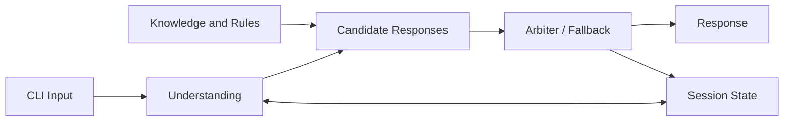
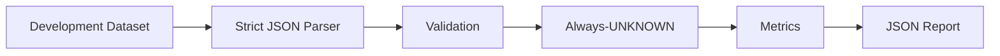
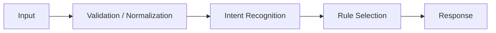

# PyBot Reference & Design Rationale

โครงการ `thai-anti-scam-ai` ศึกษา Hugging Face PyBot เป็นกรณีศึกษาการออกแบบ Rule-based AI แล้วนำแนวคิดที่เหมาะสมมาปรับใช้กับภาษาไทยและการประเมินความเสี่ยงจากการหลอกลวง โครงการนี้ไม่ได้เป็น Fork ของ PyBot และไม่ได้คัดลอก Source Code, Rules, Response Pools หรือ Dataset ของ PyBot ในงานศึกษานี้

## 1. PyBot ทำงานอย่างไร

PyBot เป็น Chatbot ที่ใช้กฎ รูปแบบข้อความ และข้อมูลความรู้ในการเลือกคำตอบ โดยใช้ Python Standard Library ใน Runtime ที่ศึกษา ไม่พบการเรียก LLM inference ในเส้นทางตอบที่ตรวจ ส่วน AI Agents และ LLM Judge ที่ผู้เผยแพร่รายงานใช้ในกระบวนการพัฒนาและประเมินผล

*ภาพรวมเชิงหน้าที่ของ PyBot ไม่ใช่ลำดับการเรียกทุกฟังก์ชัน*

| ส่วนของ PyBot | หน้าที่ |
| --- | --- |
| `pybot.py` | รับข้อความผ่าน CLI แบบ Interactive, One-shot และ Pipe |
| `bot/runtime.py` | ควบคุมแต่ละ Turn รวบรวม Candidate และเลือกคำตอบ |
| `bot/understanding/` | ปรับรูปข้อความ วิเคราะห์ชนิดข้อความ Topic และบริบท |
| `bot/modules/` | โมดูลกฎเฉพาะด้าน รวมถึง Safety และ Arbiter |
| `bot/memory/` | เก็บ Facts และประวัติภายใน Session |
| `bot/knowledge/` | ค้นข้อมูลความรู้ด้วย Index, Scoring และ Guards |
| `bot/compose/` | ประกอบคำตอบจาก Template, Response Pools และ Fallback |
| `tests/` | ทดสอบการใช้งาน CLI รวมถึง Multi-turn และ Reset |

Runtime เรียก `observe()` เพื่ออ่านและอัปเดต State จากนั้นเรียก `respond()` เพื่อรวบรวมคำตอบที่เป็น Candidate หากมีหลาย Candidate จะใช้ Arbiter เลือกผล แล้วเรียก `after()` และบันทึก Turn หาก Arbiter เลือกไม่ได้จะใช้ Candidate แรก และหากไม่มี Candidate เลยจะใช้ข้อความสำรอง

## 2. สิ่งที่เราศึกษาและนำมาปรับใช้

ตารางนี้แยกแนวทางที่เลือกแล้วออกจากข้อเสนอในอนาคต การมีข้อกำหนดหรือแผนยังไม่เท่ากับมี Runtime ที่ใช้งานได้จริง

| แนวคิดจากการศึกษา PyBot | การปรับใช้กับโครงการเรา | สถานะ ณ TASK-005 |
| --- | --- | --- |
| Standard Library | ใช้ Python Standard Library กับเครื่องมือประเมินและชุดทดสอบ เป็นแนวทางที่สอดคล้องกับ PyBot | ใช้แล้วใน Tooling |
| Modular Architecture | แยก Engine, CLI, การประมวลผลภาษา และการประเมิน เพื่อควบคุมผลกระทบของการแก้ไข | แยก Tooling แล้ว; Engine ยังเป็นแผน |
| Understanding / Text Representations | PyBot มี Raw, Clean, Plain และ Normalized Text ส่วน V0.1 เสนอให้ตรวจ Input ก่อนสร้าง Matching View และเก็บ Raw Text ชั่วคราวระหว่างประมวลผล | Proposed · ยังไม่มี Runtime |
| Intent Recognition | กำหนดเจตนาภาษาไทย 8 ประเภทก่อนเขียนกฎ | มี Specification และ Dataset; ยังไม่มีตัวจำแนก |
| Pattern Matching | ทดสอบคู่ข้อความที่มีคำร่วมแต่เจตนาต่างกัน เช่น ทักโดยตรงกับยกคำทักมาพูด และคำขอทั่วไปกับคำขอเฉพาะนอกขอบเขต | Proposed |
| Priority / Candidate Selection / Arbiter | ทดลอง precedence ที่ประกาศชัด แยกกฎเสมอกันใน Intent เดียวจากความกำกวมข้าม Intent และตรวจว่าการสลับลำดับกฎให้ผลตามนโยบาย | Proposed · การเลือกใช้หลักฐานจากข้อความเดียว |
| Response Templates / Fallback | เสนอ Rubric ตรวจคำตอบภาษาไทยและทบทวน `rule_id` สำหรับกฎที่ชนะ กรณีไม่พบกฎ และข้อความว่าง แยก Internal Error จากผล `UNKNOWN` และ `EMPTY_INPUT` | มี Specification · รายละเอียด Proposed |
| Information Extraction / Context | สกัด Slot และแก้คำอ้างอิงเฉพาะเมื่อมีหลักฐานและจำเป็นต่อขอบเขต | งานในอนาคต นอก V0.1 |
| Session Memory / Multi-turn | พิจารณา State แยกต่อ Session, Recall และ Reset โดยไม่เก็บข้อมูลเกินจำเป็น | งานในอนาคต นอก V0.1 |
| Structured Knowledge | พิจารณาฐานความรู้ที่มีแหล่งอ้างอิง เงื่อนไขและขอบเขตชัดเจน | งานในอนาคต |
| Explainability / Safety | เสนอ `rule_id` และเหตุผลจากหลักฐาน แยก Intent ออกจากระดับความเสี่ยง | ข้อเสนอ; ยังไม่มี Scam Engine |
| Regression Testing / Evaluation | ใช้ `unittest`, Test-first และผลประเมินที่ทำซ้ำได้ แนวทางทดสอบสอดคล้องกับ PyBot แต่ใช้ Metrics ของเราเอง | ใช้แล้วใน Tooling; Behavior Tests รอ Engine |

การทดลอง TASK-005 บน Python 3.14.8 / UCD 16.0.0 พบ whitespace 29 code points ขณะที่ `strip()` คง BOM และ zero-width ที่ตรวจไว้ และ NFKC เปลี่ยนรูปสระอำในตัวอย่างที่ NFC คงไว้ การเลือก Normalization ยังต้องเทียบผลด้านความหมายและการจับคู่ Input Validation, Response Rubric และ Requirement Coverage เป็นแนวทางวิศวกรรมของโครงการ [ผลทดลองและ Decision Matrix](v0.1-behavioral-contract-analysis.md)

## 3. สถาปัตยกรรมของเรา

TASK-005-R2 อ้าง **Observed** Pattern Matching, Candidate Collection และ Arbiter ของ PyBot ส่วน **Adopted** คือหลักการแยก Engine จาก CLI และ Tooling สำหรับ V0.1 ข้อเสนอ **Proposed** คือกรอง guard ก่อนจัด Priority และ Specificity ภายใน Intent แล้วเลือก Template เฉพาะผลชนะหรือใช้ Fallback ตามสาเหตุ โดยอาศัยหลักฐานจากข้อความเดียว สถานะ **Implemented** อยู่ในรายการด้านล่าง [Rule Architecture V0.1](v0.1-rule-architecture.md)

**Implemented ณ TASK-005** Project Foundation, Test Runner, Automated Tests, Behavior Specification, Development Dataset, Strict JSON Parser, Baseline Evaluator และ GitHub Actions Configuration [Evaluation Architecture](../README.md#evaluation-architecture)

**สถาปัตยกรรมที่เสนอสำหรับ AI ในอนาคต — ยังไม่ได้ Implement:**

V0.1 มุ่งที่การสนทนาภาษาไทยแบบ Single-turn และผลลัพธ์ `intent`, `response`, `rule_id` ตาม [Behavior Specification](v0.1-behavior.md) ส่วน Slot Extraction, Session Memory และ Multi-turn จะพิจารณาภายหลัง

สำหรับ Anti-Scam เสนอให้แยก Signal Extraction, Evidence Collection, Risk Assessment และ Explanation ออกจาก Conversational Intent ไม่ตัดสินว่าเป็น Scam จาก Keyword เพียงคำเดียว และต้องมีทางออกเมื่อหลักฐานไม่เพียงพอ ทั้งหมดนี้ยังเป็นข้อเสนอ ไม่ใช่ความสามารถปัจจุบัน

## 4. สิ่งที่ไม่นำมาใช้โดยตรง

- กฎภาษาอังกฤษและ Response Pools ของ PyBot: ภาษาไทยมีรูปคำ การเว้นวรรค คำลงท้าย และบริบทต่างกัน จึงต้องสร้างและทดสอบกฎเอง
- Dynamic Module Discovery จำนวนมากและ Deep Copy State ทุก Candidate: ยังไม่มีเหตุผลรองรับความซับซ้อนดังกล่าวในต้นแบบ V0.1
- Silent Exception Skipping: อาจปกปิดความผิดพลาดของกฎหรือ State จึงควรแยก Error ออกจาก Fallback ที่คาดไว้
- General-purpose Knowledge: โครงการเน้นภาษาไทยและงาน Anti-Scam ไม่ใช่การตอบความรู้ทั่วไปทุกด้าน
- SmolTalkBench และ LLM Judge เป็นตัวชี้วัดหลัก: วัดคุณภาพบทสนทนาภาษาอังกฤษคนละโจทย์กับการจำแนกเจตนาและประเมินความเสี่ยงภาษาไทย

การประมวลผลภาษาไทยต้องศึกษา Unicode, Word Segmentation, ภาษาพูด, คำปฏิเสธ, ข้อความผสมภาษา, URL และตัวเลข โดยรักษาข้อความต้นฉบับไว้ระหว่างประมวลผล และเลือกวิธี Normalization หลังเปรียบเทียบผลการทดลอง

## 5. การทดสอบและประเมินผล

| ประเด็น | PyBot | โครงการเรา |
| --- | --- | --- |
| Automated Tests | พบ 12 CLI Test Methods ใน Snapshot ที่ศึกษา รวม Multi-turn และ Reset (นับจากซอร์ส ไม่ได้รัน) | ใช้ `unittest` และ GitHub Actions ตรวจ Tooling; จะเพิ่ม Behavioral Regression เมื่อมี Engine |
| Evaluation | ผู้เผยแพร่รายงาน SmolTalkBench Win Rate ประมาณ 26% โดยใช้ LLM Judge | ใช้ Intent Accuracy, Per-intent Metrics และ Confusion Matrix จาก Label ที่กำหนดไว้ |
| Anti-Scam | ไม่ใช้ผล SmolTalkBench เป็นหลักฐานความสามารถด้านนี้ | เสนอ Precision, Recall, F1, False Positive Rate, False Negative Rate และผลรายหมวด |

Development Dataset v0.1 มี 32 ตัวอย่าง ผล Always-UNKNOWN ถูก 4/32 หรือ **12.5%** เป็นคะแนนของตัวจำแนกอ้างอิง ไม่ใช่ความแม่นยำของ AI Engine ([รายงานจริง](../reports/baseline-v0.1.json))

ใช้ Development Dataset เพื่อปรับกฎ, Regression Tests เพื่อป้องกันข้อผิดพลาดเดิม และ Held-out Dataset ที่แยกออกจาก Public Repository และ Workspace ของ Agent เพื่อประเมินอย่างอิสระเมื่อระบบพร้อม

## 6. แหล่งอ้างอิงและข้อจำกัด

การศึกษานี้อ้างอิง Public Snapshot `7d63c7fbebb44c7e466e5c8b5c1f341ab767929e` ร่วมกับผล TASK-001 ใน [DESIGN.md](../DESIGN.md) ซึ่งยังไม่มีรายงาน TASK-001 ฉบับเต็มใน Repository ค่า `SOURCE_COMMIT` ที่ CLI ระบุ (`24cbc0439e07fd015c0747ab3be6e782a42b5c5b`) ยังตรวจยืนยันจาก Public Repository ไม่ได้

หลักฐานฝั่ง PyBot มาจาก Static Source Analysis งานศึกษายังไม่มีผลการรัน PyBot, CLI Tests หรือการทำซ้ำ Benchmark ของผู้เผยแพร่ สถานะของโครงการอ้างอิง ณ TASK-005 [README.md](../README.md)

PyBot ใช้ Apache License 2.0 ตาม Snapshot ที่ศึกษา การอ้างแนวคิดไม่ใช่การนำ Source Code มาใช้ หากจะนำโค้ดมาใช้ภายหลัง ต้องตรวจ License, Attribution, Copyright Notices และ NOTICE ที่เกี่ยวข้องก่อน โดย License ของ PyBot ไม่ได้กำหนด License ของโครงการนี้โดยอัตโนมัติ

- [PyBot Public Snapshot][snapshot] · [Source Tree][tree] · [Package Metadata][metadata] · [CLI][cli]
- [Runtime][runtime-file] · [Turn Lifecycle][runtime] · [Module Registry][modules] · [Safety][safety] · [Arbiter][arbiter] · [Arbiter Selection][arbiter-selection]
- [Understanding][understanding] · [Understanding Hook][understand-hook] · [Intent Hook][intent-hook] · [Normalization][normalization] · [Topic][topic] · [Reference Resolution][reference-resolution]
- [Memory][memory] · [Facts and Turns][facts] · [Conversation History][history] · [Name Patterns][name-patterns] · [Memory Store][memory-store]
- [Knowledge][knowledge] · [Lookup][lookup] · [Candidate Retrieval][retrieval] · [Composition][compose] · [Pool Selection][pool-selection] · [Answers][answers] · [Fallback Chain][fallback]
- [CLI Tests][tests] · [PyBot README][readme] · [SmolTalkBench][bench] · [Dataset Card Revision][bench-revision] · [License][license]

[snapshot]: https://github.com/huggingface/pybot/tree/7d63c7fbebb44c7e466e5c8b5c1f341ab767929e
[metadata]: https://github.com/huggingface/pybot/blob/7d63c7fbebb44c7e466e5c8b5c1f341ab767929e/pyproject.toml
[cli]: https://github.com/huggingface/pybot/blob/7d63c7fbebb44c7e466e5c8b5c1f341ab767929e/pybot.py
[runtime]: https://github.com/huggingface/pybot/blob/7d63c7fbebb44c7e466e5c8b5c1f341ab767929e/bot/runtime.py#L82-L120
[arbiter]: https://github.com/huggingface/pybot/blob/7d63c7fbebb44c7e466e5c8b5c1f341ab767929e/bot/modules/arbiter.py
[understanding]: https://github.com/huggingface/pybot/tree/7d63c7fbebb44c7e466e5c8b5c1f341ab767929e/bot/understanding
[memory]: https://github.com/huggingface/pybot/tree/7d63c7fbebb44c7e466e5c8b5c1f341ab767929e/bot/memory
[knowledge]: https://github.com/huggingface/pybot/tree/7d63c7fbebb44c7e466e5c8b5c1f341ab767929e/bot/knowledge
[compose]: https://github.com/huggingface/pybot/tree/7d63c7fbebb44c7e466e5c8b5c1f341ab767929e/bot/compose
[tests]: https://github.com/huggingface/pybot/blob/7d63c7fbebb44c7e466e5c8b5c1f341ab767929e/tests/test_cli.py
[readme]: https://github.com/huggingface/pybot/blob/7d63c7fbebb44c7e466e5c8b5c1f341ab767929e/README.md
[bench]: https://huggingface.co/datasets/HuggingFaceSwarms/SmolTalkBench
[license]: https://github.com/huggingface/pybot/blob/7d63c7fbebb44c7e466e5c8b5c1f341ab767929e/LICENSE
[tree]: https://api.github.com/repos/huggingface/pybot/git/trees/7d63c7fbebb44c7e466e5c8b5c1f341ab767929e?recursive=1
[runtime-file]: https://github.com/huggingface/pybot/blob/7d63c7fbebb44c7e466e5c8b5c1f341ab767929e/bot/runtime.py
[modules]: https://github.com/huggingface/pybot/tree/7d63c7fbebb44c7e466e5c8b5c1f341ab767929e/bot/modules
[safety]: https://github.com/huggingface/pybot/blob/7d63c7fbebb44c7e466e5c8b5c1f341ab767929e/bot/modules/safety.py
[arbiter-selection]: https://github.com/huggingface/pybot/blob/7d63c7fbebb44c7e466e5c8b5c1f341ab767929e/bot/modules/arbiter.py#L1014-L1072
[understand-hook]: https://github.com/huggingface/pybot/blob/7d63c7fbebb44c7e466e5c8b5c1f341ab767929e/bot/modules/understand.py
[intent-hook]: https://github.com/huggingface/pybot/blob/7d63c7fbebb44c7e466e5c8b5c1f341ab767929e/bot/modules/intent.py
[normalization]: https://github.com/huggingface/pybot/blob/7d63c7fbebb44c7e466e5c8b5c1f341ab767929e/bot/understanding/normalize.py
[topic]: https://github.com/huggingface/pybot/blob/7d63c7fbebb44c7e466e5c8b5c1f341ab767929e/bot/understanding/topics.py
[reference-resolution]: https://github.com/huggingface/pybot/blob/7d63c7fbebb44c7e466e5c8b5c1f341ab767929e/bot/understanding/references.py
[facts]: https://github.com/huggingface/pybot/blob/7d63c7fbebb44c7e466e5c8b5c1f341ab767929e/bot/memory/__init__.py
[history]: https://github.com/huggingface/pybot/blob/7d63c7fbebb44c7e466e5c8b5c1f341ab767929e/bot/memory/history.py
[name-patterns]: https://github.com/huggingface/pybot/blob/7d63c7fbebb44c7e466e5c8b5c1f341ab767929e/bot/memory/facts.py#L275-L309
[memory-store]: https://github.com/huggingface/pybot/blob/7d63c7fbebb44c7e466e5c8b5c1f341ab767929e/bot/modules/memory_store.py#L875-L891
[lookup]: https://github.com/huggingface/pybot/blob/7d63c7fbebb44c7e466e5c8b5c1f341ab767929e/bot/knowledge/lookup.py
[retrieval]: https://github.com/huggingface/pybot/blob/7d63c7fbebb44c7e466e5c8b5c1f341ab767929e/bot/knowledge/lookup.py#L4649-L4694
[pool-selection]: https://github.com/huggingface/pybot/blob/7d63c7fbebb44c7e466e5c8b5c1f341ab767929e/bot/compose/__init__.py
[answers]: https://github.com/huggingface/pybot/blob/7d63c7fbebb44c7e466e5c8b5c1f341ab767929e/bot/modules/answers.py
[fallback]: https://github.com/huggingface/pybot/blob/7d63c7fbebb44c7e466e5c8b5c1f341ab767929e/bot/compose/fallback_chain.py
[bench-revision]: https://huggingface.co/datasets/HuggingFaceSwarms/SmolTalkBench/raw/e4bc258ec8b9380f5fa79725285a13ffa2c07670/README.md
