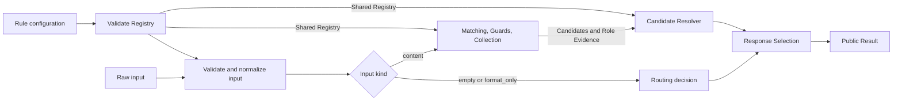
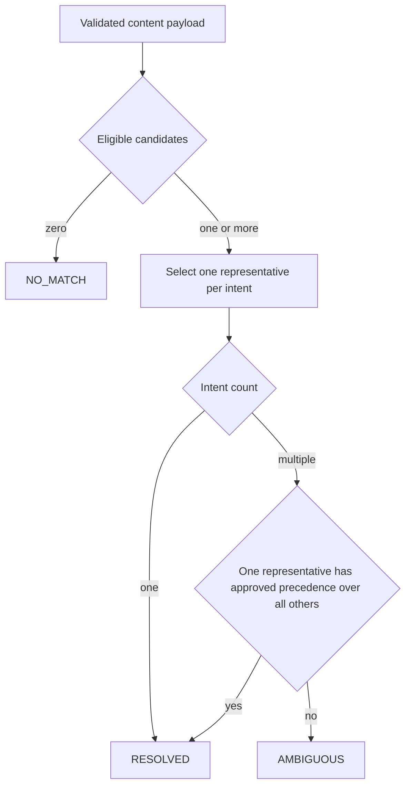

# Candidate Resolver V0.1 — Design Specification

TASK-008-R1 · `design/v0.1-candidate-resolver` · **DESIGN_REVISION_COMPLETE_PENDING_OWNER_REVIEW**

## 1. Executive Summary

เจ้าของโครงการทบทวน TASK-008 และอนุมัติหลักการ D1–D4 ได้แก่ Role Evidence ที่ตรวจย้อนกลับได้, frozen Decision Record, Rule Registry เป็นแหล่งข้อมูลหลัก และ Input Routing ก่อนเข้า Resolver สเปกนี้กำหนดข้อมูลที่แต่ละขั้นรับและคืน เกณฑ์เลือก และผลคาดหวังสำหรับ Test-first โดยอ้าง C01–C10 และผลที่ตรึงใน R6 [Decision Matrix](v0.1-behavioral-contract-analysis.md#13-open-design-questions-และ-decision-matrix) · [Decision Table เดิม](v0.1-rule-architecture.md#decision-table) · [ผลอนุมัติ R6](v0.1-regression-spec.md#approved-outcomes-และ-open-decisions)

**Implemented** มี Validation, Normalization, Matching, Guards, Candidate Collection และ Result สามฟิลด์ **Approved Design** คือหลักการ D1–D4 และนโยบายเลือกจาก Contract เดิม **Future Implementation** ต้องเพิ่มการผลิต Role Evidence, Registry ที่ใช้ร่วมกัน, Resolver และจุดประกอบ Engine/Response Selection โครงสร้างข้อมูลและรหัสภายในในเอกสารนี้เป็นรายละเอียด R1 สำหรับเจ้าของโครงการตรวจทานก่อนเริ่ม Runtime

## 2. Current Architecture

| ส่วน | สิ่งที่มีและข้อจำกัด |
| --- | --- |
| Validation และ Normalization | `normalize_text` ตรวจ exact built-in str และอักขระดิบก่อน trim คืน `raw_text`, `matching_text` จาก `strip() + NFC` และ `kind` เป็น `empty`, `format_only` หรือ `content` |
| Rule Configuration | `matching.Rule` เป็น frozen dataclass ที่ตรวจ metadata และวลีตอนสร้าง `_DEFAULT_RULES` เป็น tuple ของ Rule และ Collector ตรวจ tuple กับ ID ซ้ำก่อนตรวจข้อความ ปัจจุบันยังไม่มี Registry object, index ตาม ID หรือ snapshot ที่ส่งให้ขั้นถัดไป |
| Matching และ Guards | Matcher ตรวจช่วงเต็มหรือคู่ช่วงที่แยกด้วย ASCII space ตัวแรกเมื่อทั้งสองช่วงมีหลักฐาน Guard เก็บเฉพาะ scope `direct` และตัด match ที่ถูกปฏิเสธ อ้าง ส่งถึงคนอื่น หรือเป็น HELP ในคำขอเฉพาะตามรูปที่รองรับ |
| Candidate และ CandidateCollection | ทั้งคู่เป็น frozen dataclass ตัวสร้างยังไม่มี runtime validation Collector คืน Raw/Matching Text, kind และ Candidate ตามลำดับ ID โดยรวม Span ที่ผ่าน Guard เป็นหนึ่ง Candidate ต่อกฎ ผลที่คืนยังไม่มี Role Evidence หรือที่มาระดับคู่ช่วง |
| ช่วงหลักฐาน | `spans` ใช้ช่วงครึ่งเปิด `[start, end)` นับ Unicode code points ใน Matching Text การ trim และ NFC อาจเปลี่ยนพิกัด ไม่มี Mapping กลับ Raw Text เช่น `"  Cafe\u0301  "` เป็น `"Café"` โดยมี span `(0, 4)` |
| Result และการประกอบขั้น | `Result` ตรวจ `intent`, `response`, `rule_id` และความสัมพันธ์เบื้องต้นของฟิลด์ ขั้น Resolver, Response Selection และ Engine Orchestrator ยังไม่มี |

ตรวจการรวบรวมจริงด้วยข้อความสมมติ “สวัสดีครับ สวัสดีครับ” ได้ `greeting.direct` หนึ่ง Candidate มี spans `((0, 10), (11, 21))` [Candidate Collection](../thai_ai/candidates.py) · [Matching](../thai_ai/matching.py) · [Guards](../thai_ai/guards.py) · [Validation](../thai_ai/validation.py) · [Normalization](../thai_ai/normalization.py) · [Result](../thai_ai/result.py)

## 3. Evidence Role Contract

D1 ให้ Matcher/Collector สร้างบทบาทจากกฎที่จับจริงและบริบทของคู่ช่วงเดียวกันหลังผ่าน Guard Resolver ตรวจที่มาเชิงโครงสร้างและใช้ข้อมูลที่ขั้นต้นทางส่งมา ตำแหน่งต้นข้อความ, Priority และลำดับ Candidate เพียงอย่างเดียวพิสูจน์บทบาทไม่ได้

| Role | ความหมาย | กฎและบริบทที่สร้างหลักฐาน |
| --- | --- | --- |
| `INTRODUCTORY` | คำทักที่ทำหน้าที่นำเข้าสู่คำถามตรงในคู่ C08 | กฎ GREETING ที่ผ่าน Guard ในช่วงเปิด เช่น `greeting.direct` ใน INT-01/02 พร้อมหลักฐานคู่ช่วงคำถาม |
| `PRIMARY_QUESTION` | คำถามตรงต่อบอตเรื่องตัวตนหรือความสามารถในคู่ C08 เดียวกัน | กฎ BOT_IDENTITY หรือ BOT_CAPABILITIES ที่ผ่าน Guard เช่น `identity.direct` ใน INT-01 และ `capabilities.direct` ใน INT-02 |
| `COURTESY` | คำขอบคุณโดยตรง “ขอบคุณครับ” ที่ประกอบคำขอเริ่มต้นตาม R6 | `thanks.direct` ที่ผ่าน Guard พร้อมหลักฐานคู่ช่วงของ OPEN-MIXED-REQUEST |
| `PRIMARY_REQUEST` | คำขอเริ่มต้นตามรูป R6 “ช่วยเริ่มให้หน่อย” | `help.general` ที่ผ่าน Guard พร้อมหลักฐานวลีที่จับได้และคู่ช่วง R6 ค่า Intent HELP อย่างเดียวให้หลักฐานไม่พอ |

- กำหนด `Span = tuple[int, int]` และ `RoleEvidence` แบบ immutable ซึ่งมี `role: EvidenceRole`, `rule_id: str` และ `span: Span` แต่ละ `ContextEvidence` มี `source` เป็น enum `C08_INTRO_QUESTION` หรือ `R6_MIXED_STARTUP_REQUEST`, `context_span: Span` และ `roles: tuple[RoleEvidence, RoleEvidence]` เรียงจากบทบาทประกอบไปบทบาทหลัก `source` ระบุบริบทที่ยืนยันคู่ ส่วน `rule_id` ของแต่ละบทบาทอ้างกฎที่จับจริง
- หลักฐานทั้งสองต้องอ้างคนละ Candidate และ span ต้องมีอยู่จริงใน Candidate นั้น ช่วงซ้ายสิ้นสุดก่อนช่วงขวาเริ่ม และ `context_span` ครอบจากต้นช่วงซ้ายถึงท้ายช่วงขวา การยืนยันว่าคู่ช่วงครอบคลุมข้อความและตรงรูปที่อนุมัติเป็นหน้าที่ Matcher/Collector Resolver ตรวจการอ้างอิง พิกัด และชุด role/Intent โดยไม่จับคู่ข้อความซ้ำ
- พิกัดที่ตรวจจาก Collection จริงคือ INT-01 คำทัก `[0,10)` กับคำถาม `[11,20)`, INT-02 คำทัก `[0,10)` กับคำถาม `[11,29)` และ OPEN-MIXED-REQUEST คำขอบคุณ `[0,10)` กับคำขอ `[11,28)` ทั้งหมดอยู่ใน Matching Text ของแต่ละ fixture
- ใช้ precedence เมื่อ evidence เชื่อมผู้แทนทั้งสอง และทุก span ของ Intent ที่จะถูกลด precedence มีหลักฐานว่าเป็นบทบาทประกอบของผู้แทนหลักเดียวกัน หากมี span อิสระ หรือหลักฐานเชื่อม span เดียวกับคู่แข่งคนละ Intent จนยืนยันบทบาทต่อผู้แทนหลักคนเดียวไม่ได้ ให้คู่นั้นไม่มี precedence ถ้าหลาย Intent ยังเป็นคู่แข่งและไม่มีผู้ชนะตามตาราง ให้ AMBIGUOUS หากมี Intent เดียวให้ใช้กติกาภายใน Intent ได้โดยไม่ต้องมี Role Evidence
- หลักฐานขาดหรือมีรูปถูกต้องแต่ไม่พอตัดสินเป็นส่วนหนึ่งของการตัดสินปกติ ส่วนหลักฐานที่ผิดโครงสร้างหรือชี้ถึง Candidate/Span ที่ไม่มีจริงให้ `invalid_role_evidence` การเก็บที่มาระดับคู่ช่วงยังเป็น Dependency ใน §13

## 4. Resolver Input Contract

จุดเรียกภายในรับ `candidates: tuple[Candidate, ...]`, `matching_length: int` เป็น exact int ค่าบวกของ Matching Text ประเภท content, `context_evidence: tuple[ContextEvidence, ...]` และ `registry: ValidatedRuleRegistry` จาก Configuration เดียวกับ Matcher ทั้งสอง tuple ว่างได้ Candidate ทุกตัวต้องผ่าน Guard แล้ว Payload ไม่มี Raw Text และ Response Text

D4 ให้จุดประกอบ Engine ตรวจ Registry ก่อนรับงาน แล้ว validate/normalize ข้อความหนึ่งครั้ง `empty` และ `format_only` สร้าง Routing Decision ส่วน `content` ไปที่ Matching/Collection และ Resolver ปัจจุบัน Collector เรียก Normalization ภายในและข้าม Matcher สำหรับ early paths การส่ง normalized view ข้ามขั้นโดยไม่ทำซ้ำเป็นงาน Integration ในอนาคต

## 5. Decision Record Contract

D2 ใช้ frozen dataclass ภายในพร้อมตรวจ invariants ตอนสร้าง ใช้สมาชิก immutable ทั้งหมด รูปแบบเดียวกันรองรับผล Resolver และ Input Routing

| Field | Type และ invariant |
| --- | --- |
| `state` | `DecisionState` enum มี `RESOLVED`, `AMBIGUOUS`, `NO_MATCH`, `EMPTY`, `FORMAT_ONLY` Resolver คืนสามค่าแรก ส่วน Input Routing คืนสองค่าหลัง |
| `winner` | `Candidate \| None` ต้องมีใน RESOLVED และอ้าง eligible Candidate จากการเรียกเดียวกัน อีกสี่ state ใช้ None |
| `reason_code` | `ReasonCode` enum ที่ต้องตรงกับ state และ Intent ของผู้ชนะตาม §9 |
| `evidence` | `DecisionEvidence` แบบ frozen มี `candidates: tuple[Candidate, ...]` และ `context: tuple[ContextEvidence, ...]` เก็บ eligible Candidate และหลักฐานที่ใช้พิจารณาในลำดับมาตรฐานสำหรับ RESOLVED/AMBIGUOUS อีกสาม state ใช้ tuple ว่างทั้งสอง |
| `selection_basis` | `SelectionBasis \| None` มีเฉพาะ RESOLVED เลือกจาก `SINGLE_CANDIDATE`, `SAME_INTENT_PRIORITY`, `SAME_INTENT_SPECIFICITY`, `SAME_INTENT_ASCII_RULE_ID`, `C08_INTRO_QUESTION`, `R6_MIXED_STARTUP_REQUEST` |

AMBIGUOUS ต้องมี eligible Candidate อย่างน้อยสอง Intent และไม่มีผู้ชนะตาม policy ส่วน NO_MATCH เกิดจาก content ที่ไม่เหลือ eligible Candidate Record ไม่มี Response Text และ derive Intent/Rule ID สำหรับ public Result จาก state และ winner ตาม §9 `Result` ปัจจุบันตรวจรูปแบบของทั้งสามฟิลด์ได้ การตรวจว่า Rule ID มาจากผู้ชนะจริงอยู่ที่ขอบเขต Integration ซึ่งเห็น Decision Record [Result Contract](v0.1-behavior.md#inputoutput-contract)

## 6. Resolution Policy

1. ตรวจ payload ทั้งชุดตาม §7 ผู้ที่ Guard ปฏิเสธถูกคัดก่อนเข้า Resolver ตาม C02
2. ถ้า eligible tuple ว่างให้ NO_MATCH ตาม C03 ถ้าเหลือ Candidate เดียวให้ RESOLVED ตาม C04 รวมกฎ explicit UNKNOWN ที่ชนะจริง
3. ในแต่ละ Intent เลือกคีย์ `(-priority, -specificity, rule_id)` ที่น้อยสุด Priority สูงสุดชนะ หากเสมอใช้ Specificity สูงสุด หากยังเสมอใช้ ASCII ID ที่มาก่อน เช่น `a-1 < a.1 < a0` เมื่อมี Intent เดียว `selection_basis` ระบุขั้นที่ทำให้เหลือผู้ชนะหนึ่งรายการ
4. สำหรับหลาย Intent ใช้ผู้แทนแต่ละ Intent และหลักฐานตาม §3/§8 ผู้ชนะต้องมี precedence เหนือทุก Intent อื่นโดยตรง คะแนนและลำดับ ID มีผลเฉพาะการเลือกผู้แทนภายใน Intent จำนวน Candidate, ความยาว span และลำดับที่เข้ามาไม่มีผลตัดสินข้าม Intent
5. หากไม่มีผู้ชนะตามเงื่อนไขให้ AMBIGUOUS เช่น ตัวตนกับความสามารถที่ต่างก็ชนะคำทักนำ หรือ explicit UNKNOWN พบร่วมกับ Intent อื่นโดยไม่มี precedence ที่อนุมัติ

สำหรับการเทียบ Decision Record ทั้งชุด ให้เรียง Candidate ตาม ASCII ID, spans ตาม `(start, end)` และ ContextEvidence ตาม enum value ของ source, context span และฟิลด์ของสองบทบาทตามลำดับที่กำหนด รวม ContextEvidence ที่ซ้ำกันทุกฟิลด์ การหาผู้แทนทำได้ด้วยการสแกนหนึ่งรอบ ต้นทุนการเรียง evidence ขึ้นกับจำนวนรายการที่คืน

### Expected outcomes สำหรับการทดสอบ Determinism

Case IDs ใช้ oracle เดิม กรณีเสริมเป็นข้อเสนอสำหรับตรวจสัญญาภายในนอก Regression JSON

| การตรวจ | Expected Outcome ล่วงหน้า |
| --- | --- |
| Permutation · RES-04–07, RES-09–13 | สลับ Candidate ที่ป้อน Resolver โดยตรงและสลับ ContextEvidence ที่มี Decision Record ทุกฟิลด์ต้องเท่าเดิม ทดสอบสลับ Rule configuration ที่ขอบเขต Collection แยก เพราะ Collector คืนผลเรียง ID อยู่แล้ว |
| Priority, Specificity และ ASCII ภายใน Intent เดียว | RES-04 ชนะ `a` ตาม Priority, RES-05 ชนะ `b` ตาม Specificity, RES-06 ชนะ `a.9` ตาม ASCII กรณีเสริมให้ GREETING 2,048 รายการ มี Priority −1 และ Specificity 2 เท่ากัน ใช้ ID `r0000` ถึง `r2047` ต้องชนะ `r0000` ทั้งลำดับตรง กลับด้าน และสุ่มด้วย seed คงที่ |
| Cross-intent | RES-09/10 ชนะ `z` ส่วน RES-11/12/13 ให้ AMBIGUOUS, winner=None ต้องคงผลนี้เมื่อปรับ Priority/Specificity ให้ Registry และ Candidate ตรงกันและคง evidence เดิม กรณีเสริมที่ GREETING มี span อิสระเพิ่มจาก span ที่รับรองบทบาทบทนำให้ AMBIGUOUS |
| Eligible tuple ว่าง, Guard False และ Explicit UNKNOWN | RES-01/08 ให้ NO_MATCH, winner=None ส่วน RES-07 ให้ HELP จาก `b` และ RES-03 ให้ RESOLVED/EXPLICIT_UNKNOWN จาก `origin` |
| หลาย Span และ Candidate ซ้ำ | กฎเดียวที่จับได้สองช่วงให้ Candidate เดียวเก็บสอง spans และตัดสิน RESOLVED เมื่อส่งสอง Candidate ID เดียวถึง Resolver ให้ `duplicate_candidate` แม้ spans ต่างกัน |
| Registry และ metadata ผิด | Registry ID ซ้ำให้ `duplicate_rule_id` ก่อนตรวจ Input ตาม ERR-CONFIG ส่วน Configuration ที่ไม่ใช่ tuple ของ Rule ให้ `invalid_configuration` ID รูปถูกต้องที่ไม่มีใน Registry ให้ `unregistered_rule_id` ทดสอบเปลี่ยน Intent, Priority และ Specificity ทีละค่าให้มีรูปถูกต้องแต่ต่างจาก Registry แต่ละกรณีให้ `candidate_metadata_mismatch` แม้ Candidate นั้นไม่มีทางชนะ |
| Candidate/Evidence ผิดรูป | ID มีตัวพิมพ์ใหญ่, Intent เป็น EMPTY_INPUT, Priority เป็น bool หรือ Specificity นอก 0–2 ให้ `invalid_candidate` span ซ้ำหรืออยู่นอก Matching Text ให้ `invalid_evidence_range` บทบาทอ้าง span ที่ Candidate ไม่มีให้ `invalid_role_evidence` ประเภท error ต้องคงที่เมื่อสลับลำดับ |
| Early routing | DEV-029–032 และ INT-CR-ONLY ให้ EMPTY ส่วน INT-ZWSP-ONLY ให้ FORMAT_ONLY ทั้งสองเส้นทางข้าม Resolver เมื่อมีจุดประกอบ Engine |

## 7. Rule Registry Validation

D3 ให้สร้าง Registry แบบอ่านอย่างเดียวจาก Rule configuration ที่ใช้งานจริง เก็บ tuple ของ Rule ที่ตรวจแล้วให้ Matcher ใช้ และ index แบบอ่านอย่างเดียวจาก `rule_id` ไป Rule เดียวกันให้ Resolver ใช้ ทั้งสองขั้นอ่านจาก snapshot เดียว ตรวจทั้งชุดตอนประกอบ Configuration ก่อน normalize ข้อความ และตรวจใหม่เมื่อเปลี่ยนชุดกฎ ใน Resolver ให้ตรวจ Candidate ทุกตัวเทียบ snapshot นี้ก่อนเลือก [Rule source](../thai_ai/matching.py) · [Shared metadata](../thai_ai/_rule_metadata.py)

| จุดตรวจ | เงื่อนไข | การจำแนก |
| --- | --- | --- |
| ประกอบ Registry | Rule ID ผิดรูป, Intent นอก Taxonomy หรือเป็น EMPTY_INPUT, Priority ไม่ใช่ exact int, Specificity ไม่ใช่ exact int 0–2 หรือกฎผิด Schema | Configuration Error · `invalid_rule` หรือ `invalid_configuration` ตามขอบเขต |
| ประกอบ Registry | Rule ID ซ้ำ แม้ metadata เหมือนกัน | Configuration Error · `duplicate_rule_id` |
| Candidate schema | Payload/record ผิดชนิด, ID ไม่ใช่ exact str ตาม `[a-z0-9][a-z0-9.-]*`, Intent ไม่ใช่ exact str ใน Taxonomy สำหรับกฎ, Priority ไม่ใช่ exact int หรือ Specificity ไม่ใช่ exact int 0–2 | Invalid Candidate · `invalid_candidate` |
| Candidate spans | tuple ไม่ว่างของคู่ exact int เรียงและไม่ซ้ำ มี `0 <= start < end <= matching_length` กฎเดียวเก็บได้หลายช่วง | ผิดสัญญาเป็น Invalid Candidate · `invalid_evidence_range` |
| Registry consistency | ID รูปถูกต้องแต่ Registry ไม่มี หรือ Intent, Priority, Specificity รูปถูกต้องแต่ไม่ตรง Registry | Configuration Error · `unregistered_rule_id` หรือ `candidate_metadata_mismatch` |
| Candidate uniqueness | Collector รวมหลาย match เป็นหนึ่ง Candidate ต่อกฎและตัด span ซ้ำ หากผ่าน Collection แล้วยังมี Candidate สองรายการ ID เดียวกัน | Invalid Candidate · `duplicate_candidate` แม้ถือคนละ span |
| Context linkage | source/role ผิดชุด, context span ผิดช่วง หรืออ้าง Candidate/Span ที่ไม่อยู่ใน payload | Invalid Candidate/Evidence · `invalid_role_evidence` |

ตรวจ envelope → Candidate schema และ ranges → Registry membership และ metadata → Candidate uniqueness → Context linkage ก่อนจัดอันดับ ตรวจทุก record ในแต่ละขั้นและรายงาน error แรกตามลำดับเงื่อนไขในตาราง หากต้องระบุ ID ในข้อความวินิจฉัย ให้ใช้ ID ที่ผิดแบบ ASCII ตัวแรกของเงื่อนไขนั้น

## 8. Decision Table

| กติกา | เงื่อนไข | Decision และผู้ชนะ |
| --- | --- | --- |
| C01 / R6 | Valid input เป็น empty หรือ format_only | EMPTY หรือ FORMAT_ONLY จาก Input Routing · ไม่มีผู้ชนะ |
| C02 | Match ถูก Guard ปฏิเสธ | คัดออกก่อนเข้า Resolver |
| C03 | Content ไม่มี Candidate ที่ผ่าน | NO_MATCH · ไม่มีผู้ชนะ |
| C04 | เหลือ Candidate เดียว | RESOLVED · Candidate นั้น รวม explicit UNKNOWN |
| C05–C07 | หลาย Candidate ใน Intent เดียว | RESOLVED · ผู้ชนะตาม Priority → Specificity → ASCII rule_id |
| C08 | มี GREETING กับ BOT_IDENTITY หรือ BOT_CAPABILITIES เพียงหนึ่งกลุ่ม หลักฐานยืนยัน INTRODUCTORY และ PRIMARY_QUESTION | RESOLVED · ผู้แทนของคำถาม · INT-01/02 และ RES-09/10 |
| R6 | THANKS กับ HELP ตามคู่ OPEN-MIXED-REQUEST หลักฐานยืนยัน COURTESY และ PRIMARY_REQUEST | RESOLVED · ผู้แทน HELP |
| C09 | หลาย Intent และไม่มีผู้แทนชนะเหนือทุกกลุ่มโดยตรง | AMBIGUOUS · ไม่มีผู้ชนะ · RES-11–13 และ INT-14 |
| C10 / S26 | Configuration ผิดหรือเกิดข้อผิดพลาด | ส่ง exception พร้อมสาเหตุ |

คู่ R6 ใช้เฉพาะรูปคำขอเริ่มต้นที่อนุมัติไว้ การขยาย precedence ข้าม Intent ต้องมีหลักฐานและการอนุมัติเพิ่ม

## 9. Reason Codes

State ระบุรูปของการตัดสิน ส่วน Reason Code ระบุเหตุของเส้นทาง `selection_basis` เก็บลำดับหรือเงื่อนไขที่ทำให้ได้ผู้ชนะสำหรับ RESOLVED

| State | Reason Code | Intent และ Rule ID | Path จาก Specification |
| --- | --- | --- | --- |
| `RESOLVED` | `MATCHED` | Intent ของผู้ชนะที่ไม่ใช่ UNKNOWN · ID ของกฎจริง | `matched` |
| `RESOLVED` | `EXPLICIT_UNKNOWN` | UNKNOWN · ID ของกฎ UNKNOWN ที่ชนะจริง | `matched` |
| `AMBIGUOUS` | `AMBIGUOUS` | UNKNOWN · None | `ambiguity` |
| `NO_MATCH` | `NO_MATCH` | UNKNOWN · None | `no_match` |
| `EMPTY` | `EMPTY` | EMPTY_INPUT · None | `empty` |
| `FORMAT_ONLY` | `FORMAT_ONLY` | UNKNOWN · None | `format_only` |

Response Selection ใช้ state กับ winner เพื่อเลือก Template ที่อนุมัติ เช่น `unknown_explicit` และ `unknown_no_match` ใช้คนละเส้นทางแม้ถ้อยคำปัจจุบันตรงกัน ข้อผิดพลาดส่งต่อเป็น exception ตาม §11

## 10. Regression Traceability

Matrix ใช้ [Regression JSON](../datasets/regression/v0.1.json) ครบ **148 Case IDs** มี 146 Mandatory และ 2 Pending ครอบคลุม 15 Requirements และ 26 Scenarios ใน Mandatory Cases คอลัมน์ “ขั้นตรวจ” ระบุขอบเขตการใช้ oracle แต่ละกรณีจึงอยู่ได้หลายขั้น

| ขั้น | ขอบเขต | Case IDs |
| --- | --- | ---: |
| R · Resolver โดยตรง | ตรวจ state, winner, reason และ evidence จาก Candidate fixtures | 13 |
| C · Candidate Collection | ตรวจ eligible Candidate, evidence, early paths หรือ error จากข้อความและกฎ/Guard fixture | 63 |
| E · Engine Integration | ตรวจผลจากจุดเข้า Engine รวม Text, Input Routing, Validation และการส่งต่อ faults | 99 |
| S · Response Selection | ตรวจ Template ของ Result/Resolver cases, Response Rubric และ fault ของขั้นตอบ | 85 |
| F · Runtime Foundation | ตรวจ Input Validation, Normalization, Result schema และ wire fields ระดับ Component | 57 |
| Pending | ยังไม่มี executable expected outcome | 2 |

จำนวนแต่ละขั้นซ้อนกันได้ ผลที่ตรวจแล้วคือ **57 ครบที่จุดตรวจ Component, 73 บางส่วน, 16 รอทดสอบหรือทบทวน และ 2 Pending** ส่วน R ทั้ง 13 กรณีมีหลักฐานการรวบรวม Candidate จาก fixture และยังรอทดสอบการเลือกจริง

- ใน Matrix `—` ในช่อง Scenario หมายถึง JSON ไม่มี `source_scenarios` ผล `winner` หมายถึง `must_reference_winning_rule`, `winner=<id>` คือ fixture ID ที่กำหนด และ `None` หมายถึง `must_be_none`
- Test Harness ของ R กรอง `guard_passes=False` ก่อนสร้าง eligible payload และใช้ synthetic spans กับ Registry จาก records ใน fixture สำหรับ `greeting_is_intro=True` ของ RES-09/10/12 ให้สร้างหลักฐานคู่ช่วงจาก fixture อย่างชัดเจน RES-12 ยังคงสองกลุ่มคำถาม จึงต้อง ambiguity แม้ใส่บทบาทบทนำให้คู่ใดคู่หนึ่งหรือทั้งสองคู่ ส่วน RES-13 ไม่มีหลักฐานบทนำ การผลิตหลักฐานจากข้อความจริงตรวจผ่าน INT-01/02 และ OPEN-MIXED-REQUEST
- [Regression Validator](../tests/regression_spec_validation.py) ตรวจ fixture และผลคาดหวังที่ประกาศ Test-first ให้อ่าน frozen oracle จาก [Fixture Loader](../tests/runtime_fixtures.py) โดยตรง R ตรวจผลระดับการตัดสิน ส่วน S ตรวจ Template ที่ระบุด้วย Decision fixture หรือร่วมกับ E

| Case ID | Requirement ID | Scenario ID | Expected Outcome | ขั้นตรวจ | จุดตรวจ | ผลที่มี | เพิ่มตอน Implementation |
| --- | --- | --- | --- | --- | --- | --- | --- |
| `DEV-001` | BC-INT-01, BC-OUT-02 | — | `GREETING` / `matched` / `greeting` / `winner` | C, E, S | เลือกผู้ชนะจริงและตรวจที่มา ID | บางส่วน · Collection | Engine integration |
| `DEV-002` | BC-INT-01, BC-OUT-02 | — | `GREETING` / `matched` / `greeting` / `winner` | C, E, S | เลือกผู้ชนะจริงและตรวจที่มา ID | บางส่วน · Collection | Engine integration |
| `DEV-003` | BC-INT-01, BC-OUT-02 | — | `GREETING` / `matched` / `greeting` / `winner` | C, E, S | เลือกผู้ชนะจริงและตรวจที่มา ID | บางส่วน · Collection | Engine integration |
| `DEV-004` | BC-INT-01, BC-OUT-02 | S01 | `GREETING` / `matched` / `greeting` / `winner` | C, E, S | เลือกผู้ชนะจริงและตรวจที่มา ID | บางส่วน · Collection | Engine integration |
| `DEV-005` | BC-INT-02, BC-OUT-02 | — | `BOT_IDENTITY` / `matched` / `identity` / `winner` | C, E, S | เลือกผู้ชนะจริงและตรวจที่มา ID | บางส่วน · Collection | Engine integration |
| `DEV-006` | BC-INT-02, BC-OUT-02 | S02 | `BOT_IDENTITY` / `matched` / `identity` / `winner` | C, E, S | เลือกผู้ชนะจริงและตรวจที่มา ID | บางส่วน · Collection | Engine integration |
| `DEV-007` | BC-INT-02, BC-OUT-02 | S03 | `BOT_IDENTITY` / `matched` / `identity` / `winner` | C, E, S | เลือกผู้ชนะจริงและตรวจที่มา ID | บางส่วน · Collection | Engine integration |
| `DEV-008` | BC-INT-02, BC-OUT-02 | — | `BOT_IDENTITY` / `matched` / `identity` / `winner` | C, E, S | เลือกผู้ชนะจริงและตรวจที่มา ID | บางส่วน · Collection | Engine integration |
| `DEV-009` | BC-INT-03, BC-OUT-02 | — | `BOT_CAPABILITIES` / `matched` / `capabilities` / `winner` | C, E, S | เลือกผู้ชนะจริงและตรวจที่มา ID | บางส่วน · Collection | Engine integration |
| `DEV-010` | BC-INT-03, BC-OUT-02 | — | `BOT_CAPABILITIES` / `matched` / `capabilities` / `winner` | C, E, S | เลือกผู้ชนะจริงและตรวจที่มา ID | บางส่วน · Collection | Engine integration |
| `DEV-011` | BC-INT-03, BC-OUT-02 | — | `BOT_CAPABILITIES` / `matched` / `capabilities` / `winner` | C, E, S | เลือกผู้ชนะจริงและตรวจที่มา ID | บางส่วน · Collection | Engine integration |
| `DEV-012` | BC-INT-03, BC-OUT-02 | — | `BOT_CAPABILITIES` / `matched` / `capabilities` / `winner` | C, E, S | เลือกผู้ชนะจริงและตรวจที่มา ID | บางส่วน · Collection | Engine integration |
| `DEV-013` | BC-INT-04, BC-OUT-02 | — | `THANKS` / `matched` / `thanks` / `winner` | C, E, S | เลือกผู้ชนะจริงและตรวจที่มา ID | บางส่วน · Collection | Engine integration |
| `DEV-014` | BC-INT-04, BC-OUT-02 | — | `THANKS` / `matched` / `thanks` / `winner` | C, E, S | เลือกผู้ชนะจริงและตรวจที่มา ID | บางส่วน · Collection | Engine integration |
| `DEV-015` | BC-INT-04, BC-OUT-02 | — | `THANKS` / `matched` / `thanks` / `winner` | C, E, S | เลือกผู้ชนะจริงและตรวจที่มา ID | บางส่วน · Collection | Engine integration |
| `DEV-016` | BC-INT-04, BC-OUT-02 | — | `THANKS` / `matched` / `thanks` / `winner` | C, E, S | เลือกผู้ชนะจริงและตรวจที่มา ID | บางส่วน · Collection | Engine integration |
| `DEV-017` | BC-INT-05, BC-OUT-02 | — | `FAREWELL` / `matched` / `farewell` / `winner` | C, E, S | เลือกผู้ชนะจริงและตรวจที่มา ID | บางส่วน · Collection | Engine integration |
| `DEV-018` | BC-INT-05, BC-OUT-02 | S10 | `FAREWELL` / `matched` / `farewell` / `winner` | C, E, S | การเรียก DEV-001 หลังกล่าวลาให้ผลตามเดิม | บางส่วน · Collection | Engine integration |
| `DEV-019` | BC-INT-05, BC-OUT-02 | — | `FAREWELL` / `matched` / `farewell` / `winner` | C, E, S | เลือกผู้ชนะจริงและตรวจที่มา ID | บางส่วน · Collection | Engine integration |
| `DEV-020` | BC-INT-05, BC-OUT-02 | — | `FAREWELL` / `matched` / `farewell` / `winner` | C, E, S | เลือกผู้ชนะจริงและตรวจที่มา ID | บางส่วน · Collection | Engine integration |
| `DEV-021` | BC-INT-06, BC-OUT-02 | S04 | `HELP` / `matched` / `help` / `winner` | C, E, S | เลือกผู้ชนะจริงและตรวจที่มา ID | บางส่วน · Collection | Engine integration |
| `DEV-022` | BC-INT-06, BC-OUT-02 | — | `HELP` / `matched` / `help` / `winner` | C, E, S | เลือกผู้ชนะจริงและตรวจที่มา ID | บางส่วน · Collection | Engine integration |
| `DEV-023` | BC-INT-06, BC-OUT-02 | — | `HELP` / `matched` / `help` / `winner` | C, E, S | เลือกผู้ชนะจริงและตรวจที่มา ID | บางส่วน · Collection | Engine integration |
| `DEV-024` | BC-INT-06, BC-OUT-02 | — | `HELP` / `matched` / `help` / `winner` | C, E, S | เลือกผู้ชนะจริงและตรวจที่มา ID | บางส่วน · Collection | Engine integration |
| `DEV-025` | BC-INT-07, BC-OUT-02 | — | `UNKNOWN` / `no_match` / `unknown_no_match` / `None` | C, E, S | ไม่มี Candidate ที่ผ่าน | บางส่วน · Collection | Engine integration |
| `DEV-026` | BC-INT-07, BC-OUT-02, BC-INT-06, BC-OUT-01 | S11 | `UNKNOWN` / `no_match` / `unknown_no_match` / `None` | C, E, S | คง Guard ตัด HELP ในคำขอเฉพาะแบบ S11 | บางส่วน · Collection | Engine integration |
| `DEV-027` | BC-INT-07, BC-OUT-02 | — | `UNKNOWN` / `no_match` / `unknown_no_match` / `None` | C, E, S | ไม่มี Candidate ที่ผ่าน | บางส่วน · Collection | Engine integration |
| `DEV-028` | BC-INT-07, BC-OUT-02 | — | `UNKNOWN` / `no_match` / `unknown_no_match` / `None` | C, E, S | ไม่มี Candidate ที่ผ่าน | บางส่วน · Collection | Engine integration |
| `DEV-029` | BC-INT-08, BC-OUT-02, BC-IN-02, BC-OUT-01 | S13 | `EMPTY_INPUT` / `empty` / `empty` / `None` | C, E, S | ข้ามการจัดอันดับตาม kind | บางส่วน · Collection | Engine integration |
| `DEV-030` | BC-INT-08, BC-OUT-02, BC-IN-02, BC-OUT-01 | S13 | `EMPTY_INPUT` / `empty` / `empty` / `None` | C, E, S | ข้ามการจัดอันดับตาม kind | บางส่วน · Collection | Engine integration |
| `DEV-031` | BC-INT-08, BC-OUT-02, BC-IN-02, BC-OUT-01 | S13 | `EMPTY_INPUT` / `empty` / `empty` / `None` | C, E, S | ข้ามการจัดอันดับตาม kind | บางส่วน · Collection | Engine integration |
| `DEV-032` | BC-INT-08, BC-OUT-02, BC-IN-02, BC-OUT-01 | S13 | `EMPTY_INPUT` / `empty` / `empty` / `None` | C, E, S | ข้ามการจัดอันดับตาม kind | บางส่วน · Collection | Engine integration |
| `IN-01` | BC-IN-01, BC-ERR-01 | S17 | `TypeError` / `invalid_type` | E, F | หยุดที่ Raw Validation ก่อน Resolver | ครบ · Validation | ตรวจ propagation ที่จุดเข้า Engine |
| `IN-02` | BC-IN-01, BC-ERR-01 | S17 | `TypeError` / `invalid_type` | E, F | หยุดที่ Raw Validation ก่อน Resolver | ครบ · Validation | ตรวจ propagation ที่จุดเข้า Engine |
| `IN-03` | BC-IN-01, BC-ERR-01 | S17 | `TypeError` / `invalid_type` | E, F | หยุดที่ Raw Validation ก่อน Resolver | ครบ · Validation | ตรวจ propagation ที่จุดเข้า Engine |
| `IN-04` | BC-IN-01, BC-ERR-01 | S17 | `TypeError` / `invalid_type` | E, F | หยุดที่ Raw Validation ก่อน Resolver | ครบ · Validation | ตรวจ propagation ที่จุดเข้า Engine |
| `IN-05` | BC-IN-01, BC-ERR-01 | S17 | `TypeError` / `invalid_type` | E, F | หยุดที่ Raw Validation ก่อน Resolver | ครบ · Validation | ตรวจ propagation ที่จุดเข้า Engine |
| `IN-06` | BC-IN-01, BC-ERR-01 | S17 | `TypeError` / `invalid_type` | E, F | หยุดที่ Raw Validation ก่อน Resolver | ครบ · Validation | ตรวจ propagation ที่จุดเข้า Engine |
| `IN-07` | BC-IN-01, BC-ERR-01 | S17 | `TypeError` / `invalid_type` | E, F | หยุดที่ Raw Validation ก่อน Resolver | ครบ · Validation | ตรวจ propagation ที่จุดเข้า Engine |
| `IN-08` | BC-IN-01, BC-ERR-01 | S17 | `TypeError` / `invalid_type` | E, F | หยุดที่ Raw Validation ก่อน Resolver | ครบ · Validation | ตรวจ propagation ที่จุดเข้า Engine |
| `IN-09` | BC-IN-03, BC-ERR-01 | S19 | `ValueError` / `disallowed_control` / offset 1 | E, F | หยุดที่ Raw Validation ก่อน Resolver | ครบ · Validation | ตรวจ propagation ที่จุดเข้า Engine |
| `IN-10` | BC-IN-03, BC-ERR-01 | S19 | `ValueError` / `disallowed_control` / offset 0 | E, F | หยุดที่ Raw Validation ก่อน Resolver | ครบ · Validation | ตรวจ propagation ที่จุดเข้า Engine |
| `IN-11` | BC-IN-03, BC-ERR-01, BC-IN-02 | S18 | `ValueError` / `disallowed_control` / offset 1 | E, F | หยุดที่ Raw Validation ก่อน Resolver | ครบ · Validation | ตรวจ propagation ที่จุดเข้า Engine |
| `IN-12` | BC-IN-03, BC-ERR-01, BC-IN-02 | S18 | `ValueError` / `disallowed_control` / offset 1 | E, F | หยุดที่ Raw Validation ก่อน Resolver | ครบ · Validation | ตรวจ propagation ที่จุดเข้า Engine |
| `IN-13` | BC-IN-03, BC-ERR-01, BC-IN-02 | S18 | `ValueError` / `disallowed_control` / offset 1 | E, F | หยุดที่ Raw Validation ก่อน Resolver | ครบ · Validation | ตรวจ propagation ที่จุดเข้า Engine |
| `IN-14` | BC-IN-03, BC-ERR-01, BC-IN-02 | S18 | `ValueError` / `disallowed_control` / offset 1 | E, F | หยุดที่ Raw Validation ก่อน Resolver | ครบ · Validation | ตรวจ propagation ที่จุดเข้า Engine |
| `IN-15` | BC-IN-03, BC-ERR-01, BC-IN-02 | S18 | `ValueError` / `disallowed_control` / offset 1 | E, F | หยุดที่ Raw Validation ก่อน Resolver | ครบ · Validation | ตรวจ propagation ที่จุดเข้า Engine |
| `IN-16` | BC-IN-03, BC-ERR-01, BC-IN-02 | S18 | `ValueError` / `disallowed_control` / offset 1 | E, F | หยุดที่ Raw Validation ก่อน Resolver | ครบ · Validation | ตรวจ propagation ที่จุดเข้า Engine |
| `IN-17` | BC-IN-03, BC-ERR-01, BC-IN-02 | S18 | `ValueError` / `disallowed_control` / offset 1 | E, F | หยุดที่ Raw Validation ก่อน Resolver | ครบ · Validation | ตรวจ propagation ที่จุดเข้า Engine |
| `IN-18` | BC-IN-03, BC-ERR-01 | S19 | `ValueError` / `bidi_control` / offset 0 | E, F | หยุดที่ Raw Validation ก่อน Resolver | ครบ · Validation | ตรวจ propagation ที่จุดเข้า Engine |
| `IN-19` | BC-IN-03, BC-ERR-01 | S19 | `ValueError` / `bidi_control` / offset 0 | E, F | หยุดที่ Raw Validation ก่อน Resolver | ครบ · Validation | ตรวจ propagation ที่จุดเข้า Engine |
| `IN-20` | BC-IN-03, BC-ERR-01 | S19 | `ValueError` / `bidi_control` / offset 0 | E, F | หยุดที่ Raw Validation ก่อน Resolver | ครบ · Validation | ตรวจ propagation ที่จุดเข้า Engine |
| `IN-21` | BC-IN-03, BC-ERR-01 | S19 | `ValueError` / `bidi_control` / offset 0 | E, F | หยุดที่ Raw Validation ก่อน Resolver | ครบ · Validation | ตรวจ propagation ที่จุดเข้า Engine |
| `IN-22` | BC-IN-03, BC-ERR-01 | S19 | `ValueError` / `bidi_control` / offset 0 | E, F | หยุดที่ Raw Validation ก่อน Resolver | ครบ · Validation | ตรวจ propagation ที่จุดเข้า Engine |
| `IN-23` | BC-IN-03, BC-ERR-01 | S19 | `ValueError` / `bidi_control` / offset 0 | E, F | หยุดที่ Raw Validation ก่อน Resolver | ครบ · Validation | ตรวจ propagation ที่จุดเข้า Engine |
| `IN-24` | BC-IN-03, BC-ERR-01 | S19 | `ValueError` / `bidi_control` / offset 0 | E, F | หยุดที่ Raw Validation ก่อน Resolver | ครบ · Validation | ตรวจ propagation ที่จุดเข้า Engine |
| `IN-25` | BC-IN-03, BC-ERR-01 | S19 | `ValueError` / `bidi_control` / offset 0 | E, F | หยุดที่ Raw Validation ก่อน Resolver | ครบ · Validation | ตรวจ propagation ที่จุดเข้า Engine |
| `IN-26` | BC-IN-03, BC-ERR-01 | S19 | `ValueError` / `bidi_control` / offset 0 | E, F | หยุดที่ Raw Validation ก่อน Resolver | ครบ · Validation | ตรวจ propagation ที่จุดเข้า Engine |
| `IN-27` | BC-IN-03, BC-ERR-01 | S19 | `ValueError` / `bidi_control` / offset 0 | E, F | หยุดที่ Raw Validation ก่อน Resolver | ครบ · Validation | ตรวจ propagation ที่จุดเข้า Engine |
| `IN-28` | BC-IN-03, BC-ERR-01 | S19 | `ValueError` / `bidi_control` / offset 0 | E, F | หยุดที่ Raw Validation ก่อน Resolver | ครบ · Validation | ตรวจ propagation ที่จุดเข้า Engine |
| `IN-29` | BC-IN-03, BC-ERR-01 | S19 | `ValueError` / `bidi_control` / offset 0 | E, F | หยุดที่ Raw Validation ก่อน Resolver | ครบ · Validation | ตรวจ propagation ที่จุดเข้า Engine |
| `IN-30` | BC-IN-03, BC-ERR-01 | S19 | `ValueError` / `surrogate` / offset 0 | E, F | หยุดที่ Raw Validation ก่อน Resolver | ครบ · Validation | ตรวจ propagation ที่จุดเข้า Engine |
| `IN-31` | BC-IN-03, BC-ERR-01 | S19 | `ValueError` / `surrogate` / offset 1 | E, F | หยุดที่ Raw Validation ก่อน Resolver | ครบ · Validation | ตรวจ propagation ที่จุดเข้า Engine |
| `IN-32` | BC-IN-03, BC-ERR-01 | S19 | `ValueError` / `surrogate` / offset 0 | E, F | หยุดที่ Raw Validation ก่อน Resolver | ครบ · Validation | ตรวจ propagation ที่จุดเข้า Engine |
| `IN-33` | BC-IN-03, BC-ERR-01 | S19 | `ValueError` / `disallowed_control` / offset 0 | E, F | หยุดที่ Raw Validation ก่อน Resolver | ครบ · Validation | ตรวจ propagation ที่จุดเข้า Engine |
| `IN-34` | BC-IN-03, BC-ERR-01 | S19 | `ValueError` / `surrogate` / offset 0 | E, F | หยุดที่ Raw Validation ก่อน Resolver | ครบ · Validation | ตรวจ propagation ที่จุดเข้า Engine |
| `IN-35` | BC-IN-03, BC-ERR-01 | S19 | `ValueError` / `bidi_control` / offset 0 | E, F | หยุดที่ Raw Validation ก่อน Resolver | ครบ · Validation | ตรวจ propagation ที่จุดเข้า Engine |
| `IN-SUBCLASS-PRECEDENCE` | BC-IN-01, BC-IN-03, BC-ERR-01 | S17 | `TypeError` / `invalid_type` | E, F | หยุดที่ Raw Validation ก่อน Resolver | ครบ · Validation | ตรวจ propagation ที่จุดเข้า Engine |
| `NORM-01` | BC-IN-03, BC-IN-02 | — | Matching View `"สวัสดีครับ"` / คง Raw / idempotent | F | ใช้ Matching View จาก Normalization | ครบ · Normalization | คง Unit Regression |
| `NORM-02` | BC-IN-03, BC-IN-02 | — | Matching View `"สวัสดีครับ"` / คง Raw / idempotent | F | ใช้ Matching View จาก Normalization | ครบ · Normalization | คง Unit Regression |
| `NORM-03` | BC-IN-03 | — | Matching View `"Café ค่ะ"` / คง Raw / idempotent | F | ใช้ Matching View จาก Normalization | ครบ · Normalization | คง Unit Regression |
| `NORM-04` | BC-IN-03 | — | Matching View `"Café ค่ะ"` / คง Raw / idempotent | F | ใช้ Matching View จาก Normalization | ครบ · Normalization | คง Unit Regression |
| `NORM-05` | BC-IN-03 | — | Matching View `"ạ\u0301"` / คง Raw / idempotent | F | ใช้ Matching View จาก Normalization | ครบ · Normalization | คง Unit Regression |
| `NORM-06` | BC-IN-03 | — | Matching View `"กำ"` / คง Raw / idempotent | F | ใช้ Matching View จาก Normalization | ครบ · Normalization | คง Unit Regression |
| `NORM-07` | BC-IN-03 | — | Matching View `"กํา"` / คง Raw / idempotent | F | ใช้ Matching View จาก Normalization | ครบ · Normalization | คง Unit Regression |
| `NORM-08` | BC-IN-03 | — | Matching View `"\uFEFFสวัสดี"` / คง Raw / idempotent | F | ใช้ Matching View จาก Normalization | ครบ · Normalization | คง Unit Regression |
| `NORM-09` | BC-IN-03 | — | Matching View `"สวัส\u200Bดี"` / คง Raw / idempotent | F | ใช้ Matching View จาก Normalization | ครบ · Normalization | คง Unit Regression |
| `NORM-10` | BC-IN-03 | — | Matching View `"ก\u200Cข"` / คง Raw / idempotent | F | ใช้ Matching View จาก Normalization | ครบ · Normalization | คง Unit Regression |
| `NORM-11` | BC-IN-03 | S16 | Matching View `"👩\u200D💻 ✈\uFE0F"` / คง Raw / idempotent | F | ใช้ Matching View จาก Normalization | ครบ · Normalization | คง Unit Regression |
| `NORM-12` | BC-IN-03 | — | Matching View `"เมนู Ｈｅｌｐ"` / คง Raw / idempotent | F | ใช้ Matching View จาก Normalization | ครบ · Normalization | คง Unit Regression |
| `NORM-13` | BC-IN-03 | — | Matching View `"ดู https://example.org/A?ref=๑๒.๕ และป้าย ①"` / คง Raw / idempotent | F | ใช้ Matching View จาก Normalization | ครบ · Normalization | คง Unit Regression |
| `NORM-14` | BC-IN-03 | — | Matching View `"เขาพูดว่า “สวัสดี!”\nไม่ต้องช่วยครับ"` / คง Raw / idempotent | F | ใช้ Matching View จาก Normalization | ครบ · Normalization | คง Unit Regression |
| `NORM-15` | BC-IN-03 | S16 | Matching View `"مرحبا שלום"` / คง Raw / idempotent | F | ใช้ Matching View จาก Normalization | ครบ · Normalization | คง Unit Regression |
| `NORM-16` | BC-IN-03 | — | Matching View `"\u0301"` / คง Raw / idempotent | F | ใช้ Matching View จาก Normalization | ครบ · Normalization | คง Unit Regression |
| `NORM-17` | BC-IN-03 | — | Matching View `"กกกกกกกกกกกกกกกกกกกกกกกกกกกกกกกกกกกกกกกกกกกกกกกกกกกกกกกกกกกกกกกกกกกกกกกกกกกกกกกกกกกกกกกกกกกกกกกกกกกกกกกกกกกกกกกกกกกกกกกกกกกกกกกกกกกกกกกกกกกกกกกกกกกกกกกกกกกกกกกกกกกกกกกกกกกกกกกกกกกกกกกกกกกกกกกกกกกกกกกกกกกกกกกกกกกกกกกกกกกกกกกกกกกกกกกกกกกกกกกกกกกกกกกกกกกกกกกกกกกกกกกกกกกกกกกกกกกกกกกกกกกกกกกกกกกกกกกกกกกกกกกกกกกกกกกกกกกกกกกกกกกกกกกกกกกกกกกกกกกกกกกกกกกกกกกกกกกกกกกกกกกกกกกกกกกกกกกกกกกกกกกกกกกกกกกกกกกกกกกกกกกกกกกกกกกกกกกกกกกกกกกกกกกกกกกกกกกกกกกกกกกกกกกกกกกกกกกกกกกกกกกกกกกกกกกกกกกกกกกกกกกกกกกกกกกกกกกกกกกกกกกกกกกกกกกก ไม่ต้องช่วยครับ"` / คง Raw / idempotent | F | ใช้ Matching View จาก Normalization | ครบ · Normalization | คง Unit Regression |
| `INT-01` | BC-INT-02, BC-OUT-02, BC-INT-01, BC-SEL-01 | S05 | `BOT_IDENTITY` / `matched` / `identity` / `winner` | C, E, S | C08 บทนำ → คำถามตัวตน | บางส่วน · Collection | Engine integration |
| `INT-02` | BC-INT-03, BC-OUT-02, BC-SEL-01 | S06 | `BOT_CAPABILITIES` / `matched` / `capabilities` / `winner` | C, E, S | C08 บทนำ → คำถามความสามารถ | บางส่วน · Collection | Engine integration |
| `INT-03` | BC-INT-07, BC-OUT-02, BC-INT-06 | S07 | `UNKNOWN` / `no_match` / `unknown_no_match` / `None` | C, E, S | คง Guard ตัด HELP ที่ถูกปฏิเสธ | บางส่วน · Collection | Engine integration |
| `INT-04` | BC-INT-07, BC-OUT-02, BC-INT-01 | S08 | `UNKNOWN` / `no_match` / `unknown_no_match` / `None` | C, E, S | คง Guard ตัด GREETING ที่ถูกอ้าง | บางส่วน · Collection | Engine integration |
| `INT-05` | BC-INT-04, BC-OUT-02, BC-INT-06 | S09 | `THANKS` / `matched` / `thanks` / `winner` | C, E, S | คง THANKS เมื่อ Guard ตัดเฉพาะ HELP | บางส่วน · Collection | Engine integration |
| `INT-06` | BC-INT-08, BC-OUT-02, BC-IN-02 | S13 | `EMPTY_INPUT` / `empty` / `empty` / `None` | C, E, S | ข้ามการจัดอันดับตาม kind | บางส่วน · Collection | Engine integration |
| `INT-07` | BC-INT-08, BC-OUT-02, BC-IN-02 | S13 | `EMPTY_INPUT` / `empty` / `empty` / `None` | C, E, S | ข้ามการจัดอันดับตาม kind | บางส่วน · Collection | Engine integration |
| `INT-08` | BC-INT-01, BC-OUT-02, BC-IN-02, BC-SEL-01, BC-OUT-01 | S14 | `GREETING` / `matched` / `greeting` / `winner` | C, E, S | ผลสามฟิลด์เท่ากับ DEV-001 | บางส่วน · Collection | Engine integration |
| `INT-09` | BC-INT-07, BC-OUT-02, BC-IN-03 | S15 | `UNKNOWN` / `format_only` / `unknown_format_only` / `None` | C, E, S | ข้ามการจัดอันดับตาม kind | บางส่วน · Collection | Engine integration |
| `INT-10` | BC-INT-07, BC-OUT-02, BC-IN-03 | S15 | `UNKNOWN` / `format_only` / `unknown_format_only` / `None` | C, E, S | ข้ามการจัดอันดับตาม kind | บางส่วน · Collection | Engine integration |
| `INT-11` | BC-INT-07, BC-OUT-02, BC-IN-03 | S15 | `UNKNOWN` / `format_only` / `unknown_format_only` / `None` | C, E, S | ข้ามการจัดอันดับตาม kind | บางส่วน · Collection | Engine integration |
| `INT-12` | BC-INT-07, BC-OUT-02, BC-IN-03 | S16 | `UNKNOWN` / `no_match` / `unknown_no_match` / `None` | C, E, S | รักษา Emoji/ZWJ/VS ตาม Input Policy | บางส่วน · Collection | Engine integration |
| `INT-13` | BC-INT-07, BC-OUT-02, BC-IN-03 | S16 | `UNKNOWN` / `no_match` / `unknown_no_match` / `None` | C, E, S | RTL ปกติผ่าน Validation | บางส่วน · Collection | Engine integration |
| `INT-14` | BC-INT-07, BC-OUT-02, BC-SEL-01, BC-INT-02, BC-INT-03 | S22 | `UNKNOWN` / `ambiguity` / `unknown_ambiguity` / `None` | C, E, S | คำถามสอง Intent → C09 | บางส่วน · Collection | Engine integration |
| `INT-15` | BC-INT-07, BC-OUT-02, BC-INT-04 | — | `UNKNOWN` / `no_match` / `unknown_no_match` / `None` | C, E, S | คง Guard ตัด THANKS ที่ถูกอ้าง | บางส่วน · Collection | Engine integration |
| `INT-16` | BC-INT-07, BC-OUT-02, BC-INT-04 | — | `UNKNOWN` / `no_match` / `unknown_no_match` / `None` | C, E, S | คง Guard ตัด THANKS ที่ถูกปฏิเสธ | บางส่วน · Collection | Engine integration |
| `INT-17` | BC-INT-07, BC-OUT-02, BC-INT-01 | — | `UNKNOWN` / `no_match` / `unknown_no_match` / `None` | C, E, S | คง Guard ตัด GREETING ที่ส่งถึงผู้อื่น | บางส่วน · Collection | Engine integration |
| `INT-18` | BC-INT-03, BC-OUT-02, BC-INT-02 | — | `BOT_CAPABILITIES` / `matched` / `capabilities` / `winner` | C, E, S | คำถามความสามารถที่อ้างบอตโดยตรง | บางส่วน · Collection | Engine integration |
| `INT-19` | BC-INT-02, BC-OUT-02 | — | `BOT_IDENTITY` / `matched` / `identity` / `winner` | C, E, S | คำถามยืนยันว่าคู่สนทนาเป็นบอต | บางส่วน · Collection | Engine integration |
| `INT-CR-ONLY` | BC-IN-02, BC-INT-08, BC-OUT-01 | S13 | `EMPTY_INPUT` / `empty` / `empty` / `None` | C, E, S | ข้ามการจัดอันดับตาม kind | บางส่วน · Collection | Engine integration |
| `INT-ZWSP-ONLY` | BC-INT-07, BC-OUT-02, BC-IN-03 | S15 | `UNKNOWN` / `format_only` / `unknown_format_only` / `None` | C, E, S | ข้ามการจัดอันดับตาม kind | บางส่วน · Collection | Engine integration |
| `RES-01` | BC-SEL-01, BC-OUT-01, BC-INT-07 | — | `UNKNOWN` / `no_match` / `unknown_no_match` / `None` | R, S | C03 ไม่มี Candidate | บางส่วน · Collection fixture | Resolver unit |
| `RES-02` | BC-SEL-01, BC-OUT-01, BC-INT-01 | — | `GREETING` / `matched` / `greeting` / `winner=single` | R, S | C04 GREETING เดียวชนะ | บางส่วน · Collection fixture | Resolver unit |
| `RES-03` | BC-SEL-01, BC-OUT-01, BC-INT-07 | S12 | `UNKNOWN` / `matched` / `unknown_explicit` / `winner=origin` | R, C, S | C04 explicit UNKNOWN มีผู้ชนะจริง | บางส่วน · Collection fixture | Resolver unit + explicit UNKNOWN integration |
| `RES-04` | BC-SEL-01, BC-OUT-01, BC-INT-01 | S20 | `GREETING` / `matched` / `greeting` / `winner=a` | R, S | C05 Priority ชนะ Specificity | บางส่วน · Collection fixture | Resolver unit + permutation |
| `RES-05` | BC-SEL-01, BC-OUT-01, BC-INT-01 | S21 | `GREETING` / `matched` / `greeting` / `winner=b` | R, S | C06 Priority เสมอ ใช้ Specificity | บางส่วน · Collection fixture | Resolver unit + permutation |
| `RES-06` | BC-SEL-01, BC-OUT-01, BC-INT-01 | S21 | `GREETING` / `matched` / `greeting` / `winner=a.9` | R, S | C07 อันดับเท่ากัน ใช้ ASCII rule_id | บางส่วน · Collection fixture | Resolver unit + permutation |
| `RES-07` | BC-SEL-01, BC-OUT-01, BC-INT-06 | S23 | `HELP` / `matched` / `help` / `winner=b` | R, C, S | C02 ตัด Priority สูงที่ Guard False | บางส่วน · Collection fixture | Resolver unit + permutation |
| `RES-08` | BC-SEL-01, BC-OUT-01, BC-INT-07, BC-INT-01 | S08 | `UNKNOWN` / `no_match` / `unknown_no_match` / `None` | R, C, S | C02/C03 ไม่มีผู้ผ่าน Guard | บางส่วน · Collection fixture | Resolver unit |
| `RES-09` | BC-SEL-01, BC-OUT-01, BC-INT-02, BC-INT-01 | S05 | `BOT_IDENTITY` / `matched` / `identity` / `winner=z` | R, S | C08 คำถามตัวตนชนะคำทักนำ | บางส่วน · Collection fixture | Resolver unit + permutation + intro evidence |
| `RES-10` | BC-SEL-01, BC-OUT-01, BC-INT-03 | S06 | `BOT_CAPABILITIES` / `matched` / `capabilities` / `winner=z` | R, S | C08 คำถามความสามารถชนะคำทักนำ | บางส่วน · Collection fixture | Resolver unit + permutation + intro evidence |
| `RES-11` | BC-SEL-01, BC-OUT-01, BC-INT-07 | S22 | `UNKNOWN` / `ambiguity` / `unknown_ambiguity` / `None` | R, S | C09 Priority ข้าม Intent ตัดสินไม่ได้ | บางส่วน · Collection fixture | Resolver unit + permutation |
| `RES-12` | BC-SEL-01, BC-OUT-01, BC-INT-07 | S22 | `UNKNOWN` / `ambiguity` / `unknown_ambiguity` / `None` | R, S | C09 คำทักนำกับสองคำถามยัง ambiguity | บางส่วน · Collection fixture | Resolver unit + permutation + intro evidence |
| `RES-13` | BC-SEL-01, BC-OUT-01, BC-INT-07 | — | `UNKNOWN` / `ambiguity` / `unknown_ambiguity` / `None` | R, S | C09 คำทักที่ไม่มีบทบาทบทนำยังเป็นคู่แข่ง | บางส่วน · Collection fixture | Resolver unit + permutation |
| `ERR-MATCHING` | BC-ERR-01, BC-OUT-01 | S24 | `RuntimeError` / `propagate_fixture_fault` | C, E | Matching fault ผ่านถึง Collection | บางส่วน | Engine integration · ฉีด Matching fault |
| `ERR-GUARD` | BC-ERR-01, BC-OUT-01 | S24 | `RuntimeError` / `propagate_fixture_fault` | C, E | Guard fault ผ่านถึง Collection | บางส่วน | Engine integration · ฉีด Guard fault |
| `ERR-SELECTION` | BC-ERR-01, BC-OUT-01 | S24 | `RuntimeError` / `propagate_fixture_fault` | E | Resolver fault ส่งต่อและไม่มีผลบางส่วน | รอ | Engine integration · ฉีด Resolver fault |
| `ERR-RESPONSE` | BC-ERR-01, BC-OUT-01 | S24 | `RuntimeError` / `propagate_fixture_fault` | E, S | Response fault ส่งต่อและไม่มีผลบางส่วน | รอ | Engine integration · ฉีด Response fault |
| `ERR-OUTPUT` | BC-ERR-01, BC-OUT-01 | S24 | `RuntimeError` / `invalid_result` | E, F | Result ปฏิเสธฟิลด์ผิดและส่ง Error ต่อ | บางส่วน | Engine integration · ฉีด Result ผิด Contract |
| `ERR-CONFIG` | BC-ERR-01, BC-OUT-01 | S26 | `RuntimeError` / `duplicate_rule_id` | C, E | ตรวจกฎซ้ำก่อน Input ที่ขอบเขต Configuration | ครบ | ตรวจ precedence ซ้ำที่จุดเข้า Engine |
| `REVIEW-GREETING` | BC-OUT-02, BC-INT-01 | — | `accept` / `greeting` | S | ส่ง state และ Intent ให้ Response Selection | รอ · Response Review | ตรวจคำตอบตาม Rubric โดยผู้ทบทวน |
| `REVIEW-IDENTITY` | BC-OUT-02, BC-INT-02 | — | `accept` / `identity` | S | ส่ง state และ Intent ให้ Response Selection | รอ · Response Review | ตรวจคำตอบตาม Rubric โดยผู้ทบทวน |
| `REVIEW-CAPABILITIES` | BC-OUT-02, BC-INT-03 | — | `accept` / `capabilities` | S | ส่ง state และ Intent ให้ Response Selection | รอ · Response Review | ตรวจคำตอบตาม Rubric โดยผู้ทบทวน |
| `REVIEW-THANKS` | BC-OUT-02, BC-INT-04 | — | `accept` / `thanks` | S | ส่ง state และ Intent ให้ Response Selection | รอ · Response Review | ตรวจคำตอบตาม Rubric โดยผู้ทบทวน |
| `REVIEW-FAREWELL` | BC-OUT-02, BC-INT-05 | — | `accept` / `farewell` | S | ส่ง state และ Intent ให้ Response Selection | รอ · Response Review | ตรวจคำตอบตาม Rubric โดยผู้ทบทวน |
| `REVIEW-HELP` | BC-OUT-02, BC-INT-06 | — | `accept` / `help` | S | ส่ง state และ Intent ให้ Response Selection | รอ · Response Review | ตรวจคำตอบตาม Rubric โดยผู้ทบทวน |
| `REVIEW-UNKNOWN-EXPLICIT` | BC-OUT-02, BC-INT-07 | — | `accept` / `unknown_explicit` | S | ส่ง state และ Intent ให้ Response Selection | รอ · Response Review | ตรวจคำตอบตาม Rubric โดยผู้ทบทวน |
| `REVIEW-UNKNOWN-NO-MATCH` | BC-OUT-02, BC-INT-07 | — | `accept` / `unknown_no_match` | S | ส่ง state และ Intent ให้ Response Selection | รอ · Response Review | ตรวจคำตอบตาม Rubric โดยผู้ทบทวน |
| `REVIEW-UNKNOWN-FORMAT-ONLY` | BC-OUT-02, BC-INT-07 | — | `accept` / `unknown_format_only` | S | ส่ง state และ Intent ให้ Response Selection | รอ · Response Review | ตรวจคำตอบตาม Rubric โดยผู้ทบทวน |
| `REVIEW-UNKNOWN-AMBIGUITY` | BC-OUT-02, BC-INT-07 | — | `accept` / `unknown_ambiguity` | S | ส่ง state และ Intent ให้ Response Selection | รอ · Response Review | ตรวจคำตอบตาม Rubric โดยผู้ทบทวน |
| `REVIEW-EMPTY` | BC-OUT-02, BC-INT-08 | — | `accept` / `empty` | S | ส่ง state และ Intent ให้ Response Selection | รอ · Response Review | ตรวจคำตอบตาม Rubric โดยผู้ทบทวน |
| `REJECT-CAPABILITIES` | BC-OUT-02, BC-INT-03 | S25 | `reject` / `capabilities` | S | ส่ง state และ Intent ให้ Response Selection | รอ · Response Review | ตรวจคำตอบตาม Rubric โดยผู้ทบทวน |
| `REJECT-HELP` | BC-OUT-02, BC-INT-06 | — | `reject` / `help` | S | ส่ง state และ Intent ให้ Response Selection | รอ · Response Review | ตรวจคำตอบตาม Rubric โดยผู้ทบทวน |
| `REJECT-UNKNOWN-NO-MATCH` | BC-OUT-02, BC-INT-07 | — | `reject` / `unknown_no_match` | S | ส่ง state และ Intent ให้ Response Selection | รอ · Response Review | ตรวจคำตอบตาม Rubric โดยผู้ทบทวน |
| `WIRE-EMPTY` | BC-OUT-01 | — | JSON `EMPTY_INPUT` / ข้อความ `empty` / `null` | F | ตรวจ rule_id จาก winner/state ก่อน serialize | ครบ · Result/wire | ตรวจ mapping จริงร่วมกับ Adapter |
| `WIRE-UNKNOWN-NO-MATCH` | BC-OUT-01 | — | JSON `UNKNOWN` / ข้อความ `unknown_no_match` / `null` | F | ตรวจ rule_id จาก winner/state ก่อน serialize | ครบ · Result/wire | ตรวจ mapping จริงร่วมกับ Adapter |
| `WIRE-UNKNOWN-EXPLICIT` | BC-OUT-01 | — | JSON `UNKNOWN` / ข้อความ `unknown_explicit` / `fixture-a` | F | ตรวจ rule_id จาก winner/state ก่อน serialize | ครบ · Result/wire | ตรวจ mapping จริงร่วมกับ Adapter |
| `OPEN-BOM-PREFIX` | BC-IN-03, BC-INT-01 | — | `UNKNOWN` / `no_match` / `unknown_no_match` / `None` | C, E, S | คง BOM นำคำทักและได้ no_match | บางส่วน · Collection | Engine integration |
| `OPEN-ZWSP-IN-WORD` | BC-IN-03, BC-INT-01 | — | `UNKNOWN` / `no_match` / `unknown_no_match` / `None` | C, E, S | คง ZWSP กลางคำและได้ no_match | บางส่วน · Collection | Engine integration |
| `OPEN-COMBINING-ONLY` | BC-IN-03, BC-INT-07 | — | `UNKNOWN` / `no_match` / `unknown_no_match` / `None` | C, E, S | combining mark ล้วนเป็น content แล้วได้ no_match | บางส่วน · Collection | Engine integration |
| `OPEN-MIXED-REQUEST` | BC-SEL-01, BC-INT-04, BC-INT-06 | — | `HELP` / `matched` / `help` / `winner` | C, E, S | หลักฐานคำขอเริ่มต้น → HELP ตาม R6 | บางส่วน · Collection | Engine integration |
| `OPEN-LENGTH-LIMIT` | BC-IN-03, BC-ERR-01 | — | — | Pending | — | Pending | รอนโยบาย Production `Q-05` |
| `OPEN-REGEX-BUDGET` | BC-SEL-01, BC-ERR-01 | — | — | Pending | — | Pending | รอนโยบาย Production `Q-14` |

## 11. Error Handling

| กลุ่ม | พฤติกรรม |
| --- | --- |
| Configuration Error | Registry ผิดหรือ Candidate รูปถูกต้องแต่ไม่ตรง Registry เป็น Configuration Error ตาม D3 รักษา public exception `RuntimeError` และ reason ของ ERR-CONFIG สำหรับ duplicate ID ส่งต่อสาเหตุพร้อม stage |
| Invalid Candidate/Evidence | payload ผิดสัญญาภายในให้ `RuntimeError` และรหัสตาม §7 กรณีพบหลายข้อพร้อมกันใช้ลำดับตรวจที่กำหนดใน §7 |
| Invalid user input | คง `TypeError` สำหรับชนิดผิดและ `ValueError` พร้อมเหตุและ raw offset ของอักขระผิดตัวแรก หลัง Configuration ผ่านและก่อน Routing |
| Internal failure | Matching, Guard, Resolver, Response และ Result รักษา exception/cause ตาม fault contract รายงานข้อมูลเท่าที่จำเป็น และไม่คืน Decision หรือ Result บางส่วน |
| Guard False หรือหลักฐานไม่พอ | Guard False ตัด match ตามปกติ ไม่มีผู้ผ่านให้ NO_MATCH หลาย Intent ที่ไม่มี precedence ให้ AMBIGUOUS |

## 12. PyBot Mapping

| PyBot Concept | Project Decision | การประยุกต์ใน V0.1 |
| --- | --- | --- |
| Candidate Collection | Adopted | รวบรวม Candidate ก่อนขั้นเลือก ปัจจุบันมี Collection หลัง Guard |
| Arbiter | Adapted | แนวคิดขั้นเลือกถูกนำมาใช้กับการตัดสิน Intent จากข้อความเดียว ส่วน PyBot เลือกผลตอบและ State |
| Priority | Adapted | ใช้ Priority ระดับกฎภายใน Intent เดียว จากแนวคิด Priority ระดับโมดูลในกรณีศึกษา |
| Specificity | Adapted | กำหนดระดับหลักฐาน 0–2 ของโครงการเป็นลำดับรองภายใน Intent เดียว อาศัยแนวคิดเงื่อนไขการจัดอันดับของ Arbiter |
| Deterministic Selection | Adopted | นำหลักการเลือกตามกติกาที่ตรวจซ้ำได้มาใช้ นโยบายของ V0.1 ใช้ ASCII tie-break ภายใน Intent และ C08/C09 ข้าม Intent |
| Fallback | Adapted | แยกเส้นทางตามเหตุและชนิด Input โดย V0.1 ใช้ ambiguity เมื่อหลักฐานไม่พอและส่งต่อ Internal Error วิธีหยิบ Candidate แรกของ PyBot อยู่นอกนโยบายนี้ |

Mapping อ้าง Static Source Trace ที่มีในเอกสารโครงการ การตัดสินและ fallback ของ V0.1 ยังอยู่ในขั้นออกแบบ [PyBot Reference & Design Rationale](pybot-reference-and-design-rationale.md)

## 13. Implementation Dependencies

1. สร้าง snapshot ของ Rule Registry แยกจากการจัดอันดับ ให้ Matcher และ Resolver ใช้ snapshot เดียวกัน รักษาการตรวจ Configuration ก่อน Input
2. ให้ Matching/Guards ส่งหลักฐานคู่ช่วง C08/R6 ผ่าน Collection พร้อม Rule ID และ Span ของผู้ผ่าน Guard รักษาการรวมหลาย span ต่อกฎและ interface เดิมสำหรับผู้เรียกปัจจุบัน
3. หลังอนุมัติสเปก เขียน RED จาก RES-01–13 และกรณีเสริมด้าน determinism/integrity ใน §6 จากนั้นพัฒนา Resolver และตรวจการผลิต Role Evidence จากข้อความจริงที่ขอบเขต Collection
4. งาน Integration ตามลำดับถัดไปต้องมีจุดประกอบ Engine ที่ส่ง normalized view ให้ Collection ตาม D4 เพื่อทดสอบ early routing, Response Selection, Result, fault propagation และการเรียกหลัง FAREWELL [Test Integration Plan](v0.1-regression-spec.md#test-integration-plan)

## 14. Remaining Open Decisions

- เจ้าของโครงการทบทวนรายละเอียดสเปก R1 และอนุมัติ Branch กับ Acceptance Criteria ของงานถัดไป รวมขอบเขตส่งมอบ Registry, Role Evidence และ Resolver กับจุด Integration ที่จำเป็น
- หากจะรองรับรูปข้อความเพิ่มเติมหรือขยาย precedence ข้าม Intent ให้กำหนดหลักฐานและ Expected Outcomes เพิ่มก่อน รวมถึงพิจารณาความจำเป็นของ Raw Span Mapping แยกจาก Matching Span ปัจจุบัน
- `OPEN-LENGTH-LIMIT` (Q-05) และ `OPEN-REGEX-BUDGET` (Q-14) คง Pending สำหรับ Production กรณี Candidate จำนวนมากใน §6 ใช้ตรวจ determinism เมื่อมี Runtime
